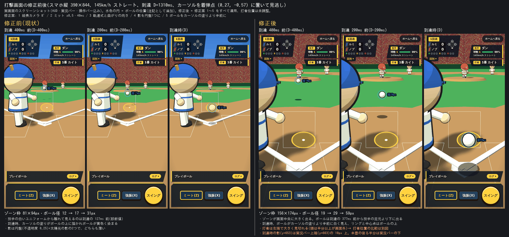
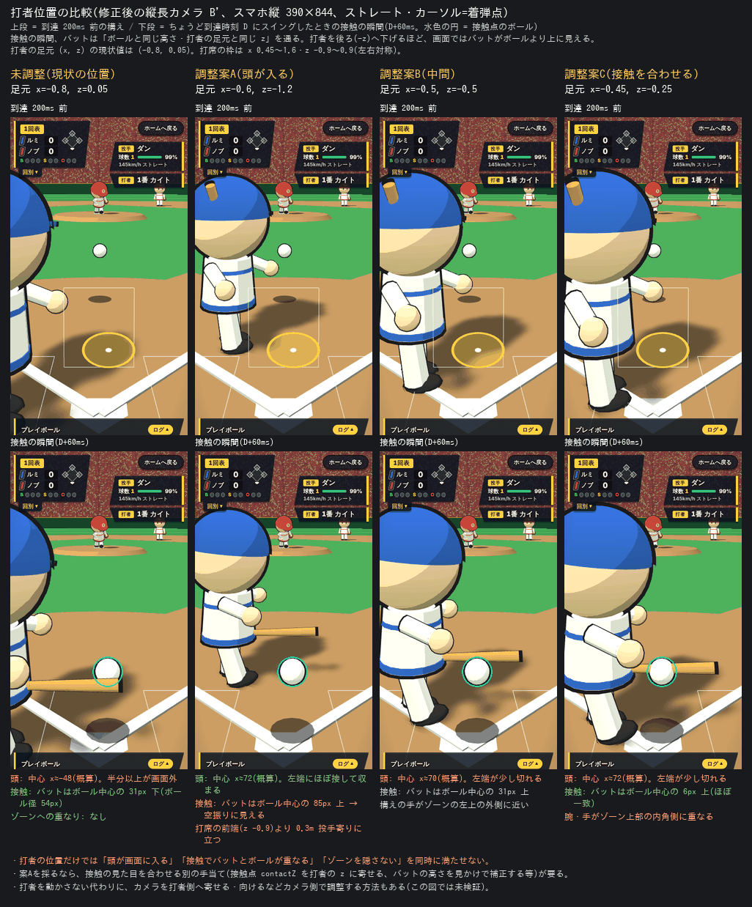

# 設計: ブラウザ野球(1試合モード・CPU対戦)— 画面の Three.js 3D 化と周辺 UI のオーバーレイ化(第1版の描画層・UI 層を置き換える改訂)

- 日付: 2026-10-12
- ステータス: 承認済み
- 対応する調査ドキュメント: [docs/investigations/2026-10-11-baseball-game.md](../investigations/2026-10-11-baseball-game.md)(第1版と共通。本改訂のための追加調査は行っていない。根拠は下記のテストレポート・承認済みモック・frontend-designer 案)
- 第1版の設計: [docs/designs/2026-10-11-baseball-game.md](2026-10-11-baseball-game.md)(承認済み・実装済み。以下「第1版」)
- 改訂の契機(テストレポート): [docs/tests/2026-10-11-baseball-game.md](../tests/2026-10-11-baseball-game.md)(ゲート2「設計からやり直し」)
- 承認済みモック(Three.js r128 の3Dモック、2026-10-12 にユーザー承認): [docs/designs/assets/2026-10-11-baseball-game-mock3d.html](assets/2026-10-11-baseball-game-mock3d.html)(以下「モック」)
- 承認者: ユーザー(hyt.wbes)
- 承認日: 2026-10-12

**本書は第1版の描画層と UI 層を置き換える改訂である。ロジック層(`model/` のルール・判定・CPU・データ)・テスト・ルールは第1版の定義を引き継ぐ(参照先は次節の表に明記)。** 第1版のファイルは履歴として無改変とし、描画・演出・画面構成・UI・hooks のうち描画に関わる部分・E2E・手動確認については本書が優先する。

## 本書の位置づけ(第1版との関係)

### 経緯

1. 2026-10-11: 第1版(DOM+SVG の平面表示)を実装し、自動テスト(frontend 29ファイル・749件)・型・lint・ビルド・E2E・コードレビューまで通過した。
2. 同日のユーザー試遊でゲート2「設計からやり直し」。理由は「どこがパワプロなんだよ、昭和のレトロゲームより酷い」。期待は「捕手後方からボールが迫る打撃画面」「2頭身のキャラクター」「打球が球場に飛ぶ演出」で、第1版はこれらを設計時に「やらないこと」へ入れていた(共有メモリ [[visual-scope-must-be-shown-at-gate1]])。ロジック面の不具合は報告されていない。
3. Canvas 2D の疑似3Dモックは不合格。
4. 2026-10-12: Three.js の3Dモックをユーザーが承認。重視点は **打撃画面の視点(捕手後方からボールが迫る)・キャラクター(2頭身・モーション)・打球の演出(球場に飛び野手が追う)** の3つ。実況テロップ・効果音は重視点に含まれない。
5. 本書は 4 の方針で描画層を作り直す設計である。同日の壁打ちで、チーム色・演出スキップ・スコア更新のタイミングが確定した(末尾「壁打ち記録」)。
6. 2026-10-12: 設計レビュー(2ラウンド、最終 PASS)の後、ユーザーから「デザインとUIがクソだからなおせ」と指示があった。3D の作り直しに加えて、**周辺 UI(スコア・対戦情報・操作・実況・タイトル・結果)を「管理画面のようなパネル型」から「ゲーム画面らしいオーバーレイ型」に作り直す**方針を本書に追加した(論点 N7・N16・N17)。
7. 2026-10-13: 遊べる版のスマホ試遊でゲート2が「修正依頼」(操作性・投球軌道)になった。診断([docs/investigations/_parts/baseball-game/2026-10-13-feel-diagnosis.md](../investigations/_parts/baseball-game/2026-10-13-feel-diagnosis.md))と修正前後の比較画像([docs/designs/assets/2026-10-13-baseball-game-feel/](assets/2026-10-13-baseball-game-feel/))に基づく修正設計を、「## 修正設計(ゲート2 修正依頼: 操作性・投球軌道、2026-10-13)」(「## 実装ステップ」の直前)に追補した。**この節が既存の本文に優先する**。

### 第1版から引き継ぐもの(変更しない)

| 領域 | 本書での扱い | 参照先(第1版) |
| --- | --- | --- |
| ルール・判定・CPU・データ(`model/` の `rng`・`pitch`・`batting`・`cpu`・`data`・`game`) | ロジックは無改変。(→ 修正設計で変更: `batting` の判定、`cpu` の難易度、`pitch/kinds` の曲がり、`game/view.ts` の `arriveAfterMs`)**加算のみ**: `game/view.ts` の `outcome`・`teamColors`・`uniforms`・`ScoreRowView.shortName`、`Team.uniformColor`・`Team.shortName`(チームデータ。描画・表示用で、判定・乱数に影響しない)。reducer・`GameState` は不変 | 「モデル設計(`model/`)」全節、「設計の既定値と論点」#1〜#13・#15〜#19 |
| 型(`types/` の `common`・`pitch`・`batting`・`game`・`actions`、`team`・`view` の既存部分) | 無改変。`team.ts` に `uniformColor`・`shortName`、`view.ts` に `outcome`・`teamColors`・`uniforms` と `ScoreRowView.shortName` を加算するのみ | 「型設計(`types/`)」 |
| 起動パラメータ・再生速度(`?seed=&innings=&fast=1`、開発ビルドのみ、`timeScale`) | 無改変。`timeScale` は演出時間にも適用する | 「起動パラメータと再生速度」、論点 #8・#11・#16 |
| hooks(`useGame`・`useCpuTurn`・`useAnimationFrame`・`useKeyboardInput`・`useLatest`・`useLaunchParams`・`random-seed`) | 無改変 | 「hooks 設計」 |
| 表示コンポーネントのうち `SwingControls`・`PitchingControls`・`PitchKindButtons`・`CourseGrid`・`LineScore`・`CountLamps`・`BaseDiamond` | **props は無改変**。testid も維持(例外: `LineScore` の合計セルの `score-<side>` は HUD 側に移すため `line-score-runs-<side>` に改名)。見た目とマークアップはオーバーレイ型に作り直す | 「UI 設計」の props 表・testid 対応表 |
| 表示コンポーネントのうち `TitleScreen`・`ResultScreen` | props(`defaultInnings`/`onStart`、`result`/`onRestart`/`onBackToTitle`)は無改変。見た目とマークアップをゲームらしく作り直す(セレクトボックス→ボタン群、testid は維持し、選択肢ごとの testid を追加) | 同上 |
| ルーティング(`routes/`、`#/baseball`)、ドキュメント運用 | 無改変 | 「アーキテクチャ・変更概要」 |
| 静的解析規約 | 継承し、three 固有の規約を追加 | 「静的解析・規約への対応」、[[sample-app-lint-random-and-index-access]] |
| 自動テスト | 既存749件の**アサーションは無改変**(`view.test.ts`・`teams.test.ts` は追記のみ、`test-fixtures.ts` は `Team` の新フィールドを足すだけ) | 「テスト戦略」 |

### 本書が置き換える・廃止する第1版の記述

- 「やらないこと」の「打球の軌道アニメーション・野手モデル」「Canvas 描画の導入」: **打球アニメーションと野手の表示は本書で「やること」に移した**(守備判定は引き続きやらない)。描画は Three.js を導入して行う。
- 「やること」の簡易フィールド図と論点 #14: 3D 球場での打球演出に置き換えて廃止する(`FieldDiagram` 削除)。
- 「全体方針」の「連続値は ref 経由で SVG 属性を直接更新する」: 毎フレーム `SceneFrame` を three に適用する方式に置き換える。
- 「UI 設計」のレイアウト(上段の Scoreboard+フィールド図、ゾーン+右側パネル)、コンポーネント構成・props 表・testid 表のうち、`BattingView`・`StrikeZoneSvg`・`FieldDiagram`・`baseball-field.css`・`Scoreboard`・`MatchupPanel`・`CommentaryLog` と、testid `field-diagram`・`batting-view`・`zone-svg`・`ball`・`swing-cursor`。**画面構成は「ステージ全面+オーバーレイ」に置き換える**(`Scoreboard`→`ScoreHud`、`MatchupPanel`→`NamePlates`、`CommentaryLog`→`Ticker`)。
- 「hooks 設計」の `usePitchFlight`・`usePointerInput`・`useBattingControls`(変更)と、新規 `useStage3d`・`useStageDirector`・`useHeldView`・`useGameStage`・`useSkipInput`。
- 「実装ステップ」(14ステップ)は本書の実装ステップに置き換える。「テスト戦略」のうち E2E・手動確認・構造検査は本書で更新する(単体テストの合格基準は第1版のまま)。
- 「ロールバック方針」は本書のものに置き換える。

## 目的・スコープ

### 目的

第1版の試遊不合格(視点・キャラクター・打球演出が無い)を解消するため、試合画面を **Three.js の3D** で作り直す。承認済みモックの世界観(デーゲームの球場、捕手後方の打撃カメラ、2頭身トゥーンキャラ、中継カメラでの打球追従、結果テロップ)を、既存のゲームロジック(判定・CPU・ルール)にそのまま接続する。判定は変えず、見た目と操作体験の層だけを置き換える。

あわせて、ユーザー指示(「デザインとUIがクソだからなおせ」)を受け、**周辺 UI を「ゲーム画面らしいオーバーレイ型」に作り直す**。ステージ(3D)を画面いっぱいに置き、スコア・対戦情報・操作・実況をその上に重ねる。右パネル・カード並びの管理画面風レイアウトはやめる。タイトル画面と結果画面もゲームらしくする。

### やること

- **3D 球場**(芝・内野の土・ベース・ファウルライン・フェンス・観客席・空)を Three.js で表示する(画像素材なし。テクスチャはコード生成)。
- **2頭身トゥーンキャラクター**(投手・捕手・打者・野手7人)を、プリミティブ形状+トゥーン材質+背面法の輪郭線でコード生成する(モックの `makePlayer` の再現)。
- **チームごとに固定のユニフォーム色**(ルミナス=青、ノーブルズ=赤)。打者は攻撃側チームの色、投手・捕手・野手は守備側チームの色で、攻守交代のたびに切り替える。
- **投球モーション**(ワインドアップ→リリース→フォロースルー)、**打者のスイング**(構え→スイング→フォロースルー)、野手・捕手の姿勢。
- **ボール軌道を判定の `flight`(`landing`・`durationMs`)と同期**させる。ボールは `t = durationMs` で必ず `landing` 位置(ゾーン平面)に到達する。
- **打球の中継カメラ追従**(接触後、打撃カメラから高い位置の中継カメラへ滑らかに移り、打球を追う)と、打球軌道(フライ/ライナー/ゴロのバウンド/ファウル/ホームランはフェンス越え)。落下点は第1版の `computeBattedLanding` と同値。
- **野手の走行**(落下点に最も近い野手が走る。他の野手は打球の方を向く)。
- **結果テロップ**(「センター前ヒット!」「ホームラン!!」「空振り!」等)。
- **演出のスキップ**: 演出中(`holding` 中)にステージのタップ/クリック、または Space/Enter で、残りの演出(打球の飛行・余韻・テロップ)を即終了して次へ進める。スイング可能な間のタップはスイングであり、スキップと衝突しない。
- **オーバーレイ型の試合画面**: ステージ全面+左上のスコア HUD(回表裏・両チーム略称とチーム色チップと得点・B/S/O ランプ・走者ダイヤモンド。回別スコアは開閉)+右上のネームプレート(打者・投手)+下部の実況ティッカー(1〜2行、全ログは開閉)+下部の操作バー(打撃: 大きなスイングボタンとミート/強振切替、守備: 球種の横並びチップと5×5の小型グリッドと「投げる」)+中央の結果テロップ。**スマホ縦(390×844)とデスクトップの両方**で成立させる。
- **ゲームらしいタイトル画面と結果画面**: 球場の絵を背景にしたロゴ風タイトル「ブラウザ野球」、選択肢はボタン群(セレクトボックスは使わない)。結果画面は3D の試合画面をぼかして背景にし、大きなスコアと勝敗を出す。
- **見た目のトーン**: 承認済みモックの世界観(昼の球場、トゥーン調)に合わせる。太めの丸ゴシック系(システムフォント)、白文字+濃い縁取り、半透明の濃紺パネル、アクセントは黄。
- 入力: 3D ステージ上でのスイングカーソル操作 → タッチの振り分けは修正設計で変更(§3)(マウスは絶対位置、タッチは相対ドラッグ。キーボード・「スイング」ボタンは第1版のまま)。
- `GameView.outcome`(解決した1球の事実)・`teamColors`・`uniforms`・`ScoreRowView.shortName` を `model/game/view.ts` に、`Team.uniformColor`・`Team.shortName` をチームデータに**加算的に**追加する(reducer・`GameState` は不変)。
- `GameScreen` を `React.lazy` で遅延ロードする(`/` とタイトル画面のバンドルに three を含めない)。
- E2E・`sample-app/README.md`・`docs/process/sample-app-dev.md` の更新。

### やらないこと(スコープ外)

- **送球・走塁アニメーション**(打者走者・走者の移動、塁上の走者の3D 表示、ゴロ捕球後の送球動作を含む)。野手は落下点に到達するまでの演出のみ。
- **守備操作・守備判定**。野手の動きは演出であり、判定(`resolvePitch` の結果)には一切関与しない。
- **効果音・BGM**(サウンド全般。重視点外)。
- **画像・3Dモデル素材の外部読み込み**(テクスチャ画像・GLTF・外部フォントを含む)。形状・テクスチャはすべてコードで生成する。タイトル/結果画面の背景も画像ではなく CSS で描く。
- **react-three-fiber / drei / three addons / Phaser / Pixi / 状態管理ライブラリ**の導入。
- 実況の拡充(音声、イニング別演出、リプレイ)。テロップは結果1行のみ。
- 物理シミュレーション(打球軌道は演出用の閉形式。判定・得点とは独立)。
- 判定・CPU・ルール・バランスの変更(第1版のまま) → 修正設計で変更(判定へのボール半径・人間の見逃し猶予・バランス再調整。修正設計 §5・§10)。スキップも表示の短縮だけで、試合の状態には触れない。
- ユニフォームの色以外のチーム差(縞・帽子マークの違い、チームロゴ)。
- **タイトル画面で3D 球場を実際に描画すること**(CSS で描いた球場の背景にする。3D 背景は将来案。N16)。
- モバイル実機での検証(Playwright の `hasTouch`+viewport 縮小で確認するのみ)、Playwright のモバイル project 追加。
- 第1版の「やらないこと」のうち描画に関わらないもの(育成・守備走塁の操作・盗塁/バント/代打/継投・コールド・結果保存・「パワプロ」等の名称の使用・backend/shared の変更・react-router 導入 等)は引き続きスコープ外。

### 見た目の受け入れ基準

共有メモリ [[visual-scope-must-be-shown-at-gate1]] の適用。第1版の失敗(見た目の帰結をゲート1で見せなかった)を繰り返さないため、**ゲート1では承認済みモックと本節の基準を提示する**。実装後は、モックと実装のスクリーンショットを並べ、下記チェックリストで判定する。モックに無い部分(HUD の詳細・操作バー・タイトル・結果)は、モックとの比較ではなく「**ゲーム画面として成立しているか**」の絶対基準で判定する。

**比較の方法**

- モック側: `docs/designs/assets/2026-10-11-baseball-game-mock3d.html` を Playwright(または通常のブラウザ)で開いて撮る。モックは three r128 と Google Fonts を CDN から読むため、到達できない環境では `three@0.128.0` を scratchpad に取得し、`<script src>` を差し替えたコピーで撮る(モック本体は改変しない)。
- 実装側: `cd sample-app && npm run dev:frontend` で開き、`/?seed=<固定値>&innings=3#/baseball` を開始して撮る。`stage-3d[data-phase]`(`idle`/`windup`/`flight`/`play`)を目印にして、飛行中・打球中は **50ms 間隔の連写(最大40枚)** から該当フレームを選ぶ。
- 画面サイズ: デスクトップは 1280×720、スマホ縦は 390×844(`hasTouch`)。
- 判定者と手順: ステップ G の implementer が自己判定して調整し、`/test` の tester が撮り直して判定し、ゲート2で人間が最終確認する。
- **ピクセル差分は使わない**(キャラクターの配置、HUD、ゲーム状態、時刻が一致しないため意味がない)。判定は下記チェックリストの〇×。1項目でも × なら不合格として調整に戻す。「同等以上」とは、各項目でモックの見え方と同等以上であること。

| 画面 | 実装側の撮り方 | モック側の撮り方 | 判定項目(すべて〇で合格) |
| --- | --- | --- | --- |
| S1 打撃画面(待機) | 人間先攻で開始直後、`data-phase="idle"` | 起動直後(t≈0.3s) | (a) カメラが捕手後方(高さ約1.25m)から投手方向を向き、**手前左に打者、奥の中央に投手**が見え、両者の全身が画面内に収まる (b) 打者と投手の間に**白いゾーン枠**と**黄色のスイングカーソル**(半透明の楕円+輪郭リング+中心点)が見える (c) 空のグラデーション、縞の芝、内野の土、ベース、ファウルライン、緑のフェンスと黄色の縁、観客席(ドット柄)、霧による遠景の霞が見える (d) キャラクターが2頭身で、トゥーンの段階影・黒い輪郭線・目のハイライト・頬・帽子とマークを備える (e) 品質 normal で人物とベースに影が落ちる (f) 左上に回表裏・両チームの略称・得点・B/S/O ランプの HUD があり、両チーム名の横にチーム色のチップがある(モックの HUD 相当) (g) **打者が攻撃側チームの色、投手・捕手・野手が守備側チームの色**で、ルミナス攻撃時(後攻で開始して表の守備を終えた後など)はモックと同じ配色(打者=青、守備=赤) |
| S2 投球中 | `data-phase="flight"` の連写 | t≈1.0〜1.4s | (a) ボールが**投手の手から離れ**、ゾーンに向かって大きくなりながら進む (b) ボールに黒い輪郭線と地面の影がある (c) 投手がワインドアップ→投球→フォロースルーの動きをする |
| S3 スイング〜接触 | `data-phase="flight"` 終盤〜`play` 冒頭の連写 | t≈1.55〜1.75s | (a) 打者の体が回転し、バットが水平に振られる (b) スイング中にカーソルが強調(濃くなる)される (c) 空振り時はバットがボールの位置を外して通過する (d) ジャスト付近のクリックでも、構えから接触姿勢へ1フレームで飛ばず、短い時間(60ms 以上)で補間される → 修正設計で変更(人間のスイングの演出は受付時刻 `max(atMs, resolvedAtMs)` を基準にし、過去の時刻から振り始めない。タップなど受付が遅れる入力でも構えから接触姿勢まで 60ms 以上を保つ。§1) |
| S4 打球追従(ヒット) | `data-phase="play"` の連写(後攻で開始し CPU 打者のヒットを待つか、人間打撃でヒットを打つ) | 「ヒット」ボタンの再生中 | (a) 接触後、約0.5秒かけて**高い位置の中継カメラへ滑らかに移る**(瞬間切替ではない) (b) 打球(ボールと影)と、**落下点へ走る最寄りの野手**が同時に画面内に見え、他の野手は打球の方を向く (c) 捕手が現れ、ゾーン枠とカーソルは消える (d) ゴロはバウンドし、ライナーは低く、フライは高い放物線になる |
| S4' 打球追従(ホームラン) | 同上(ホームランは数試合試してよい。出ない場合は単体テストの端点検証で代替し、その旨を報告) | 「ホームラン」ボタンの再生中 | (a) 打球がフェンスを越えて観客席へ飛び、カメラが追う (b) 野手は走らず打球を見送る |
| S5 テロップ | 打球の落下時 / 空振り時 / ボール・ストライク時 | 打球落下時・空振り時 | (a) 画面中央やや上(上から約38%)に**黄色の太字+黒い縁取り+影**の大きな文字が、0.18秒で拡大しながら現れる (b) 文言が結果に対応する(例: センター前ヒット!/ホームラン!!/空振り!) |
| S6 スマホ縦 | 390×844 で S1 と S4 相当。人間打撃と人間守備の両方 | (基準なし。絶対基準) | (a) **ステージが画面全面**で、打者・投手・ゾーン枠が見え、オーバーレイに隠れない(ゾーン枠の画面上の幅が 70px 以上) (b) 左上の HUD と右上のネームプレートが重ならず画面内に収まる (c) **人間打撃**ではスイングボタン(64px 以上)とミート/強振切替(44px 以上)、**人間守備**では球種チップ・5×5グリッド(セル 44px 以上)・「投げる」ボタンの全体が、スクロールなしで下部の操作バーに収まり、ゾーン枠・投手・打者を覆わない (d) ページがスクロールしない |
| S7 攻守交代の配色 | 守備側が3アウト目を取る打球〜次の半イニングの待機画面の連写(後攻で開始すると最初に起きる) | (基準なし。絶対基準) | (a) 打者=攻撃側チームの色、投手・捕手・野手=守備側チームの色(ルミナス=青、ノーブルズ=赤) (b) **3アウト目の打球演出が終わるまでは旧配色のまま** (c) 次の半イニングの待機画面から、打者と守備側の配色が入れ替わる (d) HUD のチップの色がユニフォームの色と一致する |
| S8 オーバーレイ型の画面構成(ゲーム画面として成立) | デスクトップとスマホ縦の S1・S4 の画面 | (HUD はモックの `.hud` 相当。他は絶対基準) | (a) **ステージが画面全面**で、右パネル・カード並び・管理画面風の余白付き枠が無い (b) 左上に HUD(回表裏、両チームの略称+色チップ+得点、B/S/O ランプ、走者ダイヤモンド、延長のとき「延長」)。回別スコアは HUD の「回別」から開ける (c) 右上にネームプレート(打者: 打順と名前、投手: 名前・球数・スタミナバー・球速表示) (d) 下部に実況ティッカー(1〜2行)。全ログは「ログ」から開ける (e) すべてステージの上に重なり、ゾーン枠・投手・打者・テロップを隠さない (f) 文字は太めの丸ゴシック系で白字+濃い縁取り、パネルは半透明の濃紺、アクセントは黄。**グラデーションのヒーロー、全面角丸カードの並び、既定のフォーム見た目を使っていない** (g) 演出中(`holding`)に HUD・ネームプレートの上をタップしてもスキップできる |
| S9 操作バー | デスクトップとスマホ縦、人間打撃・人間守備の両方 | (絶対基準) | (a) **打撃**: 大きなスイングボタンが親指で押せる位置(右下)にあり、ミート/強振の切替が隣にある。押せないとき(`disabled`)は見た目で分かる (b) **守備**: 球種が横並びのチップで、選択中が黄で強調される。5×5の小型グリッドで選択中のセルが強調され、「投げる」ボタンが大きく目立つ。投球中は「投げる」が押せない見た目になる (c) ボタン・セルは 44px 以上(デスクトップのグリッドのセルを除く) (d) 操作バーはステージの下部に重なり、バーの背景部分を押してもスキップ/スイングにならない |
| S10 タイトル画面 | `#/baseball` を開いた直後 | (絶対基準) | (a) 背景に球場(空、観客席、縞の芝)が描かれている (b) ロゴ風の大きな「ブラウザ野球」(太字・濃い縁取り・黄色の差し色) (c) イニング数・先攻/後攻・難易度が**ボタン群**(`select` ではない)で、選択中が黄で強調され、各 44px 以上 (d) 「試合開始」ボタンが大きく目立つ (e) 白いカードに `select` が縦に並ぶ既定のフォーム風に見えない |
| S11 結果画面 | 試合終了直後(勝ち・負け・引き分けの各1回。難しければ勝ちと負けの2回) | (絶対基準) | (a) 3D の試合画面がぼかして背景に見える (b) 大きなスコア(両チームの略称+色チップ付き)と勝敗表示(勝ち/負け/引き分けで文言と色が変わる) (c) 「もう一度」が主、「タイトルへ」が従と分かる大きなボタン (d) 管理画面風のダイアログに見えない |

**動き・体験の確認(手動)**: 通常速度(`fast` なし)で人間打撃を10球以上行い、(1)ボールが捕手後方のカメラに向かって迫って見える (2)空振り・見逃し・ファウル・インプレーのうち少なくとも2種類が起きる (3)ヒットでは中継カメラに切り替わり野手が走る (4)演出中にタップ/クリック/Space でスキップでき、次の投球に進む(スイング可能な間のタップはスイングになり、スキップにならない)、ことを確認する。操作の遅延や極端なフレーム落ちがないことを目視する(実機の数値計測は行わない)。

### 設計の判断と論点(壁打ち用)

本改訂で新たに置いた判断を N1〜N17 として並べる(第1版の #1〜#19 は上記のとおり引き継ぐ)。推奨を決めたうえで、壁打ちで確認したい論点を明記する。**N8・N9・N14 は壁打ち(2026-10-12)の人間回答により確定/変更した**(行頭に【壁打ち確定】/【壁打ち変更】と記す)。**N7・N16・N17、および N11 の変更は、ユーザー指示「デザインとUIがクソだからなおせ」(2026-10-12)に基づく**(行頭に【ユーザー指示】と記す。追加の質問はしない)。経緯は末尾「壁打ち記録」。数値は初期値で、実装後のステップ G と試遊で調整する。

| # | 項目 | 設計での決定(推奨) | 根拠 | 壁打ちで確認したい論点 |
| --- | --- | --- | --- | --- |
| N1 | 描画方式 | Three.js(npm)を命令的 API で使い、`render/` に閉じる。react-three-fiber・Phaser・Pixi・three addons は使わない | モックが Three.js で承認済み。r3f は「ui は dumb」の方針と衝突し、model の純粋性・テスト容易性も損なう | three 追加(遅延チャンクで数百KB)は許容か |
| N2 | three の版 | `three@0.186.1` + `@types/three` を同一リビジョン(0.186.x)で。公開(2026-09-24)から2週間以上経過。ステップ0で `npm view` して確定。モック(r128)との差(色管理・ライト強度の単位・`RedFormat`・`outputColorSpace`、**r163 以降は WebGL2 専用**)は `render/look.ts` と `render/stage.ts` に集約し、見た目基準で受け入れる | 最新の安定版を使う。r128 固定は型・保守の面で不利 | r128 に固定してモックとの差を無くす案(不採用)でよいか |
| N3 | `model/world/` | three 非依存の純粋関数群。表示専用の数学なので、`model/` の再現性規約(`sin/cos/log/exp/hypot` 禁止)の**適用外**。`Math.random`・`Date`・`performance`・`window`・`document` の禁止は適用 | 結果が `GameState` に戻らない。三角関数なしでは自然な動きを作りにくい。決定: [[frontend-3d-three-in-render-segment]] | — |
| N4 | 演出状態の置き場 | hooks のローカル状態(ref+少数の state)。reducer・`GameState`・既存749テストは変えない。次の投球を止める `holding` ゲートと、解決した球の事実 `GameView.outcome` を加算する。演出の進行判定(`holding`・フェーズ・終了・スイング記録の対応づけ)は純関数 `sequence/session.ts` に出して単体テストする | reducer は `SWING`/`PITCH_ARRIVED` で即解決し `phase` は `await-pitch` に戻るため、演出の長さを `GameState` は持てない。hooks は単体テストしない方針なので、判断部分だけ純関数化する | — |
| N5 | 接触の見た目の時刻 | ファウル/インプレーの接触は、原則 `durationMs`(ボールがゾーンに着く時刻)に固定して描く。バットは `contactMs − 132ms` から振り始める。人間のクリックが遅い/ジャスト付近でそれが過ぎている場合は、**スイングを残り時間に圧縮して補間**し(接触はクリックの 60ms 後以降)、構え→接触姿勢が1フレームで飛ばないようにする。判定の Δt(±150ms)と見た目は一致しない(見た目のごまかし)。人間の遅いクリック(Δt>0)では接触がクリック+60ms まで遅れ、ボールがミット方向へ少し進んでから接触位置に戻って飛ぶ(最大約210ms) | 判定窓を広く取っており、Δt ごとに接触の位置をずらすと軌道の連続性が崩れる | 遅れたクリックでボールが一瞬ずれて見える挙動を許容するか(目立てば判定待ち中だけボールを非表示にする案へ切替) |
| N6 | CPU 打者の解決の前倒し | CPU 打者の `PITCH_ARRIVED` を `durationMs − 150ms` に前倒しして送る(hooks 側。reducer・`decideCpuBat` は `flight.durationMs` 基準なので結果は不変) | 結果(空振り/ファウル/ヒット)を接触の150ms前に知り、スイングの演出を結果と整合させるため | — |
| N7 | 試合画面の構成(オーバーレイ型) | 【ユーザー指示】**ステージ(3D)を画面全面に置き、情報と操作をその上に重ねる**。右パネル・カード並びはやめる。左上=`ScoreHud`(回表裏・両チーム略称+色チップ+得点・B/S/O・走者ダイヤモンド。回別スコアは `details` で開閉)、右上=`NamePlates`(打者・投手)、下部=`Ticker`(実況1〜2行+ログの開閉)と操作バー(打撃: 大きなスイングボタン+ミート/強振、守備: 球種チップ+5×5小型グリッド+投げる)、中央=結果テロップ。**既存 `Scoreboard` の testid(`scoreboard`・`inning-label`・`line-score`・`score-away`/`score-home`・`count-*`・`bases`)は `ScoreHud` 側に移して維持**し、1 testid 1 コンポーネントを守る。`Scoreboard`・`MatchupPanel`・`CommentaryLog` は置き換えて削除する。装飾用 `StageHud` は廃止(HUD 自体が実体になるため) | ユーザー指示。管理画面風のパネル型はゲームらしくない。モックの HUD も「ステージ上に重ねる」形 | 回別スコアの開閉を `details`(ネイティブ)にしてよいか(イニング終了時の一時表示は入れない) |
| N8 | スコアの更新タイミング | 【壁打ち確定】**演出の後に更新する**。`useHeldView` が `holding` 中は直前の `GameView` を表示用に保持し、スコア・カウント・実況ログ・HUD・対戦情報は演出が終わってから(スキップした場合はスキップした時点で)更新する。操作可否や演出の入力には最新の view を使う | ホームランの瞬間にスコアと実況ログが先に変わると、テロップと打球演出の価値が下がる。推奨どおり確定 | — |
| N9 | チーム色 | 【壁打ち変更】**チームごとに固定**(ルミナス=青 `0x2f63c8`、ノーブルズ=赤 `0xe8473c`。モックの配色)。色は `Team.uniformColor`(チームデータ)に持たせ、`GameView.teamColors`(サイド別。HUD のチップ用)と `GameView.uniforms`(攻撃/守備の役割別。描画用)として渡す。打者=攻撃側チームの色、投手・捕手・野手=守備側チームの色。攻守交代で `SceneFrame.uniforms` が入れ替わり、render は**共有のアクセント材質2つ(攻撃用・守備用)の色を更新するだけ**(キャラクターは1組のまま)。**3アウト目の打球演出中は旧配色を保つ**(director は演出中も保持される表示用 view(N8)の `uniforms` を使う) | ユーザー回答「チームごとに変えるに決まってんだろ」。`render/` がチーム知識を持たない構造を保てる。キャラクターを2組持つと draw call とメモリが倍になる | 青/赤の組み合わせでよいか。色以外のチーム差(縞・帽子マーク)は今回不要でよいか |
| N10 | コース選択(人間守備) | DOM の `CourseGrid` を下部の操作バーに置く(5×5の小型グリッド。スマホ縦は各セル44px、デスクトップは36px程度)。3D 側は選択セルのハイライト(`aim`)と5×5の格子線のみ | スマホ縦でゾーン上に重ねるとセルが約23pxになり44pxのタップ目標を満たせない | — |
| N11 | スマホ縦の画面とフレーミング・打撃入力 | 【ユーザー指示で変更】ステージは**端末の全面**(縦横比は端末なり。`aspect-ratio` で固定しない)。FOV を縦横比に応じて広げて打者を画面内に収める(`fovFor`)。さらに縦長のとき、下部のティッカー+操作バーがゾーンを覆わないよう、**シーンを上へずらす `framingLift(aspect)`**(`camera.setViewOffset`。初期値は縦長で画面高の 0.16)を使う。**タッチは相対ドラッグ**(指の移動量×ゾーンの画面上の大きさ比でカーソルを動かす。指がゾーンを隠さない)。マウスは絶対位置(レイキャスト) | 全面ステージ+下部オーバーレイでは、守備時のバー(球種+グリッド+投げる)が約290px を占め、固定のカメラではゾーンの下半分に重なる。3D ではゾーンが第1版の約半分の大きさになり、絶対位置のタッチでは精度が出ず指で隠れる | 相対ドラッグでよいか(実機未検証)。シーンを上へずらす量は G で調整 |
| N12 | 簡易フィールド図(第1版 #14) | 廃止し、3D の打球演出に置き換える。`fieldMarker` は testid `batted-ball-marker` の非表示 DOM ミラーとして残す(E2E・手動確認用) | 打球は球場そのものに映る | — |
| N13 | テーマ | モック基調のダーク(`--bb-*` 変数の値を差し替え)。外部フォントは使わずシステムフォント。ページ背景は `body:has(.bb-page)` で、ホーム(`/`)へ漏らさない。詳しいトーンは N17 | モックの世界観。外部通信を増やさない | — |
| N14 | 1球のテンポと演出スキップ | 【壁打ち変更】**タップで演出をスキップできる**。windup 0.7秒 + 飛行約1.4秒 + 余韻(見逃し・ボールは判定後約0.7秒、インプレーは落下後約1.3秒)で、ボール・ストライクは約3秒、インプレーは約5〜6秒、3回制の試合は約5〜6分(第1版は約3分)。**`holding` 中に限り**、ステージのタップ/クリック、または Space/Enter で残りの演出(打球の飛行・余韻・テロップ)を即終了して次へ進める(`useStageDirector.skip()`)。スイング可能な間(`swingReady`)のタップはスイングで、スキップは `holding` 中だけ有効。入力の振り分けは純関数 `routeStagePointer`/`isSkipKey` に集約する。スキップは表示だけを飛ばし、reducer・`GameState` に触れない。E2E は通常は使わず(`fast=1` で短い)、スキップ専用のテストを1本追加する | ユーザー回答でスキップ可。`holding` と `swingReady` は同時に真にならない(次の投球は演出が終わってから始まる)ため衝突しないが、純関数で優先順位(`holding` が優先)を固定して保証する | スキップ後は即カット(打撃カメラへ戻る)でよいか。スキップ中のヒントを出す(`bb-stage__skip-hint`)のでよいか |
| N15 | WebGL が使えないとき | ステージに「3D表示を使えません」を出し、試合は続行できる(時計とゲートは renderer に依存しない)。**WebGL2 が取れない場合(WebGL1 のみの環境を含む)もこの扱い**。SVG フォールバックは作らない | 第1版の SVG 描画は廃止する。ロジックと操作は有効のまま。three は r163 以降 WebGL2 専用で、WebGL1 コンテキストを渡すと例外になる | フォールバック表示を作る価値があるか |
| N16 | タイトル画面と結果画面 | 【ユーザー指示】**タイトル**: CSS だけで描いた球場(空のグラデーション、観客席のシルエット帯、縞の芝)を背景に、ロゴ風の「ブラウザ野球」。選択肢(イニング数・先攻/後攻・難易度)は `select` ではなく**ボタン群**(ネイティブの `input[type=radio]` をボタンに見せる。`useState` 不要の非制御フォームのまま)。大きな「試合開始」ボタン。タイトルでは three を読み込まない(`/` とタイトルのバンドルに three を含めない方針を維持)。**結果画面**: 3D の試合画面を `backdrop-filter` でぼかして背景にし、大きなスコア(略称+色チップ)と勝敗表示、「もう一度」(主)と「タイトルへ」(従) | 画像素材を使わない・タイトルで three を読まない、の両立。3D 球場の実描画は将来案 | タイトルの背景を3D の実描画にするか(今回は CSS の絵) |
| N17 | 見た目のトーン | 【ユーザー指示】モックの世界観(昼の球場、トゥーン調)に合わせる。**太めの丸ゴシック系**(システムフォント: `"Hiragino Maru Gothic ProN"`, `"Hiragino Sans"`, `"Yu Gothic UI"`, `"Meiryo UI"`, `"Noto Sans JP"`, `system-ui`)、**白文字+濃い縁取り**(`text-shadow` で作る。`-webkit-text-stroke` に依存しない)、**半透明の濃紺パネル**(`rgba(8, 20, 34, 0.78)`)、アクセントは黄 `#ffd23f`。放送画面風の斜めに切ったネームプレート・HUD(`clip-path`)、チーム色の縁、ボタンは濃い縁取り+ハードな落ち影(押すと沈む)。**避けるもの**: グラデーションのヒーロー、全部が同じ角丸のカード並び、既定のフォーム見た目、ガラス風パネルの多用 | ユーザー指示。AI 生成風の既定デザインを避け、モックの HUD・テロップ(黄文字+黒縁取り)と揃える | — |

## アーキテクチャ・変更概要

### 全体方針

- 3D 描画は Three.js を命令的に使い、**`render/` セグメントに閉じる**([[frontend-3d-three-in-render-segment]])。位置・軌道・ポーズ・カメラ・時刻表・テロップ文言・演出進行の判断・入力の振り分けは three 非依存の純粋関数 `model/world/` に置き、vitest(node)でテストする([[pure-function-extraction]])。
- 演出の駆動は「**時刻 t の純関数 → プレーンデータ `SceneFrame` → `StageHandle.apply`**」。毎フレーム、`useStageDirector` が `sceneFrameAt(input)` を呼んで `stage.apply(frame)` に渡す。three のオブジェクトは `render/` の外に出ない。**チーム固有の知識(色)は `Team.uniformColor` → `GameView` → `SceneFrame.uniforms` のプレーンな数値で渡し、`render/` はチームを知らない。** ゾーンの実寸・ボール半径も `model/world` の `WORLD_PARAMS` から `StageGeometry` 経由で渡し、`render/` は直書きしない。
- **画面構成は「ステージ全面+オーバーレイ」**(N7)。ステージは `position: absolute; inset: 0` の背景で、HUD・ネームプレート・ティッカー・操作バーは別の DOM 層(`bb-overlay`)に重ねる。オーバーレイは既定で `pointer-events: none`(タップがステージに届く)、操作できる要素(ボタン・グリッド・`details` の開閉)だけ `pointer-events: auto`。
- **時計は1本**(`usePitchFlight.getElapsedMs()`、リリースからの経過ゲーム時間)。投球・スイング・打球・テロップの時刻は同じ時計で表す。
- 演出の長さは `GameState` に無いため、演出の進行は hooks のローカル状態で持ち、**演出が終わる(またはスキップされる)まで次の投球を始めさせない**(`holding`)。reducer・`GameState`・既存テストは変えない。
- 判定とゲーム進行は第1版のとおり reducer が行う。3D は結果を**表示するだけ**(判定に関与しない)。スキップも表示だけを飛ばす。

1球の流れ(`phase` の遷移は第1版のとおり。ここでは演出側の区間を示す):

```
[idle] ─(CPU守備: cpuPitchPending && !holding の立ち上がり / 人間守備: 「投げる」押下)→ [windup  u: 0→1]
   ─(dispatch = リリース。flight 出現 = t0)→ [flight  t: 0→durationMs]
   ─(SWING / PITCH_ARRIVED で outcome 出現 → plan 作成)→ [play  plan.endMs まで]
   ─(plan.endMs 到達、または skip()。finishedSeq 更新 = holding 解除)→ [idle]
```

### 変更ファイル(概要)

| 区分 | ファイル | 内容 |
| --- | --- | --- |
| 変更 | `sample-app/frontend/package.json`、`sample-app/package-lock.json` | `dependencies` に `three`、`devDependencies` に `@types/three`(同一リビジョン) |
| 変更(要検証) | `sample-app/frontend/vite.config.ts` | 遅延ロード時に依存の再最適化リロードが起きる場合のみ `optimizeDeps.include: ["three"]`(ステップ0で判断) |
| 変更(要検証) | `sample-app/frontend/playwright.config.ts` | headless で WebGL が作れない場合のみ `launchOptions.args`(ステップ0で判断、適用はステップ F) |
| 新規 | `features/baseball/types/{scene,stage}.ts` | 描画契約(`SceneFrame`・`UniformColors`・`StageGeometry`・`StageHandle` ほか) |
| 変更(加算) | `features/baseball/types/team.ts`、`model/data/teams.ts`・`teams.test.ts`、`model/game/test-fixtures.ts` | `Team.uniformColor`(チーム色)・`Team.shortName`(略称)を加算。ルミナス=青・「ルミ」、ノーブルズ=赤・「ノブ」 |
| 変更(加算) | `features/baseball/types/view.ts`、`model/game/view.ts`・`view.test.ts` | `PitchOutcomeView`・`GameView.outcome`・`teamColors`・`uniforms`・`ScoreRowView.shortName` を加算(既存 model への加算変更) |
| 新規 | `features/baseball/model/world/` | 3D の純粋計算(座標・軌道・野手・ポーズ・カメラ・時刻表・テロップ・演出進行の判断・入力の振り分け)+各テスト |
| 新規 | `features/baseball/render/` | three のビルダーと `createStage`+smoke テスト |
| 新規/変更 | `features/baseball/hooks/` | `useStage3d`・`useStageDirector`・`useHeldView`・`useGameStage`・`useSkipInput`(新規)、`usePitchFlight`・`usePointerInput`・`useBattingControls`(変更) |
| 新規/変更/削除 | `features/baseball/ui/` | 新規: `StageView`・`ScoreHud`・`NamePlates`・`Ticker`・`StageTelop`・`baseball-stage.css`。変更(作り直し): `GameLayout`・`GameScreen`・`BaseballGamePage`・`TitleScreen`・`ResultScreen`・`baseball.css`。変更(マークアップ・クラス。props 不変): `SwingControls`・`PitchingControls`・`PitchKindButtons`・`CourseGrid`・`LineScore`・`CountLamps`・`BaseDiamond`。削除: `BattingView`・`StrikeZoneSvg`・`FieldDiagram`・`baseball-field.css`(**ステップ A2 で早期に撤去**し、`GameLayout` を暫定版にして全ウェーブで lint/typecheck を緑に保つ)、`Scoreboard`・`MatchupPanel`・`CommentaryLog`(`ScoreHud`・`NamePlates`・`Ticker` に置き換え、ステップ E で削除) |
| 変更 | `sample-app/frontend/e2e/baseball.spec.ts` | `field-diagram` の待機を `stage-3d` に差し替え。タイトルのボタン群、WebGL 非対応でも進行するテスト、演出スキップのテスト、オーバーレイがゾーンを隠さないことの検証を追加 |
| 変更 | `sample-app/README.md`、`docs/process/sample-app-dev.md` | 3D 表示・WebGL 要件・手動確認の更新 |
| 不変 | backend、`@sample-app/shared`、`routes/`、`App.tsx`、`main.tsx`、`ci.yml`、Knip 設定 | — |

### DBスキーマ設計

該当なし(DB・永続化の変更を含まないため `db-designer` への委譲は行わない)。

### フロントエンド構成

`frontend-designer` の返答(構成案)を転記する。designer による追加・調整は ★ で示し、直後の「frontend-designer 案からの調整点」にまとめた。

#### 結論(判断が必要だった点)

| 論点 | 判断 | 理由 |
| --- | --- | --- |
| 演出状態の置き場 | hooks のローカル状態。reducer・`GameState`・既存749テストは変えない | reducer は `SWING`/`PITCH_ARRIVED` で即解決し `phase` は `await-pitch` に戻る。人間スイング後は飛行中でも `view.flight = null`。演出の長さを `GameState` は持てない |
| 次の投球を止める | 演出終了(またはスキップ)まで `holding`(render 中に `view.outcome` と `finishedSeq` から導出。`finishedSeq` は `useGameStage` が持つ) | effect でフラグを立てると1 commit の隙間で `useCpuTurn` が先走る |
| 演出に必要な事実 | `GameView.outcome`(`PitchOutcomeView`)を `model/game/view.ts` に**加算的に**追加 | 解決した1球の種別・インプレーの結果・打席の終わり方が view に無い。reducer・state は不変 |
| チーム色 | ★ `Team.uniformColor`(データ)→ `GameView.uniforms`/`teamColors` → `SceneFrame.uniforms` | render にチーム知識を持たせない。N9 |
| 演出のスキップ | ★ `useStageDirector.skip()`。入力の振り分けは純関数(`routeStagePointer`/`isSkipKey`)で、`holding` 中のみスキップ、それ以外は従来のスイング/ドラッグ | スイング入力との衝突を型と表で保証する。N14 |
| 周辺 UI | ★ ステージ全面+オーバーレイ(`ScoreHud`・`NamePlates`・`Ticker`・操作バー)。`details` で開閉する要素はネイティブの `<details>` を使い、dumb のまま保つ | N7。ユーザー指示 |
| 3D の純粋計算 | `model/world/`(新規)。React/DOM/three 非依存、vitest(node)可。座標は `Vec3`、回転は `Rot3`(three の Euler XYZ rad と同義) | 正しさの本体をテスト可能にする |
| three のコード | 新セグメント `render/`(標準5セグメントへの意図的追加) | three を1か所に閉じる。DOM/GL に触れるのは `render/stage.ts` だけ |
| model と render の接続 | hooks のみ。契約は `types/scene.ts`・`types/stage.ts` | 互いに import しない兄弟にする |
| `StageHandle` の置き場 | `types/stage.ts` | `useStage3d`(hooks)と `render/stage.ts` を並列実装できる |
| 入力 | `Raycaster` でゾーン平面に当てる。`usePointerInput`/`useBattingControls` は SVG 依存を外して流用、`useAnimationFrame` はそのまま、`usePitchFlight` は SVG 描画を捨てて時計と到達通知のみ | 現行のポリシーを保つ(タッチのみ N11 で相対ドラッグへ) |
| コース選択 | DOM の `CourseGrid` を操作バーに置く。3D 側は選択セルのハイライトのみ | N10 |
| 遅延ロード | `GameScreen` 単位の `React.lazy` | `/` とタイトルのバンドルに three を含めない |
| react-three-fiber | 導入しない | N1 |

#### ツリー(凡例: [新規] / [変更] / [削除] / [既存]、★=designer が追加・調整)

```
sample-app/
├── package-lock.json                          [変更] three, @types/three
└── frontend/
    ├── package.json                           [変更] dependencies: three、devDependencies: @types/three(同一リビジョン 0.186.x)
    ├── vite.config.ts                         [変更(要検証)] ★ optimizeDeps.include: ["three"](再最適化リロードが出る場合のみ)
    ├── playwright.config.ts                   [変更(要検証)] headless で WebGL が作れない場合のみ launchOptions.args
    ├── e2e/baseball.spec.ts                   [変更] field-diagram → stage-3d の待機に差し替え、★ タイトルのボタン群、WebGL 非対応でも進行するテスト、演出スキップのテスト、オーバーレイがゾーンを隠さないことの検証を追加
    └── src/features/baseball/
        ├── types/
        │   ├── scene.ts   [新規] Vec3, Rot3, CameraPose, CharacterPose, BatPose, BatterPose, ★UniformColors, SceneFrame, ScenePhase
        │   ├── stage.ts   [新規] StageGeometry(★zone・ballRadius を含む), CrowdCell, ★CharacterRig, ScreenRect, StageStatus, StageQuality, StageOptions(★battingCamera を含む), StageHandle
        │   ├── team.ts    [変更] ★ Team.uniformColor・Team.shortName を加算
        │   └── view.ts    [変更] PitchOutcomeView 追加、GameView.outcome / ★teamColors / ★uniforms 追加、★ScoreRowView.shortName 追加
        ├── model/
        │   ├── rng/ pitch/ batting/ cpu/    [既存] 無改変
        │   ├── data/teams.ts, teams.test.ts [変更] ★ uniformColor・shortName(ルミナス=青・ルミ、ノーブルズ=赤・ノブ)と、その検証を追記
        │   ├── game/view.ts, view.test.ts   [変更] outcomeOf / ★colorsOf を追加、scoreRow に shortName(state・reducer 不変)。★test-fixtures.ts は Team の新フィールドを足すだけ
        │   └── world/                            [新規]
        │       ├── space/{params,vec3,coords,geometry,crowd}.ts
        │       │     params: WORLD_PARAMS(ゾーン実寸・ボール半径・リリース点・ミット・守備位置・カメラ・演出時間(ゲームms)・CPU_SWING_LEAD_MS ほか)
        │       │     coords: zoneToWorld / worldToZone / cellToWorld / landingToWorld((x,0,-y)。本塁原点、センター方向 -z) / ★zoneDeltaFromScreenDelta
        │       │     geometry: buildStageGeometry()(ゾーン・ボール半径・塁・フェンス半径・守備位置。フェンス半径105・塁間27.4は LANDING_PARAMS から)
        │       │     crowd: buildCrowdPattern(seed)(createRng 使用)
        │       ├── path/{pitch-path,batted-path,fielders}.ts
        │       │     pitchBallAt(flight, elapsedMs): t=durationMs で zoneToWorld(landing) に厳密一致 / ★mittBallAt(flight, sinceArrivalMs)
        │       │     planBattedBall(ball, result, seq, start) / planFoul(seq, start) / battedBallAt(plan, sinceContactMs)。落下点は computeBattedLanding を呼ぶ
        │       │     pickFielder(target), ★fielderRunAt(from, to, progress)
        │       ├── camera/rig.ts   battingCamera / chaseCamera / blendCamera(状態なし、t の閉形式。モックの lerp 平滑化は使わない)
        │       ├── motion/{rig,pose,pitcher,batter,fielder,fk}.ts   ★rig: CHARACTER_RIG / キーフレーム表(関数外データ定数)+ sampleKeyframes + lerpPose(明示フィールドごと) / ★fk: 手先位置の順運動学(リリース点の検証用)
        │       └── sequence/{play-plan,frame,telop,input-route,session}.ts   planPlay({flight,outcome,swing,resolvedAtMs}) → PlayPlan / sceneFrameAt(input) → SceneFrame(唯一の外向き)/ telopFor(outcome, landing) / telopAt(plan, tMs) / ★input-route: routeStagePointer・isSkipKey(スキップとスイングの振り分け)/ ★session: isHolding・phaseOf・isPlayFinished・windupProgress・recordSwing・swingForOutcome(演出進行の判断)
        │       (各 .ts に *.test.ts 同居。params・types のみのファイルを除く)
        ├── render/                                [新規] import は types/ と three のみ
        │   ├── look.ts        色管理・ライト強度・フォグ・輪郭線太さ・パレット・★fovFor(aspect)・★framingLift(aspect)・★gradientPixels(モック r128 との差の吸収点)
        │   ├── stadium.ts     buildStadium(geometry, crowd)(テクスチャは DataTexture。CanvasTexture/document 不使用で node 生成可)
        │   ├── character.ts   buildCharacter(rig, style): 2頭身トゥーン+背面法輪郭線。{root, joints, bat}。★ createTeamMaterials / applyUniforms(攻撃用・守備用の共有アクセント材質の色を更新)
        │   ├── pose-apply.ts  applyPose / applyBatterPose(明示フィールド代入)
        │   ├── markers.ts     ゾーン枠・5×5格子・スイングカーソル・狙いセルのハイライト・ボールと影(寸法は StageGeometry から)
        │   ├── dispose.ts     disposeObject3D(root)
        │   ├── stage.ts       createStage(opts): StageHandle | null(canvas と WebGL2 コンテキストの生成・破棄、WebGLRenderer、ResizeObserver、apply、pickPlane、zoneScreenRect)。唯一 DOM と GL を触る
        │   └── look|stadium|character|pose-apply|markers|dispose の *.test.ts(smoke のみ)
        ├── hooks/
        │   ├── useStage3d.ts       [新規] createStage の生成/破棄/リサイズ、pickZone、ゾーン画面矩形
        │   ├── useStageDirector.ts [新規] 演出 session(ref)・毎フレーム sceneFrameAt→apply・telop/throwing/phase の公開・★skip()
        │   ├── useHeldView.ts      [新規] ★ holding 中は直前の GameView を表示用に保持(N8)
        │   ├── useSkipInput.ts     [新規] ★ holding 中の Space/Enter でスキップ(N14)
        │   ├── useGameStage.ts     [新規] ★ finishedSeq・holding を持ち、上記と usePitchFlight・useBattingControls・useCpuTurn を合成(GameScreen を薄く保つ)
        │   ├── usePitchFlight.ts   [変更] SVG 描画(ballRef/ballRadius)削除。時計と到達通知のみ。flight 終了後も開始時刻を保持、CPU 打者の前倒し(leadMs)
        │   ├── usePointerInput.ts  [変更] 要素型を HTMLElement に一般化、pickZone 注入式、タッチは相対ドラッグ、★ pointerdown を routeStagePointer で振り分け(スキップ/スイング/ドラッグ)
        │   ├── useBattingControls.ts [変更] svgRef/cursorRef/applyCursor/useLayoutEffect 削除、getCursor を返す、★ holding・onSkip を受ける
        │   └── その他             [既存]
        └── ui/
            ├── StageView.tsx        [新規] 全面ステージ(canvas 容器・入力面・テロップ・★スキップのヒント・フォールバック・data-* ミラー)
            ├── ScoreHud.tsx         [新規] ★ 左上 HUD(scoreboard・inning-label・score-*・count-*・bases・回別の details)。旧 Scoreboard の置き換え
            ├── NamePlates.tsx       [新規] ★ 右上ネームプレート(打者・投手)。旧 MatchupPanel の置き換え
            ├── Ticker.tsx           [新規] ★ 下部の実況ティッカー(+全ログの details)。旧 CommentaryLog の置き換え
            ├── StageTelop.tsx       [新規] 結果テロップ(DOM オーバーレイ)
            ├── GameLayout.tsx       [変更(書き換え)] ★ A2 で暫定版(ステージなし)、E で「ステージ全面+オーバーレイ」の最終形
            ├── GameScreen.tsx       [変更] useGameStage 配線、ResultScreen の遅延表示
            ├── BaseballGamePage.tsx [変更] ★ A2 で baseball-field.css の import を削除、E で h1 の視覚的非表示・ホームのリンク・css import 名・GameScreen を lazy+Suspense
            ├── TitleScreen.tsx, ResultScreen.tsx [変更(作り直し)] ★ ゲームらしいタイトル(球場の CSS 背景・ロゴ・ボタン群)と結果(ぼかし背景・大きなスコア)。props 不変
            ├── SwingControls.tsx, PitchingControls.tsx, PitchKindButtons.tsx, CourseGrid.tsx [変更(マークアップ・クラス。props・testid 不変)] ★ 下部の操作バー向け
            ├── LineScore.tsx, CountLamps.tsx, BaseDiamond.tsx [変更(HUD 向けのマークアップ・クラス。props 不変。LineScore は合計セルの testid を line-score-runs-<side> に改名)]
            ├── baseball-stage.css   [新規] 全面ステージ・オーバーレイ・HUD・ネームプレート・ティッカー・操作バーの配置と見た目(baseball-field.css の置換)
            ├── baseball.css         [変更] ダークテーマ変数(モック基調)、ボタン・タイトル・結果・操作部品のスタイル。FieldDiagram/StrikeZone 規則削除、CourseGrid 通常フロー化
            ├── StrikeZoneSvg.tsx, FieldDiagram.tsx, BattingView.tsx, baseball-field.css   [削除] ★ ステップ A2
            └── Scoreboard.tsx, MatchupPanel.tsx, CommentaryLog.tsx   [削除] ★ ステップ E(ScoreHud・NamePlates・Ticker に置き換え)
```

#### 依存方向

```
routes → features/baseball/index → ui → hooks ─┬→ model (rng ← pitch ← batting ← {game, world}、cpu、data)
                                               └→ render (three)
types/ はどこからでも参照可
```

- `world/` は `types/`・`rng/`(crowd)・`pitch/{kinds,params,zone}`・`batting/{params,batted-landing,cursor}` を import してよい。`game/`・`cpu/`・`data/` は import しない。他の model サブフォルダは `world/` を import しない。`world/` 内部は `space ← path/motion/camera ← sequence`。`motion` は `types/` だけに依存する(B1/B2 の並列のため)。
- `render/` は `types/` と `three` だけを import する(`model/`・`hooks/`・`ui/` は import しない)。`render/` のテストも `model/` を import しない(寸法や色は test 内のフィクスチャで持つ)。`render/` にチーム名・チーム id・`Team` は現れない(色は数値で受け取る)。

| 層 | 責務 | やらないこと |
| --- | --- | --- |
| `model/world` | 座標変換・軌道・野手・ポーズ・カメラ・時刻表・`SceneFrame` 合成・テロップ文言・演出進行の判断・スキップ/スイングの振り分け(入力+t → プレーンデータの純関数) | three/React/DOM/`Math.random`/`Date`/`performance`、`GameState` への書き戻し |
| `render` | `SceneFrame` を three に適用、球場/キャラ生成、材質・輪郭線、ユニフォーム色の更新、破棄 | `model` の import、ゲーム知識・チーム知識、乱数。DOM/GL は `stage.ts` のみ |
| `hooks/useStage3d` | キャンバスのライフサイクル・リサイズ・`pickZone` | ゲーム判断 |
| `hooks/useStageDirector` | view の事実(`flight`・`outcome`)から演出 session を作り、毎フレーム `sceneFrameAt` → `apply`。`telop`/`throwing`/`phase` を公開し、`skip()` で演出を打ち切る | 判定、reducer への書き込み |
| `hooks/useGameStage` | `finishedSeq`・`holding`、表示用 view、各 hook の合成 | 判定、描画 |
| `ui/`(`StageView`・`ScoreHud` ほか) | 容器・入力面・オーバーレイ DOM・`data-*` ミラー | `model`/`render` の import |

#### 標準構成からの意図的逸脱

(1) `App.tsx` は `src/` 直下のまま(第1版) (2) `model/` のサブフォルダ分割(第1版) (3) `api/`・`src/shared/` を作らない(第1版) (4) **`render/` セグメントを標準5セグメントへ追加**(three を閉じ込める) (5) **`model/world/` を追加**(3D の純粋計算)。

#### frontend-designer 案からの調整点(designer)

1. **周辺 UI をオーバーレイ型に変更**(N7、ユーザー指示): frontend-designer 案の `StageHud`(装飾用 HUD)は廃止し、HUD 自体を実体の `ScoreHud` にして `Scoreboard` の testid を移した。`MatchupPanel`→`NamePlates`、`CommentaryLog`→`Ticker`。回別スコアと全ログは、ネイティブの `<details>` で開閉する(`useState` 不要で dumb を保てる)。
2. **チーム固有色に対応**(N9): frontend-designer 案の `SceneFrame` に `uniforms: UniformColors`(攻撃側/守備側の色)を含めた。色は `Team.uniformColor` → `GameView.uniforms` → `SceneFrame.uniforms` と流れ、render は共有アクセント材質2つの色を更新するだけでチームを知らない。HUD には `Team.shortName`(略称)と `teamColors` を使う。
3. **`CharacterRig` を `types/stage.ts` に置いた**: 関節の寸法(腰・肩・手先の位置)を `world/motion/rig.ts`(データ)と `render/character.ts`(形状)で二重に持たないため。`StageOptions` で `render` に渡す(`motion` が `space` に依存すると B1/B2 を並列にできない)。
4. **`useHeldView`・`useGameStage` を追加**(N8): 表示用の view 保持と、複数 hook の合成。`finishedSeq`(と `holding` の導出)は `useGameStage` が持ち、director と `useHeldView` の循環を避ける。
5. **`mittBallAt`・`fielderRunAt`・`zoneDeltaFromScreenDelta`・`fk.ts`・`fovFor`・`framingLift` を追加**: 判定待ちの間のボール、野手の移動、タッチの相対ドラッグ、リリース点の機械検証、縦横比ごとの FOV と、全面ステージでオーバーレイがゾーンを覆わないためのシーンのずらしのため。
6. **`vite.config.ts` を「要検証」の変更に追加**: `React.lazy` の遅延ロードで依存の再最適化リロードが出る場合の対策(E2E の安定化)。
7. **ステップに G(見た目の突き合わせと数値調整)を追加**: 受け入れ基準が見た目なので、B3 のブラインド調整に頼らず、全体が動いた後に実測する。UI 全体の見た目調整も含める。
8. **演出スキップの追加**(N14): `useStageDirector.skip()`、`useSkipInput`(キー)、`usePointerInput` の振り分け、純関数 `input-route.ts`(`routeStagePointer`・`isSkipKey`)。`useKeyboardInput` は変更せず、`useSkipInput` を別 hook にして既存の Space/Enter(スイング)と排他に保つ。
9. **ステップ A2(旧 ui の撤去と暫定レイアウト)を追加**: C3 で `usePitchFlight`・`useBattingControls`・`PointerHandlers` のシグネチャを変えると、E まで残る `BattingView`・`StrikeZoneSvg` が型エラーになる。先に撤去して `GameLayout` を暫定版にすることで、全ウェーブで lint/typecheck/build を緑に保つ。
10. **`model/world/sequence/session.ts` を追加**: 演出進行の判断(`holding` の導出、フェーズ決定、終了判定、windup の進捗、人間スイング記録の対応づけ)を hooks から純関数に出し、単体テストする。
11. **`StageGeometry` に `zone`・`ballRadius`、`StageOptions` に `battingCamera` を追加**: ゾーンの実寸とボール半径、ゾーン矩形の計算に使うカメラを、`WORLD_PARAMS` から渡し render に直書きさせないため。
12. **UI の実装を B4a(新規のオーバーレイ部品)と B4b(既存部品とタイトル・結果の作り直し)に分割**: 作り直す UI ファイルが多く、新規部品(`ScoreHud` ほか)と既存部品の restyle は所有ファイルが重ならないため並列にできる。

#### リスク・要検証事項(frontend-designer より、本書の「リスク・トレードオフ」に統合)

- 構造検査は機械強制ではない(grep)。`no-restricted-imports` の追加は別判断([[feature-segment-import-boundaries-not-enforced]])。
- hooks/ui は単体テスト不可 → E2E と手動。`eslint-plugin-react-hooks` 未導入([[react-hooks-lint-not-installed]])のため、`useLatest`・cleanup の徹底と hooks の重点レビューで代替する。
- headless Chromium での WebGL が最大の不確実性(ステップ0で実測)。

### 時間軸・ゲートの規約

3D 演出と reducer の時刻を整合させるための規約。以降の全ステップがこれに従う。

1. **時計は1本**: `usePitchFlight.getElapsedMs()`(リリース = `flight` 出現からの経過ゲーム時間 ms。`timeScale` 適用済み)。スイング時刻 `atMs` と演出時刻は同じ時計。開始時刻は **`useLayoutEffect`** で記録し(`flight` 出現直後の1フレームに古い値が見えないようにする)、`flight` が `null` になっても**次の `flight` が出るまで保持**する(人間がスイングすると `view.flight` は即 `null` になるが、演出は続くため)。
2. **windup はリリース前の別区間**で、壁時計を `speed.cpuWaitMs` で 0〜1 に正規化した `u`(`windupProgress`)で表す。`u = 1` がリリース直前のポーズ。リリース後のフォロースルーはゲーム時間 `t`(`pitcherFollowMs`)で再生する。`u = 1` のポーズと `t = 0` のポーズは一致させる(連続性をテストで固定)。
3. **ボールの本塁通過 = `flight.durationMs`**(`pitchBallAt` のテストで固定)。通過後は `mittBallAt` が `mittMs`(150ms)かけて捕手ミットへ進む(人間打者の判定窓 `contactWindowMs` と同じ長さ → 修正設計で変更(ミットへは動かさず着弾点で止める。§1))。
4. **接触とスイングの時刻**(`planPlay`):
    - `base` = 人間のスイング入力があれば `swing.atMs`、なければ `resolvedAtMs` → 修正設計で変更(人間は `max(swing.atMs, resolvedAtMs)`。判定とタイミング表示は `atMs`、演出は受付時刻以降。§1)(CPU 打者は `PITCH_ARRIVED` の前倒しにより `durationMs − CPU_SWING_LEAD_MS`(150ms)付近)。
    - ファウル/インプレーの接触は `contactMs = max(durationMs, base + minSwingMs)`(`minSwingMs` 60ms)。CPU 打者は `durationMs`、人間の早いクリックも `durationMs`、遅い/ジャストのクリックは `atMs + 60ms`。
    - バットは `swing.startMs = max(contactMs − 132, base)` から振り始め、`swing.contactAtMs = contactMs`。`startMs`〜`contactMs` で構え→接触姿勢(`progress` 0→0.66)を線形に補間する。区間が 132ms 未満なら**圧縮**されるが、最短でも 60ms あるので、構え→接触姿勢が1フレームで飛ばない。`contactMs` 以降は通常の速度でフォロースルー(`progress` 0.66→1.0 を 68ms、さらに 1.4 まで)。`progress` は純関数 `swingProgressAt(swing, tMs)` で求める。
    - 人間のクリックが `durationMs` より遅い(Δt>0)接触では、`atMs` までボールがミット方向へ進んでから接触位置に戻って飛ぶ(最大約210msのずれ。N5 のごまかしとして許容し、手動確認で見え方を確認する。目立つ場合はボールを判定待ちの間だけ非表示にする案へ切り替える)。 → 修正設計で変更(ボールは着弾点で止めて待つ。ミットへは動かさず、plan が無い間も留める。§1)
5. **空振り**: 人間は `swing.startMs = swing.atMs`、`contactAtMs = startMs + 132`(圧縮なし) → 修正設計で変更(`startMs = base`(= `max(atMs, resolvedAtMs)`)。§1)。CPU は入力が無いので、`contactAtMs = durationMs ± missOffsetMs`(70ms。`seq` の偶奇で早/遅)にずらしてタイミングを外したスイングに見せ、**接触ありと同じく `startMs = max(contactAtMs − 132, base)`(`base` = `resolvedAtMs`)**とする。CPU の早い空振り(`contactAtMs = durationMs − 70`)では `contactAtMs − 132` が `resolvedAtMs`(約 `durationMs − 150`)より前になるため、`startMs = resolvedAtMs` に圧縮される(接触姿勢まで約80ms。スイングが約52ms 飛ぶのを避ける)。見逃しは振らない。**`swing.height`(バットの高さ)**: 人間のスイング入力がある空振りは `zoneToWorld(swing.cursor).y`、それ以外(CPU の空振り・ファウル・インプレー、人間のファウル/インプレー)は `zoneToWorld(flight.landing).y`。
6. **CPU 打者の `PITCH_ARRIVED` を前倒し**: `leadMs = CPU_SWING_LEAD_MS`(150ms。`world/space/params.ts`)として、`arriveAfterMs − leadMs` に送る。`decideCpuBat` は `flight.durationMs` 基準でディスパッチ時刻に依存しないため、reducer・view・テストは不変。人間打者は `leadMs = 0`(従来どおり `durationMs + contactWindowMs` → 修正設計で変更(`durationMs + lateCutoffMs`。§1))。 タップ候補の指があるときは到達通知を保留する(§1・§3)。
7. **人間のスイング入力の受け渡し**: 人間がスイングすると `view.flight` は即 `null` になるが、director は `flight` を session に保持して演出を続ける。スイング入力は `swingRecord = { seq, input }`(`seq` はスイング時点の `view.flight.seq`)として `useGameStage` が ref に記録する。**1つの `seq` につき最初の1回だけ記録**する(`recordSwing`。reducer が2回目の `SWING` を無視するのと一致)。`planPlay` に渡すのは `swingRecord.seq === outcome.seq` のときだけ(`swingForOutcome`)で、そうでなければ `null`。これにより、人間打撃の次の半イニングで CPU 打者の空振り/ファウル/インプレーに古い人間のスイングが渡らない。plan 作成後は記録を `null` に戻す。`outcome.seq` に対応する `flight` が session に無い(想定外)場合は、演出なしで即座に `finishedSeq` を更新して進行を止めない。
8. **すべての演出時間はゲーム時間で定義**し、`timeScale` で壁時計に換算する(`fast=1` の E2E を短く保つ)。windup のみ壁時計(`cpuWaitMs`)。
9. **`holding`(演出中)**: `isHolding(view.outcome, finishedSeq)`(= `outcome !== null && outcome.seq !== finishedSeq`)を **render 中に導出**する。`finishedSeq` は `useGameStage` が `useState` で持ち、director が演出の終了(`plan.endMs` 到達)または**スキップ**(規約13)で `onFinished(seq)` を呼んで更新する。`holding` の間は次を止める: ①`useCpuTurn` の `cpuPitchPending`(`view.cpuPitchPending && !holding`)、②`PitchingControls` の `ready`(`view.pitchReady && !holding && !throwing`)、③`ResultScreen` の表示(`view.result !== null && !holding`)。`pitch-controls` の `data-ready` は②と一致させる。
10. **3D が描けなくても進行する**: director の毎フレーム処理は、`stage` が `null`(WebGL 不可・context lost)でも plan の進行と `onFinished` の呼び出しを行う(`apply` だけを省く)。これを満たさないと `holding` が解除されず試合が止まる。スキップも `stage` に依存しない。
11. **人間守備の windup**: 「投げる」押下で同期的に `throwing = true`、`cpuWaitMs` 後に `throwPitch(selection)`(タイマーは cleanup で解除)。CPU 守備は `useCpuTurn` の待機(`cpuWaitMs`)を windup の長さとして使い、`cpuPitchPending && !holding` の立ち上がりで windup を始める。
12. **品質**: `speed.timeScale > 1`(`fast=1`)のとき `createStage` に `quality: "low"`(影なし、`pixelRatio` 1、`antialias` なし)。`import.meta.env` を参照するのは `useLaunchParams.ts` のみ(品質は `speed` から決める)。
13. **演出のスキップ(N14)**: `useStageDirector.skip()` は **`holding` 中だけ**有効で、現在の `view.outcome.seq` で `onFinished` を呼び(`finishedSeq` が更新され `holding` が解除される)、plan・telop を破棄し、`phase` を `idle` に戻す(次のフレームで打撃カメラ・待機姿勢へ即カット。`playKind` もクリア)。`holding` でないときは何もしない(冪等)。reducer・`GameState`・乱数に触れない(表示だけを飛ばす)。スキップの直後、表示用の view は最新の view に切り替わる(N8。スコア・実況が更新される)。次の投球は従来どおり windup から始まる(CPU 守備なら `cpuWaitMs` 後)。
    - **入力の振り分け**(`routeStagePointer`、pointerdown のみ) → 修正設計で変更(タッチの 2 本目の指・タップ・押しっぱなしの指、pointermove/pointerup の振り分けを追加。§3): 「主ポインタ操作」= マウス/ペンは `isPrimary` かつ `button === 0`、**タッチは `isPrimary` のみ(`button` は見ない)**。**`holding` が真なら、主ポインタ操作は常にスキップ**(`swingReady` や `enabled` に関係なく)。それ以外のポインタは無視。`holding` が偽のときは従来どおり、人間打撃中(`enabled`)のマウス/ペンの主ポインタ操作は「カーソルを移動してスイング」(スイング可否は `swingReady` で `swingNow` が判定)、タッチは「ドラッグ開始」、人間打撃中でなければ無視。`holding` と `swingReady` は同時に真にならない(次の投球は演出が終わってから始まる)が、同時に真になった場合も `holding` を優先してスイングを出さない。スキップに使った pointerdown は、スイングにもドラッグ開始にも使わない。
    - **キー**(`isSkipKey`): Space/Enter の keydown で、`holding` が真、`event.repeat` が偽、かつ target がリンク・select・input・textarea でないときスキップし、`preventDefault` する。`useKeyboardInput`(スイング)は `swingReady` のときだけ Space/Enter を扱うので排他。
    - 入力面(`bb-stage__input`)のハンドラは人間打撃中以外も常時つなぐ(CPU 打者のとき、人間守備のときもスキップできる)。`touch-action: none` は人間打撃中だけ。**ステージに重なるオーバーレイのうち操作しない要素(HUD・ネームプレート・ティッカー・テロップ・ヒント・フォールバック)は `pointer-events: none`** にして、タップが入力面に届くようにする。操作バーと、開閉する `details` の見出し・パネルだけ `pointer-events: auto`(バーの背景部分のタップはスキップ/スイングにならない)。
14. **ユニフォーム色の切替(N9)**: director は `SceneFrame.uniforms` の元に、`useHeldView` が保持する**表示用の view の `uniforms`** を使う。3アウト目の打球演出中は保持される view が旧半イニングのものなので旧配色のまま、`holding` が解除された(演出の終了またはスキップ)次のフレームから新配色になる。render は `uniforms` が前回と変わったときだけアクセント材質の色を更新する。

**演出時間表**(ゲーム ms。初期値。`WORLD_PARAMS` に外出しし、ステップ G と試遊で調整):

| 区間 | 開始 | 長さ | 備考 |
| --- | --- | --- | --- |
| windup | 壁時計(`cpuWaitMs` = 700ms、`fast` で 20ms) | 1.0 に正規化 | リリース前 |
| 飛行 | `t = 0` | `durationMs` | 投手のフォロースルーは `t = 0` から `pitcherFollowMs` 400ms |
| ミット | `durationMs` | 150ms | 見逃し/空振り/人間の判定待ち → 修正設計で変更(ミットへは動かさず着弾点で止め、接触なしは D+100ms で消す。§1) |
| スイング | `startMs = max(contactAtMs − 132, base)`(人間の空振りは `atMs`) → 修正設計で変更(人間の `base` は `max(atMs, resolvedAtMs)`、空振りも `startMs = base`。§1) | 接触姿勢まで 60〜132ms(圧縮あり)、通常 200ms(`contactRatio` 0.66) | カーソルは同区間 `flash` |
| 打球 | `contactMs = max(durationMs, base + 60)` | 滞空: フライ `700 + 17×距離`、ライナー `500 + 11×距離` → 修正設計で変更(フライ 1000 + 28d、ライナー 600 + 16d。§8)、ゴロ `250 + 30×距離` | 距離は落下点(m)。ファウルは別式 |
| カメラ | `contactMs` | 位置 500ms(smoothstep)、注視点 250ms | 打撃カメラ→中継カメラ |
| 野手の走行 | `contactMs` | 滞空 × 1.15 | 最寄りの1人のみ |
| テロップ(開始) | インプレー: 落下時(`contactMs + hangMs`)/ **ファウル: 落下時(`contactMs + hangMs`)**/ 空振り: `max(durationMs, swing.contactAtMs)` / 見逃し・ボール: `max(durationMs, resolvedAtMs)` | インプレー 1100、ファウル・空振り 700、見逃し・ボール 500 | `StageTelop` の DOM。**どの種別も `telop.startMs ≥ durationMs`**(早い空振りでもボールが通過してから出す) |
| 余韻 | テロップ終了後 | 200ms | `endMs = telop.endMs + 200` で `holding` 解除(スキップで前倒し) |

### 型契約(`types/` の追加)

`types/` は並列実装タスク間の契約で、実行時コードを持たず、プロパティはすべて `readonly`、省略は `T | null`(`exactOptionalPropertyTypes`)。**ステップ A で凍結し、並列中の不足は編集せず完了報告で上申する**(orchestrator がウェーブ間で直列に反映)。

- `types/team.ts`(加算)
  - `Team.uniformColor: number`(24bit RGB。例: 青 `0x2f63c8`)。描画色であり、判定・乱数・バランスには影響しない。`data/teams.ts` が設定し、ルミナス=青(`0x2f63c8`)、ノーブルズ=赤(`0xe8473c`)。
  - `Team.shortName: string`(HUD 用の略称。全角1〜3文字。ルミナス=「ルミ」、ノーブルズ=「ノブ」)。表示専用で、判定に影響しない。
- `types/view.ts`(追加)
  - `PitchOutcomeView = { seq: number; kind: "ball" | "called-strike" | "swinging-strike" | "foul" | "in-play"; inPlay: { result: InPlayResult; ball: BattedBall } | null; plate: PlateOutcome | null }`
    - `seq` は解決した投球の通し番号(= その球の `flight.seq`)。`inPlay` は `kind = "in-play"` のときのみ非 `null`。`plate` は打席が終わった球のみ(`walk`/`strikeout`/`InPlayResult`)。
  - `GameView.outcome: PitchOutcomeView | null`(`state.lastResult` が `null` の間は `null`)。
  - `GameView.teamColors: { away: number; home: number }`(サイド別のチーム色。HUD のチップ用)、`GameView.uniforms: UniformColors`(攻撃側チームの色と守備側チームの色。描画用)。
  - `ScoreRowView.shortName: string`(既存の `ScoreRowView` に加算。`Team.shortName`。HUD の略称表示用。既存の `teamName` は残す)。
  - `outcomeOf(state)`(`model/game/view.ts`、約15行): `state.lastResult`・`lastPlate`・`pitchSeq`・`phase` から作る。**`phase` が `in-flight` の間は `lastResult` が前の球のものなので `seq = pitchSeq − 1`、それ以外は `seq = pitchSeq`**(次の投球が始まっても `outcome.seq` が変わらず、`holding` が誤って立たない)。乱数を使わず、state を変更しない。
  - `colorsOf(state)`(`model/game/view.ts`): `teamColors = { away: teams.away.uniformColor, home: teams.home.uniformColor }`、`uniforms = { offense: 攻撃側(`offenseSide(half)`)チームの色, defense: 守備側チームの色 }`。乱数を使わず、state を変更しない。
- `types/scene.ts`(新規)
  - `Vec3 = { x: number; y: number; z: number }`、`Rot3 = { x: number; y: number; z: number }`(three の Euler XYZ、rad)。座標系: **本塁原点、+x = 右(ライト側)、+y = 上、−z = センター方向**、単位は m。
  - `CameraPose = { position: Vec3; target: Vec3; fovDeg: number }` → 修正設計で変更(`lift` を追加。§11)
  - `CharacterPose = { visible: boolean; position: Vec3(足元); yaw: number; scale: number; torso: Rot3; head: Rot3; armL: Rot3; armR: Rot3; legL: Rot3; legR: Rot3 }`
  - `BatPose = { visible: boolean; sweepYaw: number; tilt: number; height: number }`(モックの `swing.rotation.y`・`batTilt.rotation.x`・グループの高さ(m))、`BatterPose = CharacterPose & { bat: BatPose }`
  - `UniformColors = { offense: number; defense: number }`(24bit RGB。打者=`offense`、投手・捕手・野手=`defense`)
  - `ScenePhase = "idle" | "windup" | "flight" | "play"`
  - `SceneFrame = { camera: CameraPose; uniforms: UniformColors; ball: { visible: boolean; position: Vec3 }; pitcher: CharacterPose; catcher: CharacterPose; batter: BatterPose; fielders: readonly CharacterPose[](固定順 7人: 一塁・二塁・遊撃・三塁・左・中・右); zone: { visible: boolean; grid: boolean }; cursor: { visible: boolean; position: Vec3; scaleX: number; scaleY: number; flash: boolean }; aim: { visible: boolean; position: Vec3; width: number; height: number } }` → 修正設計で変更(`layout`・`ball.scale`・`zone.pulse`・`landingMark` を追加。§11) → さらに `safeArea`(空き領域)も追加(§4・§11)
    - **単位はすべてワールド m**。`cursor.scaleX`/`scaleY` は楕円の**半径**(m)で、`radii.rx × zone.halfWidth`(0.26)・`radii.ry × (zone.top − zone.bottom) / 2`(0.30)。単位円のメッシュに掛ける。`aim.width`/`height` は選択セルの**全幅・全高**(m)で、セル幅(ゾーン単位 2/3)× `zone.halfWidth`(= 約0.173m)、× ゾーン半高(= 0.2m)。`aim.position` は `cellToWorld(cell)`。
- `types/stage.ts`(新規)
  - `StageGeometry`: **`zone: { halfWidth: number; bottom: number; top: number; planeZ: number }`(ゾーン実寸。初期値 0.26/0.42/1.02/0.03。`WORLD_PARAMS` から渡し、`zoneToWorld` と同じ値)**、**`ballRadius: number`(初期値 0.1)**、地面・内野の土と芝・マウンド・ラバー・塁・本塁・ファウルライン・打席ボックス・フェンス(半径は `LANDING_PARAMS.fenceRadius`)・スタンド・屋根の寸法(モックの `flat(...)`/`arc(...)`/`BoxGeometry` の値を転記したフィールド。**フィールド名はステップ A の実装者が定義し、B1(生成側)と B3(消費側)はそれに従う**)。`render/` は寸法を直書きせず、すべてここから読む。
  - `CrowdCell = { col: number; row: number; paletteIndex: number }`(観客席の点の配置。色は `render/look.ts` のパレットが解決する)。
  - `CharacterRig = { hipX: number; hipY: number; torsoY: number; shoulderX: number; shoulderY: number; headY: number; armLength: number }`(関節の寸法。初期値はモックの 0.14/0.5/0.55/0.36/0.48/0.98/0.38)。
  - `ScreenRect = { left: number; top: number; width: number; height: number }`(**キャンバス左上基準**の CSS px)、`StageStatus = "loading" | "ready" | "unsupported" | "lost"`、`StageQuality = "normal" | "low"`。
  - `StageOptions = { container: HTMLElement; geometry: StageGeometry; crowd: readonly CrowdCell[]; rig: CharacterRig; battingCamera: CameraPose; quality: StageQuality; onStatusChange: (status: StageStatus) => void; onResize: (size: { width: number; height: number }) => void }`(`battingCamera` は初期カメラと `zoneScreenRect` の計算に使う) → 修正設計で変更(`battingCameraFor(aspect, layout)` に。§4・§11) → 第3引数 `safeArea`(HUD と下のオーバーレイに挟まれた空き領域)を追加(§4・§11)
  - `StageHandle = { apply(frame: SceneFrame): void; resize(width: number, height: number): void; pickPlane(clientX: number, clientY: number): Vec3 | null; zoneScreenRect(): ScreenRect | null; dispose(): void }`
  - `createStage(options: StageOptions): StageHandle | null` のシグネチャ(`render/stage.ts` が実装し、WebGL2 が取れない・`WebGLRenderer` の生成に失敗したときは `null`)。関数そのものは実行時コードなので `types/` に置けない。ステップ C2 と C3 はこのシグネチャを契約として並列実装する。
- `model/world` 内部の型(`types/` には置かない。`render` は参照しない): `PlayPlan`・`BattedPlan`・`SceneFrameInput`・`StagePointerAction`・`SwingRecord`(下記「world 設計」)。`hooks/` は `model/world` から import してよい。

### world 設計(`model/world/`)

すべて純粋関数(入力+時刻 → プレーンデータ)。数値は**初期値**で `space/params.ts`(`WORLD_PARAMS`)に外出しする。モック由来の値はモックを正とする。

**座標・寸法(`space/`)**

| 項目 | 初期値 | 由来・備考 |
| --- | --- | --- |
| ゾーン実寸 | 半幅 x ±0.26m、y 0.42〜1.02m(中心 0.72、半高 0.30)、z = 0.03 | モック `ZONE`。`zoneToWorld(p) = (p.x×0.26, 0.72 + p.y×0.30, 0.03)`。ゾーン外(±2まで)も線形に外挿。`StageGeometry.zone` と同じ値 |
| ボール半径 | 0.1m | モック。`StageGeometry.ballRadius` |
| リリース点 | (−0.30, 1.65, −18.1) | 投手(右投げ)の手先。投手の release ポーズから `fk.ts` で求めた手先位置と 0.15m 以内(テストで固定) |
| ミット | z = 1.6、y = `landing.y − 0.2` | モックの `endZ`・`target.y − 0.2` → 修正設計で変更(ミットは廃止し、ボールは着弾点で止める。§1) |
| 投手 | 足元 (0, 0.25, −18.4)、yaw 0 | モック。マウンド高 0.25 |
| 捕手 | (0, −0.25, 1.3)、yaw π | モック。打撃カメラの視界を遮るため、中継カメラの `blend ≥ 0.35` になってから `visible` |
| 打者 | (−0.85, 0, 0.05)、yaw π/2、頭は投手側へ | モック。右打ち固定(引っ張り=レフト側 x<0 と整合) → 縦長は x −0.65(アスペクトで補間)に変更(§4) |
| 野手7人(x, z) | 一塁 (16.5,−23)、二塁 (6,−32.5)、遊撃 (−7,−32.5)、三塁 (−16.5,−23)、左 (−38,−72)、中 (0,−86)、右 (38,−72)。scale 1.15 | モック `FIELD_POS` |
| 打撃カメラ | 位置 (0, 1.25, 3.4)、注視 (0, 1.0, −18)、fov 34° | モック `BATTING_CAM`。テストでモックの値に固定(ステップ G でも変更しない) → 横長のみ。縦長用の打撃カメラとレイアウト別の構図は修正設計で追加(§4) |
| 中継カメラ | 位置 = (ball.x×0.45, 16 + ball.y×0.35, 22 + ball.z×0.45)、注視 = (ball.x, max(0, ball.y×0.6), ball.z)(縦長の `kLook` と FOV は修正設計で変更。§4・§8)、fov 34° | モックの式。係数は `WORLD_PARAMS` に外出し(ステップ G で調整してよい)。位置の blend 500ms、注視点の blend 250ms(smoothstep) |
| スイング | 全体 200ms、接触姿勢まで 132ms(`contactRatio` 0.66)、`minSwingMs` 60ms、CPU の空振りのずれ `missOffsetMs` 70ms | モック(`swingK` の 0.2 秒・接触時の 0.66)から。ステップ G でも変更しない |
| 球場寸法 | 塁間 27.4(= `LANDING_PARAMS.baseDistance`、塁の座標は (±19.4, −19.4)/(0, −38.8))、フェンス半径 105(= `LANDING_PARAMS.fenceRadius`。**モックの100から変更**)、スタンドの内側 109〜外側 147、高さ 34、屋根半径 155 | モックの寸法を転記。本塁の五角形は**尖りを捕手側(+z)に向ける**(モックは投手側向きだった) |
| フォグ | 色 0xb9d9f2、near 150、far 320 | モック |

**`space/`**

- `vec3.ts`: `lerpVec3`・`addVec3`・`distanceXZ` ほか最小限。
- `coords.ts`: `zoneToWorld(ZonePoint) → Vec3`、`worldToZone(Vec3) → ZonePoint`(ゾーン平面への逆写像)、`cellToWorld(CourseCell) → Vec3`(`cellToPoint` → `zoneToWorld`)、`landingToWorld({x, y}) → Vec3`(`(x, 0, −y)`)、`zoneDeltaFromScreenDelta(dx, dy, rect: ScreenRect) → ZonePoint`(ゾーン枠の画面矩形の幅・高さを ±1 に対応させた差分。dy は下向きが正)。
- `geometry.ts`: `buildStageGeometry() → StageGeometry`(`zone`・`ballRadius` を `WORLD_PARAMS` から入れる)。`crowd.ts`: `buildCrowdPattern(seed) → readonly CrowdCell[]`(`createRng` を使い決定論。32×16 セル)。

**ボール軌道(`path/`)**

- `pitchBallAt(flight, elapsedMs) → Vec3`: 進行度 `p = clamp(elapsed / durationMs, 0, 1)`。`aim' = zoneToWorld(landing) + bendWorld`(`bendWorld = getPitchSpec(kind).bend × 半幅/半高 × bendGain(2.5)`)に向かって直進し、**終盤に曲がる**: `pos = lerp(release, aim', p) − bendWorld × p³ + (0, arcHeight × 4p(1−p), 0)`(`arcHeight` 0.12) → 修正設計で変更(式を `lerp(release, landing, g(p)) + break·(pⁿ − p)` に、曲がりの向き・誇張・時間写像 `g` を変更。§6)。`p = 1` では `zoneToWorld(landing)` を直接返す(浮動小数の誤差を避ける)。`p = 0` はリリース点に厳密一致。z は単調に増える。
- `mittBallAt(flight, sinceArrivalMs) → Vec3`: `landing` からミット位置へ `mittMs`(150ms)で線形に進み、以降はミット位置。`sinceArrivalMs = 0` は `pitchBallAt(flight, durationMs)` に厳密一致。
- `planBattedBall(ball, result, seq, start: Vec3) → BattedPlan`: `BattedPlan = { start: Vec3; end: Vec3; peak: number; hangMs: number; hops: number; shape: "fly" | "liner" | "ground"; overFence: boolean }`。`end` の x・z は `computeBattedLanding(ball, result, seq)` の `landingToWorld`(= `GameView.fieldMarker` と同値)。`y`: ホームラン以外は 0、ホームランはスタンド斜面の高さ(`StageGeometry` から算出)。`peak`・`hangMs` は打球タイプ別の式(上の時間表。フライの頂点 = `0.24 × 距離`、ライナー `0.08 ×`、ゴロ 0 でバウンド3回・高さ 0.35m から減衰)。
- `planFoul(seq, start) → BattedPlan`: `seq` の偶奇と黄金比数列で、ファウルライン外側(|x| > |z|)への飛球、またはバックネット方向(z>0)への飛球を決定論的に作る。
- `battedBallAt(plan, sinceContactMs) → Vec3`: `p = clamp(s / hangMs, 0, 1)`。xz は線形、y はフライ/ライナーが `lerp + 4·peak·p(1−p)`、ゴロはバウンド(`y ≥ 0`)。`p = 1` では `plan.end` を直接返す。
- `fielders.ts`: `FIELDER_SLOTS`(固定順7人)、`pickFielder(target: Vec3) → number`(XZ 距離が最小の野手。同距離は添字の小さい方)、`fielderRunAt(from, to, progress) → Vec3`(線形)。

**カメラ(`camera/rig.ts`)**: `battingCamera()`、`chaseCamera(ball: Vec3) → CameraPose`、`blendCamera(a, b, k) → CameraPose`、`easeInOut(x)`(smoothstep)。いずれも**状態を持たず t の閉形式**(モックのフレーム依存の lerp 平滑化は使わない)。

**モーション(`motion/`)**: `CHARACTER_RIG`(`rig.ts`)、`lerpPose`・`sampleKeyframes`(`pose.ts`)、`pitcherWindupPose(u)`・`pitcherFollowPose(sinceReleaseMs)`、`batterStancePose()`・`batterSwingPose(progress, height)`(`progress` 0〜1 がスイング(0.66 が接触姿勢)、1〜1.4 がフォロースルー)、`fielderIdlePose()`・`fielderRunPose(timeMs)`・`catcherPose()`、`handPosition(pose, rig, root)`(`fk.ts`)。キーフレーム表は関数外のデータ定数(初期値はモックの `posePitcher`/`poseBatter`/`runPose` の式を表に起こしたもの。投手の腕は上から前へ振り抜く動きに直し、リリース時に手先が `RELEASE_POINT` を通るようにする)。関節角の範囲は ±2π、隣接フレーム(16ms)の変化は 0.5rad 以内(スイングの最大速度を許容しつつ、切替点の飛びを検出できる値)。

**時刻表と合成(`sequence/`)**

- `planPlay({ flight, outcome, swing: SwingInput | null, resolvedAtMs }) → PlayPlan`(純関数・決定論)。`PlayPlan = { seq: number; kind: PitchOutcomeView["kind"]; durationMs: number; resolvedAtMs: number; swing: { startMs: number; contactAtMs: number; height: number } | null; contactMs: number | null; batted: BattedPlan | null; fielder: { index: number; from: Vec3; to: Vec3; startMs: number; arriveMs: number } | null; chaseFromMs: number | null; telop: { text: string; startMs: number; endMs: number }; endMs: number }`。時刻の決め方は規約4・5、`swing.height` は規約5、テロップの開始時刻は演出時間表のとおり(`telop.startMs ≥ durationMs` を全種別で満たす)。`swingProgressAt(swing, tMs) → number` も公開する(`tMs ≤ startMs` で 0、`contactAtMs` で 0.66、以降 1.0 → 1.4)。
- `sceneFrameAt(input) → SceneFrame`(唯一の外向き関数)。`SceneFrameInput = { phase: ScenePhase; tMs: number; windupU: number; flight: PitchFlight | null; plan: PlayPlan | null; uniforms: UniformColors; cursor: { visible: boolean; point: ZonePoint; radii: CursorRadii }; aim: CourseCell | null; grid: boolean }`。`frame.uniforms` は `input.uniforms` をそのまま写す(どの `uniforms` を渡すかは director が決める。規約14)。ボールの位置は、`contactMs` より前は `pitchBallAt`(`tMs ≤ durationMs`)/`mittBallAt`(それ以降。plan が無い人間打者の判定待ちを含む)、インプレー/ファウルの `contactMs` 以降は `battedBallAt`(落下後は終点に留まる)。`cursor`/`aim` の寸法は上記「型契約」の単位(ワールド m)で、`WORLD_PARAMS` のゾーン実寸から求める。アクターごとの小関数(`pitcherFrame`・`batterFrame`・`ballFrame`・`cameraFrame` ほか)に分け、各 60行以内にする。
- `telopFor(outcome, landing)`・`telopAt(plan, tMs) → string | null`(下表)。
- `input-route.ts`(入力の振り分け。純関数): `routeStagePointer({ holding, enabled, swingReady, pointerType, isPrimary, button }) → StagePointerAction`(`"skip" | "swing" | "drag-start" | "ignore"`。`swing` は「カーソルを移動してスイングを試みる」)と、`isSkipKey({ holding, key, repeat, targetTag }) → boolean`。判定表は規約13のとおり(`holding` が最優先)。
- `session.ts`(演出進行の判断。純関数。hooks の判断部分を単体テストできるように切り出す): `isHolding(outcome, finishedSeq)`、`phaseOf({ hasPlan, hasFlight, windupActive }) → ScenePhase`(優先順位 plan > flight > windup > idle)、`isPlayFinished(plan, tMs)`(`tMs ≥ plan.endMs`)、`windupProgress(nowMs, startedAtMs, cpuWaitMs) → number`(0〜1 にクランプ。`cpuWaitMs ≤ 0` は 1)、`SwingRecord = { seq: number; input: SwingInput }`、`recordSwing(current, seq, input) → SwingRecord`(同じ `seq` なら現在の記録を返す = 最初の1回だけ)、`swingForOutcome(record, outcomeSeq) → SwingInput | null`(`seq` が一致するときだけ)。

| 結果 | テロップ文言 |
| --- | --- |
| `ball` / `called-strike` | 「ボール」/「ストライク」(打席終了時は「フォアボール」/「見逃し三振!」) |
| `swinging-strike` | 「空振り!」(三振時は「空振り三振!」) |
| `foul` | 「ファウル」 |
| `single` | 落下点が内野(距離 < 塁間×√2 ≈ 38.8)なら「内野安打!」、それ以外は「{方向}前ヒット!」 |
| `double` / `triple` | 「{方向}への二塁打!」/「{方向}への三塁打!」 |
| `homerun` | 「ホームラン!!」 |
| `groundout` / `doublePlay` | 「ゴロアウト」/「併殺打!」 |
| `flyout` / `lineout` | 「{方向}フライ」/「{方向}ライナー」 |
| `error` | 「エラー!」 |

方向は落下点の `lateral`(= x/y)で決める: `< −0.25` → レフト、`> +0.25` → ライト、それ以外 → センター(`LANDING_PARAMS.lateral` の境界と同じ)。

### render 設計(`render/`)

- **共通**: `import` は `types/` と `three` のみ。名前付き import のみ(`import * as THREE` 禁止、addons 不使用)。three オブジェクトは `getObjectByName` で探さず、ビルダーが返す参照を保持する。関数は60行以内(球場は部品ごとの小関数に分割)。`exactOptionalPropertyTypes` のため three のオプションに `undefined` を渡さない。チーム名・チーム id・`Team` は扱わない。ゾーン・ボールの寸法は `StageGeometry` から読み、直書きしない。
- `look.ts`: 色管理・ライト・フォグ・パレット・輪郭線の太さ(1.07)・`fovFor(baseFovDeg, aspect)` → 修正設計で変更(`fovFor`・`framingLift` は `model/world/camera` へ移動。§4)(と、その定数 `MIN_HALF_WIDTH_TAN`(初期値 0.37)の export)・**`framingLift(aspect)`**(と定数 `PORTRAIT_LIFT`(初期値 0.16)・`LIFT_FULL_ASPECT`(0.6)・`LIFT_ZERO_ASPECT`(1.2)の export)・`gradientPixels(stops, height)`・ユニフォーム色の既定値(最初の `apply` までの仮の色。モックの青/赤)を集約する、**モック(r128)との差の吸収点**。第一候補は r128 の描画経路の再現: `ColorManagement.enabled = false` + `renderer.outputColorSpace = LinearSRGBColorSpace`、ライト強度は r128 の値に π を掛けた値(物理単位への換算)。見た目が合わなければステップ G で再調整する。`fovFor` は縦横比が小さいとき、ゾーン平面での画面の半幅が約 1.25m(`tan` 換算 `MIN_HALF_WIDTH_TAN`)以上になるよう縦 FOV を広げる(`max(base, 2·atan(MIN_HALF_WIDTH_TAN / aspect))`。16:10 では 34° のまま、4:5 で約 50°)。`framingLift` は縦長の画面で、下部のティッカー+操作バーがゾーンを覆わないよう、シーンを上へずらす量(画面高に対する比)を返す(`aspect ≥ LIFT_ZERO_ASPECT` で 0、`aspect ≤ LIFT_FULL_ASPECT` で `PORTRAIT_LIFT`、その間は線形)。
- `stadium.ts`: `buildStadium(geometry, crowd)`。地面(縞の芝)・内野・マウンド・塁・本塁・ファウルライン・打席ボックス・フェンス・スタンド(観客のドット柄)・屋根・空・ライト。テクスチャは **`DataTexture` のみ**(`CanvasTexture`・`document` を使わず node で生成可能)。ピクセル配列は `Uint8Array.from(...)` を使うヘルパーに集約する(変数添字の書き込みを避ける)。
- `character.ts`: `buildCharacter(rig, style) → { root, joints: { torso, head, armL, armR, legL, legR }, bat }`。モックの `makePlayer` を再現(脚・靴・胴・ベルト・縞・頭・帽子・つば・マーク・目・ハイライト・頬・腕・手、グローブ、バット)。`MeshToonMaterial` + 3段の `gradientMap`(`DataTexture`、`RedFormat`、`NearestFilter`)+ 背面法の輪郭線。`buildLeg`/`buildTorso`/`buildHead`/`buildFace`/`buildArm`/`buildBat` に分割する。**ユニフォームのアクセント色(ベルト・縞・帽子・つば)は `style.accent`(共有の `MeshToonMaterial`)を使う**。`createTeamMaterials(gradient) → { offense, defense }` が攻撃用・守備用の2材質を作り、打者は `offense`、投手・捕手・野手は `defense` を共有する。`applyUniforms(materials, uniforms)` は2材質の `color` を `uniforms.offense`/`uniforms.defense` に更新する(変化があるときだけ呼ぶ)。
- `pose-apply.ts`: `applyPose(parts, pose)`・`applyBatterPose(parts, pose)`(明示フィールドの代入)。
- `markers.ts`: ゾーン枠(`geometry.zone` の実寸)、5×5格子、スイングカーソル(塗り・リング・中心点、`depthTest` なし。`scaleX`/`scaleY` を半径(m)として単位円に掛ける)、狙いセルのハイライト(`aim.width`/`height` は全幅・全高(m))、ボール(`geometry.ballRadius`、輪郭線つき)と地面の影。`SceneFrame` の該当部分を適用する関数を持つ。
- `dispose.ts`: `disposeObject3D(root)`(geometry・material・texture を破棄)。
- `stage.ts`: `createStage(options)`。**three は r163 以降 WebGL2 専用で、WebGL1 コンテキストを渡すと例外になる。したがって canvas を自分で生成して `canvas.getContext("webgl2", attrs)` だけを取得し(WebGL1 の `"webgl"` にはフォールバックしない)、`new WebGLRenderer({ canvas, context })` に渡す**。`getContext` が `null` なら three を呼ばず `null` を返す(three の「Error creating WebGL context」の `console.error` を出さない)。**`WebGLRenderer` の生成は try/catch で囲み、例外のときは canvas を `container` から外して(追加済みなら)`null` を返す**(N15 のフォールバック表示へ)。canvas は `container` に追加し、`dispose` で remove する。`ResizeObserver` で `resize` と `onResize`。`webglcontextlost` で `onStatusChange("lost")`、復帰で `"ready"`。`apply(frame)` は camera・fov(`fovFor`)・**シーンの上方向へのずらし(`framingLift(aspect)` が 0 より大きいとき `camera.setViewOffset(w, h, 0, lift × h, w, h)`、0 のとき `clearViewOffset()`)**・ユニフォーム色(`frame.uniforms` が前回から変わったときだけ `applyUniforms`)・各ポーズ・マーカーを更新して描画する。`pickPlane` は**最後に `apply` されたカメラ**(ビューオフセットを含む)でキャンバス矩形からレイを作りゾーン平面(`geometry.zone.planeZ`)と交差する。**`zoneScreenRect` は常に `options.battingCamera`(`fovFor` と `framingLift` を適用)で**ゾーン枠の4隅を投影した矩形を返す(中継カメラ中でも値が変わらない)。`quality: "low"` は影なし・`pixelRatio` 1・`antialias` なし。
  - **`dispose()` の手順(StrictMode の二重 mount でも残骸を出さない)**: ①先頭で `disposed = true` にする(以後 `apply`/`resize` は何もせず、`pickPlane`/`zoneScreenRect` は `null`、`onStatusChange`/`onResize` は一切呼ばない)、②`webglcontextlost`/`webglcontextrestored` のリスナを解除する(後続の `forceContextLoss` が `"lost"` を通知しないため)、③`ResizeObserver.disconnect()`、④geometry・material・texture を破棄、⑤`renderer.dispose()` → `forceContextLoss()`、⑥canvas を remove。冪等(2回呼んでも例外にならない)。
  - **`document`・`window`・`ResizeObserver`・`WebGLRenderer`・`getContext` を使うのはこのファイルだけ**。

### hooks 設計

| hook | 変更 | 内容 |
| --- | --- | --- |
| `useStage3d({ quality })` | 新規 | `containerRef`・`stage`(state)・`status`・`zoneRect`・`pickZone(clientX, clientY)`(`stage.pickPlane` → `worldToZone`。平面と交差しなければ `null`)・`getZoneRect()` を返す。**生成 effect の deps は `quality` のみ**(半イニングごとに作り直さない)。`createStage` の生成と cleanup の `dispose`(と `stage` state を `null` に戻す)。`buildStageGeometry`・`buildCrowdPattern`・`CHARACTER_RIG`・`battingCamera()` を `StageOptions` に渡す(静的データは model で作り hooks 経由で render へ渡す)。`createStage` が `null` なら `status = "unsupported"`。ゾーン矩形は `onResize` で更新する。初期カメラは `battingCamera`、ユニフォーム色は director の最初の `apply` で確定する(`sceneFrameAt` に依存しない) |
| `usePitchFlight({ flight, arriveAfterMs, leadMs, timeScale, onArrive })` | 変更 | SVG 描画(`ballRef`/`ballRadius`)を削除。開始時刻を `useLayoutEffect` で記録し、`flight` が `null` になっても保持。`arriveAfterMs − leadMs` で `onArrive` を1回。`getElapsedMs()` を返す → 修正設計で変更(`getSwingAtMs` を追加。§2) |
| `usePointerInput({ enabled, holding, swingReady, onSkip, pickZone, getZoneRect, getCursor, moveCursorTo, onSwing })` | 変更 | 対象要素を `HTMLElement`(入力面の div)に一般化。**pointerdown は `routeStagePointer` の結果で分岐する**(`skip` → `onSkip()` のみ。`swing` → カーソル移動+`onSwing()`。`drag-start` → 相対ドラッグの開始。`ignore` → 何もしない)。pointermove は従来どおり(`enabled` のときカーソルに反映)。下表のポリシー |
| `useBattingControls({ enabled, holding, swingReady, cursorRadii, getElapsedMs, onSwing, onSkip, pickZone, getZoneRect })` | 変更 | `svgRef`/`cursorRef`/`applyCursor`/`useLayoutEffect` を削除し、`getCursor` と `getCursorView()`(`{ point, radii }`)を返す。カーソル位置は ref(`INITIAL_CURSOR` から)。`swingKind`・`currentRadii`・`swingNow`・`pointerHandlers` は従来どおり。`holding`・`onSkip` を `usePointerInput` へ渡す |
| `useSkipInput({ holding, onSkip })` | 新規 | `window` の keydown を購読し、`isSkipKey` が真なら `preventDefault()` して `onSkip()`。cleanup でリスナ解除。`useKeyboardInput`(スイング)は変更しない |
| `useStageDirector({ view, stage, holding, onFinished, getElapsedMs, getCursorView, swingRecordRef, aimCell, uniforms, speed })` | 新規 | 下記。`holding` と `onFinished(seq)` は `useGameStage` から受ける(`finishedSeq` は持たない)。`getCursorView()` は `{ point, radii }` を返す getter(循環を避ける) |
| `useHeldView(view, holding)` | 新規 | `holding` が偽の間は最新の view を `ref` に保存(effect)し、真の間は保存した直前の view を返す。表示用(`ScoreHud`・`NamePlates`・`Ticker`)と、director に渡す `uniforms` にのみ使う |
| `useGameStage({ game, speed, selection })` | 新規 | **`finishedSeq` を `useState` で持ち、`holding = isHolding(view.outcome, finishedSeq)` を render 中に導出**する。`useHeldView(view, holding)` で表示用 view を得て、`usePitchFlight`・`useStage3d`・`useBattingControls`・`useStageDirector`・`useSkipInput`・`useCpuTurn`(`cpuPitchPending && !holding`)を合成し、`GameScreen` が使う値(表示用 view・`holding`・`throwing`・操作関数・スイングの操作(`swingKind`・`setSwingKind`・`swingNow`)・`StageView` 用の props)を返す。`swingRecordRef` を作り、`useBattingControls` の `onSwing` で `recordSwing(現在の記録, 現在の view.flight.seq, input)` を記録してから `game.swing(input)` を呼ぶ |

**hooks 間の循環の切り方**: (a) director ↔ `useHeldView`(`holding`・`uniforms`): `finishedSeq` と `holding` を `useGameStage` が持ち、director には `holding` と `onFinished` を渡す(director は `finishedSeq` を持たない)。(b) director ↔ `useBattingControls`(カーソル・`skip`): director は `getCursorView` を ref 経由の getter で受け取り(`useGameStage` が `useBattingControls` の戻り値を layout effect で ref に保存)、`useBattingControls` は `director.skip` を `onSkip` として受ける。

`usePointerInput` のポリシー(第1版からの差分は太字):

| 入力 | 動作 |
| --- | --- |
| **`holding` 中の pointerdown(マウス/ペンの主ボタン、タッチの主ポインタ)** | **`onSkip()` のみ。カーソル移動・スイング・ドラッグ開始には使わない** |
| マウス/ペンの pointermove | `pickZone` → `clampCursor` でカーソルをその位置へ(絶対位置) |
| マウス/ペンの primary pointerdown(`holding` でない) | その位置へ移動して即スイング(`swingReady` のときだけ成立) |
| **タッチの pointerdown(`holding` でない・人間打撃中)** | **カーソルは動かさず、開始点と開始時のカーソル位置を記録して `setPointerCapture`** → 修正設計で変更(タップ候補の記録・2 本目の指・押しっぱなしの指。§3) |
| **タッチの pointermove(キャプチャ中)** | **`zoneDeltaFromScreenDelta(指の移動量, getZoneRect())` を開始時のカーソル位置に加えて `clampCursor`(スイングはしない)** |
| 「スイング」ボタン pointerdown / Space・Enter(`swingReady`)/ Z・X / 矢印・WASD | 第1版のとおり |
| **`holding` 中の Space/Enter** | **`useSkipInput` がスキップ**(`useKeyboardInput` は `swingReady` でないため何もしない) |

`touch-action: none` は人間打撃中の入力面だけに付ける(それ以外はページのスクロールを妨げない)。

**`useStageDirector` の責務**(React state は `telop`・`throwing`・`lastFlight`・`phase`・`playKind` のみ。session は ref。判断は `sequence/session.ts` の純関数を使う):

- **session**: `flight`(`view.flight` が非 `null` になるたび、`useLayoutEffect` で更新)、`plan`、`windupStartedAtMs`。`view.outcome` の `seq` が変わったら(`useLayoutEffect`)、`planPlay({ flight, outcome, swing: swingForOutcome(swingRecordRef.current, outcome.seq), resolvedAtMs: getElapsedMs() })` を作り、`swingRecordRef` を `null` に戻す。
- **毎フレーム**(`useAnimationFrame(cb, "stage")` 常時): `phaseOf` で `phase` を決め、`sceneFrameAt` の入力(`uniforms` は引数の表示用 view のもの)を組み立てて `stage?.apply(frame)`。`isPlayFinished(plan, t)` で `onFinished(plan.seq)`・plan を破棄。`telopAt`・`phase` が変わったときだけ `setTelop`・`setPhase`。**`stage` が `null` でも plan の進行は行う**(規約10)。関数は「入力の組み立て」「進行の判定」「反映」に小さく分ける。
- **windup**: CPU 守備は `cpuPitchPending && !holding` の立ち上がりで `performance.now()` を記録(`u = windupProgress(now, start, cpuWaitMs)`)。人間守備は `startThrow(onRelease)` を公開し、押下で `throwing = true`・windup 開始・`cpuWaitMs` 後に `onRelease()`(タイマーは unmount の cleanup で解除)。`throwing` は `view.flight` が出たら偽に戻す。
- **`skip()`**(規約13): `holding` のときだけ、現在の `view.outcome.seq`(最新の view を `useLatest` 経由で参照)で `onFinished` を呼び、plan・telop を破棄して `phase`/`playKind` を戻す。冪等。タイマーや rAF を止めず、次のフレームから `idle` の `SceneFrame` を描く。
- **公開**: `throwing`、`telop`、`phase`、`playKind`(演出中の `outcome.kind`)、`lastFlight`(E2E/手動確認の `data-*` ミラー用。最後に見た `flight` を保持)、`startThrow`、`skip`。

### UI 設計

**方針(N7・N16・N17、ユーザー指示)**: 3D の作り直しに加え、周辺 UI を「管理画面のようなパネル型(右パネル+カード並び)」から「ゲーム画面らしいオーバーレイ型」に作り直す。**ステージが画面全面、情報と操作はその上に重ねる**。デスクトップとスマホ縦で同じ構造にし、幅の違いはオーバーレイの寸法と操作バーの並びで吸収する。

**レイアウト**(ステージは `position: absolute; inset: 0`。ページは `position: fixed; inset: 0` でスクロールしない。高さは `100dvh`、非対応環境は `100vh`)

```
┌────────────────────────────────────────────────────────┐
│ ┌ ScoreHud ──────────┐                    [ホーム]      │  ← back-home(小さなピル、右上の最上段)
│ │ 3回表        ◇     │ ← inning-label + 走者ダイヤモンド │
│ │ ■ルミ   2          │ ← 色チップ+略称+得点(away)     │ ┌ NamePlates ────────┐
│ │ ■ノブ   1          │ ← (home)                         │ │ 投手 イブキ  球速   │
│ │ B●● S● O●  [回別▾] │ ← カウント+回別の details        │ │ 球数 12 ▮▮▮▯       │
│ └────────────────────┘                                  │ │ 打者 4番 ガイ       │
│                                                          │ └─────────────────────┘
│                                                                                    │
│                  ( 3D ステージ全面 : ゾーン枠・投手・打者 )                           │
│                          [ 結果テロップ(上から38%) ]                                 │
│                                                                                    │
│ ┌ Ticker : 実況1〜2行 ────────────────────────────────── [ログ▴] ┐                  │
│ ┌ action-bar ────────────────────────────────────────────────────┐                  │
│ │ 打撃: [ミート][強振]                                  ( SWING ) │                  │
│ │ 守備: [ストレート][スライダー][カーブ][フォーク]   (球種チップ)    │                  │
│ │       ┌5×5┐ グリッド                              [ 投げる ]     │                  │
│ └────────────────────────────────────────────────────────────────┘                  │
└────────────────────────────────────────────────────────┘
```

- **左上 `ScoreHud`**: 回表裏(「3回表」。延長のとき「延長」バッジ)、走者ダイヤモンド(小)、両チームの行(チーム色チップ+略称+得点)、B/S/O ランプ(横並び)、「回別」(`<details>` の見出し。開くと `LineScore`(R/H/E 付き)を HUD の下に出す)。
- **右上 `NamePlates`**: 投手(名前、球数、スタミナバー、球速表示)と打者(打順+名前)の2枚。放送画面風に斜めに切ったプレート。`back-home` のリンク(ページ右上の小さなピル)の下に置く。
- **下部**: `Ticker`(実況の最新1〜2行。右端の「ログ」で全ログのパネルが上へ開く)と、その下の**操作バー**(`bb-bar`、testid `action-bar`)。
- **操作バー(打撃時)**: 右下に大きな円形のスイングボタン(`SwingControls`。64px 以上)、その左にミート/強振の切替(各 44px 以上)。デスクトップではマウス/キーボードでの操作が主で、ボタンも使える。
- **操作バー(守備時)**: 1段目に球種の横並びチップ(`PitchKindButtons`。選択中が黄)、2段目に5×5の小型グリッド(`CourseGrid`。スマホ縦は各セル 44px =約228px 四方、デスクトップは 36px 程度)と「投げる」ボタン(`PitchingControls`。大きく)。スマホ縦では、グリッドを左、「投げる」を右(約138px 幅)に置く。
- **デスクトップ**(幅 641px 以上): HUD とネームプレートは大きめの文字、操作バーは下端中央〜右寄りに最大幅 720px。**スマホ縦**(幅 640px 以下): HUD は約150px 幅、ネームプレートは約170px 幅で左右に並べる。操作バーは全幅。ティッカーとバーの合計は、打撃時で約150px、守備時で約330px(これがゾーンを覆わないよう、`framingLift` でシーンを上へずらす。N11)。
- `ResultScreen` は `position: fixed` の全面オーバーレイで、背景の3D 試合画面を `backdrop-filter: blur()` でぼかす。WebGL 不可・context lost のときはステージ中央に `bb-stage__fallback`(`role="status"`)で「3D表示を使えません(WebGL が利用できない環境です)。操作と試合の進行は続けられます。」/「描画が中断されました。ページを再読み込みしてください。」を出す。
- タイトル画面: 全面の CSS 背景(空のグラデーション、観客席のシルエット帯、縞の芝)の中央に、ロゴ「ブラウザ野球」と選択肢のボタン群、大きな「試合開始」ボタン。

**コンポーネント構成**

```
BaseballGamePage (E)     .bb-page(全面)。視覚的に隠した h1「ブラウザ野球」、back-home のピル、TitleScreen または GameScreen
├── TitleScreen (B4b)
└── GameScreen (E)       useGame・useGameStage、投球の選択状態
    ├── GameLayout (A2 暫定 → E)   .bb-game(+ --batting / --pitching / --cpu)
    │   ├── StageView (E)           全面ステージ(canvas・入力面・テロップ・ヒント・フォールバック・data-* ミラー)
    │   └── .bb-overlay             pointer-events: none
    │       ├── .bb-overlay__top    ScoreHud (B4a) / NamePlates (B4a)
    │       └── .bb-overlay__bottom Ticker (B4a) / .bb-bar [action-bar]: SwingControls | PitchingControls + CourseGrid (B4b)
    └── ResultScreen (B4b)
```

**コンポーネント(新規・変更)**

| コンポーネント | ステップ | props / 内容 |
| --- | --- | --- |
| `StageView` | E | `containerRef`、`status`、`telop`、`pointerHandlers`、`inputActive`(人間打撃中)、`skipHint`(`holding` 中に真)、`phase`、`playKind`、`lastFlight`、`zoneRect`、`marker`(`FieldMarkerView` または `null`)。`bb-stage` ルートに `data-testid="stage-3d"` と `data-*` ミラー、`bb-stage__canvas`(容器)、`bb-stage__input`(canvas 上の入力面。ハンドラは常時つなぐ)、`StageTelop`、スキップのヒント(`bb-stage__skip-hint`、`aria-hidden`、「タップ / Space でスキップ」)、フォールバック表示、非表示の `batted-ball-marker` を描く。HUD などのオーバーレイは子にしない |
| `ScoreHud` | B4a | `scoreboard: ScoreboardView`(行に `shortName`)、`teamColors`、`inningLabel`、`isExtra`、`balls`、`strikes`、`outs`、`bases`。ルートが `data-testid="scoreboard"`。内部に `inning-label`、`BaseDiamond`(`bases`)、`CountLamps`(`count-*`)、両チームの行(`data-side`、色チップ、略称(`aria-label` に正式名)、得点の `score-away`/`score-home`)、`<details className="bb-hud__more">`(見出し `line-score-toggle`、中に `LineScore`(`line-score`))。hooks を呼ばない |
| `NamePlates` | B4a | `batter`(`GameView.batter`)、`pitcher`(`GameView.pitcher`)、`pitchSpeedLabel`。ルートが `data-testid="name-plates"`。`batter-name`(「4番 ガイ」)、`pitcher-name`、`pitch-count`(数値)、`pitcher-stamina`(「66%」。バー付き)、`pitch-speed` を描く |
| `Ticker` | B4a | `lastEvent`、`log`。ルートが `data-testid="ticker"`。`last-event`(`aria-live="polite"`、最大2行)と、`<details>`(見出し `log-toggle`、中に `commentary-log`(新しい順))。旧 `CommentaryLog` の置き換え |
| `StageTelop` | B4a | `text`(文字列または `null`)。`data-testid="stage-telop"`、`aria-hidden="true"`。表示/非表示は CSS クラス(`--show`)とトランジション |
| `TitleScreen` | B4b | props 不変(`defaultInnings`・`onStart(config)`)。**非制御フォーム**(`useState` なし)で、イニング数・先攻/後攻・難易度は `fieldset` の中の `input[type=radio]`(ボタンに見せる)。`FormData` から `onStart` に変換する |
| `ResultScreen` | B4b(Fix2 で props 追加) | ぼかし背景、大きなスコア、「もう一度」(主)・「タイトルへ」(従)。**Fix2 で `teams: ResultTeams`(略称・正式名・`#rrggbb`)を追加し、チーム色チップ+略称を表示**(`GameScreen` が表示用 view から作る。`types/`・`model/` は不変) |
| `SwingControls`・`PitchingControls`・`PitchKindButtons`・`CourseGrid` | B4b | props・testid 不変。操作バー向けのマークアップ・クラスに作り直す(`CourseGrid` は通常フローの5×5) |
| `LineScore`・`CountLamps`・`BaseDiamond` | B4b | props 不変。HUD 向けのマークアップ・クラス。`LineScore` の合計セルの testid を `score-<side>` から `line-score-runs-<side>` に改名(`score-<side>` は `ScoreHud` が持つ) |
| `GameLayout` | A2(暫定)→ E(最終形) | 最終形: 表示用 `view`、`pitchReady`、`swingReady`、`throwing`、`selection`、スイング操作(`swingKind`・`onSelectSwingKind`・`onSwing`)、`stageProps`、各コールバック。上記構成の配線のみ。暫定版(A2): 現行の props 型のまま、`Scoreboard`・`MatchupPanel`・(人間守備のとき)`PitchingControls`→`CourseGrid`・`CommentaryLog` だけを縦に並べる(ステージなし。試合は進行しない) |
| `GameScreen` | E | `useGame`・`useGameStage` の結線、投球の選択状態 `{ kind, cell }`(第1版どおり)、`ResultScreen`(`view.result !== null && !holding`) |
| `BaseballGamePage` | A2(css import 削除のみ)→ E | `baseball.css`・`baseball-stage.css` を import。視覚的に隠した `h1`、`back-home` のピル、`GameScreen` を `React.lazy`(`.then((m) => ({ default: m.GameScreen }))`)+ `Suspense`(fallback は「読み込み中…」) |

各コンポーネントは60行以内。60行を超える場合は担当ステップ内で `ui/` に分割ファイルを追加してよい(追加したファイル名は完了報告に記す)。`ScoreHud`・`NamePlates`・`Ticker`・`StageTelop`・`TitleScreen`・`ResultScreen` など props のみで描くコンポーネントは hooks を呼ばない。

**クラス名の契約**(B4a・B4b の CSS と E の TSX が並列でも食い違わないよう、ここで固定する。「定義」はそのクラスの CSS を書くファイル)

| クラス | 役割 | 定義 |
| --- | --- | --- |
| `bb-page` | ページ全面(`position: fixed; inset: 0; overflow: hidden`) | baseball-stage.css |
| `bb-home-link` | `back-home` のピル(右上の最上段。`pointer-events: auto`) | baseball-stage.css |
| `bb-game` / `bb-game--batting` / `--pitching` / `--cpu` | 試合画面のルート(全面)/ 操作バーの種類 | baseball-stage.css |
| `bb-stage` | ステージのルート(`position: absolute; inset: 0`) | baseball-stage.css |
| `bb-stage__canvas` | canvas の容器(`position: absolute; inset: 0`。内側の canvas は 100%) | baseball-stage.css |
| `bb-stage__input` / `bb-stage__input--active` | canvas 上の入力面(`inset: 0`、オーバーレイより下)/ 人間打撃中(`touch-action: none`) | baseball-stage.css |
| `bb-stage__skip-hint` | スキップのヒント(ステージ中央の下寄り(上から約62%)、小さく低コントラスト、**`pointer-events: none`**、`holding` 中だけ表示) | baseball-stage.css |
| `bb-stage__fallback` | WebGL 不可の表示(**`pointer-events: none`**) | baseball-stage.css |
| `bb-stage__telop` / `bb-stage__telop--show` | `StageTelop`(上から約38%、**`pointer-events: none`**) | baseball-stage.css |
| `bb-overlay` / `bb-overlay__top` / `bb-overlay__bottom` | オーバーレイ層(`position: absolute; inset: 0`、**`pointer-events: none`**、グリッドで上・中央(空き)・下に分ける、`env(safe-area-inset-*)` の余白)/ 上段(HUD 左・ネームプレート右)/ 下段(ティッカー+操作バー) | baseball-stage.css |
| `bb-hud` / `bb-hud__inning` / `bb-hud__extra` / `bb-hud__team` / `bb-hud__chip` / `bb-hud__abbr` / `bb-hud__score` / `bb-hud__more`(`pointer-events: auto`) / `bb-hud__more-summary` / `bb-hud__linescore` | `ScoreHud` の内部(ルートは **`pointer-events: none`**) | baseball-stage.css(`LineScore`・`CountLamps`・`BaseDiamond` の既存クラスを `.bb-hud` 配下で小さく上書き) |
| `bb-plates` / `bb-plate` / `bb-plate--batter` / `bb-plate--pitcher` / `bb-plate__name` / `bb-plate__meta` | `NamePlates` の内部(**`pointer-events: none`**。既存の `bb-stamina` を再利用) | baseball-stage.css |
| `bb-ticker` / `bb-ticker__line` / `bb-ticker__more`(`pointer-events: auto`) / `bb-ticker__summary` / `bb-ticker__log` | `Ticker` の内部(ルートは **`pointer-events: none`**) | baseball-stage.css |
| `bb-bar` / `bb-bar--swing` / `bb-bar--pitch` / `bb-bar__row` | 操作バー(**`pointer-events: auto`**。背景部分のタップはステージに届かない) | baseball-stage.css |
| `bb-swing*` / `bb-pitching*` / `bb-pitch-kinds` / `bb-pitch-kind` / `bb-course-grid` / `bb-course-cell` ほか既存の操作部品のクラス | `SwingControls`・`PitchingControls`・`PitchKindButtons`・`CourseGrid` の内部 | baseball.css |
| `bb-logo` / `bb-title-screen`(CSS の球場背景)/ `bb-title__panel` / `bb-choice`(`fieldset`)/ `bb-choice__legend` / `bb-choice__option`(`label`)/ `bb-choice__input`(視覚的に隠した radio)/ `bb-start` | `TitleScreen` の内部 | baseball.css |
| `bb-result` / `bb-result__panel` / `bb-result__headline` / `bb-result__score` / `bb-result__team` / `bb-result__actions` ほか | `ResultScreen` の内部 | baseball.css |

**テーマとトーン(`baseball.css`、モック基調。N17)**: `--bb-bg: #0d1722`、`--bb-panel: rgba(8, 20, 34, 0.78)`(オーバーレイのパネル。モックの `.hud`)、`--bb-panel-solid: #15283a`(開いたパネル)、`--bb-border: #2d4a63`、`--bb-text: #f1f5f9`、`--bb-muted: #a3b8ca`、`--bb-accent: #ffd23f`、`--bb-ink: #20140a`(縁取り・落ち影の色)、`--bb-out: #e8473c`、`--bb-ball-lamp: #3fcf6b`、`--bb-strike: #ffd23f`、`--bb-font`(丸ゴシック系のシステムフォントのスタック)。`color-scheme: dark`。ページ背景は `body:has(.bb-page)` に付け、ホーム(`/`)へ漏らさない。
- 文字: 太め(800)、白文字+`--bb-ink` の縁取り(`text-shadow` を4方向+下に重ねる)。数字は `font-variant-numeric: tabular-nums`。
- パネル: 半透明の濃紺、小さい角丸(4〜6px)、**斜めに切った形(`clip-path`)とチーム色/黄の縁**。全部を同じ大きな角丸のカードにしない。
- ボタン: 濃い縁取り(3px、`--bb-ink`)+ハードな落ち影(`0 4px 0 var(--bb-ink)`)、押すと2px 沈む。主ボタンは黄の面+暗い文字、選択中は黄の縁取りと文字、`disabled` は彩度を落とし影を消す。タップ目標は 44px 以上(スイングボタンは 64px 以上)。
- 避ける: グラデーションのヒーロー、角丸カードの並び、ガラス風パネルの多用、既定のフォーム見た目、外部フォント。
- タイトルの背景(N16): 空のグラデーション(モックの `#3a7bd5 → #8cc5f2 → #f3e7c9`)、観客席のシルエット帯、`repeating-linear-gradient` の縞の芝。画像は使わない。
- `prefers-reduced-motion` ではテロップのトランジション・ボタンの沈みを止める。

**testid 対応表の更新**(第1版の表のうち変更分。ここに無いものは第1版のまま。1 testid は 1 コンポーネントにだけ属する)

| testid | 扱い |
| --- | --- |
| `field-diagram` | 廃止(E2E の待機は `stage-3d` に差し替え) |
| `batted-ball-marker` | **維持**(`StageView` の非表示 DOM ミラー。`view.fieldMarker` から `data-result`/`data-seq`/`data-over-fence`/`data-distance`/`data-lateral` を同じ形式で) |
| `batting-view`・`zone-svg`・`swing-cursor`・`ball` | 廃止。代わりに `stage-3d` の `data-*`(下記) |
| `stage-3d`(新規、`StageView`) | `data-status`(`loading`/`ready`/`unsupported`/`lost`)、`data-phase`(`idle`/`windup`/`flight`/`play`)、`data-play-kind`(演出中の `outcome.kind`)、`data-flight-seq`・`data-landing-x`・`data-landing-y`(ゾーン座標、小数3桁)・`data-duration-ms`(**最後に見た flight を保持**。E2E が飛行の短い区間を取り逃さないため)、`data-zone-rect`(`left,top,width,height`、キャンバス左上基準。リサイズ時の `zoneScreenRect()`) |
| `stage-telop`(新規、`StageTelop`) | テロップの要素 |
| `scoreboard`・`inning-label`・`score-away`/`score-home`・`count-balls`/`count-strikes`/`count-outs`・`bases` | **維持。持ち主を `ScoreHud` 系に移す**(`scoreboard`・`inning-label`・`score-*` は `ScoreHud`、`count-*` は `CountLamps`、`bases` は `BaseDiamond`)。旧 `Scoreboard`・`LineScore` からは外す |
| `line-score`(`LineScore`) | 維持(`ScoreHud` の「回別」の `details` の中) |
| `line-score-runs-away`/`line-score-runs-home`(新規、`LineScore`) | `LineScore` の合計セル(旧 `score-<side>` の改名) |
| `line-score-toggle`(新規、`ScoreHud`) | 「回別」の `details` の見出し |
| `name-plates`(新規、`NamePlates`) | ネームプレートのルート |
| `batter-name`・`pitcher-name`・`pitch-count`・`pitcher-stamina`・`pitch-speed` | 維持。持ち主を `NamePlates` に移す(旧 `MatchupPanel`) |
| `ticker`(新規、`Ticker`)、`log-toggle`(新規、`Ticker`) | ティッカーのルート、全ログの `details` の見出し |
| `last-event`・`commentary-log` | 維持。持ち主を `Ticker` に移す(旧 `CommentaryLog`) |
| `action-bar`(新規、`GameLayout`) | 操作バーのルート(`bb-bar`) |
| `pitch-controls` の `data-ready` | `view.pitchReady && !holding && !throwing` と一致 |
| `baseball-title`・`start-game` | 維持(`TitleScreen`) |
| `setting-innings`・`setting-side`・`setting-difficulty` | 維持。要素が `select` から **`fieldset`**(ボタン群のコンテナ)に変わる |
| `setting-innings-1`/`-3`/`-5`/`-9`、`setting-side-away`/`-home`、`setting-difficulty-easy`/`-normal`/`-hard`(新規、`TitleScreen`) | 選択肢の `label`(ボタンに見える要素)。選択状態は中の `input[type=radio]` の `checked` |
| その他(`swing-button`・`swing-kind-*`・`throw-pitch`・`pitch-kind-*`・`course-cell-*`・`result-screen`・`result-text`・`final-score-*`・`restart-game`・`back-to-title`・`back-home` ほか) | 維持 |

### 静的解析・規約への対応

[[sample-app-lint-random-and-index-access]]・[[eslint-strictness-ratchet-v2]] に従う(第1版の規約をそのまま適用)。three 固有の要点:

- 変数添字禁止: `Map`・`.find`・`.at`・`for...of`・明示フィールド代入で書く。`DataTexture` のピクセルは `Uint8Array.from(...)` ヘルパー、キーフレームは `.find`/`for...of` で探す。
- `Math.random` 禁止(乱数は `createRng`)。`world/` では三角関数・`hypot` を使ってよい(N3)。インライン `eslint-disable` 禁止。
- 関数は60行・複雑度20・cognitive 15・`max-params` 6 以内。ネスト三項禁止。ES2022(`toSorted`/`with` 不可)。
- three のオブジェクトは `getObjectByName` で探さずビルダーの参照を保持する。`exactOptionalPropertyTypes` のため three のオプションに `undefined` を渡さない。
- ステップ0で three 風スニペットを `npx eslint --stdin` に流して実測し、`no-param-reassign` 相当(引数オブジェクトのプロパティ代入 `mesh.position.y = …`)・`Map`・`.set()` が通ることを確認する。error になる書き方があれば規約表を更新して報告する。

## 修正設計(ゲート2 修正依頼: 操作性・投球軌道、2026-10-13)

> **ゲート1(2026-10-14)での決定 — 本節のこれ以降の記述に優先する。**
> - **Q-C は「誇張なし」**: `WORLD_PARAMS.pitch.bendGain` は **1.0**(本節の 1.8 はすべて 1.0 に読み替える)。球種の曲がり量(ゾーン単位)と式・n = 2.2 はそのまま。時間写像 `speedProfile` 0.5 は残す(H12 で不自然なら 0.3 まで下げてよい)。
> - そのため §15 の M1・M2(画面上の曲がりの大きさ)は**合格条件から外し、参考値として計測・記録する**(誇張なしでは目標に届かないことを人間が承知のうえで選んだ)。曲がりの**向き**(スライダー・カーブ = グラブ側 +x、シュート = 腕側 −x、カーブ・フォーク = 落ちる)と S300 は引き続き合格条件。`pitch-screen.test.ts` は向きと S300 を守り、M1・M2 は値を出力するだけにする。「`bendGain`・`speedProfile` を範囲内で調整」(H10)は `bendGain` を 1.0 に固定して `speedProfile` のみ調整する。
> - **Q-A はタップでスイング**(本節どおり)。Q-B(縦長の構図)は承認。
> - 撮り直しで判明した未達 R1〜R7(「見た目の比較」節)は、表の対応ステップで解消する。

本節は、第2版(Three.js 3D)の遊べる版をスマホで試遊した人間のゲート2「修正依頼」への修正設計である(設計レビュー ラウンド1の指摘 M1〜M5・m1〜m6・n1〜n2 を反映した改訂版)。**本節は既存の本文に優先する。** 既存の本文は書き換えず、本節で変わる記述にだけ「→ 修正設計で変更」と注記した(一覧は本節末尾「既存本文への注記一覧」)。この下の既存「実装ステップ」(0〜G)は完了済みの履歴であり、次に実装するのは本節の「修正の実装ステップ(H0〜H12。H3 は H3a・H3b に分ける)」である。

### 背景と根拠

- **経緯**: 2026-10-13、遊べる版をスマホで試遊したユーザーが「操作性、球の軌道が終わってる」と判断し、ゲート2が修正依頼になった([テストレポート](../tests/2026-10-12-baseball-game.md)「人間確認ゲート記録」)。ひどい点は「タイミングが合わない」「カーソルが思い通りに動かない」「投球の軌道が不自然」、端末はスマホ(ブラウザの枠の中、claude.ai のアーティファクト表示を含む。画面の高さは一定でない)。自動テスト(単体 1142 件・E2E 13 件)は全て合格しており、**野球ゲームとしての手触りが不合格**だった。**目標: スマホで遊んで、野球ゲームとして普通に打てること。**
- **根拠**: [診断](../investigations/_parts/baseball-game/2026-10-13-feel-diagnosis.md)(計測値・原因箇所・改善案・ボット試算。以下「診断」)と、修正案を実際に適用して作った**修正前後の比較画像**(下の「比較画像から分かったこと」)。本節の数値は診断の計測値と比較画像の実測から導いた**初期値**で、各節に「調整してよい範囲」と受け入れ基準を書いた。診断のスクリプト(投影・ボット)は使い捨て(scratchpad、コミット対象外)なので、再現が必要な部分は単体テスト(`camera/project.ts`・`path/pitch-screen.test.ts`・`sim/bot-balance.test.ts`)として持つ。
- **用語**: 以下、`D` = 投球の `flight.durationMs`(ボールがゾーン平面に着く時刻。判定の基準時刻)、`Δt` = `swing.atMs − D`(負 = 早い)。**`atMs`** = 判定時刻(入力イベントの時刻から遅延補正を引いたもの。過去の時刻になりうる)。**受付時刻 `receivedAtMs`** = 入力を処理した時刻(director が plan を作る `resolvedAtMs`。既存の値で、型の追加はない)。判定とタイミング表示は `atMs`、スイングの演出は受付時刻以降(§1)。「打撃レイアウト」= 人間が打つ画面、「守備レイアウト」= 人間が投げる画面(構図が違う。§4)。**空き領域(`safeArea`)** = 上の HUD(スコア・ネームプレート)の下端と下のオーバーレイ(ティッカー・操作バー)の上端に挟まれた、ステージが見える縦の範囲(§4)。
- **共有メモリの適用**: [[game-feel-needs-playability-check]](到達ずれ・遅延補正・ボット試算を数値の目標にする。本節の受け入れ基準が該当)、[[swiftshader-playwright-input-latency]](E2E の安定化)、[[dom-key-input-exclusivity]](キー入力の排他は変えない)、[[visual-scope-must-be-shown-at-gate1]](ゲート1で修正前後の見た目を見せる)、[[frontend-3d-three-in-render-segment]](境界は維持し、カメラ構図の決定を `model/world` に寄せる。同エントリを更新済み)。
- **設計のしかた**: DB の変更は無い(`db-designer` への委譲なし)。フロントエンド構成は既存 feature へのファイル追加(`hooks/useSafeArea.ts`、`model/sim/` の追加)のみでセグメントの新設はなく、構成判断を伴わないため `frontend-designer` への委譲は行わない。

### 比較画像から分かったこと(修正案の適用結果。ゲート1で提示する)

[[visual-scope-must-be-shown-at-gate1]] の適用。別担当が、本節の**途中案**(縦長カメラ B'・ミット z 0.5・軌道式・影・描画順)を実際に適用して撮った画像が `docs/designs/assets/2026-10-13-baseball-game-feel/` にある。**この比較で、当初の案のままでは足りない点が 8 つ見つかった**。設計への反映は右の列のとおり(各節に詳細)。**これらの画像は途中案の値で撮ったもので、最終設計の値(カメラのずらし −0.25m・打者 x −0.65・接触点 z 0.03・時間写像・誇張・着弾点での停止・空き領域に合わせた構図)を表していない。最終値での撮り直しは次の「見た目の比較」に指示を書いた。**

| 画像(途中案) | 内容 |
| --- | --- |
| [before-after-batting-view.png](assets/2026-10-13-baseball-game-feel/before-after-batting-view.png) | 打撃画面の修正前後(スマホ縦、ストレート、到達の 400ms 前・200ms 前・到達時) |
| [before-after-pitch-strobe-slider.png](assets/2026-10-13-baseball-game-feel/before-after-pitch-strobe-slider.png)・[-curve](assets/2026-10-13-baseball-game-feel/before-after-pitch-strobe-curve.png)・[-fork](assets/2026-10-13-baseball-game-feel/before-after-pitch-strobe-fork.png) | 球種別のストロボ合成(修正前 / 軌道式のみ / 軌道式+縦長カメラ)と、直線からのずれの形 |
| [before-after-arrival.png](assets/2026-10-13-baseball-game-feel/before-after-arrival.png) | 到達時の拡大(スマホ縦・デスクトップ)。ミット(不採用)・影・描画順 |
| [batter-position-options.png](assets/2026-10-13-baseball-game-feel/batter-position-options.png) | 縦長カメラでの打者位置 4 案(接触の瞬間のバットとボールの重なり) |





| # | 比較で分かったこと | 設計の対応 | 節 |
| --- | --- | --- | --- |
| 1 | 縦長カメラ B' では、**守備画面**でティッカーの上端(y=476)がゾーン(y 376〜550)の下 42% を隠す(グリッド下段・着弾付近も)。打撃画面はティッカー y=663 で問題なし | **ステージの構図を打撃/守備のレイアウトで分け、さらに実際の空き領域(`safeArea`)に合わせて決める**。守備は 5×5 格子全体を、打撃はゾーン全体を空き領域に収める(390×844 では守備が tan 0.38・ゾーン 102×115px、打撃が tan 0.25・154×174px) | §4 |
| 2 | B' の到達時の影は y=653 でティッカーの 10px 上、本塁の後ろ半分はティッカーの下。デスクトップは新旧とも到達時の影が画面外(y=760)で、影・本塁はデスクトップではタイミングの手がかりにならない | 本塁の発光はやめ、**ゾーン枠(常に画面内)を D の瞬間に光らせる**。影は 1 つ・濃くして高さの手がかり(深さ・落下の見え方)として残す | §6 |
| 3 | z=0.5 のミットは縦長カメラに近く、到達後 40ms でボールが 95px 落ち 59→72px に膨らむ。D ちょうどのスイングでも接触姿勢は D+60 で、その時点でボールはミットにあり、接触点(z −0.2)へ 0.7m 跳び戻る | **ミットへは動かさず、ボールを着弾点(ゾーン平面)で止める**。接触ありなら接触の瞬間まで待ち、接触なしなら消える。plan が無い間も着弾点に留める。接触点の z をゾーン平面に合わせる(0.03) | §1・§4 |
| 4 | 新しい式で横の向きは直るが、捕手後方のカメラでは画面上の直線からのずれが 0.4〜10px(フォーク 0〜0.4、カーブ 5、スライダー 10)しかなく、縦の変化は速さの変化にしか見えない。画面上の動きの 72〜80% が最後の 300ms に集中する(現行 66〜78%) | **変化量を誇張**(`bendGain` 1.0 → 1.8)し、**進行の時間写像**(出だしを速く・終盤を遅く。係数 0.5)で最後の 300ms の割合を約 57% に。単体テストで画面上のずれ量・割合を守る | §6・受け入れ基準 |
| 5 | 縦長カメラは中継カメラへの blend の起点でもあり、`battingCamera()` 自体をアスペクト依存にする必要がある(ステージ側の差し替えでは接触時にカメラが跳んだ)。`MIN_HALF_WIDTH_TAN` 0.25 は縦長の中継カメラも狭める | blend の起点を **`battingCameraFor(aspect, layout, safeArea)`**(model の `sceneFrameAt` が作る `frame.camera`)にし、中継カメラの水平半幅 tan は別定数(0.37)にする。接触時にカメラが跳ばないことを単体テストで固定 | §4 |
| 6 | スキップのヒント(x 92〜298、y 422〜449)が新しいゾーンの上中央に重なる。投手の頭(y≈157)がネームプレート下端(155)のすぐ下 | ヒントの位置をレイアウト別に上へ。投手の頭とネームプレートの間は、構図の式(`headGap`)で必ず確保する | §4・§7・H8 |
| 7 | 打者を動かすだけでは「頭が画面内・バットとボールが合う・ゾーンが隠れない」を同時に満たせなかった((−0.6, −1.2) は頭が入るがバットが 85px 上、(−0.45, −0.25) はバットが合うが腕がゾーン上内側を隠す) | 打者の位置・カメラ・接触点を**組み合わせて**決める: 縦長のカメラを −0.25m 横にずらし、打者は x −0.65(z は 0.05 のまま)、**接触点の z をゾーン平面(0.03)に合わせてバットとボールの奥行きをそろえる**。頭 x≈73px(390×844)、バットのずれ ≈0px、手はゾーン枠の左 28px 以上離れる(計算) | §4 |
| 8 | カーソルをボールの奥に描くには描画順だけでは足りない(Group の renderOrder が子全体の第1キーになり、ボールは不透明パスで先に描かれる) | 実装上の注意として H5 に明記: カーソルの Group の `renderOrder` を外して各メッシュに個別に付け、ボール(本体と輪郭)を透明パスへ移し(`transparent: true`)、カーソルの塗りの `depthWrite` を切る | §6・H5 |

### 見た目の比較(最終値での撮り直しの指示)

設計レビュー ラウンド1の指摘(M3)のとおり、上の画像は途中案の値で、最終設計の見た目を表していない。**ゲート1の前に、次の最終値で下の画像を撮り直す**(撮影は orchestrator が比較画像の担当に依頼する。使い捨てのハーネスでよく、コミットするのは画像だけ。実装後のスクリーンショットは H12 が `docs/tests/assets/2026-10-13-baseball-game-feel/` に別途保存する)。保存先は `docs/designs/assets/2026-10-13-baseball-game-feel/`、ファイル名の先頭は `final-`(途中案の画像は残す)。画像が揃ったら、この節の「撮り直し後のパス」欄(下の表の右端)を実際のファイル名で埋め、上の途中案の画像の埋め込みを撮り直し後の画像に差し替える(途中案は「経緯」として残す)。

**撮影に使う最終値**(撮影ハーネスの投影は、この表の値で `camera/project.ts` と同じピンホール式に合わせる。空き領域の高さは CSS の実測値の想定で、撮影担当が実際の画面で測り直した値を使ってよい):

| 項目 | 値 |
| --- | --- |
| 縦長の打撃・守備のカメラ姿勢(共通) | 位置 (−0.25, 1.75, 2.6)、注視 (−0.25, 0.55, −18) |
| 水平半幅 tan・lift(空き領域に合わせて決まる。§4 の式) | 下の「ビューポート別の構図」の表の値をそのまま使う |
| 打者 | x −0.65(縦長)、z 0.05、接触点の z 0.03(ゾーン平面) |
| 球種の最終の曲がり(ゾーン単位、`bendGain` 前) | slider (1.2, −0.27)、curve (0.8, −1.83)、fork (0, −1.67)、shoot (−1.15, −0.33)。**`bendGain` 1.8** |
| 軌道の式 | `pos = lerp(release, landing, g(p)) + break·(pⁿ − p) + (0, 4·0.12·p(1−p), 0)`、n = 2.2、`g(p) = p + 0.5·p(1−p)` |
| 到達後のボール | 着弾点(ゾーン平面)に止める。ミットなし。接触なしは D+100ms(人間の見逃しは D+250ms)で消える |
| 到達の手がかり | ゾーン枠の発光(D−20ms から立ち上げ、D〜D+60ms 最大、D+260ms で 0)。影は円盤 1 つ(不透明度 0.5・半径 ×1.8)。ボールはカーソルより手前 |
| ゾーン実寸・リリース点・判定窓 | 変更なし(ゾーン 0.52m × 0.60m、窓 ±150ms) |
| 守備の操作バー | 画面の高さ 800px 未満では高さ 300px 以内に詰める(ティッカーを非表示、格子のセル 36px)。800px 以上は 368px |

**ビューポート別の構図**(§4 の式で計算した値。ゾーン・格子は画面の CSS px。「空き」= 上端は HUD の下 155px、下端は打撃で下から 181px、守備で下から 368px(高さ 800 未満は 300px)を上のオーバーレイの上端とした):

| ビューポート | レイアウト | 水平半幅 tan | lift | ゾーン(幅×高、x、y) | 格子の下端(守備) | カーソル(打撃) |
| --- | --- | --- | --- | --- | --- | --- |
| 390×844(枠なし) | 打撃 | 0.25 | 0.250 | 154×174、x 192〜346、y 384〜559 | — | 112×76 |
| 390×844 | 守備 | 0.38 | 0.266 | 102×115、x 約 194〜296、y 311〜426 | y 464 | — |
| 390×745 | 打撃 | 0.25 | 0.219 | 154×174、x 192〜346、y 382〜557 | — | 112×76 |
| 390×745 | 守備(バー 300px) | 0.413 | 0.240 | 94×106 | y 約 439 | — |
| 390×664(Safari のツールバーあり) | 打撃 | 0.313 | 0.199 | 124×140、x 193〜316、y 338〜478 | — | 90×61 |
| 390×664 | 守備(バー 300px) | 0.583 | 0.222 | 66×75 | y 約 359 | — |
| 375×667 | 打撃 | 0.298 | 0.200 | 125×141 | — | 90×61 |
| 360×640 | 打撃 | 0.312 | 0.193 | 114×129 | — | 83×56 |
| 360×640 | 守備(バー 300px) | 0.614 | 0.215 | 58×66 | y 約 335 | — |
| 1280×720(デスクトップ) | 打撃・守備 | 0.37(従来) | 0(従来) | 約 181×209(従来) | — | 従来 |

**撮り直す画像の一覧**(1 枚 500KB 以下を目安。各画像に撮影時の値と実測値を余白に書き込む):

| # | ファイル(`final-` の続き) | 内容 | 目的 | 撮り直し後のパス |
| --- | --- | --- | --- | --- |
| 1 | `batting-390x844.png` | 縦長・打撃・390×844。ストレート(中央)の D−400・D−200・D・接触(D+60)の 4 枚。左に修正前 | ゾーン・投手・打者・ボールの見え方。接触の瞬間にバットとボールが重なり、待っていたボールと打球の始点が一致する | [final-batting-390x844.png](assets/2026-10-13-baseball-game-feel/final-batting-390x844.png) |
| 2 | `batting-390x664.png`・`batting-390x745.png` | 縦長・打撃・ツールバーありの高さ。D−200・D・接触 | 低いビューポートでもゾーンがティッカーに隠れない。ゾーンが小さくなる程度 | [664](assets/2026-10-13-baseball-game-feel/final-batting-390x664.png)・[745](assets/2026-10-13-baseball-game-feel/final-batting-390x745.png) |
| 3 | `pitching-390x844.png`・`pitching-390x745.png`・`pitching-390x664.png` | 縦長・守備。操作バー(球種・5×5 格子・投げる)つき。D−200・D の 2 枚 | 格子がバーに隠れない。投手の頭がネームプレートに掛からない。バーの詰め方(800px 未満) | [844](assets/2026-10-13-baseball-game-feel/final-pitching-390x844.png)・[745](assets/2026-10-13-baseball-game-feel/final-pitching-390x745.png)・[664](assets/2026-10-13-baseball-game-feel/final-pitching-390x664.png) |
| 4 | `strobe-slider.png`・`strobe-curve.png`・`strobe-fork.png`(任意で `strobe-shoot.png`) | 縦長・打撃・390×844。**最終式(`bendGain` 1.8・n 2.2・時間写像 `g(p)`)**のストロボ合成。50ms ごとの点、弦、同じ着弾のストレートの軌跡、M1・M2・S300 の値を併記。左に修正前 | 軌道の誇張と終盤の減速が自然に見えるか(要確認 Q-C の材料) | [slider](assets/2026-10-13-baseball-game-feel/final-strobe-slider.png)・[curve](assets/2026-10-13-baseball-game-feel/final-strobe-curve.png)・[fork](assets/2026-10-13-baseball-game-feel/final-strobe-fork.png)・[shoot](assets/2026-10-13-baseball-game-feel/final-strobe-shoot.png) |
| 5 | `arrival-portrait.png`・`arrival-desktop.png` | D−100・D・D+60 の 3 枚。ゾーン枠の発光、止まったボール、影、カーソルとボールの前後 | 到達の手がかり(デスクトップ 1280×720 を含む)。ミットが無く、ボールが跳ばない | [portrait](assets/2026-10-13-baseball-game-feel/final-arrival-portrait.png)・[desktop](assets/2026-10-13-baseball-game-feel/final-arrival-desktop.png) |
| 6 | `batter-contact-390x844.png` | 接触の瞬間。着弾点がゾーン中央と四隅の 5 枚 | カメラ −0.25・打者 x −0.65・接触点 z 0.03 の組み合わせで、頭が画面内、バットとボールが合い、手がゾーンを隠さない | [final-batter-contact-390x844.png](assets/2026-10-13-baseball-game-feel/final-batter-contact-390x844.png) |
| 7 | `tap-sequence-390x844.png` | タップでスイングした場合の時系列(押下 D+100、離し D+200、`atMs` D+30)。受付時刻、D+230(接触)、打球の始点 | 受付が遅れたスイングでも、ボールが消えて再出現せず、バットが過去の時刻から振り始めない(§1) | [final-tap-sequence-390x844.png](assets/2026-10-13-baseball-game-feel/final-tap-sequence-390x844.png)(接触は §1 どおり D+260。左の D+230 は誤記) |
| 8 | `chase-390x844.png` | 接触 +300ms・+800ms・落下。落下点のリング、ボールの最小径、ホームランの頂点と HUD | 打球が追える | [final-chase-390x844.png](assets/2026-10-13-baseball-game-feel/final-chase-390x844.png) |
| 9 | `desktop-batting-1280x720.png`・`desktop-pitching-1280x720.png` | 修正前後(従来から変わらないことの確認。接触点 z 0.03 と影・発光だけが変わる) | 横長の回帰 | [batting](assets/2026-10-13-baseball-game-feel/final-desktop-batting-1280x720.png)・[pitching](assets/2026-10-13-baseball-game-feel/final-desktop-pitching-1280x720.png) |

**撮り直しで判明した未達(2026-10-14。実装で解消し、H12 で再計測する):** 最終値で撮ると、次の受け入れ基準が満たせていなかった(撮影は使い捨てハーネス。守備バー 300px は CSS 未実装のため近似、タップは未実装のためスイングボタンと時刻のずらしで代用)。

| # | 未達 | 実測 | 対応ステップと方針 |
| --- | --- | --- | --- |
| R1 | 打者の構えの手がゾーン左上に掛かる(#27 は 0) | 390×844 で 38×47px(ゾーンの約 4.8%)、664 で 30px | H12: 縦長の構えのポーズ(前の手の位置)と打者 x(−0.60〜−0.70 の範囲)で調整。足りなければ縦長だけ構えの手を下げるキーフレームを持つ |
| R2 | 守備画面で CPU 打者が格子・ゾーン左上に掛かる | 格子の約 10.2%、ゾーンに 16〜25px | H12: 同上(守備レイアウトの打者配置)。格子の可視が優先 |
| R3 | 投手の頭がネームプレート下端より上(#28 は 8px 以上下) | 頭頂 y 143〜150(下端 155)、守備で −1〜+3px | H2: 閉形式の基準を「頭の中心」から「頭頂(頭の画面半径を加味)」に変える |
| R4 | ホームランが縦長で画面上端から出る(§8 の目的に反する) | 頂点 y=14、約 0.9 秒画面外、HUD 帯に約 4 秒 | H2: 中継カメラは打撃の lift を引き継がず、blend 中に lift を 0 へ戻す。縦長の `kLook` と追跡の FOV を、ホームランの頂点が HUD 下端より下に収まる値にする(H2 のテストで頂点の画面 y を検査) |
| R5 | 軌道の M1/S300 が着弾点によって未達 | カーブ M1 0.7〜10.1px(目標 7)、スライダー M1 7.5/10.8(目標 12)、カーブ S300 63〜65%(目標 62% 以下)、フォーク S300 69%(目標 68% 以下) | H1/H12: 球種別の曲がり K の配分(カーブは縦に加えて横も持たせる等)を調整。M1/M2/S300 は 6 着弾点の平均で判定し、最悪点は参考値とする(§15 を H12 で更新) |
| R6 | 「最後に急に迫る」見え方は残る | 50ms ごとの移動がスライダー 1.5→44.7px、カーブ 0.2→50.3px | 透視投影の性質で、時間写像だけでは消えない。誇張の程度とあわせてゲート1で人間が判断する(Q-C) |
| R7 | 低い打撃画面でゾーン下とティッカーの間が狭い | 745 で 7px、664 で 5px。到達の影はティッカーに半分隠れる | H8/H12: `marginRatio` を上げる、または低い高さでティッカーを1行に詰める |

### スコープ

**やること**: 診断 #1〜#10 のすべてと、操作性の修正で崩れる打撃バランスの再調整。

| 診断 | 問題(診断の計測値) | 修正の要点(値は「決定値の一覧」) | 節 | ステップ |
| --- | --- | --- | --- | --- |
| #1 | 「届いた」と見える時刻と判定の基準時刻がずれ(見た目の到達 D+150〜261ms)、遅いスイングは黙って捨てられる(D+150 で見逃し確定) | ボールを D でゾーン平面に止める(ミットへ動かさない)。人間の見逃し確定を D+250(`lateCutoffMs`)に延ばし、遅いスイングは振り遅れの空振り/ファウルとして必ず演出を返す。判定時刻 `atMs` と演出の時刻(受付時刻以降)を分ける。スイング後に「早い/遅い/ジャスト」を表示。D の瞬間にゾーン枠を光らせる | 1, 6, 7 | H0, H1, H3a, H4, H5, H6, H8, H9 |
| #2 | タッチ遅延を補正していない(判定時刻 = ハンドラ実行時刻) | `atMs` を `event.timeStamp` から求め、入力種別ごとに遅延補正(タッチ 70ms、マウス・キー 20ms)。タッチ端末は pixelRatio ≤ 1.5・影マップ 1024 | 2, 9 | H0, H4, H5, H7 |
| #3 | スマホでボールが小さく(リリース 4.9px)、飛行の 9 割が投手の体に重なる | 縦長(アスペクト < 1)専用の打撃カメラ(案 B' を出発点に、−0.25m 横にずらす)。打撃/守備のレイアウトと**実際の空き領域**で構図を決める。横長は現行のまま | 4 | H0, H2, H5, H6, H7, H8, H9 |
| #4 | タッチではステージをタップしても振れない。片手は空振り 45%。置いた指が次の球でドラッグにならない | ドラッグ中の 2 本目の指は即スイング、1 本指のタップもスイング(離した時点で出る。タップ中は到達通知を保留)、押しっぱなしの指は演出終了後の最初の pointermove でドラッグ開始 | 3 | H4, H7 |
| #5 | ゾーン(81×94px)とカーソル(59×41px)が指より小さい | #3 のカメラ(打撃)でゾーン 124〜154px 幅・カーソル 90〜112px 幅になり、カメラ変更だけで足りる(カーソル半径のパラメータは変えない)。カーソルは画面内に収める | 4, 5 | H2, H4, H7 |
| #6 | 重なって見えるのに空振り(判定はボール中心のみ。縁が触れて見える範囲は判定の 2.6 倍)。カーソルがボールの上に描かれる。`cursorScale` が表示に反映されない | 判定楕円にボール半径(rx +0.23、ry +0.20)を加える(質 q は中心距離のまま)。表示カーソルに `cursorScale` を反映。ボールをカーソルの塗りより手前に描く | 5, 6 | H3a, H5, H9 |
| #7 | 変化球の横の曲がりが逆向き | `PitchSpec.bend` を「終盤の曲がり量」と定義し直して符号を実際の右投手どおりに(スライダー・カーブ = グラブ側 +x、シュート = 腕側 −x) | 6 | H1 |
| #8 | 軌道が「ほぼ止まって見えて最後に急加速」。曲がりが画面上で 0.4〜10px しか見えない | 式を `lerp(release, landing, g(p)) + break·(pⁿ − p)` に(n = 2.2)。変化量を誇張(`bendGain` 1.8)、進行の時間写像 `g` で最後の 300ms の割合を約 57% に。守備側(人間が投げる)も同じ式 | 6 | H1, H10 |
| #9 | 影が 2 つで薄い(10×2px)。本塁・影は画面外/操作バーの下でタイミングの手がかりにならない | 影を 1 つ(円盤)にして濃く・大きく。D の瞬間に**ゾーン枠**を光らせる(常に画面内) | 6 | H5, H6 |
| #10 | 打球が中継カメラでほとんど見えない(径 1.2〜4.8px) | 最小表示径(表示高の 0.95% = スマホで 8px)・落下点のリング・滞空の延長・縦長の kLook 0.4 | 8 | H0, H2, H5, H6 |
| — | 操作性を直すと安打が増えすぎる(ボット B で 75%) | 打球タイプ・強さ・結果表と CPU 難易度の再調整。人間代理ボット(タップ・片手を含む)を単体テストで持つ | 10 | H3a, H3b |

**やらないこと(スコープ外)**:

- **初心者向けアシスト**(カーソルの自動寄せ・吸着)と、**タイミング補正の設定 UI**(補正量は固定値)。
- **守備側(人間が投げる)の操作改善**(windup の短縮、投球直後の狙いと着弾点の重ね表示。診断 §3)。ただし曲がりの向きと軌道の式(#7・#8)と、守備レイアウトの構図(§4)は守備側の見え方に効く。
- 横長(デスクトップ)の打撃カメラの変更。判定窓(±150ms)・ミート/強振の仕組み・結果の種類・選手の能力値の変更。
- ゴロの転がり表現、球場・キャラクター・HUD のデザイン変更、効果音。
- 実機での自動検証(Playwright の headless のみ。実機の手触りはゲート2の人間の試遊で確認する)。
- 縦長で高さが 640px 未満の画面(下限の扱いは §4)。

### 設計の判断と論点(P1〜P19、壁打ち用)

本節で新たに置いた判断を P1〜P19 として並べる(既存の N1〜N17 は引き継ぐ)。orchestrator の決定事項を前提に、自分で決められることは決めた。**「要確認」は 3 つだけ**(Q-A〜Q-C。P5・P6・P11 の行)。いずれも既定を決めてあり、不同意でも設計の骨格(ステップ H0〜H12)は変わらない。なお P1(ミット)は orchestrator の当初の決定(z 0.5・40ms)から、比較画像の実測(上の表 #3)に基づいて変更した。

| # | 項目 | 設計での決定 | 根拠 | 壁打ち |
| --- | --- | --- | --- | --- |
| P1 | 到達後のボールと「届いた」の見た目 | ボールは D でゾーン平面(z 0.03)に**止まる**(ミットへは動かさない)。(a) plan がまだ無い間(人間が振る/見逃す入力待ち)は着弾点に留める、(b) 接触ありの plan は**接触の瞬間まで待って**から打球が出る、(c) 接触なしの plan は `max(D + 100ms, 受付時刻)` で消える。人間の見逃しでは D+250ms まで残る | 診断 #1: 前はボール静止 D+150ms・拡大率の到達 D+261ms で、判定の基準 D から最大 260ms ずれた。比較画像 #3: ミット z 0.5 は縦長カメラに近く、40ms で 95px 落ちて 59→72px に膨らむ跳び。レビュー M1: plan が D+100ms より後にできる(タップ・描画遅れ)と、ボールが消えてから再出現する | — |
| P2 | 見逃しの確定 | 人間打者の `arriveAfterMs` = D + `lateCutoffMs`(新定数 250)。**締切は入力イベントの時刻(遅延補正前)で D+250**。D+150 を超えたスイングは窓外の空振り(`swinging-strike`)として演出が返る。タップ中の指があるときは通知を保留(P5)。CPU は無関係 | 診断 #1・[[game-feel-needs-playability-check]]「遅れたスイングは黙って捨てず、振り遅れとして結果を返す」 | — |
| P3 | 判定時刻 | `atMs` = `event.nativeEvent.timeStamp` から求めた経過ゲーム時間 − 入力種別の遅延補正。ハンドラを起動したイベントの経過時間が `0 〜 250ms`(タップは押下→離しも `0 〜 200ms`)のときだけ timeStamp を使い、範囲外は `now` を使う。補正は範囲外でも引く | 診断 #2。timeStamp の使用でメインスレッドの待ち(描画で詰まった分)を判定から除く。範囲外の保険は、時計の基準が違う環境(古い Safari 等)や合成イベントへの備え | — |
| P4 | 遅延補正の値 | タッチ 70ms、マウス/ペン 20ms、キー 20ms(ゲート ms。`timeScale` で換算しない)。固定値で、設定 UI は作らない | 診断 §1: スマホの touch-to-display 約 46〜120ms、PC は約 20〜40ms。ボット B(遅延 80ms)が補正後ほぼ 0 になる値 | — |
| P5 | タッチ入力 | (a) 1 本目の指 = 相対ドラッグ(従来)、(b) **ドラッグ中などの 2 本目以降の指 = 現在のカーソル位置で即スイング**(ステージでもスイングボタンでも)、(c) **1 本指のタップ(≤180ms・移動 ≤10px)は、指を離した時点でスイングを出す。判定時刻は指を置いた時刻、位置は指を置いた時点のカーソル位置**、(d) タップ候補の指がある間は `PITCH_ARRIVED` を保留する、(e) 演出中に置いた指は従来どおりスキップに使い、押しっぱなしの指は演出終了後の最初の pointermove でドラッグ開始。**ステージ右側など領域でスイングを分けない** | 診断 #4。右親指 1 本のドラッグ→ボタンへの移動に約 0.4 秒かかり、片手は空振り 45%・安打 8%。移動量としきい値でタップとドラッグを区別すれば、領域分けなしでスキップ(pointerdown)・ドラッグと衝突しない。レビュー M1(c): タップは離すまで確定しないので、到達通知を保留しないと D+80 以降のタップが黙って捨てられる。レビュー m4: タップ中の相対ドラッグでカーソルがずれるので、位置は押下時点を使う | **要確認 Q-A** |
| P6 | 縦長の打撃カメラ | アスペクト ≤ 0.7 で縦長用、≥ 1.0 で現行(横長)、その間は smoothstep で補間。縦長の姿勢(位置・注視)は両レイアウト共通: 位置 (−0.25, 1.75, 2.6)・注視 (−0.25, 0.55, −18)(診断 §6 案 B' を −0.25m 横にずらしたもの)。水平半幅 tan と lift は P7 の式で空き領域から決める(390×844 で打撃 0.25 / 0.250、守備 0.38 / 0.266)。横長は現行のまま(0.37) | 診断 §6 案 B' を出発点に、打者の見切れ(頭 x≈−48)を解消するため横にずらす(比較画像 #7)。守備はバーが大きく(比較画像 #1)ゾーンを小さくする必要がある | **要確認 Q-B** |
| P7 | 構図の責務・レイアウト・空き領域 | `CameraPose` に `lift`(シーンを上へずらす量、画面高比)を加え、`fovFor`・`framingLift` を render から `model/world/camera` へ移す。render は姿勢をそのまま適用する。`sceneFrameAt` に `layout`(`"batting"` / `"pitching"`)と `safeArea`(空き領域。画面高比の `{ top, bottom }`)を入れ、`battingCameraFor(aspect, layout, safeArea)` が**投手の頭を HUD の直下(隙間 `headGap`)に置き、打撃はゾーン全体・守備は格子全体を、下のオーバーレイの上端より上に収める** tan と lift を閉形式で決める(収まらなければ tan を大きくしてゾーンを小さくする。上限あり)。`safeArea` は hooks が DOM の実測値(HUD とオーバーレイの矩形)から作る | レビュー M2: `100dvh` なのでブラウザのツールバーがあると実高は 664px 程度(390×745 もある)になり、390×844 だけで決めた構図では守備のゾーンの約 74%(390×745 でも 46%)、打撃も約 33px が隠れる。ユーザーは claude.ai のアーティファクト表示でも試遊した可能性があり、高さは一定でない。CSS で逃げると高さごとの調整が要るので、実測した空き領域から model が決める | — |
| P8 | 判定の当たり範囲 | `measureContact` は「ボール中心が、カーソル楕円に (rx +0.23, ry +0.20) を足した楕円の内側」で接触とする(0.06m ÷ ゾーン半幅 0.26 / 半高 0.30)。質 q・高さ(打球タイプ)は元の楕円の中心距離のまま(`q = max(0, 1 − d)·…`) | 診断 #6。表示のボール半径 0.1m は実寸の 2.7 倍(見やすさのため)。判定は中間の 0.06m(実寸の 1.6 倍)にし、縁が触れて見える範囲と判定範囲の比を 2.6 → 約 1.4 に縮める | — |
| P9 | `cursorScale` | **表示にも反映する**(廃止しない)。飛行中は、表示するカーソルの半径に球種の `cursorScale` を掛ける(director が `scaleRadiiForPitch` を使う)。リリースの瞬間に変化球だとカーソルが少し縮み、打ちにくさが見える | 診断 #6。廃止すると球種の打ちにくさの差が消え、守備側の配球の意味が薄れる | — |
| P10 | 描画順 | ボールは `depthTest: false` の**透明パス**で、カーソルの塗り・リングより手前(renderOrder 12)に描く。カーソルの Group の `renderOrder` は外して各メッシュに個別に付け、カーソルの塗りは `depthWrite: false` | 診断 #6: 届いた瞬間にボールがカーソルの黄色に染まる。比較画像 #8: 不透明のボールは透明パスのカーソルより先に描かれ、Group の `renderOrder` が子全体の第1キーになるため、描画順の数値だけでは手前にならない | — |
| P11 | 軌道の式・誇張・時間写像 | `pos(p) = lerp(release, landing, g(p)) + break·(pⁿ − p) + (0, 4·arcHeight·p(1−p), 0)`。`g(p) = p + a·p(1−p)`(a = 0.5。出だしを約 1.5 倍速く、到達時の速さを約 0.5 倍に)、n = 2.2、`break` = 球種の終盤の曲がり量 × `bendGain`(1.8。実際より大きい誇張)。p = 0 でリリース点、p = 1 で着弾点に厳密一致。`PitchSpec.bend` を「終盤の曲がり量(ゾーン単位)」と再定義 | 診断 #7・#8。比較画像 #4: 式を直しても画面上の直線からのずれは 0.4〜10px で、縦の変化は速さの変化にしか見えず、動きの 72〜80% が最後の 300ms に集中する。遠近法で画面上の速さは 1/奥行きに比例するので、世界での進行を終盤で遅くして画面上で均す(野球ゲームで一般的な誇張) | **要確認 Q-C** |
| P12 | 到達の手がかり | ボールの `castShadow` をやめ、地面の円盤(不透明度 0.5・半径 ×1.8)の 1 つだけにする(深さ・落下の見え方の手がかり)。**ゾーン枠(常に画面内)を、D−20ms から立ち上げ、D〜D+60ms は最大、D+260ms で 0 になるよう光らせる**(枠を黄色に寄せ、ゾーンの内側を薄く塗る) | 診断 #9。比較画像 #2: 本塁・影は到達時にティッカーの下か画面外(デスクトップ y=760)で、手がかりにならない。ゾーン枠は打撃レイアウトでも守備レイアウトでもデスクトップでも画面内に見える | — |
| P13 | タイミング表示 | スイング直後から 900ms、**ゾーン枠の上端中央の直上**に小さなピル「早い −62ms」「ジャスト!」「遅い +48ms」(青・黄・橙)。ジャスト = `|Δt| < 窓 × centerRatio`(ミート ±37.5ms、強振 ±28ms)。`Δt` は判定時刻 `atMs` で計算する。テロップ(上から 38%)とは別要素。CPU の打席・見逃しでは出さない | #1 の「早い/遅い」。テロップは打球の落下後(インプレーで接触の約 1 秒後)に出るので、即時のフィードバックには使えない。カーソルは接触と同時に消えるため、カーソル自体の変色は使わない | — |
| P14 | バランス | 打球タイプの帯(`linerHalfBand`)を狭め、強さのしきい値を上げ、ライナー行の安打率を下げる(出発点の机上見積もりでボット B 約 34%)。CPU 難易度は「ふつう ≈ ボット B」の精度に調整し、`balance.test.ts` のしきい値は**変えない**。人間代理ボット(タップ・片手・低いビューポートを含む)を `model/sim/bot-balance.test.ts` として持つ | 診断 §0: 操作性を直すとボット B の安打が 75%。カーソルの中心で捉えると全てライナー(安打率 40〜85%)になるため | — |
| P15 | 打球の見え方 | 中継カメラ中のボールの最小表示径(表示高の 0.95%)、落下点のリング、滞空の延長(フライ 1000 + 28d、ライナー 600 + 16d)、縦長の `kLook` 0.4 | 診断 #10。見かけの重力 2.9〜4.1G を約 1.2〜1.7G に。テンポ(1 球が長くなる)は既定値で進め、H12 の調整とゲート2の試遊で判断する(スキップ可) | — |
| P16 | 描画負荷 | `pointer: coarse` の端末は pixelRatio ≤ 1.5・影マップ 1024 | 診断 #2。メインスレッドの詰まりが入力の遅れに直結する | — |
| P17 | 打者の位置と接触点 | 縦長の打者は x −0.65(横長は −0.8)、z は 0.05 のまま(補間)。**接触点の z(`batted.contactZ`)を −0.2 → ゾーン平面の 0.03 に変える**。バットの高さは既存の `batHeightInRoot`(接触の高さ = ボールの高さ)のまま。カメラのずらしは −0.22〜−0.25 の範囲でだけ動かす(−0.25 を超えると右の余白が 40px を切り、−0.22 を超えて戻すと頭が 60px を切る) | 比較画像 #7: バットとボールの画面上のずれは「接触点の z と打者の z の差」でほぼ決まる(打者の z 0.05 で 31px 下、−0.25 で 6px 上、−0.5 で 31px 上、−1.2 で 85px 上)。z を動かして頭を入れると接触点とずれ、x だけ内側に寄せると腕がゾーンを隠す。カメラ側を横にずらして頭を入れ、接触点を打者の奥行きに合わせれば、3 条件が同時に満たせる(§4 の計算) | — |
| P18 | 判定時刻と演出の時刻の分離 | 人間のスイングは、判定とタイミング表示に `atMs`(過去になりうる)、演出(バット・接触・ボールの待機)に受付時刻 `resolvedAtMs` 以降の `base = max(atMs, resolvedAtMs)` を使う。`contactMs = max(D, base + 60ms)`、バットは `base` から振り始める | レビュー M1: 遅延補正で `atMs` が過去になり、タップなど受付が遅れる入力では plan が `atMs` より大きく遅れてできる。`atMs` のまま演出を作ると、バットが過去の時刻から振り始めて(接触姿勢まで 60ms 以上を保つ S3(d) の違反)、D ちょうどのタップでも接触姿勢を飛ばす | — |
| P19 | カーソルの可動範囲 | カーソルの中心を、ゾーン座標の ±1.8 と「画面の左右端から 8px 内側」の狭い方に制限する(`clampCursorToView`) | レビュー m5: 縦長ではゾーンが右寄りで、±1.8 の右端が画面外(x≈408px)になり、カーソルが見えなくなる | — |

**要確認(最大 3 つ)**:

- **Q-A タップ方式(P5)**: 既定(推奨)は「1 本指のタップ = スイング」+「2 本目の指 = スイング」+「スイングボタン」の 3 通り。**タップのスイングは、指を離した時点で出る**(押下から離すまで最大 180ms なので、バットが動き出すのはマウスのクリックより最大 180ms 遅い。判定は押した時刻で行うので打てるかどうかには影響しないが、見た目は遅れる。受付が遅れても、ボールが消えず・バットが過去から振り始めないよう P18 で扱う)。懸念は、ドラッグするつもりで軽く触れて(≤180ms・≤10px)離すとスイングになる誤爆。代替は「ボタンと 2 本目の指だけ」(誤爆なし、ただし片手は不利のまま)。
- **Q-B 縦長の構図(P6・P7・P17)**: ゾーンが画面中央よりやや右(中心 x≈269/390)になり、打者が左に寄って左端で少し見切れる(頭の中心 x≈73)。守備側ではゾーンが小さく(390×844 で 102×115px、ツールバーありの 390×664 で 66×75px)なる。高さは実測した空き領域に合わせて自動で決まるので、端末の環境(ツールバーの有無)の確認は不要。代替は「カメラ x = 0 でゾーンを中央に置き、打者は大きく見切れる」。撮り直し後の比較画像(`final-batting-*.png`、`final-batter-contact-390x844.png`)で確認する。
- **Q-C 軌道の見せ方(P11)**: 変化量を実際の 1.8 倍に誇張し、球を終盤で減速させて(到達時の速さが約半分)画面上の動きを均している。実際の野球とは違う見かけの調整で、「不自然」に感じる可能性がある。撮り直し後のストロボ(`final-strobe-*.png`)で、許容か、`bendGain` 1.4・`speedProfile` 0.3 まで弱める(曲がりが見えにくくなる)かを確認する。

### 決定値の一覧

「調整可」は、ステップ H12(見た目の確認と調整)・H3b(バランス再調整)で、受け入れ基準を満たす範囲で変えてよい値と範囲。それ以外は変えない。

| 項目 | 前 | 後 | 置き場所 | 調整可 |
| --- | --- | --- | --- | --- |
| 到達後のボール | z 1.6 のミットへ 150ms(yOffset −0.2) | 動かさない(着弾点で停止)。plan 無しの間は留める。接触なしは `max(D + holdMs, 受付時刻)` で非表示、接触ありは接触まで待つ | `WORLD_PARAMS.catch.holdMs`(新、100)。`WORLD_PARAMS.mitt` は削除 | holdMs 60〜150 |
| 接触点の z | −0.2 | 0.03(ゾーン平面) | `WORLD_PARAMS.batted.contactZ` | 固定(打者の z 0.05 との差 ≤ 0.05) |
| 人間の見逃し確定(入力イベント時刻の締切) | D + 150(= `contactWindowMs`) | D + 250 | `BATTING_PARAMS.lateCutoffMs`(新) | 固定 |
| 判定窓・ファウル境界・ジャスト | ±150ms(強振 ×0.75)・0.7・0.25 | 変更なし | `BATTING_PARAMS` | `foulRatio` のみ 0.6〜0.8 |
| 判定の当たり範囲 | カーソル楕円 | 楕円 + (rx 0.23, ry 0.20) | `BATTING_PARAMS.ballReachX/Y`(新) | 固定 |
| 入力の遅延補正 | なし | タッチ 70 / マウス・ペン 20 / キー 20(ゲート ms) | `BATTING_PARAMS.inputLatencyMs`(新) | 固定 |
| timeStamp の許容範囲 | — | ハンドラを起動したイベントの経過 `0 〜 250`(ms)。タップの押下→離しは `0 〜 200` | `BATTING_PARAMS.maxEventAgeMs`(新)・`maxTapSpanMs`(新、200) | 固定 |
| タップの判定・到達通知の保留 | — | ≤ 180ms かつ ≤ 10px。保留は押下から最大 200ms | `input-route.ts` の定数 | 固定 |
| 人間スイングの演出の基準時刻 | `atMs` | `max(atMs, resolvedAtMs)` | `play-plan.ts` | 固定 |
| 縦長の打撃・守備のカメラ姿勢 | — | 位置 (−0.25, 1.75, 2.6)、注視 (−0.25, 0.55, −18)(両レイアウト共通) | `WORLD_PARAMS.battingCameraPortrait`(新) | x のずらし −0.22〜−0.25、y 1.65〜1.85 |
| 構図の式(空き領域に合わせる) | — | 既定の水平半幅 tan: 打撃 0.25 / 守備 0.38。上限: 打撃 0.40 / 守備 0.65。`marginRatio` 0.008、`headGapRatio` 0.019。既定の空き領域(画面高比): 上 0.1837、下 打撃 0.7855 / 守備 0.5640 | `WORLD_PARAMS.framing.fit`(新) | 既定 tan は打撃 0.24〜0.28・守備 0.36〜0.40。`headGapRatio` 0.012〜0.025 |
| 水平半幅 tan(横長・中継カメラ) | 0.37 | 変更なし(横長 0.37、中継カメラは縦長でも 0.37) | `framing.landscapeMinHalfWidthTan`・`framing.chaseMinHalfWidthTan` | 固定 |
| 横長の打撃カメラ | (0, 1.25, 3.4) / (0, 1.0, −18) / 34° | 変更なし | `WORLD_PARAMS.battingCamera` | 固定 |
| 縦横比の補間 | — | ≤ 0.7 で縦長、≥ 1.0 で横長、smoothstep | `framing.portraitFullAspect/landscapeFullAspect`(新) | 固定 |
| シーンを上へずらす量 `lift` | 0.2(≤0.6)、1.2 以上で 0 | 縦長側は空き領域から決まる(390×844 で打撃 0.250 / 守備 0.266)。横長側は従来の `legacyLift(aspect)`(0.2 → 0、アスペクト 0.6〜1.2)。その間は縦横比の補間 `k` で混ぜる | `framing.fit`・`framing.legacyLift { fullAspect 0.6, zeroAspect 1.2, value 0.2 }`(新) | — |
| 打者の x | −0.8(scale 0.92、z 0.05) | 横長 −0.8、縦長 −0.65(補間。z は 0.05 のまま) | `WORLD_PARAMS.actors.batter.portraitX`(新) | −0.60〜−0.70 |
| 中継カメラの `kLook` | 0.6 | 横長 0.6、縦長 0.4(補間) | `WORLD_PARAMS.chaseCamera.portraitKLook`(新) | 0.3〜0.5 |
| 軌道の指数 n・曲がりの誇張・時間写像 | p³ 相当・`bendGain` 2.5 | n = 2.2・`bendGain` 1.8・`g(p) = p + 0.5·p(1−p)` | `WORLD_PARAMS.pitch.breakExponent/bendGain/speedProfile` | n 2.0〜2.5、`bendGain` 1.4〜2.6、`speedProfile` 0.3〜0.7(0 で時間写像なし) |
| 球種の曲がり(ゾーン単位、+x = ライト側・+y = 上。`bendGain` 前) | スライダー (0.6, 0)、カーブ (0.3, 0.8)、フォーク (0, 0.7)、シュート (−0.6, 0) | スライダー (1.2, −0.27)、カーブ (0.8, −1.83)、フォーク (0, −1.67)、シュート (−1.15, −0.33)(`bendGain` 1.8 で 0.56/−0.15、0.37/−0.99、0/−0.90、−0.54/−0.18 m) | `model/pitch/kinds.ts` | `bendGain` 経由のみ |
| ボールの影 | 円盤 0.25・半径 ×1.2 + 太陽光の影 | 円盤 0.5・半径 ×1.8(`castShadow` なし) | `render/markers.ts` | 不透明度 0.4〜0.6 |
| 到達の手がかり(ゾーン枠の発光) | なし(本塁の発光は採らない) | D−20ms で立ち上げ、D〜D+60ms は最大、D+260ms で 0 | `WORLD_PARAMS.cue.zonePulse`(新) | 固定 |
| タイミング表示の表示時間 | — | 900ms | `WORLD_PARAMS.cue.timingMs`(新) | 700〜1200 |
| スキップのヒントの位置(縦長) | 上から 50% | 打撃 30%・守備 27%(高さ 800px 未満は打撃 33%・守備 30%)(CSS) | `ui/baseball-stage.css` | ゾーン・投手・テロップと重ならない範囲 |
| 守備の操作バーの高さ | 368px | 画面の高さ 800px 未満で 300px 以内(ティッカー非表示、格子のセル 36px)。800px 以上は 368px | `ui/baseball-stage.css` | 目標 ≤ 300px |
| カーソルの可動範囲 | ゾーン座標 ±1.8 | ±1.8 と「画面端から 8px 内側」の狭い方 | `model/world/space/cursor-bounds.ts`(新) | edge 6〜12px |
| 中継カメラ中のボールの最小径 | なし(1.2〜4.8px) | 表示高の 0.95%(844px で 8px) | `WORLD_PARAMS.ball.minScreenDiameterRatio`(新) | 0.008〜0.012 |
| 落下点のリング | なし | 半径 max(2.0m, 表示高の 3% 相当)、接触 +200ms から落下 +400ms、フライ・ライナーのみ(ファウルの飛球を含む。ホームラン・ゴロは出さない) | `WORLD_PARAMS.landingMark`(新) | 値のみ |
| 滞空 | フライ 700 + 17d / ライナー 500 + 11d(ms、d = 距離 m) | フライ 1000 + 28d / ライナー 600 + 16d(ゴロは 250 + 30d のまま) | `WORLD_PARAMS.batted` | 延長を半分まで戻してよい(H12・ゲート2の判断) |
| 描画負荷(`pointer: coarse`) | pixelRatio ≤ 2・影マップ 2048 | pixelRatio ≤ 1.5・影マップ 1024 | `render/look.ts`(`pixelRatioFor`)・`stadium.ts` | 固定 |
| 打球の強さ・結果の出発点 | `linerHalfBand` 0.30、`mediumFrom` 0.18、`strongFrom` 0.42、結果表(旧) | 0.14、0.38、0.62、結果表(新。§10) | `BATTING_PARAMS`・`result-table.ts` | §10 の「動かしてよい値」 |
| CPU 難易度(cursorSigma / timingSigmaMs) | easy 0.40/80、normal 0.34/65、hard 0.27/52 | easy 0.22/75、normal 0.15/55、hard 0.10/42(出発点) | `model/cpu/difficulty.ts` | §10 |

### 1. 時間軸の変更(到達後のボール・見逃しの確定・受付時刻と判定時刻・CPU との整合)— 診断 #1

「時間軸・ゲートの規約」(本書の既存節)のうち、次の点を変更する。他の規約は変えない。

| 規約 | 前 | 後 |
| --- | --- | --- |
| 3(ボールの本塁通過とミット) | D で通過、`mittMs` 150ms かけて z 1.6 のミットへ | D で通過、**ミットへは動かさない**(着弾点で停止)。待機と消失の規則は下の「ボールの停止と待機」。ボールの静止は D |
| 4(接触とスイングの時刻) | `base` = 人間なら `atMs`、`contactMs = max(D, base + 60)` | 人間の `base` = **`max(atMs, resolvedAtMs)`**(`resolvedAtMs` = 受付時刻)。`contactMs = max(D, base + 60)` の式は変えない。**判定(`measureContact`)とタイミング表示は `atMs`**。接触点の z がゾーン平面になる(§4)ので、待っていたボールと打球の始点が一致し、跳ばない |
| 5(空振り) | 人間は `startMs = atMs`、`contactAtMs = atMs + 132` | 人間は **`startMs = base`**、`contactAtMs = base + 132`(圧縮なし)。**D+150〜D+250 のスイングも同じ「空振り」の演出になる**(`measureContact` が窓外で miss を返すため、新しい分岐は不要) |
| 6(人間打者の到達通知) | `leadMs = 0`、D + `contactWindowMs`(150ms) | `leadMs = 0`、**D + `lateCutoffMs`(250ms)**。`GameView.arriveAfterMs` が変わる。**タップ候補の指があるときは通知を保留する**(下)。CPU 打者の前倒し(`CPU_SWING_LEAD_MS` = 150ms)は変えない |

- **判定時刻 `atMs` と受付時刻の区別(レビュー M1)**: `atMs` = 入力イベントの時刻 − 遅延補正で、**過去の時刻になりうる**(タッチなら押した時刻の 70ms 前)。受付時刻 = 入力を処理して plan を作る時刻(`resolvedAtMs`。`usePlanSession` が `getElapsedMs()` を渡している既存の値)。演出は受付時刻より前に始められない。例(D を基準、`minSwingMs` 60、窓 ±150):

  | 入力 | イベント時刻 e | `atMs` | 受付 | `base` | `contactMs`(接触あり) | 空振りのバット | 表示 |
  | --- | --- | --- | --- | --- | --- | --- | --- |
  | マウスのクリック | D | D−20 | D+3 | D+3 | D+63 | D+3 〜 D+135 | ジャスト(Δt −20) |
  | タッチのタップ(押下 e = D+100、離し D+200) | D+100 | D+30 | D+200 | D+200 | D+260 | D+200 〜 D+332 | ジャスト(Δt +30) |
  | 早いキー(e = D−300) | D−300 | D−320 | D−297 | D−297 | (空振り) | D−297 〜 D−165 | 早い −320ms |
  | 遅いタップ(押下 e = D+240、離し D+330) | D+240 | D+170 | D+330 | D+330 | (空振り) | D+330 〜 D+462 | 遅い +170ms |
- **ボールの停止と待機**(`frame.ts` の `ballFrame`): `tMs ≤ D` は `pitchBallAt`。`tMs > D` は次のとおり(着弾点 = `zoneToWorld(landing)`)。(a) **plan が無い**(`phase = flight`。人間が振る/見逃すのを待っている間)は着弾点に留める。(b) plan があり `contactMs` があれば、`tMs < contactMs` の間は着弾点に留め、`contactMs` で打球に切り替わる。(c) plan があり接触なし(空振り・見逃し・CPU)は `tMs ≤ plan.ballHoldUntilMs` の間だけ着弾点に留め、以降は非表示。`PlayPlan.ballHoldUntilMs` = `max(D + holdMs, resolvedAtMs)`(接触ありの plan は `contactMs`)。これで**一度消えたボールが再び現れる経路が無い**(消えるのは接触なしの plan に限り、plan ができた時刻以降)。`pitch-path.ts` の `mittBallAt` は `heldBallAt(flight)` に置き換える。
- **到達通知(`PITCH_ARRIVED`)の保留(レビュー M1(c))**: 人間打者の通知は D+250(`lateCutoffMs`)。締切は**入力イベントの時刻**で判定する(押した時刻が D+250 以前なら有効)。1 本指のタップは離すまでスイングが確定しないので、タップ候補の指(押下から最大 200ms)がある間は `usePitchFlight` が通知を保留し、離したときにスイングを先に出して(`flight` が `null` になり、通知のループは止まる)、スイングが出なければ保留を解いて通知する。これで、D+80 以降に押した指のタップが「離したときには見逃しが確定済み」で黙って捨てられることがない。保留中も `phase = flight`・plan なしなので、ボールは着弾点に留まる(上の (a))。
- **遅いスイング**: 人間が D+150〜D+250 に押すと、スイングは空振りの演出(バットが空を切る。ボールは受付時刻まで着弾点に残り、その時刻に消える)、カウントはストライク、テロップ「空振り!」。D+250 を超えて押された入力は、通知が先に見逃しを確定していれば無視される(`swingReady` が偽)。D+105〜D+150(窓の 70%〜100%)は接触ありのファウルになる(`contactMs = base + 60`)。
- **「D ちょうどで振っても接触姿勢が D+60」**: スイングは構えから接触姿勢まで最短 60ms 要る(S3(d) の基準。縮めると 1 フレームで飛ぶ)ので、接触は `base + 60` 以降になる。その間ボールは着弾点で待つ。「接触姿勢までの時間を判定時刻に合わせて縮める」案は、スイングが速すぎて見える(0.86 rad/フレーム超)ため採らない。**バットは受付時刻より前の時刻から振り始めない**(過去の `atMs` から始めると、接触姿勢を過ぎた位置から始まって S3(d) に違反する)。
- **人間の見逃し(振らない)**: 確定が D+250 なので、ボールは D+250 まで着弾点に残り(静止 250ms。上の (a))、ボール/ストライクのテロップとカウントの更新が従来より 100ms 遅い。`takeSegment` の `telopStartMs = max(D, resolvedAtMs)` は変えない(`resolvedAtMs` が D+250 になる)。静止が不自然ならば `lateCutoffMs` を 200 まで縮めてよい(H12)。
- **CPU 打者との整合**: (1) `CPU_SWING_LEAD_MS` は「結果を接触の 150ms 前に知って、スイングの演出を結果と整合させる」ためのもので、`lateCutoffMs` や到達後のボールと無関係なので変えない。(2) CPU の見逃し・空振りの `PITCH_ARRIVED` は D−150ms 付近で、`telop.startMs = max(D, resolvedAtMs)` = D。ボールは D+100 まで着弾点に留まり、コールは D に出る。(3) CPU の接触ありは `contactMs = D`(ファウル/インプレー)で、ボールは D で打球に切り替わる(待機なし)。(4) `decideCpuBat` は `resolvePitch` を通るので、§5 の当たり範囲の変更とバランスの再調整(§10)の影響を受ける。CPU のスイング時刻の分布(D に対するガウス)・早振りのバイアスは変えない。
- **到達の手がかり**(P12)は §6。

### 2. 入力の時刻(`atMs`)と遅延補正 — 診断 #2

- `SwingInput.atMs` の意味(リリースからの経過ゲーム時間)は変えない。求め方を変える。
- 純関数 `swingAtMs({ origin, nowMs, startedAtMs, timeScale })`(`model/world/sequence/swing-time.ts`、新規):

  | 条件 | 結果 |
  | --- | --- |
  | `origin = null`(プログラムからの呼び出し) | `(nowMs − startedAtMs) × timeScale`(補正なし。従来と同値) |
  | `origin` あり、`0 ≤ nowMs − origin.sourceTimeStamp ≤ maxEventAgeMs`(250) かつ `0 ≤ origin.sourceTimeStamp − origin.timeStamp ≤ maxTapSpanMs`(200) | `eventMs = origin.timeStamp` |
  | `origin` あり、その範囲外(負、250ms 超、`NaN`、桁違いの epoch 値) | `eventMs = nowMs`(従来どおり) |
  | `origin` あり | `atMs = (eventMs − startedAtMs) × timeScale − inputLatencyMs(origin.inputKind)`(補正は範囲外でも引く) |
  | `startedAtMs = null`(一度も `flight` が出ていない) | 0(時計の既定と同じ。`swingReady` が偽の間は呼ばれない) |

- 遅延補正の値はゲート ms 固定(`timeScale` で換算しない)。`fast=1` は開発専用で、補正は通常速度の体験のため。`inputLatencyMs` は `inputKind` の 3 値なので `switch` で引く(変数添字は lint error。[[sample-app-lint-random-and-index-access]])。
- `SwingOrigin = { timeStamp: number; sourceTimeStamp: number; inputKind: "touch" | "mouse" | "key" }`(`types/batting.ts`)。`timeStamp` = 入力が起きた時刻(タップは指を置いた時刻)、`sourceTimeStamp` = ハンドラを起動したイベントの時刻(タップは指を離したイベント。それ以外は `timeStamp` と同じ)。入力元: ステージのポインタ(`pointerType === "touch"` ならタッチ、それ以外はマウス/ペン)、スイングボタンの `onPointerDown`(同じ判定)、キー(`key`)。いずれも **`event.nativeEvent.timeStamp`**(React の合成イベントの `timeStamp` は 0 のとき `Date.now()` にフォールバックするため使わない)。
- **タップによるスイング**(§3)は、`timeStamp` = 指を置いた(pointerdown)時刻、`sourceTimeStamp` = 指を離した(pointerup)時刻とする(スイング自体は pointerup で発火)。許容範囲の判定は pointerup 側の経過時間で行う(タップは最大 180ms かかるので、押下時刻からの経過では 250ms の範囲に収まらないことがある)。
- `usePitchFlight` は `getSwingAtMs(origin: SwingOrigin | null): number` と、到達通知の保留(`holdArrivalFor(ms)`・`releaseArrival()`。§3)を返す(内部で `swingAtMs`、`performance.now()`、開始時刻 ref、`timeScale` を使う)。`useBattingControls.swingNow(origin?, cursorAtDown?)` が `atMs` に使う。
- **E2E の F1(Space でスイングの稀な失敗)への効果**: (1) timeStamp により、描画で詰まったメインスレッドの待ち(最大 250ms)が判定から除かれる。(2) 見逃し確定が D+250 になり、D+150〜D+250 に届いた入力は `called-strike` ではなく `swinging-strike` になる。(3) タッチ端末の描画負荷の削減(§9)は E2E(headless は `fast=1` で `quality: "low"`)には効かない。**残る失敗**(キーがほぼ D 以降に届いて「早いスイング」にならない)は、テスト側の**有効試行の判定**(アプリと同じ計算で `atMs` を求め、早いスイングと確実に言える試行だけを検証する。§13)で除く。

### 3. タッチ入力の振り分け — 診断 #4

純関数 `model/world/sequence/input-route.ts` を拡張する。`holding` を hooks が直接見て分岐してはならない(既存の構造検査 9 を維持)。

**pointerdown**(`routeStagePointer`。戻り値を 5 種に拡張: `"skip" | "swing" | "swing-here" | "drag-start" | "ignore"`):

| 入力 | 条件(上から順に判定) | 結果 |
| --- | --- | --- |
| マウス/ペン | `isPrimary` かつ `button === 0` でない | `ignore` |
| | `holding` | `skip` |
| | `enabled` でない | `ignore` |
| | それ以外 | `swing`(カーソルをポインタ位置へ移動して即スイング。従来どおり) |
| タッチ・2 本目以降の指(`isPrimary = false`) | `holding` または `enabled` でない | `ignore`(2 本目の指ではスキップしない) |
| | それ以外 | **`swing-here`**(カーソルを動かさず、現在のカーソル位置で即スイング。可否は呼び出し先が `swingReady` で判定) |
| タッチ・1 本目の指(`isPrimary = true`) | `holding` | `skip` |
| | `enabled` でない | `ignore` |
| | それ以外 | `drag-start`(相対ドラッグの開始。同時に「タップ候補」を記録: 押下の `timeStamp`・位置・**その時点のカーソル位置(`cursorAtDown`)**・`swingReady`。`swingReady` が真なら到達通知を保留する) |

**pointermove**(`routeStageMove({ holding, enabled, pointerType, dragging, held })` → `"drag" | "drag-start" | "follow" | "ignore"`):

| 条件 | 結果 |
| --- | --- |
| `enabled` でない | `ignore` |
| マウス/ペン | `follow`(絶対位置追従。従来どおり) |
| タッチ・ドラッグ中 | `drag`(相対移動。従来どおり。**押下からの移動が 10px を超えたら、タップ候補を取り消して到達通知の保留を解く**) |
| タッチ・ドラッグ中でなく、`held`(スキップに使った指がまだ下りている)かつ `holding` でない | **`drag-start`**(その時点の指の位置と現在のカーソル位置でドラッグ開始。この move 自体ではカーソルを動かさない) |
| それ以外 | `ignore` |

**pointerup**(`routeStageRelease({ pointerType, tapCandidate, tapOk, holding, enabled })` → `"swing-here" | "none"`。`tapOk` は純関数 `isTapGesture({ downTimeStamp, upTimeStamp, movedPx })` = 持続 ≤ 180ms かつ移動 ≤ 10px。時間は **2 つのイベントの `timeStamp` の差**で測る(ハンドラの実行時刻ではない。描画で pointerup が遅れても誤判定しない)):

| 条件 | 結果 |
| --- | --- |
| タッチの 1 本目、`tapCandidate`(pointerdown が `drag-start` で、そのとき `swingReady` が真)、`tapOk`、`enabled` かつ `holding` でない | **`swing-here`**(`origin` = `{ timeStamp: 押下, sourceTimeStamp: 離し, inputKind: "touch" }`、**カーソル位置は押下時点の `cursorAtDown`**) |
| それ以外(ドラッグした・長押し・pointercancel・スキップに使った指・マウス/ペン) | `none` |

- **カーソルのずれ(レビュー m4)**: タップ中の 10px 以内の動きでも相対ドラッグはカーソルを動かすので、タップのスイングは**押下時点のカーソル位置**を使う(カーソルの見た目が最大 10px 動いても、判定の位置は押した時のまま)。不感帯は設けない(10px を超えた瞬間にカーソルが跳ぶのを避けるため)。
- **到達通知の保留の手順**: pointerdown(`drag-start`、`swingReady` が真)で `holdArrivalFor(200)`。pointerup では**先に** `routeStageRelease` の結果でスイングを出し、**そのあと必ず** `releaseArrival()`(スイングが出ていれば `flight` が `null` なのでループは止まっており、`PITCH_ARRIVED` は送られない。出ていなければ次のフレームで通知される)。pointercancel・10px 超の移動・コンポーネントの unmount でも `releaseArrival()`。保留は 200ms で自動的に切れる(指を離すイベントが届かなくても試合が止まらない)。
- **誤爆の整理**: スキップに使った pointerdown は、スイングにもタップ候補にもならない(`skip` を返した指は `held` に入るだけ)。`holding` と `swingReady` は同時に真にならない(既存の規約 13)。2 本目の指でスイングした後に 1 本目の指が(静止したまま)離れても、`swingReady` が偽なので 2 回目のスイングは起きない(reducer も 2 回目の `SWING` を無視する)。
- **ステージ右側のタップを即スイングにするか → しない**。ステージの領域で動作を分けると、ゾーン(縦長の打撃で x 192〜346)やドラッグの開始位置と重なり、スキップの pointerdown とも衝突する。代わりに「全域で、移動 ≤10px かつ ≤180ms のタップ = スイング」とした(Q-A)。右親指 1 本でも「ドラッグで狙う → 一度離して(または別の指で)タップ」で、ボタンへの 0.4 秒の移動が無くなる。
- 保持: `touch-action: none` は人間打撃中の入力面だけ(従来どおり)。スイングボタン(右下 92px)は残す。`useKeyboardInput` は `onSwing` に `origin`(`key`、`event.timeStamp`)を渡す変更だけ許可する(Space/Enter の排他・`defaultPrevented` の扱いは変えない。[[dom-key-input-exclusivity]])。
- `usePointerInput` は、上の 3 つの `route*` の戻り値だけで分岐する。ドラッグ状態・タップ候補・`held` は ref。60 行・複雑度の制限のため、`handleDown`・`handleMove`・`handleUp` に分けて書く。

### 4. 縦長の打撃カメラ・空き領域に合わせた構図・打者の位置 — 診断 #3・#5・#10(一部)

**カメラ関数**(`model/world/camera/rig.ts`・`camera/project.ts`。いずれも状態を持たない閉形式):

- `portraitBlendAt(aspect)`: `k = smoothstep(clamp((landscapeFullAspect − aspect) / (landscapeFullAspect − portraitFullAspect), 0, 1))`。`portraitFullAspect = 0.7`(以下は縦長 100%)、`landscapeFullAspect = 1.0`(以上は横長 100%)。非有限・0 以下は横長(`k = 0`)。
- `fitPortraitFraming(aspect, layout, safeArea) → { halfWidthTan, lift }`(縦長 100% として計算する): 下の「構図の式」。
- `battingCameraFor(aspect, layout, safeArea) → CameraPose`(`layout` = `"batting"` | `"pitching"`、`safeArea` = `{ top, bottom }` | `null`。`null` は既定の空き領域): `position`・`target` は横長と縦長を `k` で線形補間(縦長の姿勢はレイアウトによらず同じ)。水平半幅 tan = `lerp(0.37, fit.halfWidthTan, k)`。`fovDeg = max(34, 2·atan(水平半幅 tan / aspect))`(度)。`lift = lerp(legacyLift(aspect), fit.lift, k)`。**`k = 0`(アスペクト ≥ 1.0)では、`position`・`target`・FOV が従来の `battingCamera()` に一致し、`lift` は両レイアウトで同じ `legacyLift(aspect)`**(= 従来の `framingLift`: アスペクト ≤ 0.6 で 0.2、1.2 以上で 0、その間は線形。16:9 では 0)。つまり**アスペクト ≥ 1.0 の横長は、打撃・守備で同じ姿勢**である。`battingCamera()`(引数なし)は横長の姿勢(`lift: 0`)として残す。
- `chaseCamera(ball, aspect, lift)`: 位置・注視点の式は従来どおり(`kLook` だけ `lerp(0.6, 0.4, k)`)。`fovDeg = max(34, 2·atan(0.37 / aspect))`(従来の `fovFor`。**打撃の水平半幅 tan を中継カメラに持ち込まない**: 縦長の中継カメラを狭めると野手が画面外になるため、定数 `chaseMinHalfWidthTan` を別に持つ)。`lift` は接触前の打撃カメラの `lift` をそのまま受ける(blend 中に画面が上下に跳ねない)。
- `blendCamera` は `lift` も線形補間する。`ballScaleFor(camera, ball)` は §8。
- **blend の起点**: 接触後の打撃カメラ → 中継カメラの blend(`cameraFrame`)は、`battingCameraFor(input.aspect, input.layout, input.safeArea)`(= 接触前の `frame.camera` と同じ姿勢)から始める。ステージ側で打撃カメラだけ差し替えると、接触の瞬間にカメラが跳ぶ(比較画像の作成中に確認)。`frame.camera` は model が常に最終の姿勢(FOV・lift まで)を作り、render はそのまま適用する。

**構図の式(`fitPortraitFraming`)**: 縦長の姿勢(位置 (−0.25, 1.75, 2.6)、注視 (−0.25, 0.55, −18))では、水平半幅 tan = `h`、`σ = aspect / (2h)` として、**ずらし(lift)なしの画面 y(画面高に対する比)** が `0.5 + c·σ` になる(`c` は姿勢と対象の点だけで決まる係数)。lift を引いた最終の y = `0.5 + c·σ − lift`。係数(姿勢から `projectPoint` で導く。単体テストで ±0.003 を確認):

| 対象 | 係数 `c` |
| --- | --- |
| 投手の頭の中心(`cHead`) | −0.0513 |
| ゾーン枠の上端 / 下端(`cZoneTop` / `cZoneBottom`) | 0.2221 / 0.4458 |
| 5×5 格子の下端(`cGridBottom`。ゾーンの中心から 5/3 倍) | 0.5204 |

手順(`t` = `safeArea.top`、`b` = `safeArea.bottom`。画面高比。`cBot` = 打撃なら `cZoneBottom`、守備なら `cGridBottom`):

1. 空き領域が使えない(`null`、または `b − t < 0.2`)なら既定の空き領域(`framing.fit.defaultSafeArea`)を使う。
2. `avail = b − marginRatio − t − headGapRatio`(`marginRatio` 0.008、`headGapRatio` 0.019)。
3. `hReq = aspect · (cBot − cHead) / (2 · avail)`(`avail ≤ 0` は無限大)。
4. `h = clamp(hReq, 既定 tan, 上限 tan)`(既定: 打撃 0.25 / 守備 0.38。上限: 打撃 0.40 / 守備 0.65)。
5. `σ = aspect / (2h)`。`hReq ≤ 上限` なら `lift = 0.5 + cHead·σ − (t + headGapRatio)`(**投手の頭が HUD の直下 `headGapRatio` に来る**。ゾーン/格子の下端は `t + headGapRatio + (cBot − cHead)σ ≤ b − marginRatio`)。`hReq > 上限`(下限を下回る低い画面)なら `lift = 0.5 + cBot·σ − (b − marginRatio)`(**ゾーン/格子が隠れないことを優先**。投手の頭は HUD に掛かりうる)。

390×844 の既定値で、打撃は `h` 0.25・`lift` 0.250、守備は `h` 0.38・`lift` 0.266 になり(投手の頭は HUD 下端 155px の 16px 下)、診断の案 B' と一致する。**サポートする最小の画面は 360×640**(縦長の打撃・守備とも、ゾーン/格子が隠れず、投手の頭が HUD に掛からない)。それ未満の高さは式が最善を尽くす(隠れないことを優先し、投手の頭は掛かりうる)が、受け入れの対象外。

**ビューポート別の構図(式の出力。上の「見た目の比較」の表と同じ値。実測は H12)**:

| 項目(390×844 の値。他の高さは上の表) | 現状 | 打撃レイアウト | 守備レイアウト |
| --- | --- | --- | --- |
| カメラ姿勢 | (0, 1.25, 3.4) → (0, 1.0, −18) | (−0.25, 1.75, 2.6) → (−0.25, 0.55, −18) | 同じ |
| 水平半幅 tan / 縦 FOV | 0.37 / 77.4° | 0.25 / 56.8° | 0.38 / 79.4° |
| lift | 0.2 | 0.250 | 0.266 |
| ゾーン枠 | 81×94px(x 154〜235、y 283〜376) | **154×174px**(x 約 192〜346、y 約 384〜559) | 102×115px(x 約 194〜296、y 約 311〜426) |
| 5×5 格子(守備のみ表示) | 135×157px(y 約 252〜408) | — | 169×191px(y 約 273〜464) |
| カーソル(ミート能力 56) | 59×41px | **112×76px**(判定の当たり範囲 = 楕円 + ボール半径は約 147×110px) | — |
| ボール径(リリース / ゾーン面) | 4.9 / 31px | 7.5 / 59px | 約 5 / 39px |
| 画面上の軌跡 / 投手の体から離れる時刻 | 88px / 到達の 160ms 前 | 285px / 到達の 377ms 前以上(時間写像でさらに早まる) | — |
| 投手(足元 y / 頭 y / 中心 x) | 271 / 約 230 / 195 | 約 219 / 約 171 / 204 | 約 203 / 約 171 / 201 |
| 打者の頭の中心 x | −48(半分以上が画面外) | 約 73(左端は少し切れる) | 約 114 |
| 下のオーバーレイの上端(ティッカー) | 打撃 y 663 / 守備 y 476 | 663(ゾーン下端 559 と 104px 空く) | 476(格子の下端 464 と 12px 空く) |

- **守備レイアウトを分ける理由**: 縦長の守備は、下の 476px 以下が操作バー(球種チップ+5×5 グリッド+投げる)とティッカーで覆われる(比較画像 #1)。打撃と同じ大きなゾーンのままでは両立しないので、守備はゾーンを小さくして、**格子全体(ゾーンの 5/3 倍)をティッカーの上に収める**。守備ではタップ精度を要求しないので、ゾーンが小さくても操作に支障はない(S6(a) の基準は幅 70px 以上。下限の 360×640 では 58px まで小さくなる。守備の狙いは下のバーの格子で選ぶため許容する)。
- **画面の高さが一定でない理由と扱い(レビュー M2)**: ゲーム画面は `100dvh` なので、ブラウザのツールバーがあると高さが縮む(Safari で 664px・745px 程度、アーティファクト表示ではさらに低い可能性)。**ステージの構図は 844px 固定の値にせず、実測した空き領域から式で決める**。受け入れの対象は **390×844・390×745・390×664(ツールバーあり)と、サポート下限の 375×667・360×640** とデスクトップ 1280×720。守備の操作バーは、画面の高さ 800px 未満では **300px 以内**に詰める(CSS のみ: 守備時のティッカーを非表示、格子のセルを 44 → 36px、余白を縮める。H8 が実測し、300px を超えるときは完了報告に書く。式は超えた分だけゾーンを小さくして対応する)。
- **空き領域の測り方(`safeArea`)**: `hooks/useSafeArea.ts`(新規)が、ステージの親(`[data-safe-area-root]`)の中の `[data-inset="top"]`(HUD とネームプレートの行 `bb-overlay__top`)の下端と、`[data-inset="bottom"]`(ティッカーと操作バーの `bb-overlay__bottom`)の上端を `getBoundingClientRect` で測り、ステージの矩形に対する画面高比 `{ top, bottom }` にして ref で保持する。再測定は `ResizeObserver`(ステージ・両オーバーレイ)・`window` の resize・レイアウト(打撃/守備)の切り替え時。**変化が 0.004(約 3px)未満なら更新しない**(カメラの揺れ防止)。測る要素は高さが固定のコンテナだけにし、開閉するパネル(絶対配置の `details` の中身)は含めない(ログを開いたときにカメラが動かない)。要素が見つからない・上下が逆転しているときは `null`(既定の空き領域)。director は毎フレームこの ref を読んで `SceneFrameInput.safeArea` に入れる。
- **打者の配置(比較画像 #7 の結論)**: 打者の位置だけでは 3 条件を同時に満たせない。組み合わせで決める。(1) **頭を入れる**: 縦長のカメラを −0.25m 横にずらす(位置と注視点の両方。向きは変えない)。頭の x は `W/2 + (W/(2h))·(打者の x − カメラの x) / 奥行き` で計算でき、390×844(h 0.25)・打者 x −0.65・奥行き 2.55 で約 73px、390×664(h 0.313)で約 97px。(2) **バットとボールを合わせる**: バットとボールの画面上のずれは、接触点の z と打者の z の差で決まる(比較画像: 打者の z 0.05 で 31px 下、−0.25 で 6px 上、−0.5 で 31px 上、−1.2 で 85px 上)。z を動かして頭を入れると接触点とずれるので、打者の z は 0.05 のまま、**接触点の z(`batted.contactZ`)を −0.2 → ゾーン平面の 0.03 にする**(バットの高さは既存の `batHeightInRoot` が接触の高さ = ボールの高さにそろえる)。これでバットとボールの奥行きがそろい、ずれは約 0px。ボールが着弾点で待つ(§1)ので、待っていたボールと打球の始点も一致する。(3) **ゾーンを隠さない**: 打者の手の位置は x≈−0.35(390×844 で画面約 164px)で、ゾーン枠の左端(192px)から 28px 離れる(x −0.45 の案では手がゾーン上内側に入った)。縦長の打者の x は `portraitBlendAt` の `k` で補間する(横長は −0.8)。**カメラのずらしの範囲は −0.22〜−0.25**(レビュー m5: −0.30 では 390×844 の右の余白が約 29px で E2E の ≥ 40px に反し、−0.20 では頭が約 57px で ≥ 60px に反する)。H12 で、頭の中心 x ≥ 60px、バットとボールの中心のずれ ≤ 20px(ゾーン中央と四隅)、手・腕とゾーン枠の重なり 0 を確認し、足りなければ打者の x を −0.60〜−0.70 の範囲で動かす。
- **ゾーンが画面右寄りになる**(390×844 の打撃: 中心 x 約 269/390、右の余白 44px)。ボールの着弾が右端を超える外角(ゾーン単位 +1.8 以上)は画面外になりうるが、狙いのセル(+1.33)は見える(x 約 372px)。**カーソルの中心は画面端から 8px 内側までに制限する**(P19。純関数 `clampCursorToView(point, zoneRect, viewWidthPx)`、`model/world/space/cursor-bounds.ts`。390×844 の打撃で右端はゾーン座標 +1.46(x 382px)、左は従来の −1.8)。`useBattingControls` の `moveCursorTo` が適用する。
- **render の変更**: `look.ts` の `fovFor`・`framingLift`・`MIN_HALF_WIDTH_TAN`・`PORTRAIT_LIFT`・`LIFT_*_ASPECT` を削除する。`stage.ts` の `placeCamera` は `pose.fovDeg` と `pose.lift` をそのまま使う。`StageOptions.battingCamera` を `battingCameraFor: (aspect: number, layout: SceneLayout, safeArea: SafeArea | null) => CameraPose` に変える。`SceneFrame.layout`・`SceneFrame.safeArea` を受けたステージが、どちらかが変わったときにゾーン矩形を再計算し、`onResize` で通知する(`useStage3d` の `zoneRect` が追従する)。
- **ゾーン座標 ⇔ 画面座標への影響**: (1) `zoneScreenRect()` は、最後に `apply` したフレームの `battingCameraFor(現在のアスペクト, layout, safeArea)` の矩形(中継カメラ中でも不変)。(2) `pickPlane` は最後に `apply` したカメラ(`setViewOffset` 込み)を使うので変更不要。(3) タッチのドラッグは `zoneDeltaFromScreenDelta(指の移動量, ゾーン矩形)` で 1 : 1 の画面対応のまま。打撃ではゾーンが大きくなる分、同じ指の移動でのゾーン単位の移動量は小さくなり、細かい調整がしやすい。(4) `useStage3d` は現在のアスペクト(`getAspect`)を保持して director に渡す。
- **E2E テスト5(オーバーレイの幾何検証。設計書の番号)への影響**: 縦長(390×844・390×745・390×664)× 人間打撃・人間守備の 6 条件と、デスクトップ(1280×720)の 2 条件で、ゾーン矩形(守備は格子 = 5/3 倍に広げた矩形)が `scoreboard`・`name-plates`・`ticker`・`action-bar` のいずれとも 4px の余白つきで交差しないことを確認する。縦長の打撃では「ゾーン幅 ≥ 115px・高さ ≥ 130px(390×844・390×745 は ≥ 140px・≥ 155px)、ビューポート内で左右の余白 ≥ 40px」、縦長の守備では「ゾーン幅 ≥ 60px(390×844・390×745 は ≥ 85px)」を追加する(§13)。デスクトップは従来どおり。
- **カーソル寸法はカメラ変更で足りる**: 診断の数値で、現状 59×41px(約 10×7mm)が 390×844 の打撃レイアウトで 112×76px(約 18×12mm)、390×664 で 90×61px(約 15×10mm)になり、指先(約 10〜20mm)と同等になる。`meetBaseRx` などのカーソル半径のパラメータは変えない(診断の代替案 = タッチだけ `meetBaseRx` 0.65 は採らない)。判定の当たり範囲は §5 のボール半径でさらに広がる。

### 5. 判定(打撃)の見直し — 診断 #6

- `measureContact`(`model/batting/contact.ts`): 接触 = `ellipseDistance(landing, cursor, reach) ≤ 1` かつ `|Δt| ≤ 窓`。`reach = { rx: rx + ballReachX, ry: ry + ballReachY }`(`rx`・`ry` は `effectiveRadii` = 打者の半径 × 強振補正 × 球種の `cursorScale`)。`q = max(0, 1 − d)·(1 − |Δt|/窓)·edgeFactor` の `d` は**元の楕円(reach を足す前)の中心距離**。`height`(打球タイプの入力)も元の `ry` で割る。楕円の外側(reach の内側)の接触は `q = 0`(かすった当たり = 弱い打球)になる。`Δt` は判定時刻 `atMs` から求める(受付時刻ではない。§1)。
- `scaleRadiiForPitch(radii, pitchKind) → CursorRadii`(`contact.ts` に export。`effectiveRadii` もこれを使う): 球種の `cursorScale` を掛けるだけの純関数。director が飛行中の表示カーソルの半径に使い、**表示と判定の `cursorScale` を一致させる**。
- ボールの描画順(P10)は §6 の render の項。
- 縁が触れて見える範囲と判定範囲の面積比: 診断の 2.6 倍 → 約 1.4 倍(ミート能力 56: 見た目 0.288×0.230m 対 判定 0.248×0.190m)。受け入れ基準は ≤ 1.5 倍。

### 6. 投球の軌道・影・到達の手がかり・描画順 — 診断 #7・#8・#9

- **`PitchSpec.bend` の再定義**(`types/pitch.ts` の説明、`kinds.ts` の値): 「終盤の曲がり量(ゾーン単位、`bendGain` を掛ける前)。x は + がライト側(画面右)、y は + が上」。右投手の実際の向きにする。

  | 球種 | 前 | 後(ゾーン単位) | 後(m、`bendGain` 1.8) | 見え方 |
  | --- | --- | --- | --- | --- |
  | straight | (0, 0) | (0, 0) | (0, 0) | 直進(山なりの持ち上げのみ) |
  | slider | (0.6, 0) | (1.2, −0.27) | (+0.56, −0.15) | グラブ側(右打者から離れる向き)へ切れ、わずかに沈む |
  | curve | (0.3, 0.8) | (0.8, −1.83) | (+0.37, −0.99) | グラブ側へ少し、大きく落ちる |
  | fork | (0, 0.7) | (0, −1.67) | (0, −0.90) | まっすぐ落ちる |
  | shoot | (−0.6, 0) | (−1.15, −0.33) | (−0.54, −0.18) | 腕側(右打者の内側)へ食い込み、わずかに沈む |

- **`pitchBallAt`**(`model/world/path/pitch-path.ts`): `p = clamp(elapsed / D, 0, 1)`。`pos(p) = lerp(release, landing, g(p)) + break·(pⁿ − p) + (0, 4·arcHeight·p(1−p), 0)`。`g(p) = p + speedProfile·p(1−p)`(`speedProfile` = 0.5)、`break = (bend.x·halfWidth, bend.y·halfHeight, 0)·bendGain`、n = 2.2、`bendGain` = 1.8、`arcHeight` = 0.12(従来どおり)。`p = 0` は `RELEASE_POINT`、`p = 1` は `zoneToWorld(landing)` に厳密一致。z は単調増加(`g` が単調)、y は 0〜3。初速は着弾点に向かう直線から `−break` の側へずれる(内側に放って曲がり込む)。
- **時間写像 `g` の意味と根拠**(比較画像 #4): 遠近法で画面上の速さは 1/奥行きに比例するので、世界で一定の速さで進めると、画面上の動きの 71〜80% が最後の 300ms に集中し、出だしは止まって見える。`g` は世界での進行を「出だしを約 1.5 倍速く、到達時を約 0.5 倍の速さ」にして、画面上の速さを均す。到達時刻 D(判定の基準)は変わらない。到達時に遅くなるので、到達の瞬間を捉えやすくなる効果もある(ゾーン枠の発光 = P12 と組み合わせる)。物理的には不自然(球が減速する)だが、野球ゲームで一般的な見かけの誇張として許容する(Q-C)。違和感があれば `speedProfile` を 0.3 まで下げる(0 で無効)。
- **変化量の誇張の根拠**(比較画像 #4): 捕手後方のカメラは投球線のほぼ延長上にあるため、横の曲がりは画面上でほとんど見えない(現行の式のままだと 0.4〜10px)。`bendGain` 1.8 は、診断の目安値(スライダー 0.31m など)の約 1.8 倍の誇張で、画面上の弦からのずれをスライダー・シュートで 12px 以上、カーブの横で 7px 以上にする。縦の変化(カーブ・フォークの落ち)は投球線と同じ向きなので、画面上の直線からのずれにはならず、「同じ着弾のストレートとの同時刻の差」と、**地面の影との間隔の変化**(落ちるとボールが影に近づく)で見せる。影を 1 つ・濃くする(下)のはこのためでもある。
- **守備側の見え方**も同じ関数(人間が投げる投球も `pitchBallAt`)。**旧 2D の `model/pitch/flight.ts`(`ballPositionAt`)は削除する**(未使用で、旧い `bend` の意味に依存して再定義後は誤った向きを返すため)。あわせて `flight.test.ts`・`types/pitch.ts` の `BallPosition`・`PITCH_PARAMS.startPoint`・`startScale` も削除する(Knip の未使用 export も減る)。`PITCH_PARAMS.ballRadius` など `GameView.geometry` 用の 2D 残置分は触らない。
- **画面上の軌道の検証**(診断の投影スクリプトの再現): `model/world/path/pitch-screen.test.ts`(新規)が、`pitchBallAt` と `camera/project.ts` で、スマホ 390×844 の打撃レイアウトの画面座標を計算して次を守る(§15): (M1) 弦(リリース→着弾の画面上の直線)からの最大ずれ、(M2) 同じ着弾のストレートとの同時刻の画面上の最大差、(S300) 最後の 300ms の画面上の移動の割合。
- **影**(`render/markers.ts`): ボール本体の `castShadow` を外す。地面の円盤を不透明度 0.5・半径 `ballRadius × 1.8` にし、`ball.scale`(§8)を掛ける。太陽光の影は人物とベースに残す。
- **到達の手がかり = ゾーン枠の発光**: `SceneFrame.zone.pulse`(0〜1)を model が計算(`zonePulseAt(durationMs, tMs)`)。D−20ms で 0 → 1 へ立ち上がり、D〜D+60ms は 1、D+60〜D+260ms で 0 へ減衰。投球(`flight`)があり `phase` が `flight`/`play` のときだけ(ゾーン枠が見えている間)。`render/markers.ts` は、ゾーン枠の線の色を白から黄(`PALETTE.accent`)へ `pulse` で寄せ、ゾーン内側を覆う板(`MeshBasicMaterial`、黄、不透明度 = `pulse × 0.25`、`depthTest: false`)を重ねる。**本塁の発光は採らない**(本塁・影は到達時にティッカーの下か画面外になり、手がかりにならない。比較画像 #2)。
- **ボールの描画順**(P10・比較画像 #8): ボール(本体と輪郭)を `transparent: true`(透明パス)にして `depthTest: false`・renderOrder 12(輪郭線 11.5)にする。カーソルの **Group の `renderOrder` を外し**(Group の値が子全体の第1キーになるため)各メッシュに個別に付け(塗り 11・リング 11・中心点 11)、カーソルの塗りは `depthWrite: false` にする。副作用として、ボールが人物の裏に回る場面でも見える(打者の内角では x が離れているので影響は小さい)。

### 7. タイミング表示 — 診断 #1

- **純関数**(`model/world/sequence/timing-cue.ts`、新規): `timingCueOf(dtMs, windowMs) → TimingCue`(`label`: `|dtMs| < windowMs × centerRatio` なら `just`、`dtMs < 0` なら `early`、それ以外は `late`。`dtMs` は四捨五入した整数に丸めて持つ)。`timingAt(plan, tMs) → TimingCue | null`(`plan.timing.startMs ≤ tMs < endMs` のとき)。
- **`PlayPlan.timing`**: `{ label, dtMs, startMs, endMs } | null`。`planPlay` が、人間のスイング入力があるとき `dtMs = swing.atMs − flight.durationMs`(**判定時刻 `atMs`**)、`windowMs = swingWindowMs(swing.kind)`、`startMs = base`(= `max(atMs, resolvedAtMs)`。受付時刻以降に表示する)、`endMs = startMs + WORLD_PARAMS.cue.timingMs`(900)で作る。見逃し・CPU 打者は `null`。
- **表示**: `StageView` がゾーン枠の矩形(`zoneRect`)の上端中央の直上に小さなピル(`bb-stage__timing`、`aria-hidden`、`pointer-events: none`)を出す。文言: ジャスト = 「ジャスト!」(黄 #ffd23f)、早い = 「早い −62ms」(青 #6ec1ff)、遅い = 「遅い +48ms」(橙 #ff9f43)。表示は 900ms、スキップ時に消す。ピルはゾーン枠の矩形に追従するので、ビューポートが変わっても枠からの相対位置は変わらない。テロップ(上から 38%)とぶつかる場合の代替は、ゾーン枠の下端中央の直下(H12 で 390×844・390×664 を確認)。
- **`data-*` ミラー**(E2E・手動確認用): `stage-3d` に `data-timing`(`early`/`just`/`late`)・`data-timing-ms`(符号つき整数)。次の投球の `flight` が出るまで保持し、値が無いときは属性ごと出さない。**この属性が出ていることが「スイングが受理された」ことの目印**になる(§13 の E2E)。
- 範囲外のスイング(窓 ±150ms を超える大きなずれ)でも「早い/遅い」と `ms` を出す(空振りの理由が分かる)。
- **スキップのヒント**(診断 §7・比較画像 #6): 縦長で新しいゾーンの上中央に重なるため、CSS でレイアウト別に上へ移す(打撃 `top: 30%`、守備 `top: 27%`。画面の高さ 800px 未満は打撃 33%・守備 30%。`.bb-game--batting`/`--pitching` の配下のセレクタ)。ゾーン・投手・テロップ(上から 38%)と重ならないことを H12 で 390×844・390×664 について確認し、重なる場合は CSS の値を調整する。文言は `pointer: coarse` では「タップでスキップ」、それ以外は従来の「タップ / Space でスキップ」(CSS の `@media` で 2 つの `span` を切り替える)。

### 8. 打球の見え方(中継カメラ)— 診断 #10

- **最小表示径**: `ballScaleFor(camera, ball) = max(1, minRatio·dist·2·tan(fov/2) / (2·ballRadius))`(`dist` = カメラからボールまでの距離、`minRatio` = `WORLD_PARAMS.ball.minScreenDiameterRatio` 0.0095 = 表示高の 0.95%。844px で 8px、720px で 6.8px)。`SceneFrame.ball.scale` に入れる。**中継カメラへ移り始めてから(`ctx.chase !== null`)だけ**適用し、投球中・接触前は 1。render は `ball` のメッシュと影の円盤にこの倍率を掛ける。
- **落下点のリング**: `SceneFrame.landingMark = { visible, position, radius }`。打球が**フライまたはライナーでホームランでないとき**(ファウルの飛球を含む。ゴロ・ホームランは出さない)、接触 +200ms から落下 +400ms まで、`batted.end` の地面(y 0.07)に黄色の半透明のリング。半径 = `max(2.0m, 0.03·2·dist·tan(fov/2))`(画面で表示高の 3%)。
- **滞空の延長**: フライ `1000 + 28d`、ライナー `600 + 16d`(ms)。見かけの重力: 外野フライ(81m)は 3.7G → 約 1.5G、ライナー(61m)は 2.9G → 約 1.6G、ファウルの飛球(43m)は 4.1G → 約 1.7G、ホームラン(124m)は 3.1G → 約 1.2G。野手の走行時間は滞空 × 1.15 に連動して伸びる(走る速さは遅くなるが、距離は変わらない)。`play-plan.test.ts` の `endMs ≤ D + 6000` は最長の滞空 + テロップ + 余韻から計算する式に変える(ホームランで約 D + 5800ms になるため)。テンポ(1 球が長くなる)は既定値で進め、H12 の調整(延長を半分まで戻してよい)とゲート2の試遊で判断する(スキップ可)。
- **縦長の `kLook`**: 中継カメラの注視点の高さ係数を 0.6 → 0.4(縦長のみ。`k` で補間)。ホームランの頂点が上部の HUD の帯(上から約 130px)に入らないようにする。H12 で確認し、入るなら 0.3 まで下げてよい。
- 中継カメラの位置の式・blend 時間(500ms/250ms)は変えない。FOV の式は `chaseCamera(ball, aspect, lift)` に移る(§4)。

### 9. 描画負荷(タッチ端末)— 診断 #2

- `render/look.ts` の `pixelRatioFor(quality, devicePixelRatio, coarsePointer)`: `low` は 1 固定(従来)。`normal` は `min(coarsePointer ? 1.5 : 2, dpr)`。
- `buildStadium(geometry, crowd, options)` の `options.shadowMapSize`: `coarsePointer` なら 1024、それ以外は 2048(`LIGHT_LOOK.sun.shadow.mapSize`)。
- `coarsePointer` は `render/stage.ts` が `window.matchMedia("(pointer: coarse)")` で一度だけ判定する(`window` に触れてよいのは `stage.ts` のみ、の既存規約どおり)。`matchMedia` が無い環境は偽。
- 効果: メインスレッドとレンダリング負荷を下げて、入力→画面の遅れとフレーム落ちを減らす(遅延補正 70ms の前提を満たしやすくする)。実機の数値は計測しない(実機は人間の試遊)。E2E は `quality: "low"` で影響を受けない。

### 10. バランス再調整の方針と検証 — 診断 §0・§4

**問題**: 操作性を直す(ずれを減らす・当たり範囲を広げる・カメラで精度が上がる)と、ボット B(スマホ標準)の安打が 32% → 75%(見逃し猶予 +250ms・ボール半径・meetBaseRx 0.6 の案 ⑥)になる。ボットの位置誤差は、新しいカメラでは「ゾーン単位で約 0.5 倍」(px が約 1.9 倍になるため)になり、カーソルの中心で捉えて打球が**ほぼ全てライナー**になり、結果表のライナー行の安打率(40〜85%)がそのまま出る。

**目標**:

| 対象 | 目標 |
| --- | --- |
| ボット B(スマホ標準。タップ、390×844) | 無効(見逃し扱い)0%、**安打率 30〜35%**(ストライクを振った球に対する割合) |
| ボット B@664(同じ操作、390×664 のゾーン px) | 無効 0%、安打率 26〜35%(ゾーンが小さく、位置のゾーン単位の誤差が大きくなる分は許容) |
| ボット F(片手 = 親指 1 本。ドラッグで狙い、離してタップ) | 無効 0%、安打率 22〜33% かつ B との差 ≤ 8 ポイント、空振り ≤ 15% |
| CPU 打者(ふつう) | 打率(`balance.test.ts` の定義 = 安打 ÷ (打席 − 四球))が .23〜.29(既存の許容 .18〜.34 の内側)。ボット B と同程度の精度。easy ≈ C、hard ≈ A |
| 技量の勾配 | A > B > C(安打率が各 3 ポイント以上離れる) |
| 強振 | ミートより当たりにくい(空振り・ファウルが増える)が、期待値が支配的に高くならない(安打率 ≤ ミートのボット + 8 ポイント) |

**方針(構造は変えず、数値で合わせる)**:

1. 打球形成の 5 段構造(接触 → 高さ → 方向 → 強さ → 結果表)は変えない。変えるのは §5 の当たり範囲(構造)と、次の数値。
2. **打球タイプの帯**(`linerHalfBand`): 0.30 → **0.14**(カーソルの縦の中心から外れるほどゴロ/フライ)。位置が正確なほどライナーが増える関係は残すが、ボット B で約 40% に抑える。
3. **強さのしきい値**: `mediumFrom` 0.18 → **0.38**、`strongFrom` 0.42 → **0.62**。q が平均 0.5 のとき「中」が中心になり、強い当たりは良い質(中心・ジャスト)のときだけ。
4. **結果表**(ライナー行の安打率を下げ、フライとゴロの行はほぼ維持。各行の合計は 100。出発点):

   | タイプ | 強さ | groundout | doublePlay | flyout | lineout | single | double | triple | homerun | error |
   | --- | --- | --- | --- | --- | --- | --- | --- | --- | --- | --- |
   | ground | weak | 55 | 38 | - | - | 7 | - | - | - | - |
   | ground | medium | 46 | 32 | - | - | 20 | - | - | - | 2 |
   | ground | strong | 32 | 25 | - | - | 36 | 5 | - | - | 2 |
   | liner | weak | - | - | - | 62 | 33 | 5 | - | - | - |
   | liner | medium | - | - | - | 42 | 42 | 14 | 2 | - | - |
   | liner | strong | - | - | - | 22 | 40 | 28 | 4 | 6 | - |
   | fly | weak | - | - | 97 | - | 3 | - | - | - | - |
   | fly | medium | - | - | 80 | - | 6 | 9 | 1 | 4 | - |
   | fly | strong | - | - | 42 | - | - | 18 | 3 | 37 | - |

   既存の不変条件(タイプと矛盾する結果は 0、`doublePlay` は ground のみ、強さに対して安打の重みが単調非減少、fly strong の本塁打 > liner strong の本塁打、ground の本塁打・三塁打は 0)は守る。
5. **机上見積もり**(ボット B: 位置 σ 約 0.12 ゾーン単位、時刻 σ 50ms): ライナー約 38%・ゴロ約 31%・フライ約 31%、強さ 弱 24%・中 52%・強 24% で、インプレー内の安打率 約 37%、×(インプレー 92%)≒ **34%**。**実測ではなく出発点の見積もり**。ボット試算(下)で確認し、帯に入るまで調整する。
6. **CPU 難易度**: ふつうの `cursorSigma` 0.34 → 約 0.15、`timingSigmaMs` 65 → 約 55(「ふつう ≈ ボット B」)。easy は 0.22/75、hard は 0.10/42 を出発点にする。理由: 判定にボール半径を加えたうえで強さのしきい値を上げたため、旧い精度(0.34)のままでは CPU の q が低く弱い当たりばかりになり、打率が下限(.18)を割る。難易度の順序(easy > normal > hard のノイズ)は保つ。

**動かしてよい値**(この順に調整): `linerHalfBand`(0.08〜0.22)、`mediumFrom`(0.30〜0.45)、`strongFrom`(0.52〜0.72)、`RESULT_TABLE` の重み(上の不変条件を守る範囲で、各セル ±8)、`foulRatio`(0.6〜0.8)、`trajectoryShiftPerLevel`(0.05〜0.15)、`powerBase`/`powerPerAbility`/`kindFactor`/`directionFactor`(強振の調整のため ±15%)、CPU 難易度の `cursorSigma`/`timingSigmaMs`/`zoneSwingRate`/`chaseSwingRate`。**動かさない値**: `contactWindowMs`・`powerWindowScale`・`centerRatio`(P13 の「ジャスト」と整合)、`meetBaseRx`・`aspect`・`powerScale`、`ballReachX/Y`、`lateCutoffMs`、`inputLatencyMs`、`PITCH_PARAMS`、`LANDING_BANDS`、選手の能力値、チームデータ。

**検証方法 = 人間代理ボットを単体テストとして持つ**(診断の `bot-sim.ts` の再現):

- **置き場所(レビュー m3)**: `model/sim/bot-sim.ts`・`model/sim/bot-balance.test.ts`(新規フォルダ `model/sim/`)。ボットは `world/`(軌道・投影)と `game/`・`cpu/`・`batting/`・`pitch/`・`data/` の両方を使うため、既存の「他の model サブフォルダは `world/` を import しない」「`world/` は `game/`・`cpu/`・`data/` を import しない」に反する。**`model/sim/` はテスト専用の合成層として例外とし、`*.test.ts` 以外から import しない**(構造検査 19)。`model/` の他のサブフォルダは `sim/` を import しない。
- `bot-sim.ts` の定義 —— 遅延 L・時刻のばらつき σt・反応時間 RT・位置のばらつき σpos(px)・端末(スマホ/PC)・**入力の種類(タップ/クリック)**・追跡(直線外挿)・到達の手がかりのずれ。1 球ごとに `chooseCpuPitch` → `deliverPitch` →、ボットの**入力イベント時刻** `e = D + 手がかりのずれ + L + N(0, σt)`、**`e > D + lateCutoffMs` なら「無効」(見逃し扱い。締切は補正前の入力時刻。タップは保留により押下時刻で判定される。§1)**、そうでなければ `atMs = e − 遅延補正`(タッチ 70、マウス・キー 20)でカーソル位置を `pitchBallAt` の直線外挿 + N(0, σpos px ÷ px/ゾーン単位) として `resolvePitch`。ストライクだけ振る。ボット側の乱数は独自の mulberry32(`Math.random` 禁止)、ゲーム側は `createRng`。演出の時刻(受付時刻・タップの長さ)は結果に影響しないので、ボットには持たない(演出の整合は `play-plan.test.ts` の性質テストで守る。§13)。
- **ボット F(片手)**: ボット B と同じ時刻の分布(σt は +10ms)で、カーソルは押下の 200ms 前までしか追わず(離した指では追えない)、その時点の直線外挿の位置に、指を離す・置くときのずれ N(0, 5px) を加える。診断の旧い片手(空振り 45%・安打 8%)の後継で、「ドラッグで狙って離し、同じ指でタップ」が B からどれだけ落ちるかを測る。
- px/ゾーン単位: ビューポートごとに `camera/project.ts` の `zoneRectOf(battingCameraFor(aspect, "batting", その高さの safeArea))` から取る(390×844 で x 77・y 87、390×664 で x 約 62・y 約 70、PC 1280×720 は x 90.7・y 104.5。**H10 で、ボットが使う値が `project.ts` の計算値と ±8% 以内に一致することをテストで固定する**。カメラを調整したらここが失敗して気づける)。
- `model/sim/bot-balance.test.ts`(新規): 固定シードで各ボット 4000 球。実行は数秒。受け入れの帯:

  | ボット | L / σt / RT / σpos | 無効 | 空振り | ファウル | 安打率 |
  | --- | --- | --- | --- | --- | --- |
  | A 上手い人 | L = 補正量(正味 0) / 35 / 150 / 5px | 0% | ≤ 3% | ≤ 20% | 38〜55% |
  | **B スマホ標準**(タップ、390×844) | 80 / 50 / 200 / 8px(タッチ補正 70) | **0%(≤ 0.5%)** | ≤ 8% | 6〜20% | **30〜35%** |
  | B@664(B と同じ、390×664) | 〃 | 0% | ≤ 10% | 6〜22% | 26〜35% |
  | F 片手(上の定義、390×844) | 80 / 60 / 200 / 8px + 離し 5px | 0% | ≤ 15% | ≤ 25% | 22〜33%(B との差 ≤ 8 ポイント) |
  | C スマホ初心者 | 100 / 70 / 250 / 12px | ≤ 2% | ≤ 15% | ≤ 25% | 20〜30% |
  | D B + 到達を遅く感じる(+60ms) | 〃 | ≤ 2% | ≤ 15% | ≤ 30% | 18〜32% |
  | E PC マウス | 40 / 40 / 150 / 10px(補正 20) | 0% | ≤ 5% | ≤ 15% | 33〜48% |
  | B-強振(強振スイング) | B と同じ | 0% | ≤ 20% | ≤ 25% | 25〜45%、本塁打 ≤ 8% |
  | CPU ふつう(参考。同じ定義 = ストライクを振った球あたり) | — | — | — | — | 24〜30% |

  帯の根拠: 診断のボット試算(現状 B = 無効 8%・空振り 2%・ファウル 22%・安打 32%、CPU ふつう相当 = 28%)を、無効 0%・安打 30〜35%(B)に揃える。B@664・F の帯は机上の見積もりで、H3b が実測して確定する(確定した値と、満たせない場合の理由を完了報告に書く)。これは人間の代理モデルであり、実際の人間の手触りを保証しない(ゲート2の試遊で確認する)。
- `balance.test.ts` の既存の基準は**変えない**(CPU の数値で吸収する)。変えざるを得ない場合は、変更前後の値と理由(例: 打率の許容を .18〜.34 → .20〜.34 など)を完了報告に書き、設計の見直しとして orchestrator に上申する。
- 固定シードの期待値に依存する既存テスト(`reducer.test.ts`・`cpu-batter.test.ts` など)は、性質(単調性・不変条件)を保ったまま期待値を再導出する。しきい値を緩めてテストを通さない。
- E2E の seed(`GAME_SEED` 47・`SKIP_SEED` 7・`SWING_SEED` 1)は判定の変更で結果が変わりうる。H11 で再探索する(spec のコメントの手順)。

### 11. 契約の変更(`types/`・`WORLD_PARAMS`・主要な関数)

`types/` は並列実装の契約で、**ステップ H0 で凍結**する。並列中の不足は編集せず完了報告で上申する(orchestrator がウェーブ間で直列に反映する。既存のルールどおり)。

- `types/scene.ts`:
  - `CameraPose = { position: Vec3; target: Vec3; fovDeg: number; lift: number }`(`lift` = シーンを上へずらす量、画面高に対する比、0 以上。render が `setViewOffset` で適用)。
  - `SceneLayout = "batting" | "pitching"`(構図のレイアウト)。`SceneFrame.layout: SceneLayout`。
  - `SafeArea = { top: number; bottom: number }`(画面高比。HUD の下端と下のオーバーレイの上端)。`SceneFrame.safeArea: SafeArea`(model が既定値で補った後の値。ステージがゾーン矩形の再計算に使う)。
  - `SceneFrame.ball = { visible; position; scale: number }`(`scale ≥ 1`)。
  - `SceneFrame.zone = { visible; grid; pulse: number }`(`pulse` = 到達の手がかりの発光、0〜1)。
  - `SceneFrame.landingMark = { visible: boolean; position: Vec3; radius: number }`(m)。
- `types/stage.ts`: `StageOptions.battingCamera: CameraPose` → `battingCameraFor: (aspect: number, layout: SceneLayout, safeArea: SafeArea | null) => CameraPose`。`onResize` は「サイズまたはゾーン矩形が変わった」通知として、レイアウトまたは空き領域の変更でも呼ぶ。
- `types/batting.ts`: `SwingInputKind = "touch" | "mouse" | "key"`、`SwingOrigin = { timeStamp: number; sourceTimeStamp: number; inputKind: SwingInputKind }`、`TimingLabel = "early" | "just" | "late"`、`TimingCue = { label: TimingLabel; dtMs: number }`。
- `types/pitch.ts`: `BallPosition` を削除。`PitchSpec.bend` の説明を §6 に更新。
- `hooks/useGameStage.ts` の `GameStageViewProps`(H0 で型だけ追加し、値は `null` 固定で返す。実装は H9): `timingCue: TimingCue | null`(表示中)、`lastTiming: TimingCue | null`(`data-*` ミラー用。次の投球まで保持)。
- `model/world/space/params.ts`(`WORLD_PARAMS`、H0 で値まで入れる): `catch { holdMs }`(`mitt` は削除)、`pitch.breakExponent`・`bendGain`・`speedProfile`、`battingCameraPortrait`、`framing`(`landscapeMinHalfWidthTan` 0.37・`chaseMinHalfWidthTan` 0.37・`portraitFullAspect` 0.7・`landscapeFullAspect` 1.0・`legacyLift { fullAspect 0.6, zeroAspect 1.2, value 0.2 }`・`fit { batting { defaultHalfWidthTan 0.25, maxHalfWidthTan 0.40 }, pitching { 0.38, 0.65 }, marginRatio 0.008, headGapRatio 0.019, minBandRatio 0.2, defaultSafeArea { batting { top 0.1837, bottom 0.7855 }, pitching { top 0.1837, bottom 0.5640 } } }`)、`actors.batter.portraitX`、`batted.contactZ`(0.03)・`batted.fly/liner`、`chaseCamera.portraitKLook`、`ball.minScreenDiameterRatio`、`landingMark`、`cue { zonePulse { leadMs 20, holdMs 60, fadeMs 200 }, timingMs 900 }`、`input { edgeMarginPx 8 }`。
- `model/batting/params.ts`(`BATTING_PARAMS`、H0 で構造と出発値を入れ、H3b が調整): `lateCutoffMs`・`ballReachX`・`ballReachY`・`inputLatencyMs { touch, mouse, key }`・`maxEventAgeMs`・`maxTapSpanMs`、`linerHalfBand`・`mediumFrom`・`strongFrom` の出発値。
- 主要な関数のシグネチャ(実装は担当ステップ):
  - `camera/rig.ts`: `portraitBlendAt(aspect)`、`fitPortraitFraming(aspect, layout, safeArea)`、`battingCameraFor(aspect, layout, safeArea)`、`battingCamera()`(横長。残す)、`legacyLift(aspect)`、`fovForAspect(baseFovDeg, aspect, minHalfWidthTan)`、`chaseCamera(ball, aspect, lift)`、`blendCamera(a, b, k, targetK?)`(`lift` も補間)、`ballScaleFor(camera, ball)`。
  - `camera/project.ts`(新規): `projectPoint(pose, size, point) → { x, y, depth }`(ピンホール投影 + `lift`)、`zoneRectOf(pose, size, zone) → ScreenRect`。
  - `path/pitch-path.ts`: `pitchBallAt(flight, elapsedMs)`(§6)、`heldBallAt(flight)`(着弾点。`mittBallAt` を置き換える)。
  - `sequence/swing-time.ts`(新規): `swingAtMs(...)`(§2)。`sequence/timing-cue.ts`(新規): `timingCueOf`・`timingAt`(§7)。`sequence/input-route.ts`: `routeStagePointer`(拡張)・`routeStageMove`・`routeStageRelease`・`isTapGesture`(§3)。`space/cursor-bounds.ts`(新規): `clampCursorToView`(§4)。
  - `sequence/frame.ts`: `SceneFrameInput` に `aspect: number`(非有限・0 以下は 16/9 とみなす)・`layout: SceneLayout`・`safeArea: SafeArea | null` を追加。`sceneFrameAt` が `battingCameraFor(aspect, layout, safeArea)`・`chaseCamera(ball, aspect, lift)`・打者の x(`portraitBlendAt` で補間)・`ball`(停止・待機・非表示・`scale`)・`zone.pulse`・`landingMark` を作る。`zonePulseAt(durationMs, tMs)` は `frame.ts` の内部関数(単体テストのため export)。
  - `sequence/play-plan.ts`: `PlayPlan` に `ballHoldUntilMs: number` と `timing` を追加(型は `model/world` 内部)。人間のスイングの `base = max(swing.atMs, resolvedAtMs)`(§1)。
  - `batting/contact.ts`: `scaleRadiiForPitch(radii, pitchKind)`(新規 export)、`measureContact`(reach)。
  - `hooks/usePitchFlight.ts`: 戻り値に `getSwingAtMs`・`holdArrivalFor(ms: number)`・`releaseArrival()`(§2・§3)。`hooks/useSafeArea.ts`(新規): `useSafeArea(containerRef) → { getSafeArea: () => SafeArea | null }`(§4)。
- `model/world/` の依存許可リストに `batting/contact` を追加する(`swingWindowMs` を `timing-cue.ts` が使うため。`game/`・`cpu/`・`data/` を import しない規則は変えない)。`model/sim/` は §10 のテスト専用の例外。

### 12. 変更ファイル(概要)

パスは `sample-app/frontend/src/features/baseball/` 相対(E2E・ドキュメントを除く)。担当は修正の実装ステップ。

| 区分 | ファイル | 内容 | 担当 |
| --- | --- | --- | --- |
| 変更 | `types/{scene,stage,batting}.ts` | 契約(§11) | H0(`pitch.ts` は H1) |
| 変更 | `model/world/space/params.ts`、`model/batting/params.ts` | 新しい定数・出発値 | H0(`batting/params.ts` の値の調整は H3b) |
| 変更 | `hooks/useGameStage.ts`(型のみ) | `GameStageViewProps` に 2 項目 | H0 → H9 で実装 |
| 変更 | `model/world/path/pitch-path.ts`(+test)、`model/world/path/batted-path.test.ts`、`model/pitch/kinds.ts`(+test)、`model/pitch/params.ts`、`types/pitch.ts` | 軌道の式・時間写像・誇張・曲がりの符号・`heldBallAt`・2D の定数削除。滞空・見かけの重力のテスト(受け入れ #24・#25) | H1 |
| 削除 | `model/pitch/flight.ts`、`model/pitch/flight.test.ts` | 旧 2D の `ballPositionAt` | H1 |
| 変更/新規 | `model/world/camera/rig.ts`(+test)、`camera/project.ts`(+test) | 縦長カメラ・空き領域に合わせた構図・補間・lift・投影 | H2 |
| 変更 | `model/batting/contact.ts`(+test)、`model/game/view.ts`(+test) | 当たり範囲・`scaleRadiiForPitch`・`arriveAfterMs` | H3a |
| 変更/新規 | `model/batting/{batted-ball,result-table}.ts`(+test)、`model/cpu/difficulty.ts`(+test)、`model/sim/bot-sim.ts`、`model/sim/bot-balance.test.ts`、固定シードに依存する既存テスト | 帯・表・CPU・人間代理ボット | H3b |
| 変更/新規 | `model/world/sequence/{input-route.ts,swing-time.ts,timing-cue.ts}`(+test)、`model/world/space/cursor-bounds.ts`(+test) | 入力の時刻・振り分け・タイミング表示・カーソル制限 | H4 |
| 変更 | `render/{look,markers,stadium,stage,test-fixtures}.ts`(+test) | `fovFor`/`framingLift` 削除、ボールの描画順(透明パス)・影・ゾーン枠の発光・リング・最小径・coarse・レイアウトと空き領域への追従、`makeFrame` の新フィールド | H5 |
| 変更 | `ui/{StageView,SwingControls,GameLayout}.tsx`、`ui/baseball-stage.css` | タイミング表示・`data-timing`・ヒントの位置と文言・`onSwing` の型・`data-inset`/`data-safe-area-root`・守備バーの詰め | H8 |
| 変更 | `model/world/sequence/{frame,play-plan}.ts`(+test) | aspect・layout・safeArea・ball(停止/待機/非表示/scale)・zone.pulse・landingMark・timing・`base`・`ballHoldUntilMs` | H6 |
| 変更/新規 | `hooks/{usePitchFlight,usePointerInput,useBattingControls,useKeyboardInput,useStage3d}.ts`、`hooks/useSafeArea.ts` | `getSwingAtMs`・到達通知の保留・タッチの振り分け・カーソル制限・`battingCameraFor`・`getAspect`・空き領域の実測 | H7 |
| 変更 | `hooks/{useStageDirector,useGameStage}.ts` | aspect・layout・safeArea・カーソルの `cursorScale`・タイミング表示の配線 | H9 |
| 新規 | `model/world/path/pitch-screen.test.ts` | 画面上の軌道の検証(M1・M2・S300) | H10 |
| 変更 | `sample-app/frontend/e2e/baseball.spec.ts` | テスト5の追加・Space テストの有効試行の判定・タッチのテスト・seed の再探索 | H11 |
| 変更 | `sample-app/README.md`、`docs/process/sample-app-dev.md` | 操作(ドラッグで狙う・タップ/2 本目の指でスイング)・ボット試算のテスト | H11 |
| 不変 | backend、`@sample-app/shared`、`routes/`、`App.tsx`、`ci.yml`、`GameScreen.tsx`、`useKeyboardInput` の Space/Enter 排他、reducer・`GameState` | — | — |

### 13. テスト戦略の変更

**自動テストを新規作成するか:** する。合格基準は本書の既存「テスト戦略」を引き継ぎ、次を変更・追加する。期待値は `WORLD_PARAMS`/`BATTING_PARAMS` から計算し、H12 で調整してよい値のリテラルを書かない。

**単体テスト(vitest、node)**:

- `pitch-path.test.ts`: 端点・単調性・クランプは維持。「ストレートは直線」は `lerp(release, landing, g(p))`(中点は `g(0.5)` = 0.625)に更新。**曲がりの向きの固定**: 終盤(p = 0.9〜1)の弦からのずれの変化の向きが、スライダー・カーブで +x、シュートで −x、カーブ・フォークで −y(落ちる)。初速の向きが `−break` の側。弦からのずれが `|break|·(p − pⁿ)`(`bendGain` 込み)に一致(1e-9)。既存の「p = 0.9 のずれは p = 0.6 より小さい」は維持(説明文の `(p − p³)` を `(p − pⁿ)` に)。`g` が単調で `g(0) = 0`・`g(1) = 1`。`heldBallAt` が `pitchBallAt(flight, D)` に厳密一致。旧 `mittBallAt` のテストは削除。
- `batted-path.test.ts`(H1): 滞空(外野フライ 81m / ライナー 61m / ホームラン 124m)が `WORLD_PARAMS` の式どおりで、受け入れ #24 の下限(≥ 3000 / ≥ 1500 / ≥ 4000ms)を満たす。見かけの重力(8·頂点 ÷ 滞空²)が ≤ 2G(受け入れ #25)。
- `kinds.test.ts`: straight は (0, 0)。曲がりの符号(slider.x > 0、curve.x > 0、shoot.x < 0、curve.y < 0、fork.y < 0)と大きさ(各 ≤ 2.0)。`flight.test.ts` は削除。
- `rig.test.ts`: `battingCamera()`(横長)は従来の固定値 `(0, 1.25, 3.4)/(0, 1.0, −18)/34°` に **`lift: 0`** を加えた形で一致(リテラルのまま。横長は変えないため)。**アスペクト ≥ 1.0 の `battingCameraFor(a, layout, safeArea)` は、`layout`・`safeArea` によらず同じ姿勢で(位置・注視・FOV が `battingCamera()` に一致、`lift` は `legacyLift(a)`)**、1.0〜1.2 でも打撃と守備の `lift` が一致する(レビュー n1)。`≤ 0.7` は縦長(`fitPortraitFraming` の出力と一致)。`portraitBlendAt` が単調で 0〜1。アスペクトを走査して、水平半幅 tan(= `tan(fov/2)·aspect`)が `lerp(0.37, fit の値, k)` 以上、FOV ≥ 34°、連続(隣接 0.01 の差が小さい)。**構図の式**: (1) 390×844 の既定の空き領域で、打撃は `h` 0.25・`lift` 0.250(±0.003)、守備は `h` 0.38・`lift` 0.266(±0.003)。(2) 空き領域を 390×745・390×664・375×667・360×640 に相当する値にしたとき、打撃のゾーン下端と守備の格子の下端が `b − marginRatio` 以下(許容 0.5px)、投手の頭が `t + headGapRatio` 以上、tan が既定以上・上限以下。(3) 高さ 560〜900px を 20px 刻みで走査(幅 390、バーの高さは打撃 181px・守備は 800 未満で 300px、それ以上で 368px)して、ゾーン/格子が下のオーバーレイに掛からない(高さ 640 以上では投手の頭も HUD に掛からない)。(4) `safeArea` が `null` または無効(`b − t < 0.2`)なら既定値と同じ結果。`chaseCamera(ball, aspect, lift)`: 位置・注視点は `WORLD_PARAMS.chaseCamera` から計算(縦長で `kLook` が 0.4)、**FOV は縦長でも従来の `fovFor`(水平半幅 tan 0.37)と同値で、打撃の値にならない**、`lift` は引数のまま。`blendCamera` が `lift` を補間。**blend の起点が接触前のカメラと一致する**(`k = 0` の blend が `battingCameraFor(aspect, layout, safeArea)` に厳密一致)。
- `project.test.ts`: 390×844 の縦長・打撃で、ゾーン矩形の幅 ≥ 140・高さ ≥ 155(設計値 154×174 の許容)、矩形がビューポート内で左右の余白 ≥ 40px。390×664 の打撃で幅 ≥ 115・高さ ≥ 130。縦長・守備で、ゾーン幅 ≥ 85(390×844・390×745)・≥ 60(390×664)、格子(ゾーンを中心から 5/3 倍)の下端がティッカー(または 300px のバー)の上端より上。横長 1280×720 で従来の 181×209px(±2)。診断の案 B'(位置 (0, 1.75, 2.6)・注視 (0, 0.55, −18)・minTan 0.25・lift 0.26)を `projectPoint` に与えると x 117〜271・y 376〜550(±2px)になる**検算テスト**(投影の式が three と一致することの根拠)。打者の頭の位置(`W/2 + (W/(2h))·(x − cx)/奥行き` 相当)が、縦長・打撃で ≥ 60px。
- `contact.test.ts`: 「d > 1 は空振り」を更新 —— 接触の境界は `(rx + ballReachX)`・`(ry + ballReachY)`。`rx·1.01` は接触(q = 0)、`(rx + ballReachX)·1.01` は空振り。`q` の式(中心距離ベース、`max(0, 1 − d)`)・`height`・窓の境界・強振・ミート能力の既存テストは維持。`scaleRadiiForPitch` が `effectiveRadii` と一致。
- `batted-ball.test.ts`・`result-table.test.ts`: パラメータを import しているので原則そのまま通る。表の不変条件(§10)が維持されていることを確認。
- `view.test.ts`: 人間打者の `arriveAfterMs` = `durationMs + BATTING_PARAMS.lateCutoffMs`。
- `model/sim/bot-balance.test.ts`(新規): §10 の帯。ボットの px/ゾーン単位が `project.ts` の値と ±8%、遅延補正が `BATTING_PARAMS.inputLatencyMs` と一致(H10)。無効判定が入力イベント時刻(`e > D + lateCutoffMs`)であること(補正後の `atMs` ではないこと)を、境界の入力で固定。
- `balance.test.ts`: 基準は不変(§10)。
- `difficulty.test.ts`: 難易度の順序(ノイズが easy > normal > hard)・下限(0 にならない)を維持。
- `input-route.test.ts`: §3 の 3 つの表の**全組み合わせ**を走査 —— (1) 2 本目以降のタッチ(`holding` でも `enabled` でもない) は `swing-here`/`ignore` のみ(`skip` にならない)。(2) `holding` が真で 1 本目の主ポインタは必ず `skip`(`swing`/`swing-here`/`drag-start` は返らない。既存の性質を維持)。(3) 1 本目のタッチは `holding` が偽で `enabled` なら `drag-start`、マウス/ペンは `swing`。(4) 主ポインタ操作でないマウス/ペンは `ignore`。`routeStageMove`: `held` かつ `holding` でない最初の move が `drag-start`、`holding` 中は `ignore`、ドラッグ中は `drag`。`routeStageRelease`/`isTapGesture`: 境界(180ms ちょうど・10px ちょうど)、スキップに使った指・ドラッグした指・マウスは `none`。`isSkipKey` は不変。
- `cursor-bounds.test.ts`: 390×844 の打撃(ゾーン x 192〜346)で右端がゾーン座標 +1.46 付近(画面端から 8px 内側)、左は −1.8。デスクトップ(ゾーンが画面中央)では ±1.8 のまま。入力が範囲内なら変えない。
- `swing-time.test.ts`: §2 の表を全行。イベントが新しい/古い(251ms)/未来(負)/`NaN`/epoch 値のとき `now` が使われ、補正は引かれる。タップ(押下→離しが 180ms)で `eventMs` が押下時刻、押下→離しが 201ms 以上なら `now`。`timeScale` 8 で補正が換算されない。入力種別 3 つ。
- `timing-cue.test.ts`: `just` の境界(ミート ±37.5ms 未満、強振 ±28.125ms 未満)、早い/遅いの符号、`timingAt` の区間(`startMs` 以上 `endMs` 未満)。
- `frame.test.ts`: `aspect`・`layout`・`safeArea` 入力で `camera` が `battingCameraFor(…)` に一致(`16/9` では従来どおり `battingCamera()`)。打者の x が `k` で補間(z は不変)。**ボール**: `tMs ≤ D` は `pitchBallAt`。**plan が無い**とき `tMs > D` でも着弾点(`phase = flight`)。接触ありの plan は `tMs < contactMs` で着弾点に留まり `contactMs` で打球の始点(= 着弾点)に切り替わる(位置が連続)。接触なしは `ballHoldUntilMs` まで着弾点、以降は非表示。**ボールの可視性の性質**: シナリオ格子(`atMs` ∈ D−400〜D+250、受付 ∈ `atMs`〜D+330、接触あり/なし、人間の見逃し、CPU)を走査し、**ボールが一度消えたら、同じ投球では再び現れない**(接触ありの打球への切り替えを除く)。`ball.scale` が `ctx.chase = null` で 1、中継カメラ中は表示高比 `minRatio` を満たす最小の倍率(`ballScaleFor` と一致)。`zone.pulse` が D−20ms 前 0、D〜D+60ms で 1、D+260ms 以降 0。`landingMark` がフライ/ライナー(ファウルの飛球を含む)で出て、ゴロ・ホームランで出ない。既存の性質(決定論・入力を変更しない・全数値が有限)を維持。
- `play-plan.test.ts`: 人間の見逃しの `resolvedAtMs` を `D + lateCutoffMs` に。**D+150〜D+250 の人間スイングは `swinging-strike` の空振り**になる。**受付時刻の性質(レビュー M1)**: `atMs` ∈ D−400〜D+250 と `resolvedAtMs` ∈ `atMs`〜D+330 の格子で、人間のスイングについて (1) `swing.startMs ≥ resolvedAtMs`(バットが過去から振り始めない)、(2) 接触あり: `contactMs − startMs ≥ minSwingMs`(60ms)かつ `contactMs ≥ D`(接触姿勢を飛ばさない)、(3) 空振り: `contactAtMs − startMs = 132ms`、(4) `ballHoldUntilMs ≥ resolvedAtMs`(接触なし)。具体例: マウス(`atMs` D−20・受付 D+3)、タップ(`atMs` D+30・受付 D+200 → `startMs` D+200・`contactMs` D+260)、遅いタップ(`atMs` D+170・受付 D+330 → 空振り、`startMs` D+330)。`timing.dtMs` が **`atMs − D`** であること(受付時刻ではない)と、`timing.startMs` = `base`。`batted.start` の z が `WORLD_PARAMS.batted.contactZ`(= ゾーン平面)。`endMs ≤ D + 上限` を `WORLD_PARAMS` の最長の滞空(ホームラン級)+ テロップ + 余韻から計算する式に。
- `look.test.ts`・`markers.test.ts`・`stadium.test.ts`(render の smoke): `fovFor`/`framingLift` のテストを削除し、`pixelRatioFor` の coarse(≤ 1.5)、`buildStadium` の `shadowMapSize`、ボール材質が `transparent: true` かつ `depthTest === false` でカーソルの塗り・リングより `renderOrder` が大きい、カーソルの塗りの `depthWrite === false`、カーソルの Group の `renderOrder` が 0、影の円盤の不透明度、ゾーン枠の発光板・リングの生成と破棄を確認。`test-fixtures.ts` の `makeFrame` は新フィールド(`layout`・`safeArea`・`ball.scale`・`zone.pulse`・`landingMark`・`camera.lift`)の既定値を持つ(H5)。
- `pitch-screen.test.ts`(新規、H10): スマホ 390×844 の打撃レイアウトで、5 球種 × 着弾(ゾーン中央・四隅・外角低め)の画面座標を `pitchBallAt` と `projectPoint` で計算し、§15 の M1・M2・S300 を満たす。

**E2E(Playwright)**:

- テスト5(オーバーレイの幾何検証): 縦長(390×844・390×745・390×664)× 打撃・守備の 6 条件に、デスクトップ(1280×720)の 2 条件を加えた 8 条件で、ゾーン矩形(守備は 5/3 倍に広げた格子の矩形)がオーバーレイと交差しない。縦長の打撃に「ゾーン幅・高さの下限(§4)、ビューポート内で左右の余白 ≥ 40px」、守備に「ゾーン幅の下限(§4)」を追加。レイアウト(打撃/守備)の切り替え後に `data-zone-rect` が更新されることも確認する(レイアウト別の構図と空き領域の測定が効いているかの機械確認)。
- **Space でスイング(F1 の安定化。レビュー M5)**: 「飛行中に Space を押す → `swinging-strike`」を保つ。ページ内のトレースに、keydown の `event.timeStamp` と、飛行開始時刻(既存の `flightStartedAt`。MutationObserver の `performance.now()`)と、`data-duration-ms` の D を記録する。**有効試行の条件**(アプリと同じ計算で `atMs` を見積もる): `atMs の見積もり = keydown.timeStamp − flightStartedAt − 20(キーの補正)< D − 150(判定窓)− 50(余裕)`、かつ keydown が飛行中(`phaseAtKeyDown = "flight"`)。つまり「確実に早いスイング」と言える試行だけを検証する。**無効な試行**(環境が遅くて keydown が遅れた)は失敗にせず、演出をスキップして次の投球で最大 5 回まで再試行する。**有効な試行では必ず**、(1) `data-timing` が出ている(スイングが受理された)、(2) `data-timing` が `early`、(3) `data-play-kind` が `swinging-strike`、(4) `play` に入ってしばらく `idle` に戻らない(Space の同じ keydown で演出がスキップされない — このテストの本来の目的)を検証する。有効試行で受理されなかった場合は**必ず失敗**(回帰の検出)。有効な試行が 5 回得られなければ「環境が遅すぎる」と明示して失敗させる。`--repeat-each=10 --workers=2` で 0 件失敗を目標にする。定数(判定窓 150・余裕 50・キー補正 20)は spec 内にコメントで `BATTING_PARAMS` との関係を書く。
- **タッチ(新規)**: `hasTouch`・390×844 で人間打撃。(1) `page.touchscreen.tap` で飛行中にステージをタップ → `data-timing` が出て `data-play-kind` がスイング結果(`swinging-strike`/`foul`/`in-play`)。(2) CDP `Input.dispatchTouchEvent` で 1 本目をドラッグ中に 2 本目の指でステージをタップ → 同様にスイング。(3) **遅いタップ**: 飛行中にタッチを置き、D+100 ごろに離す(CDP で押下→離しの間隔を指定)→ 見逃しにならずスイング結果になる(到達通知の保留の確認)。どれも有効試行のガード(`data-timing` の有無で受理を判定し、受理されない遅い試行は再試行)。押しっぱなしの指(`held`)は `routeStageMove` の単体テストと手動確認で担保する(CDP での再現が不安定なため)。
- **seed の再探索**: `GAME_SEED`(延長なし)・`SKIP_SEED`(後攻・中央ストレートの 1 球目が in-play)は判定・CPU の変更で変わる。spec のコメントの手順で探し直して定数化する。`SWING_SEED` は「早いスイングは必ず空振り」にだけ依存するので原則そのまま。
- 起動パラメータ・待ち合わせ・固定 sleep を使わない方針は変えない。

**構造検査(`/test`・`code-reviewer` が grep)の更新**: 既存の 1〜12 に加えて —— (13) `from "three"` が引き続き `render/` のみ、`render/` に `fovFor`・`framingLift` が無い。(14) `render/` が縦横比・レイアウト・空き領域で構図を分岐していない(`aspect` は `placeCamera` の `camera.aspect` とリサイズ、`layout`・`safeArea` は `battingCameraFor` に渡すだけ)。(15) `model/pitch/flight.ts`・`ballPositionAt`・`BallPosition`・`mittBallAt`・`WORLD_PARAMS.mitt` が無い。(16) `usePointerInput` が `routeStagePointer`/`routeStageMove`/`routeStageRelease` の戻り値で分岐し、`holding` を直接参照していない。(17) 既存の検査 9 のうち「`useKeyboardInput.ts` が変更されていない」は、**`onSwing` に `origin` を渡す変更だけ許可**に読み替える(Space/Enter の排他は不変)。(18) スイング時刻を `performance.now()` の差だけで求めている箇所が無い(`swingAtMs` を経由する)。(19) `model/sim/` を import しているのが `*.test.ts` だけで、`model/` の他のサブフォルダが `sim/` を import していない。(20) `getBoundingClientRect` を使う hooks が `useSafeArea.ts`・`useStage3d.ts`・`usePointerInput.ts`(既存)に限られ、`model/` と `render/`(`stage.ts` 以外)に DOM が無い。

**手動確認(ゲート2の試遊の前に tester が実施)**: ① スマホ縦(`hasTouch`)の 390×844・390×745・390×664 で、ゾーン・投手・打者・ボールの見え方(修正前後の画像と比較)と、守備の格子がティッカー/バーに隠れない。② 1 本指のドラッグ → タップでスイング、ドラッグ中の 2 本目の指でスイング、スキップ後に置いたままの指でドラッグが始まる、**D の少し後にタップしても見逃しにならない**。③ 早い/遅い/ジャストの表示が出て、窓外の遅いスイング(D+150〜D+250)でも空振りの演出が返る。④ 変化球 4 種の曲がりの向き・曲がり方の見え方と、D の瞬間のゾーン枠の発光・影。⑤ D ちょうどで振ったとき(マウスのクリック・タップの両方)、ボールが着弾点で待ってから打球になり、跳ばず、消えて再び現れず、バットが接触姿勢から始まらない。⑥ 打球の追従(ボールが見える・リング・ホームランの頂点が HUD に入らない)、接触時にカメラが跳ばない。⑦ ボットの試算結果(`model/sim/bot-balance.test.ts` の出力)を完了報告に貼る。

### 14. 修正の実装ステップ(H0〜H12)

実装順のチェックリスト。**同じファイルを複数ステップで触らない**(例外: H0 が型・定数を先に入れる `batting/params.ts` と `useGameStage.ts`(型のみ)を、後続の H3b・H9 が別ウェーブで引き継ぐ)。「並列」欄のステップ同士は同時に dispatch できる(ファイル所有が重ならず、依存も無い)。実装者は担当ファイル以外を編集しない。`types/` は H0 で凍結し、型の変更が必要になったら編集せず報告する。

| ウェーブ | ステップ | 並列 |
| --- | --- | --- |
| 1 | H0 | — |
| 2 | H1, H2, H3a, H4, H5, H8 | 並列可(6 ステップ。H8 は H0 の型だけに依存し、他と所有ファイルが重ならない) |
| 3 | H3b, H6, H7 | 並列可(H3b は H1・H2・H3a・H4 の後、H6 は H1・H2・H4 の後、H7 は H2・H4・H5 の後) |
| 4 | H9 | — |
| 5 | H10 | — |
| 6 | H11, H12 | 並列可 |

**H3 を H3a・H3b に分ける理由(レビュー M4)**: ボット試算(`model/sim/bot-sim.ts`)は軌道(`pitchBallAt`。H1)と画面座標(`project.ts`。H2)に依存するので、H1 と並列にできない。当たり範囲・`arriveAfterMs`(H3a)は軌道に依存しないので wave 2 のまま、ボットと帯の調整(H3b)は H1・H2 の後の wave 3 に置く。

**全体の typecheck の扱い(レビュー m1)**: 既存の A2〜E は全ウェーブで lint・typecheck・build を緑に保っていたが、**本節の H0〜H9 は緑にならない**(H0 で `CameraPose`・`SceneFrame`・`StageOptions`・`PlayPlan` の型を変えると、担当外のファイルでエラーが残る。H0 に全ての生成側の修正まで持たせると、後続ステップの所有ファイルを H0 が触ることになるため採らない)。代わりに各ステップの完了条件に「**`cd sample-app && npm run typecheck` の出力を担当パスで絞り込み、担当ファイル起因が 0 件**」を加える(他ステップ起因のエラーは完了報告に列挙して区別する)。H0 は、型を変えたことで壊れる箇所の一覧(ファイル・理由)を完了報告に書いて、後続ステップの担当に渡す。**全体の lint・typecheck・build・単体テストの緑は H10 の完了条件**。この間のコミットは出荷しない。

共通の完了条件(各ステップ): 担当ファイルが `cd sample-app && npx eslint <担当パス>` で 0 件。**`npm run typecheck` の出力のうち担当ファイル起因が 0 件**。テストがあるステップは `cd sample-app/frontend && npx vitest run <担当パス>` が成功。コミット・共有メモリへの書き込みは並列 dispatch 中は行わない(orchestrator が集約)。

- [ ] **ステップ H0: 契約と定数の凍結**(直列)
  - 依存: なし。担当ファイル: `types/{scene,stage,batting}.ts`、`model/world/space/params.ts`、`model/batting/params.ts`、`hooks/useGameStage.ts`(`GameStageViewProps` の型と `null` 固定の値のみ)
  - やること: §11 のとおり型を定義する(`pitch.ts` は H1)。`WORLD_PARAMS` に §「決定値の一覧」の新しい値(`framing.fit` を含む)を入れ、`mitt` を削除して `catch` を入れ、滞空(`batted.fly/liner`)と `batted.contactZ`(0.03)を新しい値に更新する。`BATTING_PARAMS` に `lateCutoffMs`・`ballReachX/Y`・`inputLatencyMs`・`maxEventAgeMs`・`maxTapSpanMs` を入れ、`linerHalfBand`・`mediumFrom`・`strongFrom` を出発値にする(結果表と CPU は H3b)。
  - 完了条件: 担当ファイルの lint 0 件・typecheck 起因 0 件。`types/` が他セグメントを import していない。既存のテストが `WORLD_PARAMS` の滞空・`contactZ`・`linerHalfBand` などを参照して通る(リテラルで固定していない)ことを確認し、落ちるもの(`mitt` を参照するテスト等)と、型の変更で壊れる箇所の一覧を担当ステップに申し送る。

- [ ] **ステップ H1: 投球の軌道・球種の曲がり・旧 2D の削除・打球の滞空テスト**(並列: H2, H3a, H4, H5, H8)
  - 依存: H0。担当ファイル: `model/world/path/pitch-path.ts`(+test)、`model/world/path/batted-path.test.ts`、`model/pitch/kinds.ts`(+test)、`model/pitch/params.ts`、`types/pitch.ts`、削除: `model/pitch/flight.ts`・`model/pitch/flight.test.ts`
  - やること: §6 のとおり式(時間写像 `g`・誇張・`break`)・`bend` の符号と値・`heldBallAt`(`mittBallAt` を置き換え)を実装し、テストを更新する(§13)。旧 2D の `ballPositionAt`・`BallPosition`・`PITCH_PARAMS.startPoint`/`startScale` を削除する。`batted-path.test.ts` に滞空・見かけの重力のテスト(受け入れ #24・#25)を足す。
  - 完了条件: 担当の `vitest run` 成功(曲がりの向きの固定・端点の厳密一致・弦からのずれの形・`g` の単調性・滞空と見かけの重力)。`grep -rn "ballPositionAt\|BallPosition\|startScale\|mittBallAt" sample-app/frontend/src` が `frame.ts`・`frame.test.ts`(H6 が直す)以外で 0 件。

- [ ] **ステップ H2: カメラ・構図・投影**(並列: H1, H3a, H4, H5, H8)
  - 依存: H0。担当ファイル: `model/world/camera/rig.ts`(+test)、`model/world/camera/project.ts`(+test、新規)
  - やること: §4 のとおり `portraitBlendAt`・`fitPortraitFraming`・`battingCameraFor(aspect, layout, safeArea)`・`legacyLift`・`fovForAspect`・`chaseCamera(ball, aspect, lift)`・`blendCamera`(`lift` 補間)・`ballScaleFor` と、ピンホール投影 `projectPoint`・`zoneRectOf` を実装する。three は import しない。診断の案 B' の検算テスト、構図の式のテスト(§13 の rig.test)、打撃/守備の格子の収まりテストを書く。
  - 完了条件: 担当の `vitest run` 成功(横長は従来と一致・両レイアウトで 1.0 以上は同姿勢・縦長・打撃のゾーン幅 ≥ 140・守備の格子がオーバーレイに掛からない・高さの走査・B' 検算・連続性・中継カメラの FOV が 0.37 のまま・blend の起点が一致)。`from "three"` が無い。

- [ ] **ステップ H3a: 判定の当たり範囲と見逃し確定**(並列: H1, H2, H4, H5, H8)
  - 依存: H0。担当ファイル: `model/batting/contact.ts`(+test)、`model/game/view.ts`(+test)
  - やること: §5(`measureContact` の reach・`scaleRadiiForPitch`)を実装し、`arriveAfterMs` を `lateCutoffMs` に変える。
  - 完了条件: 担当の `vitest run` 成功(§13 の `contact.test`・`view.test`)。既存の `balance.test.ts` 以外のテストで、この変更で落ちるもの(固定シード依存)は H3b に申し送る。

- [ ] **ステップ H4: 入力の時刻・振り分け・タイミング表示・カーソル制限(純関数)**(並列: H1, H2, H3a, H5, H8)
  - 依存: H0。担当ファイル: `model/world/sequence/{input-route.ts,swing-time.ts,timing-cue.ts}`(+test。`swing-time.ts`・`timing-cue.ts` は新規)、`model/world/space/cursor-bounds.ts`(+test、新規)
  - やること: §2・§3・§4(`clampCursorToView`)・§7 のとおり実装する。`input-route.test.ts` は表の全組み合わせを走査する。
  - 完了条件: 担当の `vitest run` 成功(全組み合わせ・境界・`timeScale`・タップの時間範囲)。`world/` が `game/`・`cpu/`・`data/` を import していない。`from "react"`・`document`・`window`・`performance` が無い。

- [ ] **ステップ H5: render**(並列: H1, H2, H3a, H4, H8)
  - 依存: H0。担当ファイル: `render/{look,markers,stadium,stage,test-fixtures}.ts`(+`look|markers|stadium` の test)
  - やること: §4(`fovFor`/`framingLift`/定数の削除、`placeCamera` が `pose.fovDeg`/`pose.lift` を使う、`battingCameraFor(aspect, layout, safeArea)` でゾーン矩形、`SceneFrame.layout`・`safeArea` の変化で矩形を再計算して `onResize`)、§6(影、ゾーン枠の発光板、ボールの描画順)、§8(`ball.scale`・落下点のリング)、§9(`pixelRatioFor` の coarse・`shadowMapSize`・`matchMedia`)を実装する。`test-fixtures.ts` の `makeFrame` に新フィールドの既定値を入れる。`render/` は `types/` と `three` だけを import する。
  - **描画順の実装上の注意(比較画像 #8)**: ボール(本体と輪郭)の材質を `transparent: true`(透明パス。不透明のままだと renderOrder に関わらず透明パスのカーソルより先に描かれる)・`depthTest: false`・`depthWrite: false` にして renderOrder をカーソルより大きくする(輪郭 11.5・本体 12)。カーソルの `Group` の `renderOrder` は外し(Group の値が子全体の第1キーになる)、塗り・リング・中心点のメッシュに個別に付ける。カーソルの塗りは `depthWrite: false`。ゾーン枠の発光板も透明で `depthTest: false`(renderOrder 10)。
  - 完了条件: 担当の `vitest run` 成功。`import * as THREE` が無い。`document`・`window`・`matchMedia` を使うのが `stage.ts` のみ。`render/` に `fovFor`・`framingLift` が無い。

- [ ] **ステップ H8: UI(タイミング表示・ヒント・空き領域の印・守備バー)**(並列: H1, H2, H3a, H4, H5)
  - 依存: H0。担当ファイル: `ui/{StageView,SwingControls,GameLayout}.tsx`、`ui/baseball-stage.css`
  - やること: §7(ゾーン枠の上端中央の直上のピル `bb-stage__timing`、`data-timing`/`data-timing-ms`、スキップのヒントのレイアウト別の位置と coarse の文言)、`SwingControls`・`GameLayout` の `onSwing` の型を `PointerEventHandler<HTMLButtonElement>` に変える。**`GameLayout` の `bb-overlay__top` に `data-inset="top"`、`bb-overlay__bottom` に `data-inset="bottom"`、ゲーム画面のルート(`bb-game`)に `data-safe-area-root` を付ける**(§4)。**守備の操作バーを、画面の高さ 800px 未満で 300px 以内に詰める**(ティッカー非表示、格子のセル 36px)。props のみのコンポーネントに hooks を呼ばない。
  - 完了条件: 担当の lint 0 件・typecheck 起因 0 件。`ui/` から `../model`・`../render` を import していない。`bb-stage__timing` が `pointer-events: none`。`data-inset` の 2 つと `data-safe-area-root` が出る。守備の `bb-overlay__bottom` の高さを 390×745・390×664 で測った値を報告する(300px 超なら理由も)。

- [ ] **ステップ H3b: バランス再調整とボット検証**(並列: H6, H7)
  - 依存: H1(軌道)、H2(`project.ts`)、H3a、H4(`swing-time`)。担当ファイル: `model/batting/{params,batted-ball,result-table}.ts`(+test)、`model/cpu/difficulty.ts`(+test)、`model/sim/bot-sim.ts`・`model/sim/bot-balance.test.ts`(新規)、固定シードの期待値に依存する既存テスト(`reducer.test.ts`・`cpu-batter.test.ts` など)の再導出、`balance.test.ts`(原則無改変)
  - やること: §10(出発値の設定 → ボット試算 → 調整)を実装する。ボットの px/ゾーン単位は `project.ts` から取る。調整内容(各値の前→後)と最終的なボット試算の表(B@664・F を含む)を完了報告に書く。
  - 完了条件: 担当の `vitest run` 成功。`balance.test.ts` が**基準を変えずに**成功。`model/sim/bot-balance.test.ts` の帯(§10 の表)をすべて満たす。満たせない帯があれば、緩めずに理由と最良の値を報告する(設計の見直しとして上申)。`model/sim/` を `*.test.ts` 以外が import していない。

- [ ] **ステップ H6: sequence の合成(frame・play-plan)**(並列: H3b, H7)
  - 依存: H0, H1, H2, H4。担当ファイル: `model/world/sequence/{frame,play-plan}.ts`(+test)
  - やること: §1(`ballFrame` の停止・待機(plan 無し含む)・非表示、`mittBallAt` → `heldBallAt`、人間の `base = max(atMs, resolvedAtMs)`、`PlayPlan.ballHoldUntilMs`)、§4(`aspect`・`layout`・`safeArea` 入力、打者の x、`contactZ`)、§6(`zonePulseAt`)、§7(`PlayPlan.timing`)、§8(`ball.scale`・`landingMark`)を実装する。
  - 完了条件: 担当の `vitest run` 成功(§13 の `frame.test`・`play-plan.test`。受付時刻の性質テストとボールの可視性の性質テストを含む)。`frame.ts` の各関数が 60 行以内。`grep mittBallAt` が 0 件。

- [ ] **ステップ H7: hooks の部品**(並列: H3b, H6)
  - 依存: H0, H2, H4, H5。担当ファイル: `hooks/{usePitchFlight,usePointerInput,useBattingControls,useKeyboardInput,useStage3d}.ts`、`hooks/useSafeArea.ts`(新規)
  - やること: §2(`getSwingAtMs`、`swingNow(origin?, cursorAtDown?)`、スイングボタン用の `swingFromButton`、キーの `origin`)、§3(`usePointerInput` の 3 つの `route*` による分岐、タップ候補・`held` の ref、`holdArrivalFor`/`releaseArrival` の呼び出し順、`usePitchFlight` の保留(保留中は通知のループが `continue`、保留の自動失効 200ms))、§4(`useStage3d` が `battingCameraFor` を渡し、`getAspect` を返す。`useSafeArea` で空き領域を実測。`moveCursorTo` に `clampCursorToView`)を実装する。全ての effect に cleanup を付ける(既存の例外規則は維持)。
  - 完了条件: 担当の lint 0 件・typecheck 起因 0 件。`hooks/` から `three` を import していない。`usePointerInput` が `holding` を直接参照していない。`useKeyboardInput` の変更が `origin` の受け渡しだけ。`releaseArrival` がスイングの後に呼ばれ、unmount・pointercancel でも呼ばれる。

- [ ] **ステップ H9: director と統合 hooks**(直列)
  - 依存: H3b, H6, H7, H8。担当ファイル: `hooks/{useStageDirector,useGameStage}.ts`
  - やること: `getAspect` と `getSafeArea` を director に渡して `SceneFrameInput.aspect`・`safeArea` に入れ、`layout`(`aimCell !== null` なら `"pitching"`、それ以外 `"batting"`)を入れる。飛行中の表示カーソルの半径に `scaleRadiiForPitch(…, session.flight.kind)` を掛ける(P9)。`plan.timing` から `timingCue`/`lastTiming` を作り(`Shown` に追加、スキップで消す、次の `flight` で `lastTiming` を消す)、`GameStageViewProps` に値を入れる。`useGameStage` が `swingNow` に `swingFromButton` を返す。
  - 完了条件: 担当の lint 0 件・typecheck 起因 0 件。`skip()` が reducer に触れていない。`stage === null` でも plan を進めている(既存の検査 8)。

- [ ] **ステップ H10: 統合確認**(直列)
  - 依存: H9。担当ファイル: 残った型エラーの解消に必要な最小限のファイル(担当外のファイルを直す場合は完了報告に明記)、`model/sim/bot-balance.test.ts`(整合テストの追加のみ)、`model/world/path/pitch-screen.test.ts`(新規)
  - やること: `cd sample-app && npm run typecheck && npm run lint && npm run test && npm run build` を通す。ボットの px/ゾーン単位が `project.ts` と ±8% で一致し、遅延補正が `BATTING_PARAMS.inputLatencyMs` と一致することをテストで固定する。`pitch-screen.test.ts` で §15 の M1・M2・S300 を守る(満たせない場合は `bendGain`・`speedProfile` を範囲内で調整し、調整値を報告する)。構造検査(§13)を grep で確認する。`index` チャンクのサイズが 201.04KB から +5KB 以内であることを確認する。
  - 完了条件: 上記がすべて成功。構造検査 1〜20 が pass。

- [ ] **ステップ H11: E2E とドキュメント**(並列: H12)
  - 依存: H10。担当ファイル: `sample-app/frontend/e2e/baseball.spec.ts`、`sample-app/README.md`、`docs/process/sample-app-dev.md`
  - やること: §13 の E2E(テスト5の 8 条件・Space テストの有効試行の判定・タッチのテスト(遅いタップを含む)・seed の再探索)。README に操作(ドラッグで狙う・タップまたは 2 本目の指でスイング・スイングボタン)、`sample-app-dev.md` に `model/sim/bot-balance.test.ts` の見方を追記する。「パワプロ」等の名称は書かない。
  - 完了条件: `cd sample-app && npm run test:e2e --workspace frontend` が 3 回連続で成功(`home.spec.ts` は無改変)。Space テストを `--repeat-each=10 --workers=2` で実行して失敗 0 件(有効試行が得られず失敗した場合は件数を報告)。

- [ ] **ステップ H12: 見た目の確認と調整**(並列: H11)
  - 依存: H10。**例外として次を調整してよい**: `WORLD_PARAMS` の「調整可」の値(§「決定値の一覧」の範囲内)、`render/{look,markers,stadium}.ts` の見た目の値、`ui/baseball-stage.css`。それ以外が必要なら変更せず報告する。
  - やること: 390×844・390×745・390×664(`hasTouch`)と 375×667・360×640・1280×720 で修正前後のスクリーンショット(仮想時計+手動 rAF のハーネスで決定論的に撮る。[[swiftshader-playwright-input-latency]])を比較し、§「受け入れ基準」の表を計測して〇×を付ける。特に(1)縦長の打撃・守備のゾーン(格子)・投手・打者・HUD の重なり(高さごと)、(2)曲がりの向き・弦からの最大ずれ・最後の 300ms の割合、(3)タイミング表示の位置(テロップと被るなら下端の直下へ)、(4)ホームランの頂点と HUD、(5)360×640 の守備のバー、(6)ボールの停止・待機・消失の違和感(消える/待つが不自然なら `holdMs` や `lateCutoffMs` を調整)、(7)打者の頭・バット・手の位置(§4)、(8)スキップのヒントの位置(高さ 800 未満)、(9)時間写像の違和感(強ければ `speedProfile` を下げる)、(10)接触時にカメラが跳ばない、(11)タップのスイングの見た目(§1 の例)を確認する。画像(1 枚 500KB 以下、25 枚程度)を `docs/tests/assets/2026-10-13-baseball-game-feel/` に保存する。最大 3 ラウンドで未達の項目は理由を報告してゲートへ引き継ぐ。
  - 完了条件: 受け入れ基準の表がすべて〇、または未達の理由が報告されている。`npm run lint`・`typecheck`・`test` が成功。**H11 と H12 の両方が完了した後に、orchestrator が E2E を最終実行して成功を確認する。**

### 15. 受け入れ基準(診断の計測を再実行したときの目標値)

測り方は、診断と同じ手順(実装の `pitchBallAt`・`heldBallAt`・`battedBallAt`・`chaseCamera` を three の `PerspectiveCamera` で投影、実画面は G の仮想時計+手動 rAF ハーネス、ボットは `model/sim/bot-balance.test.ts`)。単体テストで機械的に守れるものは担当ステップに書いた。画面上の軌道の指標(M1・M2・S300)は次の定義。

- **M1**: 弦(リリース点→着弾点の画面上の直線)からのボール中心の最大ずれ(px)。
- **M2**: 同じ着弾のストレートとの、同時刻のボール中心の画面上の最大差(px)。
- **S300**: 最後の 300ms に動く画面上の距離 ÷ 全体の距離(%)。

| # | 指標 | 診断時(現状) | 目標 | 測り方・守る場所 |
| --- | --- | --- | --- | --- |
| 1 | ゾーン枠(打撃)。390×844 / 390×745 / 390×664 / 375×667 / 360×640 | 81×94px(390×844) | 幅×高 ≥ 140×155 / 140×155 / 115×130 / 115×130 / 105×118(設計値 154×174 / 154×174 / 124×140 / 125×141 / 114×129)。390 幅で左右の余白 ≥ 40px | `rig.test`・`project.test`、E2E テスト5(`data-zone-rect`) |
| 2 | ゾーン枠・5×5 格子(守備)。390×844 / 390×745 / 390×664 / 360×640 | 81×94px・格子の下端 y 408(390×844) | ゾーン幅 ≥ 85 / 85 / 60 / 52(設計値 102 / 94 / 66 / 58)。**格子がオーバーレイと交差しない(余白 ≥ 4px)** | `rig.test`・`project.test`、E2E テスト5 |
| 2b | 空き領域への追従(高さ 560〜900px の走査) | 844 固定の構図 | ゾーン/格子が下のオーバーレイに掛からない(全高さ)。高さ 640 以上で投手の頭が HUD に掛からない | `rig.test` |
| 3 | カーソル(ミート能力 56)/ 判定の当たり範囲(打撃)。390×844 / 390×664 | 59×41px / (楕円のみ) | ≥ 100×68 / ≥ 130×100(390×844)、≥ 80×54 / ≥ 105×80(390×664)(設計値 112×76 / 147×110、90×61 / 118×88) | `project.test` + 半径 |
| 4 | ボール径(リリース / ゾーン面。打撃 390×844) | 4.9 / 31px | ≥ 7 / ≥ 50px(設計値 7.5 / 59) | 投影計測(H12) |
| 5 | 画面上の軌跡の長さ(打撃 390×844) | 88px | ≥ 250px(設計値 285) | `pitch-screen.test.ts` |
| 6 | 投手の体から離れて見える時間(到達の何 ms 前から。打撃 390×844) | 160ms 前 | ≥ 350ms 前(設計値 377 以上) | `pitch-screen.test.ts` |
| 7 | 縁が触れて見える範囲 ÷ 判定範囲(面積比) | 約 2.6 | ≤ 1.5(設計値 1.4) | 単体テスト(半径から計算) |
| 8 | ボールの静止 − D / 到達後の画面上の移動 | +150ms / D→D+150ms で 95px 以上(ミットへ飛ぶ) | 0 / D→接触または消失の間 0px(止まる)。接触の瞬間の打球の始点が待機位置と一致(跳びなし) | `frame.test`、画像(H12) |
| 8b | **ボールの消失と再出現** | plan が遅れると消えて再出現しうる | 同じ投球でボールが一度消えたら再び現れない(接触ありの打球への切り替えを除く)。plan が無い間は着弾点に残る | `frame.test`(性質テスト) |
| 8c | **人間のスイングの演出の時刻** | `atMs` 基準(補正後は過去になりうる) | 全ての `atMs`×受付時刻の組み合わせで、`swing.startMs ≥ resolvedAtMs`、接触あり: `contactMs − startMs ≥ 60ms` かつ `contactMs ≥ D`、空振り: `contactAtMs − startMs = 132ms` | `play-plan.test`(性質テスト) |
| 9 | 人間の見逃し確定 | D+150ms | D+250ms(入力イベント時刻の締切)。D+150〜250 のスイングは空振りの演出が返る。**D+80 以降に押したタップも、離したときに見逃し確定済みにならない** | `view.test`・`play-plan.test`・E2E(遅いタップ) |
| 10 | スイング時刻の遅延補正(タッチ/マウス・キー) | 0 | 70ms / 20ms。タップは押下の時刻で判定。timeStamp の許容は起動イベントの経過 0〜250ms・押下→離し 0〜200ms | `swing-time.test` |
| 11 | ボット B の無効率 / 空振り / ファウル / 安打率 | 8% / 2% / 22% / 32% | **0% / ≤ 8% / 6〜20% / 30〜35%** | `model/sim/bot-balance.test.ts` |
| 11b | ボット B@664 の無効率 / 安打率 | — | 0% / 26〜35% | 同上 |
| 11c | **ボット F(片手)の無効率 / 安打率 / 空振り** | 旧い片手: 空振り 45%・安打 8% | 0% / 22〜33%(B との差 ≤ 8 ポイント)/ ≤ 15% | 同上 |
| 12 | ボット D(到達を +60ms 遅く感じる)の無効率 | 42%(+130ms は 88%) | ≤ 2% | 同上 |
| 13 | ボット C(初心者)の安打率 | 17% | 20〜30% | 同上 |
| 14 | ボット A > B > C の安打率の勾配 | — | 各 3 ポイント以上 | 同上 |
| 15 | CPU ふつうの安打率(ストライクを振った球あたり)/ 打率 | 28%(診断の参考値)/ 未計測 | 24〜30% / .23〜.29。`balance.test.ts` 全項目が基準不変で成功 | `model/sim/bot-balance.test.ts`・`balance.test.ts` |
| 16 | 片手(右親指 1 本)で 狙う→振る | ボタンまで約 0.4 秒、空振り 45% | 「ドラッグで狙って離し、同じ指でタップ」で受理される(E2E)。片手ボット F の成績が #11c | E2E(タッチ)・手動確認・#11c |
| 17 | 変化球の曲がりの向き(右投手) | 逆(スライダーは右打者側へ) | スライダー・カーブ = +x、シュート = −x、カーブ・フォーク = 落ちる | `pitch-path.test`・`kinds.test` |
| 18 | M1: 弦からの画面上の最大ずれ(スマホ・打撃) | スライダー 8〜10px、カーブ 5〜8px、フォーク 0px(新しい式のみ・B' でも 10/5/0) | スライダー・シュート ≥ 12px、カーブ ≥ 7px(フォークは縦のみのため対象外) | `pitch-screen.test.ts` |
| 19 | M2: 同じ着弾のストレートとの同時刻の最大差(スマホ・打撃) | — | スライダー・シュート ≥ 12px、カーブ・フォーク ≥ 20px | `pitch-screen.test.ts` |
| 20 | S300: 最後の 300ms の画面上の移動の割合(スマホ・打撃) | 66〜80%(現行 66〜78%、B' + 新しい式 72〜80%) | ストレート・スライダー・シュート・カーブ ≤ 62%、フォーク ≤ 68%(設計値: ストレート 約 57%) | `pitch-screen.test.ts` |
| 21 | 影の数・濃さ | 2 つ・10×2px・不透明度 0.25 | 1 つ・不透明度 0.5・円盤半径 ×1.8 | `markers.test`、画像 |
| 22 | 到達の手がかり(ゾーン枠の発光) | 本塁・影(到達時にティッカーの下か画面外) | D−20ms で立ち上げ、D+260ms で消灯。打撃・守備・デスクトップのすべてで画面内 | `frame.test`、画像 |
| 23 | 中継カメラ中のボール径(スマホ) | 1.2〜4.8px | ≥ 表示高の 0.95%(844px で 8px) | `frame.test`(`ballScaleFor`) |
| 24 | 滞空(外野フライ 81m / ライナー 61m / ホームラン 124m) | 2081 / 1177 / 2807ms | ≥ 3000 / ≥ 1500 / ≥ 4000ms(設計値 3268 / 1576 / 4472) | `batted-path.test`(H1。`WORLD_PARAMS` から計算) |
| 25 | 打球の見かけの重力 | 2.9〜4.1G | ≤ 2G | `batted-path.test`(H1。8·頂点 ÷ 滞空²) |
| 26 | ホームランの頂点が上部の HUD の帯(上から約 130px)に入らない(スマホ縦) | 入る | 入らない | 画像(H12) |
| 27 | 打者の頭の中心 x / バットとボールの中心のずれ / 手とゾーン枠の重なり(スマホ縦・打撃 390×844) | −48px / 31px(下) / 0 | ≥ 60px(設計値 73)/ ≤ 20px(ゾーン中央と四隅)/ 0 | `project.test`(頭)、画像(H12) |
| 28 | スマホ縦のオーバーレイとの重なり(ゾーン・格子・投手・打者・スキップのヒント) | ヒントがゾーンに重なる・投手の頭がネームプレートの 2px 下 | 0(投手の頭とネームプレート下端の間 ≥ 8px(高さ 640 以上)) | E2E テスト5(ゾーン・格子)、`rig.test`、画像(H12) |
| 29 | 接触時のカメラの跳び | 打撃カメラを差し替えると跳ぶ | 接触前後で `frame.camera` が連続(blend の起点 = 接触前のカメラ。16ms あたりの移動 ≤ 1.5m) | `rig.test`・`frame.test` |
| 30 | E2E「Space でスイング」の失敗 | 1/26 | `--repeat-each=10` で 0 件(有効試行の判定: 早いスイングと確実に言える試行だけを検証。無効試行は再試行) | E2E |
| 31 | タッチ端末の描画負荷 | pixelRatio ≤ 2・影 2048 | pixelRatio ≤ 1.5・影 1024(`pointer: coarse`) | `look.test`・`stadium.test` |
| 32 | `index` チャンクのサイズ | 201.04KB | +5KB 以内 | `npm run build`(H10) |
| 33 | カーソルの可動範囲(390×844 の打撃) | 右端が画面外(x≈408px) | 中心が画面端から 8px 内側まで(右端はゾーン座標 +1.46) | `cursor-bounds.test` |
| 34 | ゲート1の比較画像 | 途中案の値の画像 | 最終値(§「見た目の比較」の表)で撮り直した画像が揃い、パスが記入されている | 設計書の「見た目の比較」 |

**ゲート2での人間の試遊**: 実機(スマホ)で、(1)ボールが追えるか、(2)届いたときに振れて、早い/遅いの表示で自分のずれが分かるか、(3)カーソルが指に追従し片手で狙って打てるか、(4)変化球の曲がりが自然か(誇張と時間写像で違和感が無いか)、(5)守備のとき格子と投手が見えるか(ブラウザのツールバーがあってもゾーンが隠れないか)、(6)打球を追った後のテンポが重くないか、を確認する。ボット・単体テストは代理であり、最終判断は人間が行う。

### 16. リスク・トレードオフ・ロールバック

- **バランスの出発値は机上見積もり**: 打球タイプの帯・強さのしきい値・結果表・CPU 難易度は、ボット試算で確認するまで当たらない。帯に入らない場合は、動かしてよい値(§10)の範囲内で調整し、それでも満たせなければ緩めずに上申する。ボットは人間の代理であり、実際の人間の手触りはゲート2の試遊で決まる。ボット F・B@664 の帯は特に机上の見積もりで、H3b が実測して確定する。
- **CPU 難易度の再調整は試合の結果を変える**: 固定シードに依存するテスト・E2E の seed が変わる。性質(単調性・不変条件)を保って期待値を再導出し、E2E の seed は再探索する(H3b・H11)。`balance.test.ts` の基準は変えない。
- **軌道の誇張と時間写像(P11)**: 変化量の誇張(`bendGain` 1.8)と、出だしが速く到達時が遅い時間写像は、実際の野球とは違う見かけの調整で、ユーザーが「不自然」と感じる可能性がある(特に球が減速して見えること)。撮り直し後の画像と H12 の連写で確認し(Q-C)、強ければ `speedProfile` を 0.3 まで、`bendGain` を 1.4 まで下げる。誇張を完全にやめると、比較画像 #4 のとおり縦長でも画面上のずれは 0.4〜10px にとどまり、「軌道が不自然」の解消は期待できない。
- **縦長カメラの構図(Q-B)**: ゾーンが画面右寄りになり、右端の外角のボールが画面外に出うる(カーソルは画面内に制限)。打者は左で少し見切れる。守備ではゾーンが小さくなる(390×844 で 102×115px、ツールバーありの 390×664 で 66×75px、下限の 360×640 で 58×66px)。レイアウト別の構図は半イニングの切り替えで画面が切り替わる(UI のバーも同時に入れ替わるので許容)。収まらないときは、`framing.fit` の値(§「決定値の一覧」の範囲)で調整する。
- **空き領域の実測に依存する構図(P7)**: 構図が DOM の実測(`useSafeArea`)に依存するため、(a) 測定値が揺れるとカメラが揺れる(0.004 未満の変化は更新しない、測る要素は高さが固定のコンテナだけ)、(b) 測定の前に最初のフレームが描かれると既定値で一瞬描かれる(既定値は 390×844 の値で、実測に近ければ目立たない)、(c) `bb-overlay__top`・`bb-overlay__bottom` の構造を変えると式の入力が変わる(`data-inset` の印を目印にする)。`safeArea` が `null` なら既定値に戻るだけで、操作・判定は変わらない。
- **サポートする画面の下限**: 縦長の高さ 640px 未満は受け入れの対象外(式はゾーン/格子が隠れないことを優先し、投手の頭は HUD に掛かりうる)。守備の操作バーを 800px 未満で 300px に詰める CSS が実測で 300px に収まらない場合、式が超えた分だけゾーンを小さくするので、ゾーンが想定(66×75px)より小さくなる。
- **接触点の z を変える影響**: `batted.contactZ` を −0.2 → 0.03 にすると、横長のバットとボールの位置関係(承認済みの S3)も変わる(バットが近づく側にずれる)。H12 で横長の S3 も確認する。
- **タップでスイング(Q-A)**: ドラッグのつもりで軽く触れるとスイングする誤爆がありうる。タップは「≤180ms かつ ≤10px」に限り、長押し・ドラッグ・スキップに使った指は対象外にした。スイングは指を離した時点で出るので、タップのスイングはクリックより最大 180ms 遅く見える(判定には影響しない)。許容できなければ、1 本指のタップを外して「ボタン+2 本目の指」だけにする(§3 の pointerup の行を `none` にするだけ)。
- **到達通知の保留(P5(d))**: タップ候補の指がある間は見逃しの確定が最大 200ms 遅れる(指を置いたまま見逃す場合)。保留は 200ms で自動失効し、離す・動かす・キャンセルでも解除するので、試合が止まらない。
- **timeStamp の信頼性**: 古いブラウザや合成イベントで `timeStamp` の時計基準が異なる場合は、範囲外として `now` に戻る(補正は引く)。補正値(タッチ 70ms・他 20ms)は仮の固定値で、端末差(46〜120ms)は吸収できない。設定 UI は作らない(スコープ外)ので、端末が極端に遅い場合は D+250ms の猶予と「早い/遅い」の表示で自分で補う。
- **ボールの停止と消失**: 人間の見逃しではボールが D+250ms まで着弾点で止まって見える(plan ができるまで留めるため。タップの保留・再出現の防止の代償)。不自然なら `lateCutoffMs` を 200 まで縮める、`holdMs` を調整する、または捕手のミットを一瞬表示する案を後続で検討する(今回はやらない)。
- **ボールの `depthTest: false`**: ボールが人物や構造物の裏に回っても見える。内角の投球・ホームランの観客席では影響が小さい。違和感があれば、投球中だけ `depthTest: false`、打球中は通常に戻す(H12)。
- **テンポ**: 滞空の延長(外野フライ・ホームランで +1.2〜1.7 秒、ライナーで +0.4 秒)と見逃し確定の +0.1 秒で、1 球が長くなる(スキップ可)。既定値で進め、H12 の調整(延長を半分まで戻してよい)とゲート2の試遊で判断する。
- **`CameraPose.lift`・`SceneFrame`・`PlayPlan` の追加項目**: `CameraPose` を使う全ての箇所(テストの固定値・フィクスチャ)に `lift`、`SceneFrame` を作る箇所に `layout`・`safeArea`・`zone.pulse` などが要る。H0 で型を変え、H2・H5・H6 で解消する。typecheck が赤い期間は出荷しない(§14)。
- **旧 2D の削除**: `ballPositionAt` などの削除は未使用コードの整理で、Knip の残り(11 件のうち一部)も減る。`PITCH_PARAMS` の 2D 残置の他のフィールド(`viewHalfExtent` など)は触らない。
- **ロールバック**: 変更は上の「変更ファイル」に閉じる(DB・外部システム・データ移行なし)。問題が出たら PR 単位で `git revert` する。ホーム画面(`/`)と `home.spec.ts` には影響しない。`CameraPose.lift` と `SceneFrame` の追加項目は加算的で、他の機能には波及しない。判定・バランスの変更(`BATTING_PARAMS`・結果表・CPU 難易度)は、元の値に戻せば第2版の挙動に戻る(`model/sim/bot-balance.test.ts` は戻した値に合わせて帯を見直す)。

### 既存本文への注記一覧

既存の本文は書き換えず、次の箇所の末尾に「→ 修正設計で変更」の短い注記を付けた(本節の該当節を指す)。注記の無い記述は、本節で触れていない限り有効。

1. 「本書の位置づけ」の経緯に 7 番(本節の存在)を追記。
2. 「やらないこと」の「判定・CPU・ルール・バランスの変更(第1版のまま)」→ 判定(ボール半径・見逃し猶予)とバランスは本節で変更(§5・§10)。
3. 「第1版から引き継ぐもの」の「ルール・判定・CPU・データ」の行 → `batting`・`cpu`・`pitch/kinds` の判定と数値は本節で変更。
4. 「やること」の入力の行(スイングカーソル操作)→ タッチの振り分けを変更(§3)。
5. 「時間軸・ゲートの規約」3(ミット 150ms)・6(人間打者の `durationMs + contactWindowMs`)→ §1。
6. 規約 13 の「入力の振り分け」→ §3。演出時間表の「ミット」「打球」(滞空)の行 → §1・§8。
7. 「world 設計」の表のミット・打撃カメラ・中継カメラ、`pitchBallAt` の式 → §1・§4・§6。
8. 「型契約」の `CameraPose`・`SceneFrame` の末尾・`StageOptions.battingCamera` → §11(`SceneFrame` には `layout`・`safeArea` も追加、`battingCameraFor` は第3引数 `safeArea` つき)。
9. 「render 設計」の `fovFor`・`framingLift` → render から `model/world/camera` へ移動(§4)。
10. 「hooks 設計」の `usePitchFlight` の行・`usePointerInput` のタッチの行 → §2・§3。
11. ステップ G の「変えてはならない値」→ 打撃カメラ(縦長・空き領域に合わせた構図を追加)・ミット・判定へのボール半径は本節で変更。ゾーン実寸・リリース点・スイングの長さは引き続き固定。
12. 「テスト戦略」の `rig.test.ts` の記述、構造検査 9(`useKeyboardInput.ts` が変更されていない)→ §13。
13. **(r2 で追加)** 「シーン(S3 スイング〜接触)」の基準 (d)(ジャスト付近のクリックでも構えから接触姿勢へ 1 フレームで飛ばない)→ 人間のスイングの演出は受付時刻 `max(atMs, resolvedAtMs)` を基準にし、過去の時刻から振り始めない(§1)。
14. **(r2 で追加)** 「時間軸・ゲートの規約」4(接触とスイングの時刻の `base`、人間のクリックが遅い場合のボールの動き)・5(人間の空振りの `startMs`)・6(到達通知の保留)・演出時間表のスイングの行 → §1。
15. **(r2 で追加)** 12 の注記の追加分: `SceneFrame` の `safeArea`、`StageOptions.battingCameraFor` の第3引数 `safeArea`(§4・§11)。

(本節は設計レビュー ラウンド1の指摘を反映した改訂版(r2)である。設計レビュー(`design-reviewer`)のラウンド2と人間確認ゲート1を経て、「設計レビュー結果」「人間確認ゲート記録」に追記する。)

## 実装ステップ

実装順のチェックリスト。**同じファイルを複数ステップで触らない**(例外は、A2 で暫定にして E で最終形にする `GameLayout`・`BaseballGamePage` と、ステップ G)。「並列」欄のステップ同士は同時に dispatch できる(ファイル所有が重ならず、依存も無い)。実装者は担当ファイル以外を編集しない。`types/` はステップ A で凍結し、型の変更が必要になったら編集せず報告する。

| ウェーブ | ステップ | 並列 |
| --- | --- | --- |
| 1 | 0 | — |
| 2 | A | — |
| 3 | A2, B1, B2, B3, B4a, B4b | 並列可(6ステップ。A2 は `ui/` の撤去と暫定版のみ、B4a は新規ファイルと `baseball-stage.css`、B4b は既存部品と `baseball.css` で、互いに重ならない) |
| 4 | C1, C2, C3 | 並列可(3ステップ。C1 は B1・B2、C2 は B3、C3 は A・A2・B1・B2 の完了後) |
| 5 | D | — |
| 6 | E | — |
| 7 | F, G | 並列可 |

**全ウェーブで lint・typecheck・build を緑に保つ**(A2 で旧 ui を撤去するため。B4b は既存部品の props を変えないので A2 の暫定 `GameLayout` が壊れない)。ただしステップ A2 から E までは試合が進行しない中間状態で、`baseball.spec.ts` は失敗する(F で更新する)。この間のコミットは出荷しない。

共通の完了条件(各ステップ): 担当ファイルが `cd sample-app && npx eslint <担当パス>` で0件。テストがあるステップは `cd sample-app/frontend && npx vitest run <担当パス>` が成功。`cd sample-app && npm run typecheck --workspace frontend` が成功(並列中は他タスクの未完成ファイル起因のエラーを無視し、完了報告に記す)。コミット・共有メモリへの書き込みは並列 dispatch 中は行わない(orchestrator が集約)。

- [x] **ステップ0: three の導入と試し打ち**(直列・前提)
  - 依存: なし。担当ファイル: `sample-app/frontend/package.json`、`sample-app/package-lock.json`、(必要な場合のみ)`sample-app/frontend/vite.config.ts`。使い捨てのプローブは scratchpad に置き、リポジトリにはコミットしない。
  - やること:
    1. `npm view three version time` と `npm view @types/three versions` で three の最新版と公開日、同一リビジョンの `@types/three` を確定する。**想定: three 0.186.1(2026-09-24 公開、2週間以上経過)、`@types/three` 0.186.x。** 想定と異なる場合(その版が無い、公開から2週間未満、`@types/three` の同リビジョンが無い 等)は先に進まず報告する。
    2. `cd sample-app && npm install --workspace frontend three` と `npm install --workspace frontend --save-dev @types/three@<同一リビジョン>`。`npm install` が範囲指定を書き換える前例(vitest)があるため `frontend/package.json` を目視し、0.x 系の範囲(`^0.186.x`)であることを確認する。
    3. 次の確認項目を実測し、結果を表にして報告する(orchestrator が本書末尾「ステップ0 試し打ち結果」に転記する):
       - (1) `npm ci --dry-run` が成功し、`package-lock.json` の差分が three と `@types/three`(とその依存)に限られる。
       - (2) vitest(node)で `three` を名前付き import し、`Group`・`Mesh`・`DataTexture`(`RedFormat`)・`MeshToonMaterial`(`gradientMap`、`color.setHex`)を生成して `dispose` できる。`ColorManagement`・`WebGLRenderer#outputColorSpace`・`RedFormat`・`LinearSRGBColorSpace`・`PerspectiveCamera#setViewOffset` が `@types/three` に実在し、`npm run typecheck` が通る。
       - (3) Playwright headless Chromium(クラウドでは [[playwright-browser-revision-mismatch]] の回避構成を含む)で、素のページに canvas を作って `getContext("webgl2")`(**WebGL1 は使わない。three r163 以降は WebGL2 専用**)を取り、そのコンテキストを `new WebGLRenderer({ canvas, context })` に渡して1フレーム描画できるか(コンテキストが非 `null`、描画後に `gl.getError() === 0`、`readPixels` で背景以外の画素がある)。作れない場合は `launchOptions.args`(`--use-angle=swiftshader`・`--enable-unsafe-swiftshader`・`--ignore-gpu-blocklist` 等)を試し、**必要な最小の引数**を報告する(適用はステップ F)。
       - (4) 名前付き import のみで toon キャラ+球場相当のスニペットを `vite build` したときのチャンクサイズ(minify/gzip)。あわせて、現状の `index` チャンクのサイズを記録する(`React.lazy` 後に増えていないことの基準)。500KB 超の警告は許容。
       - (5) `npx eslint --stdin --stdin-filename frontend/src/features/baseball/render/probe.ts` に three 風スニペット(引数オブジェクトのプロパティ代入、`mesh.position.set(...)`、`Map<string, Object3D>`、`for...of`、`Uint8Array.from(...)`、60行制限、`max-params`)を流した結果。
       - (6) `vite` dev で `GameScreen` を `React.lazy` した最小構成を開き、初回ロードで「optimized dependencies changed. reloading」が出るか。出る場合は `vite.config.ts` に `optimizeDeps.include: ["three"]` を追加する。
    4. 想定外の結果(版・公開日の不一致、lockfile 差分の肥大、フラグを付けても WebGL2 を作れない、vitest で three を import できない、eslint 規約が本書の規約と矛盾 等)が出たら、先のステップに進まずその場で orchestrator に報告する(設計の見直しが必要になる)。
  - 完了条件: ルートで `npm run typecheck`・`npm run lint`・`npm run build`・`npm run test` が成功。`npm ci --dry-run` が成功。(1)〜(6) の実測表を報告。

- [x] **ステップ A: 契約(`types/`、`outcome`、チーム色・略称)**(直列)
  - 依存: ステップ0。担当ファイル: `features/baseball/types/{scene,stage}.ts`(新規)、`types/team.ts`、`types/view.ts`、`model/data/teams.ts`、`model/data/teams.test.ts`、`model/game/view.ts`、`model/game/view.test.ts`、`model/game/test-fixtures.ts`
  - やること: 本書「型契約」のとおり型を定義する(実行時コードなし)。`StageGeometry`(`zone`・`ballRadius` を含む)のフィールド名はモックの寸法に沿ってここで定義する。`Team.uniformColor`・`Team.shortName` を加算し、`data/teams.ts` にルミナス=`0x2f63c8`(青)・「ルミ」、ノーブルズ=`0xe8473c`(赤)・「ノブ」を設定、`test-fixtures.ts` の `makeTeam` に固定の色と略称を足す(2チームで別の値)。`outcomeOf(state)` と `colorsOf(state)` を `model/game/view.ts` に追加し、`toGameView` の戻り値に `outcome`・`teamColors`・`uniforms` を加え、`scoreRow` に `shortName` を加える(**`phase` が `in-flight` のときの `outcome.seq` は `pitchSeq − 1`**)。`view.test.ts`・`teams.test.ts` に追記する(テスト戦略の該当項)。
  - 完了条件: `npm run typecheck --workspace frontend` 成功、lint 0件、**既存749件のアサーションが無改変で成功**(`view.test.ts`・`teams.test.ts` は追記のみ)。`types/` が他セグメントを import していない(`scene.ts`/`stage.ts` は `types/` 内と DOM 型のみ)。`balance.test.ts` の結果が変わらない(色・略称は判定に影響しない)。

- [ ] **ステップ A2: 旧 ui の撤去と暫定レイアウト**(並列: B1, B2, B3, B4a, B4b)
  - 依存: なし(C3 の開始前に完了)。担当ファイル: `ui/BattingView.tsx`・`ui/StrikeZoneSvg.tsx`・`ui/FieldDiagram.tsx`・`ui/baseball-field.css`(削除)、`ui/GameLayout.tsx`(暫定版)、`ui/BaseballGamePage.tsx`(`baseball-field.css` の import 削除のみ)
  - やること: 旧 ui の4ファイルを削除する。`GameLayout` を暫定版に書き換える: props 型は現行のまま(`GameScreen` を変更しないため)、`Scoreboard`・`MatchupPanel`・(人間守備のとき)`PitchingControls`→`CourseGrid`・`CommentaryLog` だけを縦に並べる(ステージ・`SwingControls`・`FieldDiagram` は描かない)。使わない props は分割代入しない(未使用変数の lint を避ける)。`BaseballGamePage` から `baseball-field.css` の import を消す(`baseball-stage.css` の import は E)。**`GameLayout`・`BaseballGamePage` を A2 と E で2回触るのは意図的**(C3 以降の全ウェーブで lint/typecheck/build を緑に保つため。A2〜E の間は試合が進行しない)。`Scoreboard`・`MatchupPanel`・`CommentaryLog` は暫定版が使うので、ここでは削除しない(E で削除する)。
  - 完了条件: lint・typecheck・`npm run build`・`npm run test` がすべて成功(削除したファイルへの参照が無い)。

- [ ] **ステップ B1: `model/world` の空間・軌道・カメラ**(並列: A2, B2, B3, B4a, B4b)
  - 依存: A。担当ファイル: `model/world/space/{params,vec3,coords,geometry,crowd}.ts`、`model/world/path/{pitch-path,batted-path,fielders}.ts`、`model/world/camera/rig.ts` と、`params` を除く各 `.test.ts`
  - やること: 本書「world 設計」のとおり実装する。値は `WORLD_PARAMS` に外出しし、`buildStageGeometry()` が `zone`・`ballRadius` を同じ値から入れる。フェンス半径・塁間は `LANDING_PARAMS` から導出し、`sin/cos` を使ってよいが `Math.random`/`Date`/`performance` は使わない。ファイルが多いため、orchestrator は B1 を B1a(`space/`・`camera/`)→ B1b(`path/`)に分けてよい(ファイルは重ならない)。
  - 完了条件: 担当の `vitest run` 成功(テスト戦略の合格基準)。`world/` が `game/`・`cpu/`・`data/` を import していない。`from "three"`・`react`・`document`・`window` が無い。

- [ ] **ステップ B2: `model/world` のモーション**(並列: A2, B1, B3, B4a, B4b)
  - 依存: A。担当ファイル: `model/world/motion/{rig,pose,pitcher,batter,fielder,fk}.ts` と各 `.test.ts`(`rig` を除く)
  - やること: キーフレーム表(関数外のデータ定数)と補間でポーズ関数を作る。`motion` は `types/` だけに依存する。投手の release ポーズから `fk.ts` で求めた手先位置が `RELEASE_POINT`(−0.30, 1.65, −18.1)と 0.15m 以内になるよう合わせる(`RELEASE_POINT` は B1 の `params.ts` の値。**B2 は同値をテスト内の定数で持ち、B1 完了後の統合確認はステップ G で行う**)。
  - 完了条件: 担当の `vitest run` 成功(ポーズの連続性・範囲・境界の一致)。

- [ ] **ステップ B3: `render/` のビルダー**(並列: A2, B1, B2, B4a, B4b)
  - 依存: A、0。担当ファイル: `render/{look,stadium,character,pose-apply,markers,dispose}.ts` と `look|stadium|character|pose-apply|markers|dispose` の smoke テスト
  - やること: 本書「render 設計」のとおり実装する(`character.ts` に `createTeamMaterials`・`applyUniforms` を含む。`markers.ts` はゾーン・ボールの寸法を `StageGeometry` から読む。`look.ts` は `fovFor`・`MIN_HALF_WIDTH_TAN`・`framingLift`・`PORTRAIT_LIFT`・`LIFT_FULL_ASPECT`・`LIFT_ZERO_ASPECT` を export する)。`render/` は `types/` と `three` のみを import する。テストは node で three を import して生成・適用・破棄を確認する(テスト内のリグ寸法・色・`StageGeometry` はフィクスチャで持ち、`model` を import しない)。
  - 完了条件: 担当の `vitest run` 成功。`import * as THREE` が無い。`document`・`window`・`CanvasTexture` が無い(`stage.ts` はステップ C2)。`render/` にチーム名・`Team` が現れない。

- [ ] **ステップ B4a: オーバーレイの新規部品と配置の CSS**(並列: A2, B1, B2, B3, B4b)
  - 依存: なし(本書の「UI 設計」のクラス名の契約と testid 表に従う)。担当ファイル: `ui/ScoreHud.tsx`・`ui/NamePlates.tsx`・`ui/Ticker.tsx`・`ui/StageTelop.tsx`(新規)、`ui/baseball-stage.css`(新規)
  - やること: `ScoreHud`(`scoreboard`・`inning-label`・`score-away`/`score-home`・`count-*`・`bases`・回別の `<details>`)・`NamePlates`(`batter-name`・`pitcher-name`・`pitch-count`・`pitcher-stamina`・`pitch-speed`)・`Ticker`(`last-event`・`commentary-log`・ログの `<details>`)・`StageTelop` を props のみで作る(hooks を呼ばない)。既存の `LineScore`・`CountLamps`・`BaseDiamond` を子として使う(それらの restyle は B4b)。`baseball-stage.css` に、契約の表で「baseball-stage.css」と書かれた全クラス(ページ全面、ホームのピル、ステージ全面、オーバーレイ層、HUD、ネームプレート、ティッカー、操作バー、スキップのヒント、フォールバック、テロップ)を定義する。デスクトップ/スマホ縦(幅 640px 以下)、`env(safe-area-inset-*)`、`100dvh` のフォールバック(`100vh`)、`pointer-events` の指定(契約のとおり)、`prefers-reduced-motion`、`body:has(.bb-page)` のページ背景を含める。トーンは「テーマとトーン」(N17)に従う。外部フォントは使わない。
  - 完了条件: lint・typecheck 通過。各コンポーネントが hooks を呼ばない。各コンポーネント60行以内。`ScoreHud` に旧 `Scoreboard`・`LineScore` と重複する testid が無い(`score-away`/`score-home` は `ScoreHud` のみ)。`bb-stage__telop`・`bb-stage__fallback`・`bb-stage__skip-hint`・`bb-hud`(ルート)・`bb-plates`・`bb-ticker`(ルート)・`bb-overlay` が `pointer-events: none`、`bb-bar`・`bb-hud__more`・`bb-ticker__more`・`bb-home-link` が `pointer-events: auto`。

- [ ] **ステップ B4b: 既存部品の作り直し・タイトル・結果・テーマ**(並列: A2, B1, B2, B3, B4a)
  - 依存: なし(同上)。担当ファイル: `ui/TitleScreen.tsx`・`ui/ResultScreen.tsx`・`ui/SwingControls.tsx`・`ui/PitchingControls.tsx`・`ui/PitchKindButtons.tsx`・`ui/CourseGrid.tsx`・`ui/LineScore.tsx`・`ui/CountLamps.tsx`・`ui/BaseDiamond.tsx`、`ui/baseball.css`
  - やること: **props を変えずに**マークアップとクラスを作り直す(A2 の暫定 `GameLayout` が壊れないため)。`TitleScreen` は `select` をやめ、`fieldset`+`input[type=radio]`(ボタンに見せる)の非制御フォームにして、`setting-innings`/`-side`/`-difficulty`(`fieldset`)と選択肢の `label`(`setting-innings-<n>` ほか)の testid を付け、`defaultInnings`/先攻/普通を初期選択にし、ロゴ「ブラウザ野球」と CSS の球場背景を描く。`ResultScreen` はぼかし背景・大きなスコア・勝敗の色分け・主従のボタン。`SwingControls`(大きな円形のスイングボタン、ミート/強振の切替)・`PitchingControls`・`PitchKindButtons`(横並びのチップ)・`CourseGrid`(通常フローの5×5。スマホ縦は行の高さ 44px 固定、デスクトップはセル 36px 程度)は操作バー向けに作り直す。`LineScore` の合計セルの testid を `line-score-runs-<side>` に改名する。`baseball.css` はダークテーマ変数(N17)と、これらの部品のスタイル、`--bb-font`、ボタンの共通スタイルを定義し、FieldDiagram・StrikeZone の規則を削除する。トーンは N17 に従う(斜めに切ったパネル、濃い縁取り+ハードな落ち影、黄のアクセント。グラデーションのヒーロー・全部が同じ角丸のカードを避ける)。外部フォントは使わない。
  - 完了条件: lint・typecheck 通過(**props 不変なので A2 の暫定 `GameLayout` もコンパイルできる**)。`TitleScreen` が `select` と `useState` を使っていない。各コンポーネント60行以内(超える場合は分割ファイルを追加し、完了報告に記す)。操作部品のボタン・セルが 44px 以上(`swing-button` は 64px 以上。デスクトップのグリッドのセルを除く)。

- [ ] **ステップ C1: `model/world` の合成・入力の振り分け・演出進行の判断**(並列: C2, C3)
  - 依存: B1, B2。担当ファイル: `model/world/sequence/{play-plan,frame,telop,input-route,session}.ts` と各 `.test.ts`
  - やること: `planPlay`(`swingProgressAt` を含む)・`sceneFrameAt`(`uniforms` を写す)・`telopFor`・`telopAt` を「時間軸・ゲートの規約」と演出時間表のとおり実装する。`sceneFrameAt` はアクターごとの小関数に分ける。`input-route.ts` に `routeStagePointer`・`isSkipKey` を規約13の判定表どおり、`session.ts` に `isHolding`・`phaseOf`・`isPlayFinished`・`windupProgress`・`recordSwing`・`swingForOutcome` を実装し、全組み合わせをテストする。
  - 完了条件: 担当の `vitest run` 成功(時刻表の単調性・決定性・テロップ文言・振り分けの全組み合わせ・session の真理値表)。

- [ ] **ステップ C2: `render/stage.ts`**(並列: C1, C3)
  - 依存: B3(契約は A)。担当ファイル: `render/stage.ts`
  - やること: `createStage(options): StageHandle | null` を実装する。canvas と **WebGL2 コンテキストだけ**の自前生成(`getContext("webgl2")` が取れなければ three を呼ばず `null`。WebGL1 にはフォールバックしない)、`WebGLRenderer({ canvas, context })` の生成を **try/catch で囲み、失敗時は canvas を外して `null`**、context lost/restored、`ResizeObserver`、`quality`、`pickPlane`、`zoneScreenRect`(常に `options.battingCamera`。`fovFor` と `framingLift` を適用)、`apply` での `framingLift`(`setViewOffset`/`clearViewOffset`)とユニフォーム色の更新(前回から変わったときだけ `applyUniforms`)。**`dispose()` は「render 設計」の手順どおり**(先頭で `disposed` フラグ → context リスナ解除 → `ResizeObserver.disconnect()` → geometry/material/texture 破棄 → `renderer.dispose()` → `forceContextLoss()` → canvas remove。以後 `onStatusChange`/`onResize` を呼ばない。冪等)。単体テストは書かない(E2E と手動で担保)。
  - 完了条件: lint・typecheck 通過。`document`・`window`・`ResizeObserver`・`WebGLRenderer`・`getContext` を使うのがこのファイルだけ。`getContext("webgl")`(WebGL1)を使っていない。`new WebGLRenderer` が try/catch の中にあり、例外時に canvas を外して `null` を返す。`dispose` の先頭が `disposed = true` で、リスナ解除と `disconnect()` が `forceContextLoss()` より前にあり、`disposed` の後に `onStatusChange`/`onResize` の呼び出しが無い(コードレビューで確認)。ゾーン・ボールの寸法の直書きが無い。

- [ ] **ステップ C3: hooks の部品**(並列: C1, C2)
  - 依存: A、A2、B1、B2(`createStage` のシグネチャは本書が契約。typecheck は C2 完了後に最終確認。`routeStagePointer`・`isSkipKey` のシグネチャは本書が契約で、C1 完了後に最終確認)。担当ファイル: `hooks/{useStage3d,usePitchFlight,usePointerInput,useBattingControls,useSkipInput}.ts`
  - やること: 本書「hooks 設計」のとおり実装・変更する(pointerdown は `routeStagePointer` の結果で分岐、`useSkipInput` はキーのスキップ)。`useStage3d` の生成 effect の deps は `quality` のみ。全ての effect に cleanup を付け、ref ガードで StrictMode を回避しない(**例外: 資源を持たない ref 代入・冪等な更新だけの layout effect は cleanup 不要**。cleanup で値を戻すと規約1の「開始時刻・flight の保持」が壊れるため。コードレビュー ラウンド1で妥当と判断。該当: `usePitchFlight`・`useFlightSession`・`useHeldView`・`useBindCursorSource`。理由はコードコメントに書く)。
  - 完了条件: lint・typecheck 通過(**旧 ui を A2 で撤去済みのため、プロジェクト全体の typecheck も成功する**)。`hooks/` から `three` を import していない。`Math.random`・`Date` が無い。`usePointerInput` が `holding` を直接分岐せず `routeStagePointer` を経由している。`useStage3d` の生成 effect の deps に `uniforms` 等の半イニングで変わる値が入っていない。

- [ ] **ステップ D: hooks の統合**(直列)
  - 依存: C1, C3(typecheck は C2 も必要)。担当ファイル: `hooks/{useStageDirector,useHeldView,useGameStage}.ts`
  - やること: 「時間軸・ゲートの規約」のとおり `useStageDirector`(session・毎フレームの `sceneFrameAt` → `apply`・`telop`/`throwing`/`phase`/`playKind`/`lastFlight`・windup・`skip()`)、`useHeldView`、合成の `useGameStage` を実装する。`finishedSeq` と `holding`(`isHolding`)は `useGameStage` が持ち、director には `holding`・`onFinished` を渡す。`swingRecordRef`(`recordSwing` で最初の1回だけ記録、`swingForOutcome` で `seq` が一致するときだけ `planPlay` に渡し、plan 作成後に `null` に戻す)を配線する。`stage` が `null` でも plan を進める。CPU 打者の前倒し(`leadMs = CPU_SWING_LEAD_MS`)と `useCpuTurn` の `holding` ゲートを配線する。`uniforms` には保持される表示用 view のものを使う。`useSkipInput`・`useBattingControls` に `holding`/`skip` を配線し、director ↔ `useBattingControls` の循環は ref 経由の getter で切る。`useGameStage` は `SwingControls` 用の `swingKind`・`setSwingKind`・`swingNow` も返す。
  - 完了条件: lint・typecheck 通過。`holding` を effect 内で立てていない。`stage === null` の分岐が `apply` のみを省略している。`skip()` が reducer に触れていない(`dispatch` 系の関数を呼ばない)。

- [ ] **ステップ E: ui の配線(ステージ全面+オーバーレイ)**(直列)
  - 依存: D、B4a、B4b、A2。担当ファイル: `ui/{StageView,GameLayout,GameScreen,BaseballGamePage}.tsx`、`ui/` の削除3件(`Scoreboard.tsx`・`MatchupPanel.tsx`・`CommentaryLog.tsx`)
  - やること: 本書「UI 設計」のとおり配線する。`GameLayout` を暫定版から最終形に書き換える: `StageView` を全面に、その上の `bb-overlay` に `ScoreHud`・`NamePlates`・`Ticker`・操作バー(`bb-bar`、testid `action-bar`。人間打撃のとき `SwingControls`、人間守備のとき `PitchingControls`→`CourseGrid`)を置き、`bb-game--batting`/`--pitching`/`--cpu` を付ける。`ScoreHud`・`NamePlates`・`Ticker` には**表示用の view**(保持される view)を渡し、操作可否(`pitchReady`・`swingReady`・`throwing`)は最新の値を使う。`BaseballGamePage` は `baseball-stage.css` を import し、視覚的に隠した `h1`、`back-home` のピル(`bb-home-link`)、`GameScreen` の `React.lazy`+`Suspense` にする(旧ヘッダは廃止)。`StageView` は「クラス名の契約」と testid 表に従う。削除した3ファイルを参照するものが無いこと(Knip・typecheck)を確認する。
  - 完了条件: lint・typecheck・`npm run build` 通過。`ui/` から `../model`・`../render` を import していない。`npm run dev:frontend` で `/#/baseball` を開いてタイトル→開始→ステージ全面+オーバーレイが表示され、コンソールエラーが無い(詳細な見た目の調整はステップ G)。build 後、`index` チャンクに three が含まれず、サイズがステップ0の基準から +5KB 以内(three は遅延チャンクにある)。testid の重複が無い(`score-away`/`score-home` は `ScoreHud` のみ)。

- [ ] **ステップ F: E2E とドキュメント**(並列: G)
  - 依存: E。担当ファイル: `frontend/e2e/baseball.spec.ts`、(要検証時のみ)`frontend/playwright.config.ts`、`sample-app/README.md`、`docs/process/sample-app-dev.md`
  - やること: テスト戦略の E2E のとおり更新する(`field-diagram` → `stage-3d`、**タイトルのボタン群**(`setting-innings-1` の radio が選択済み、`setting-side-home` のクリック)、既存の守備側ロジック維持、WebGL 非対応でも進行するテスト、演出スキップのテスト、**オーバーレイがゾーンを隠さないことの検証**を追加)。**スキップのテストに使う seed は、実装後に探して定数化する**(後攻で開始し、人間が中央・ストレートで投げた1球目が in-play になる seed を、scratchpad の使い捨てプローブで `?seed=N` を変えながら `data-play-kind` を読んで選ぶ。ロジックを変えたら再探索が必要である旨を spec のコメントに残す)。ステップ0で WebGL にフラグが必要と分かった場合のみ `playwright.config.ts` に `launchOptions.args` を追加する。README に Three.js の使用・WebGL 要件・構成(`render/`・`model/world/`)・オーバーレイ型の画面構成・演出スキップの操作を追記し、`sample-app-dev.md` の手動確認(ゲーム画面のスクリーンショット確認、WebGL の注意)を更新する。「パワプロ」等の名称は書かない。
  - 完了条件: `cd sample-app && npm run test:e2e --workspace frontend` で `home.spec.ts`(無改変)と `baseball.spec.ts` が成功し、3回連続で安定。`grep -rin "パワプロ\|パワフル" sample-app --exclude-dir=node_modules` が0件。レイアウト検証(テスト5)が失敗したら、ステップ G に戻して調整する。

- [ ] **ステップ G: 見た目の突き合わせと数値調整(UI 全体を含む)**(並列: F)
  - 依存: E。**例外として次のファイルの見た目を調整してよい**: `render/{look,character,stadium,markers}.ts`・`model/world/space/params.ts`・`model/world/motion/` のキーフレーム表(いずれも数値・色・寸法のみ。構造・関数・型は変更しない)、`model/data/teams.ts` の `uniformColor`・`shortName`、**`ui/baseball-stage.css`・`ui/baseball.css`(スタイルは自由に調整してよい。ただしクラス名の契約と testid は変えない)**、**`ui/` の表示コンポーネントのマークアップ・クラス・文言(props・testid・hooks の有無は変えない)**。それ以外の変更が必要なら報告する。**ただし次の値は変えてはならない**(→ 修正設計で変更: 打撃カメラ(縦長・レイアウト別を追加)・ミット(廃止)・`model/batting/params.ts` の一部・接触点の z。ゾーン実寸・リリース点・スイングの長さ・`CPU_SWING_LEAD_MS`・判定窓(±150ms)は引き続き固定)(入力の対応・テストの固定値・判定との整合に関わるため): ゾーン実寸(`zone.halfWidth`/`bottom`/`top`/`planeZ`)、打撃カメラ(位置・注視・fov)、リリース点 `RELEASE_POINT`、スイングの長さ(全体 200ms・接触姿勢まで 132ms・`minSwingMs` 60ms)、`CPU_SWING_LEAD_MS`、`mittMs`、判定窓に関わる値(`model/batting/params.ts` 全般)。見た目が合わずこれらの変更が必要になる場合は、変更せず報告する。**調整してよい値(中継カメラの係数・blend、滞空式、捕手の表示しきい値、テロップ長・余韻、`fovFor` の `MIN_HALF_WIDTH_TAN`、`framingLift` の定数ほか)は、単体テストがリテラルで固定しておらず `WORLD_PARAMS`/定数を参照する設計なので、調整してもテストは壊れない**(テスト戦略の冒頭を参照)。
  - やること: 「見た目の受け入れ基準」のとおり、モックと実装の S1〜S7 と、モックに無い S8〜S11(HUD・操作バー・タイトル・結果)の「ゲーム画面として成立しているか」をスクリーンショットで比較・判定し、チェックリストを自己判定する。× の項目は上記ファイルを調整し、最大3ラウンド繰り返す。特に**スマホ縦(390×844)とデスクトップ(1280×720)で、HUD・ネームプレート・ティッカー・操作バーがゾーン枠・投手・打者を隠さないこと**(`framingLift` と各オーバーレイの寸法で調整する)、人間守備のバー全体(球種チップ・5×5グリッド・投げる)が収まることを実測する。あわせて B2 の `RELEASE_POINT` の値が B1 の `params.ts` と一致していることを確認する。最終版のスクリーンショット(JPEG/PNG、1枚 500KB 以下、計20枚程度)を `docs/tests/assets/2026-10-12-baseball-game/` に保存し、判定表(〇×と所見)を完了報告に書く。3ラウンドで未達の項目はその理由を報告して人間ゲートへ引き継ぐ。
  - 完了条件: S1〜S11 のチェックリスト全項目が〇、または未達項目の理由が報告されている。`npm run lint`・`npm run typecheck`・`npm run test` が成功(world のテストは関係式を検証しており、数値調整で壊れない)。**G 自身は E2E を実行しない**(F が更新する前の spec は `field-diagram` を待つため必ず失敗する)。**F と G の両方が完了した後に、orchestrator が `npm run test:e2e --workspace frontend` を最終実行して成功を確認する**(G の調整が E2E に影響していないことの確認を兼ねる。レイアウト検証が失敗した場合は G に戻す)。

## テスト戦略

**自動テストを新規作成するか:** する。

- 単体(vitest、node): `model/world/` の全モジュール(入力の振り分け・演出進行の判断を含む)、`model/game/view.ts` の `outcome`・`teamColors`・`uniforms`・`shortName`、`model/data/teams.ts` の色・略称、`render/` の smoke。配置は各ソースに同居する `*.test.ts`。`hooks/`・`ui/`・`render/stage.ts` は単体テストしない(jsdom・WebGL を使わない。E2E と手動確認で担保)。hooks の判断部分(`holding` の導出、フェーズ決定、終了判定、スイング記録の対応づけ)は `session.ts` の純関数でテストする。スキップとスイングの衝突は、純関数 `routeStagePointer`/`isSkipKey` の全組み合わせテストで保証する。
- E2E(Playwright): `frontend/e2e/baseball.spec.ts` を更新する。オーバーレイ型のレイアウト(ステージ全面・ゾーンを隠さない・44px)は E2E の幾何検証(テスト5)で機械的に確認する。
- 実装ステップのチェックリストにテスト作成を含めてある(A・B1・B2・B3・C1・F)。

### 単体テストの合格基準

全テストは固定入力・決定論(グリッド走査)で、乱数やタイミングに依存しない。テストを通すためにテスト自体を歪めない。しきい値を緩める場合は理由を報告する。

**期待値の書き方(ステップ G との整合)**: ステップ G で調整してよい値(`WORLD_PARAMS` の中継カメラ係数・blend、滞空式、捕手の表示しきい値、テロップ長・余韻、`look.ts` の `fovFor`・`framingLift` の定数 `MIN_HALF_WIDTH_TAN`・`PORTRAIT_LIFT` ほか)は、**テストにリテラルを直書きせず、`WORLD_PARAMS`/定数を import して期待値をそこから計算する**。リテラルで固定してよいのは、G で変更を禁止する値(ゾーン実寸・打撃カメラ・リリース点・スイングの長さ・`minSwingMs`・`CPU_SWING_LEAD_MS`・`mittMs`)だけである。以下の合格基準で「`WORLD_PARAMS`」と書いた箇所はこの原則による。

**`model/world/space/`**

- `coords.test.ts`: `zoneToWorld({0,0}) = (0, 0.72, 0.03)`、`zoneToWorld(±1, ±1)` が枠の4隅 (±0.26, 0.42/1.02)(ゾーン実寸は G で変更しないためリテラル可)。`worldToZone(zoneToWorld(p))` が ±2 の格子点で `p` に一致(1e-9)。`cellToWorld({2,2})` がゾーン中心、`{0,0}` が左上遠隅((−0.347, 1.12))。`landingToWorld({x: 10, y: 50}) = (10, 0, −50)`。`zoneDeltaFromScreenDelta(rect.width, 0, rect) = (2, 0)`、`(0, rect.height, rect) = (0, −2)`。
- `geometry.test.ts`: フェンス半径 = `LANDING_PARAMS.fenceRadius`。本塁から各塁までの距離 = `baseDistance`(±0.1)。スタンド内側半径 > フェンス半径。**`geometry.zone` が `zoneToWorld` と一致(`zone.halfWidth = zoneToWorld({1,0}).x`、`zone.top`/`bottom = zoneToWorld({0,±1}).y`、`zone.planeZ = zoneToWorld({0,0}).z`)、`ballRadius > 0`**。
- `crowd.test.ts`: 同一 seed で同一配置(deep equal)、別 seed で異なる、セル数が 32×16、`paletteIndex` が 0〜7。
- `vec3.test.ts`: `lerpVec3` の端点・中点、`distanceXZ`。

**`model/world/path/`**

- `pitch-path.test.ts`(5球種 × 25セルの着弾点の全組み合わせ): `pitchBallAt(flight, 0)` が `RELEASE_POINT` に厳密一致、**`pitchBallAt(flight, durationMs)` が `zoneToWorld(landing)` に一致(1e-9)**、範囲外の経過時間はクランプ、z が単調増加、y が 0 以上 3 以下。曲がる球種(カーブ/スライダー/フォーク/シュート)は中間で直線からずれ、終点では一致する。`mittBallAt(flight, 0)` が `pitchBallAt(flight, durationMs)` に厳密一致、`mittMs` 以降はミット位置 (z = 1.6)で不動。
- `batted-path.test.ts`(**`batting/result-table.ts` の `RESULT_TABLE` で重みが正の(打球タイプ × 強さ × 結果)の組み合わせ**だけを列挙して使う。到達しない組み合わせ(例: ground の `homerun`)は対象外 × 方向3種 × seq 1〜50): `battedBallAt(plan, 0)` が `start` に厳密一致、**`battedBallAt(plan, hangMs)` の x・z が `landingToWorld(computeBattedLanding(ball, result, seq))` に一致**、`p ≥ 1` で `end` に厳密一致。ホームラン以外は終点の y = 0 かつ全区間で y ≥ 0、ホームランは終点が `fenceRadius` 以遠でスタンド斜面の上(y > 0)。頂点の高さが `peak` の ±1%(フライ/ライナー)。ゴロは y ≥ 0 でバウンドする(区間内で y が複数回極大)。`planFoul` の落下点がフェア領域(|x| ≤ |z| かつ z < 0)に入らない。
- `fielders.test.ts`: 格子(x ±90、z −130〜−5、5m刻み)の全点で `pickFielder` が総当たりの最小距離の野手と一致(同距離は小さい添字)。`fielderRunAt` の端点と中点。`FIELDER_SLOTS` が7人で固定順。

**`model/world/camera/`**

- `rig.test.ts`: `battingCamera()` がモックの値((0,1.25,3.4)/(0,1.0,−18)/34°)に一致(G で変更しないためリテラル可) → 横長のみ。`lift: 0` を加えた形で維持し、縦長・レイアウト別・補間は修正設計で追加(§13)。**`chaseCamera(ball)` が `WORLD_PARAMS` の中継カメラ係数から計算した式 (ball.x×kx, baseY + ball.y×ky, baseZ + ball.z×kz) / 注視 (ball.x, max(0, ball.y×kLook), ball.z) に一致する(係数をテストに直書きしない)**。`blendCamera(a, b, 0) = a`、`(a, b, 1) = b`、`k` について単調。

**`model/world/motion/`**

- `pose.test.ts`・`pitcher.test.ts`・`batter.test.ts`・`fielder.test.ts`: 全ポーズ関数について、**全関節の角度が ±2π 以内**、有限値。**連続性**: 16ms 刻みで走査し、隣接サンプル間の各関節の差が 0.5rad 以下(切替点を含む)。**境界の一致**: `pitcherWindupPose(1)` と `pitcherFollowPose(0)` が一致、`pitcherWindupPose(0)` が待機姿勢、`batterSwingPose(0, h)` が構え姿勢に一致、`batterSwingPose` の `progress` 1 と 1.4 の連続。`lerpPose(a, b, 0) = a`、`(a, b, 1) = b`。`handPosition`(順運動学)で、リリース時の投手の手先が `RELEASE_POINT` の 0.15m 以内。

**`model/world/sequence/`**

- `play-plan.test.ts`(kind: `ball`/`called-strike`/`swinging-strike`/`foul`/`in-play`(**`RESULT_TABLE` で重みが正の結果 × 打球タイプ**のみ)× スイング(なし/人間の早い・同時・遅いクリック、atMs を `durationMs − 300` から `durationMs + 150` まで 15ms 刻み/CPU の空振り・ファウル・インプレー(入力なし、`seq` の偶奇両方))の全組み合わせ。**CPU のケースの `resolvedAtMs` は `durationMs − CPU_SWING_LEAD_MS`(前倒しされた `PITCH_ARRIVED` の想定どおり)を使う**。人間のケースの `resolvedAtMs` は `swing.atMs` に等しいとして渡す):
  - **時刻表の単調性**: `durationMs ≤ contactMs`(インプレー/ファウル)、`contactMs ≤ contactMs + hangMs`、`telop.startMs ≥ durationMs`(**全種別。早い空振り・CPU の空振りでも**)、`telop.startMs < telop.endMs`、`endMs = telop.endMs + (WORLD_PARAMS の余韻)`、`fielder.startMs = contactMs ≤ fielder.arriveMs ≤ endMs`、`endMs` が有限かつ `durationMs + 6000` 以下。
  - **テロップ開始の定義どおり**: インプレー/ファウルは `contactMs + hangMs`、空振りは `max(durationMs, swing.contactAtMs)`、見逃し・ボールは `max(durationMs, resolvedAtMs)`。
  - **スイング**: 接触あり(ファウル/インプレー)で `swing.startMs ≥ base`(`base` は人間は `atMs`、CPU は `resolvedAtMs`)、`60 ≤ swing.contactAtMs − swing.startMs ≤ 132`、`swing.contactAtMs = contactMs`、`contactMs = max(durationMs, base + 60)`(CPU は `durationMs`)。人間の空振りは `startMs = atMs`・`contactAtMs = atMs + 132`。**CPU の空振りは `contactAtMs = durationMs ± 70`、`startMs = max(contactAtMs − 132, resolvedAtMs)`、`startMs ≥ resolvedAtMs`、`60 ≤ contactAtMs − startMs ≤ 132`(早い空振りで約52ms 飛ばない)**。見逃しに `swing` が無い。
  - **`swing.height`**: 人間の空振りは `zoneToWorld(swing.cursor).y`、それ以外は `zoneToWorld(flight.landing).y`(CPU の空振りを含む)。
  - ホームランは `fielder = null`、フェアのゴロ/フライ/ライナーは `fielder` あり、ファウルは `fielder = null`。同一入力で deep equal(決定論)。`outcome` に `inPlay` があるとき `batted.end` が `computeBattedLanding` と一致。
  - `swingProgressAt`: `startMs` 以前で 0、`contactAtMs` で 0.66、単調非減少で連続(16ms 刻みの差が小さい)、`contactAtMs + 68` で 1.0、十分後で 1.4。
- `frame.test.ts`: `sceneFrameAt` が同一入力で deep equal、入力を変更しない(deep freeze)、`fielders.length = 7`、全数値が有限(`phase` × `plan` の全組み合わせ × 時刻グリッド)。**`frame.uniforms` が `input.uniforms` と一致**(`phase`・`plan` によらず、攻守交代後に別の値を渡せば別の値になる)。可視性: 打撃カメラ中は `catcher.visible = false`、`blend ≥ (WORLD_PARAMS の捕手表示しきい値)` で `true`。`cursor.visible` は入力が真かつ中継カメラに移る前のみ。`cursor.flash` はスイング区間のみ。**`cursor.scaleX = radii.rx × 0.26`、`scaleY = radii.ry × 0.30`、`aim.width = (2/3) × 0.26`、`aim.height = (2/3) × 0.30`、`aim.position = cellToWorld(cell)`**(ゾーン実寸は G で変更しないためリテラル可)。`aim.visible` は `aim` 入力があるときのみ。`zone.grid` は入力に従う。ボールは `phase = idle`/`windup` で非表示、リリース後に表示。`idle`/`windup`/`flight` のカメラは `battingCamera()` に一致、`play` で `chaseFromMs` 以降 `blendCamera` に一致し、16ms 間の移動が 1.5m 以下。
- `telop.test.ts`: `telopFor` が全 `kind`・全 `InPlayResult`・`plate` の組み合わせで空でない文字列。`homerun` → 「ホームラン!!」、`plate = strikeout` が `swinging-strike` で「空振り三振!」、`walk` で「フォアボール」、`single` で落下点が内野なら「内野安打!」、`lateral` による方向名(レフト/センター/ライト)。`telopAt` が `startMs` 前で `null`、区間内で文言、`endMs` 後で `null`。
- `input-route.test.ts`(**スキップとスイングが衝突しないことの保証**): 「主ポインタ操作」は、マウス/ペンが `isPrimary` かつ `button === 0`、**タッチは `isPrimary` のみ(`button` は見ない)**。`routeStagePointer` を `holding`(真/偽)× `enabled`(真/偽)× `swingReady`(真/偽)× `pointerType`(mouse/pen/touch)× `isPrimary`(真/偽)× `button`(0/1/2)の全組み合わせで走査し、(1)`holding` が真で主ポインタ操作なら必ず `"skip"`(`swingReady`・`enabled` によらない)、(2)`holding` が真のとき `"swing"`/`"drag-start"` は一度も返らない、(3)`holding` が偽で `enabled` が真のとき、マウス/ペンの主ポインタ操作は `"swing"`、タッチの主ポインタは `button` によらず `"drag-start"`、(4)`holding` が偽で `enabled` も偽なら `"ignore"`、(5)主ポインタ操作でないもの(マウス/ペンの `isPrimary` 偽または `button` ≠ 0、タッチの `isPrimary` 偽)は `holding` によらず `"ignore"`、(6)戻り値は常に4種のいずれか1つ。`isSkipKey`: `holding` が真で Space(`" "`)・Enter、`repeat` が偽、`targetTag` が `BODY`/`DIV`/`BUTTON` のとき真。`holding` が偽・`repeat` が真・他のキー・`targetTag` が `A`/`SELECT`/`INPUT`/`TEXTAREA` のときは偽。
- `session.test.ts`(**hooks の判断部分**): `isHolding`: `outcome = null` で偽、`outcome.seq ≠ finishedSeq` で真、`=` で偽(次の投球が `in-flight` になっても `outcome.seq` が変わらない前提で偽のまま)。`phaseOf`: plan > flight > windup > idle の優先順位(8通りの組み合わせ)。`isPlayFinished`: `tMs < endMs` で偽、`≥` で真(境界)。`windupProgress`: 0〜1 にクランプ、`cpuWaitMs` が 0 以下は 1、単調。`recordSwing`: 初回は記録、**同じ `seq` の2回目は最初の記録を保つ**、別の `seq` は新しい記録に置き換える。`swingForOutcome`: `seq` が一致するときだけ入力を返し、**人間の `seq = 5` の記録に対する CPU の `outcome.seq = 6` では `null`**、記録が `null` のときも `null`。

**`model/game/view.test.ts`(追記)**: `outcome` が最初の投球の解決前は `null`。ボール/見逃し/空振り/ファウルの解決後は `{ seq: pitchSeq, kind, inPlay: null, plate }`。インプレー後は `inPlay = { result, ball }`。三振・四球で `plate` が `strikeout`/`walk`。**次の投球が始まった(`in-flight`)間も前の球の `outcome` が保持され、`seq` が変わらない(`pitchSeq − 1`)**。**`teamColors` が `teams.away/home.uniformColor` と一致。`uniforms` は、表(`half = "top"`)では `offense = away の色`・`defense = home の色`、裏では逆。攻守交代の前後(3アウト目の解決後)で入れ替わる。`in-flight` の間は変わらない**。**`scoreboard.rows[].shortName` が各チームの `shortName` と一致し、`teamName` は従来どおり**。`toGameView` が state を変更しない。既存の749件のアサーションが無改変で成功。

**`model/data/teams.test.ts`(追記)**: 各チームの `uniformColor` が 0〜0xffffff の整数。2チームの色が異なり、RGB 各成分の差の合計が 200 以上(見分けがつく)。ルミナスが青系(B 成分が最大)、ノーブルズが赤系(R 成分が最大)。**各チームの `shortName` が全角1〜3文字で、2チームで異なる**。

**`render/`(smoke のみ。node)**: `look.test`: **`fovFor(base, aspect)` が `max(base, 2·atan(MIN_HALF_WIDTH_TAN / aspect))`(度)に一致する(`MIN_HALF_WIDTH_TAN` は `look.ts` の定数を import して使い、「4:5 で約 50°」のようなリテラルを直書きしない)**、`aspect` が十分大きい(3.0)とき `base` に一致、縦横比に対して単調非増加で `base` を下回らない。**`framingLift(aspect)`: `aspect ≥ LIFT_ZERO_ASPECT` で 0、`aspect ≤ LIFT_FULL_ASPECT` で `PORTRAIT_LIFT`、その間は単調非増加で `[0, PORTRAIT_LIFT]` に収まる(定数は import して使う)**。`gradientPixels` の長さと両端の色。`stadium.test`: `buildStadium` が `Group` を返し、テクスチャがすべて `DataTexture`、子の数が妥当。`character.test`: `buildCharacter` の `joints` が全て揃い、メッシュ数が妥当。**`createTeamMaterials` が攻撃用・守備用の2材質を返し、打者は攻撃用、複数の守備側キャラクターが同一の守備用材質インスタンスを共有する。`applyUniforms` で2材質の `color` が指定の色になり(1回の呼び出しで全守備側キャラクターのアクセントが変わる)、再度別の色で呼ぶと入れ替わる。`render/` のテストに `Team`・チーム id が現れない**。`pose-apply.test`: `applyPose` が各関節の `rotation`・`root.position`・`visible` に正しく反映される。`dispose.test`: `disposeObject3D` 後、全 geometry・material・texture の `dispose` イベントが1回ずつ発火する。`markers.test`: ゾーン枠・カーソル・ボールの生成と破棄、ゾーン枠の寸法が渡した `StageGeometry.zone` に一致する(フィクスチャの値を変えると追従する)。

### E2E(Playwright)

- 既存 `home.spec.ts` が**無改変**で通る。
- `baseball.spec.ts`(`field-diagram` の待機を `stage-3d` に差し替え、他は維持):
  1. 「`/` のリンクからゲーム画面へ遷移できる」(変更なし)。
  2. 「1イニングの試合が結果画面まで到達する」: **タイトルのイニング選択は `setting-innings-1` の中の radio が選択済み(`toBeChecked`)であることを確認して**から開始する(旧 `setting-innings` の `toHaveValue("1")` を置き換え)。開始後、`stage-3d` が可視で `data-status="ready"`(WebGL が使える環境。使えない環境では失敗させて気づく)、`scoreboard` が可視。第1版の待ち合わせ(結果画面か `pitch-controls[data-ready="true"]` のどちらか)と、人間守備中の `throw-pitch` クリック、初期選択 `course-cell-2-2` の保持確認はそのまま。追加: 最初の投球後に `stage-3d` の `data-flight-seq` が数値になり、`data-landing-x`/`data-landing-y` が数値、結果画面で `final-score-*`/`score-*` が `/^\d+$/`(`score-*` は HUD の得点)。**スキップは使わない**(`fast=1` で演出が短く、スキップに依存しない通常の進行を検証する)。
  3. 「3D が使えなくても試合が結果画面まで進む」: `page.addInitScript` で `HTMLCanvasElement.prototype.getContext` が `webgl`/`webgl2` に `null` を返すようにし、`stage-3d` が `data-status="unsupported"`、フォールバック表示が見えることを確認したうえで、テスト2と同じ進行ループで結果画面に到達する(**時計とゲートが renderer 非依存であることの検証**)。進行ループは spec 内のヘルパー関数にして共有する。
  4. 「演出中のタップでスキップできる」(**通常速度**。`fast` を付けない): `?seed=<探して定数化した seed>&innings=1#/baseball` で **`setting-side-home`(後攻)のラベルをクリック**して開始し、人間守備で `throw-pitch`(中央・ストレート)をクリック。**`page.waitForFunction` に `{ polling: "raf" }` を指定して `stage-3d` の `data-phase` が `play` になる瞬間を検出**する(`toHaveAttribute` のポーリングでは取り逃すため)。**1球目が in-play になる seed を使い**、`data-play-kind="in-play"` であることを確認してからクリックする(in-play の演出は滞空+余韻で最短でも約2秒続くため、スキップの有無を明確に区別できる)。クリックは `stage-3d` の中央(HUD・ネームプレート・操作バーが無い位置)に対して行う。クリックから **300ms 以内に** `data-phase` が `idle` になり、`pitch-controls[data-ready="true"]` が見える。さらに `idle` 状態で `stage-3d` をもう一度クリックしても何も起きない(`data-phase` が `idle` のまま、`score-*` が変わらない)ことで冪等性を確認する。所要は1球分(約5秒)で、`test.setTimeout(60_000)`。seed を探す手順はステップ F に記す。
  5. 「オーバーレイがステージ全面に重なり、ゾーンを隠さない」(**レイアウトの幾何検証**): `fast=1` で、viewport を **1280×720(デスクトップ)** と **390×844(`hasTouch` のスマホ縦)** の2通り、**人間打撃(先攻)** と **人間守備(後攻、`setting-side-home`)** の2通りで、計4通り行う。開始後に `stage-3d` が `ready` で `data-zone-rect` が空でないことを待ち、次を検証する: (a) `stage-3d` のバウンディングボックスがビューポート全体を覆う(幅・高さがビューポートの 99% 以上)、(b) ページがスクロールしない(`document.documentElement.scrollHeight <= window.innerHeight`)、(c) `scoreboard`・`name-plates`・`ticker`・`action-bar` がすべて可視でビューポート内にある、(d) `stage-3d` の位置と `data-zone-rect` から求めたゾーン枠のページ座標の矩形が、上記4要素のどの矩形とも交差しない(4px の余白を見込む)、(e) 人間守備では `throw-pitch`・`course-cell-0-0`・`course-cell-4-4` がビューポート内にあり、スマホ縦ではセルの幅・高さが 44px 以上、`throw-pitch` の高さが 44px 以上、人間打撃では `swing-button` の高さが 44px 以上(スマホ縦は 64px 以上)。このテストは見た目の調整(ステップ G)の合否を機械的に確認するもので、失敗したら G に戻す。
- `fast=1` の所要時間: 1球あたり windup 20ms + 飛行約170ms + 余韻(見逃し・ボールは約100ms、インプレーは滞空込みで約350〜500ms)で約0.3〜0.7秒。1イニング(両軍・約30球)で約10〜20秒。`test.setTimeout(120_000)`、固定 sleep を使わない。ブラウザの負荷が高い環境では spec 内で `test.describe.configure({ mode: "serial" })` にしてよい(`playwright.config.ts` は共有のため変えない)。
- 起動パラメータは開発ビルドのみ有効(第1版 #8)。`playwright.config.ts` の webServer は `npm run dev` のまま。

### 静的チェック

- `cd sample-app && npm run typecheck`・`npm run lint`・`npm run test`・`npm run build`・`npm run test:e2e --workspace frontend` がすべて成功。Knip(report-only)は判定に使わない([[knip-dead-code-detection]])。
- **構造検査(code-reviewer/tester が grep)**:
  1. `from "three"` が `render/` 配下のみ。`import * as THREE`・`getObjectByName` が無い。
  2. `render/`(テストを含む)が `../model`・`../hooks`・`../ui` を import していない。`render/` に `Team`・`uniformColor`・チーム id・チーム名が現れない(色は `UniformColors` の数値だけ)。ゾーン・ボールの寸法の直書きが無い(`StageGeometry` から読む)。
  3. `model/` の他サブフォルダが `world/` を import していない。`world/` が `game/`・`cpu/`・`data/` を import していない。
  4. `render/` 内で `document`・`window`・`ResizeObserver`・`WebGLRenderer`・`getContext` を使うのが `stage.ts` のみ。`CanvasTexture`・`document.createElement("canvas")` が無い(canvas の生成は `stage.ts` のみ)。`getContext("webgl")`(WebGL1)を使っていない。`stage.ts` の `dispose` が規定の順序(先頭で `disposed = true`、リスナ解除と `disconnect()` が `forceContextLoss()` より前)。
  5. `model/` のうち `world/` 以外に、`from "react"`・`document`・`window`・`Math.random`・`Date`・`performance`・`Math.sin`/`cos`/`log`/`exp`/`hypot` が無い。`model/world/` には `from "react"`・`document`・`window`・`Math.random`・`Date`・`performance` が無い(三角関数・`hypot` は許可)。`render/`・`hooks/` は三角関数の検査対象外。
  6. `import.meta.env` が `hooks/useLaunchParams.ts` のみ。
  7. `ui/` から `../model`・`../render` を import していない。`ScoreHud`・`NamePlates`・`Ticker`・`StageTelop`・`TitleScreen`・`ResultScreen` など props のみのコンポーネントに hooks の呼び出しが無い。`TitleScreen` に `<select>` が無い。
  8. `holding` を effect 内で `setState` していない(render 中の導出のみ)。director の毎フレーム処理が `stage === null` でも plan を進めている。`useStage3d` の生成 effect の deps が `quality` のみ。
  9. **`skip()` が `dispatch`/`throwPitch`/`swing`/`cpuPitch`/`pitchArrived` を呼んでいない**(表示状態だけを変更する)。**`usePointerInput` の pointerdown 分岐が `routeStagePointer` の戻り値で決まり、`holding` を直接参照して分岐していない**。`useKeyboardInput.ts` が変更されていない → 修正設計で変更(`onSwing` に `origin` を渡す変更だけ許可。§13)。
  10. 各 `data-testid` が testid 表のコンポーネントにだけ現れる(重複なし)。特に `score-away`/`score-home` は `ScoreHud` のみ、`LineScore` は `line-score-runs-<side>`。旧 `Scoreboard`・`MatchupPanel`・`CommentaryLog` が残っていない。
  11. `bb-overlay` 配下で操作しない要素が `pointer-events: none`、操作する要素(`bb-bar`・`bb-hud__more`・`bb-ticker__more`・`bb-home-link`)が `pointer-events: auto`(CSS の grep)。
  12. `grep -rin "パワプロ\|パワフル" sample-app --exclude-dir=node_modules` が0件。

### 手動確認(Playwright CLI でスクリーンショット)

通常速度(`fast` なし)で `npm run dev:frontend` を起動し(ゲームは backend 不要)、使い捨てスクリプト(コミットしない)で確認する。保存先は tester が決める。

1. **見た目の突き合わせ**: 「見た目の受け入れ基準」の S1〜S7(モックとの並置)と、S8〜S11(絶対基準)。tester が撮り直して判定する。
2. **打撃体験**: `/?seed=7&innings=1#/baseball` で開始し、`stage-3d` の `data-landing-x/y`・`data-duration-ms`・`data-zone-rect` から画面座標を求めてマウスを動かし、`durationMs` の少し前にクリックしてスイングする(`px = canvas.left + zoneRect.left + (x/2 + 0.5) × zoneRect.width`、`py = canvas.top + zoneRect.top + (0.5 − y/2) × zoneRect.height`)。10球以内に実況ログへ安打系が出て、中継カメラで野手が走る。Space キーのスイングが、フォーカス中のボタンの click と二重発火しないこと。ジャスト付近(接触の直前直後)のクリックでスイングが滑らかに見えること(S3(d))。
3. **投球**: 後攻を選んで開始。コースのセルを選ぶと 3D のゾーン上の同じセルがハイライトされ(投球はされない)、「投げる」で windup→投球。投球後も選択が保持され、飛行中は「投げる」が押せない。
4. **ネタバレ抑止**: ホームラン/ヒットの打球中、HUD・ネームプレート・ティッカーがテロップ表示後(またはスキップした時点)に更新される。
5. **スマホ縦(390×844、`hasTouch`)**: 人間打撃ではスイングボタンとミート/強振切替、人間守備では球種チップ・5×5グリッド・「投げる」の全体がスクロールなしで操作バーに収まり、ゾーン枠・投手・打者を覆わない。相対ドラッグでカーソルが動き、「スイング」ボタンでスイングできる。演出中のタップでスキップできる(実機では未検証)。
6. **WebGL 不可**: `getContext` を `null` にするスタブで開き、フォールバック表示が出て、試合が進行する(E2E テスト3の目視版)。**このときブラウザが出す WebGL 生成失敗のログは想定内**とし、それ以外のエラーが 0 であることを確認する(`createStage` は three を呼ばずに `null` を返すため、three の「Error creating WebGL context」は出ない想定)。
7. **リソース解放**: 「もう一度」「タイトルへ」→再開始を5回繰り返しても、DOM の `canvas` が1つ以下で、`stage-3d` の `data-status` が `lost` にならず、フォールバック表示(`bb-stage__fallback`)が出ない。**開発サーバー(StrictMode の二重 mount)でタイトル→開始した直後も、`canvas` が1つで、`data-status` が `lost` にならず、フォールバックが出ない**(`dispose` の手順の確認)。**判定にはブラウザが出す context lost や "Too many active WebGL contexts" の警告の有無を使わない**(ブラウザ・環境で出方が異なり、`forceContextLoss` の正常な後始末でも出うるため)。
8. **本番ビルドで起動パラメータが無視される**(第1版 手動確認5と同じ)。`index` チャンクに three が含まれない(`/` とタイトルの読み込みで three のチャンクが取得されない)。
9. **コンソールエラー0**(**WebGL が使える環境**での各画面。6 とは分けて判定する)。
10. **演出スキップ**: 人間打撃で、スイング直後の演出中に (a)マウスクリック (b)タッチのタップ (c)Space (d)Enter でスキップでき、次の投球に進むこと。スキップ前は打撃中のクリック=スイングで、スキップにならないこと。スキップに使ったクリックが次の投球のスイングとして扱われないこと(ヒントの表示/非表示、スキップ直後のスコア・実況の更新も確認)。最後の打席(試合終了)の演出をスキップすると結果画面が出ること。テロップ・HUD・ネームプレートの上でタップしてもスキップできること(`pointer-events: none`)。操作バーの背景を押してもスキップ/スイングにならないこと。
11. **攻守交代の配色**: 3アウト目の打球演出が終わるまでは旧配色で、次の半イニングの待機画面から打者と守備側の配色が入れ替わる(S7)。HUD のチップの色がユニフォームと一致する。
12. **オーバーレイ型の UI**(S8〜S11): デスクトップとスマホ縦で、HUD の「回別」と、ティッカーの「ログ」が開閉できる。タイトルの選択肢がボタン群で、キーボード(矢印・Tab・Space)でも選べる。結果画面が勝ち・負け・引き分けで文言と色が変わる。右パネル・カード並びが残っていない。

合格基準: 1 のチェックリストが全て〇、2〜12 が確認でき、致命的な表示崩れ・コンソールエラーがない。

## リスク・トレードオフ

- **headless WebGL(最大の不確実性)**: Playwright の headless Chromium(クラウドと CI の双方)で WebGL2 が作れないと E2E でステージを検証できない。ステップ0で実測し、ダメなら `launchOptions.args`(swiftshader 系)、`quality: "low"`、最悪は WebGL 非対応でも進行する経路(規約10・E2E テスト3)で試合ロジックだけを検証する。three は r163 以降 WebGL2 専用なので WebGL1 のみの環境ではフォールバック表示になる(N15)。CI での実挙動はクラウドの実測と一致しない可能性があり、PR の CI 結果で初めて分かる(失敗時は自動解決せず報告)。ソフトウェア描画(SwiftShader)は遅く、`fast=1` では `quality: "low"` で負荷を下げる。
- **モック(r128)との見た目の差**: 色管理・ライト強度の単位・`RedFormat` が異なるため同じ数値でも同じ見た目にならない。`render/look.ts` に集約し、ステップ G のスクリーンショット比較で受け入れる。「同等以上」の判定は主観が入るため、チェックリスト化した(ピクセル差分は使わない)。2頭身キャラの出来は最終的にゲート2で人間が判断する。
- **UI の「ゲームらしさ」の判定は主観が入る**: モックに無い HUD・操作バー・タイトル・結果は、「ゲーム画面として成立しているか」のチェックリスト(S8〜S11)で判定する。トーン(N17)は具体的な指定(フォント・縁取り・パネル・アクセント・避けるもの)に落としたが、最終的な出来はゲート2でユーザーが判断する。第1版の失敗(見た目をゲートで確認しなかった)を繰り返さないため、タイトル・結果・操作バーのスクリーンショットも必ず提示する。
- **全面ステージ+オーバーレイでゾーンが隠れる**: 守備時のバー(球種+グリッド+投げる)が約290px、ティッカーを含めると約330pxになり、スマホ縦(390×844)ではゾーンの下半分に重なりうる。`framingLift`(シーンを上へずらす)とオーバーレイの寸法で避け、E2E の幾何検証(テスト5)で機械的に確認する。縦長で FOV が広がり(`fovFor`)、投手が小さく見えるトレードオフがある。実機未検証。
- **タイトルの背景は CSS の絵**: 3D の実描画ではない(N16)。タイトルで three を読み込まない方針(`/` とタイトルのバンドルを軽く保つ)との両立のため。3D 背景にしたい場合は、タイトルでの遅延読み込みと WebGL コンテキストの共有を伴う別の設計が必要になる。
- **ネイティブ要素の見た目**: `details`/`summary`、`input[type=radio]` をゲーム風に見せるため、`appearance`/`clip-path`/`::marker` の CSS が必要になる。ブラウザ差(特に iOS Safari の `summary`)は実機未検証。
- **ゲートと E2E の整合**: `holding`・`throwing` が `pitch-controls` の `data-ready` に含まれないと、E2E が演出中に二重投球する。演出時間はゲーム時間で定義して `timeScale` で縮める。windup は壁時計(`fast` で 20ms)。スキップ専用の E2E(テスト4)は通常速度で1球だけ行い、`fast` の通常進行テストには影響させない。テスト4の seed はロジック変更で変わりうるため、ステップ F で探した手順を spec に残す。タイトルの `select` が radio に変わったため、E2E のタイトル操作(`setting-innings`・`setting-side`)を差し替える。
- **スキップとスイングの誤爆**: 人間打撃中の演出直後は「スキップのクリック」と「次の投球のスイング」が連続しうる。`holding` と `swingReady` は同時に真にならず(次の投球は windup を経てから始まる)、`routeStagePointer` が `holding` を優先して1つの入力に1つの動作だけを返す。スキップに使った pointerdown はスイング・ドラッグに使わない。結果画面の `autoFocus` ボタンへの誤作動(Enter/Space のキー操作で最後の演出をスキップした直後に「もう一度」が押される)は、keydown で `preventDefault` し `event.repeat` を無視することで避け、手動確認10で確認する。
- **スキップの即カット**: スキップすると、打撃カメラ・待機姿勢へ補間なしで戻る(演出途中の野手・ボールは消える)。違和感があれば短いフェードやカメラの戻りを後続で足す(今回は入れない)。
- **接触時刻固定は見た目のごまかし**: 判定の Δt(±150ms)と見た目の接触時刻は一致しない(N5)。遅いクリックではボールが最大約210ms分ずれて見える。ジャスト付近は残り時間にスイングを圧縮して補間する(最短60ms)ので構え→接触姿勢の飛びは出ないが、スイングが速く見える。CPU の早い空振りも同様に圧縮される(約80ms)。目立てば判定待ち中のボール非表示に切り替える。CPU 打者の前倒し(N6)も同様に判定上の時刻とは独立。
- **スコアのネタバレ抑止**: `useHeldView` で抑止する(N8、確定)。保持中の view と最新の view の取り違えが不具合の温床になるため、表示用(`ScoreHud`・`NamePlates`・`Ticker`・ユニフォーム色)と制御用(操作可否・演出の入力)を明確に分け、手動確認4・11で確認する。
- **人間スイング記録の取り違え**: 人間打撃の次の半イニング(CPU 打者)で古い人間のスイングが `planPlay` に渡ると、CPU の空振りが人間の入力どおりに描かれるなど演出が狂う。`swingRecord` を `{ seq, input }` にして `seq` が一致するときだけ渡し、1つの `seq` につき最初の1回だけ記録する(`session.ts` の純関数を単体テスト)。
- **StrictMode の二重 mount と `dispose`**: 開発サーバーでは `createStage` が二重に呼ばれる。`dispose` の手順(先頭の `disposed` フラグ、context リスナ解除、`ResizeObserver.disconnect()`、`forceContextLoss()`、canvas remove)を守らないと、残骸の canvas、`forceContextLoss` による「lost」通知、破棄後のコールバックが起きる。`useStage3d` の生成 effect は `quality` のみに依存させ、半イニングごとに作り直さない。単体テストできないため、コードレビューの確認事項と手動確認7(`data-status`・フォールバック・canvas 数で判定)で担保する。
- **チーム色・略称**: 青/赤以外の色を足す場合、トゥーンの3段階の陰影(`gradientMap`)で明るい色が白く飛ぶ、暗い色が黒い輪郭線に沈むなど見え方が変わる。色はデータ(`uniformColor`)だけで変えられるが、見た目はステップ G で確認する。攻守交代の色の切替は表示用 view に追従するため、`useHeldView` の不具合は配色の誤りとして現れる(S7 で検出)。略称(`shortName`)は全角1〜3文字(HUD の幅に合わせる)。
- **リリース点とキーフレームの合わせ込み**: 手先がリリース点を通るかは `fk.ts` のテストで機械検証するが、見た目の自然さは目視(ステップ G)。B2 と B1 の `RELEASE_POINT` を別ステップで持つため、G で一致を確認する。G は固定値(ゾーン・打撃カメラ・リリース点・スイング長)を変更しない。
- **打球演出の範囲**: 送球・走塁・捕球後の動作は含めない(ヒット後は野手が落下点に着いて止まる)。ファウル・ゴロ(バウンド)・ライナーの軌道は新規設計で、見た目は目視で調整する。
- **バンドルサイズ**: three は遅延チャンクに隔離する(`/` とタイトルは増えない)が、ゲーム画面の初回表示は数百KBの追加読み込みになる。ステップ0・E で実測する。
- **モバイル GPU / context lost**: 影マップとピクセル比が負荷になる。縮小は未実装で、`webglcontextlost` は「描画が中断されました」の表示にとどめる。実機未検証。縦画面の FOV 補正・`framingLift`・相対ドラッグ(N11)も実機未検証。
- **テンポ**: ボール・ストライクで約3秒、インプレーで約5〜6秒と、第1版より長い(N14)。タップ/Space によるスキップで短縮できる(確定)。
- **依存の再最適化リロード**: Vite の dev で遅延ロード時に依存が再最適化されるとページがリロードされ、E2E が不安定になる。ステップ0で確認する。
- **構造検査は機械強制でない**: `render/` と `world/` の境界、`render/` にチーム知識が無いこと、`skip()` が reducer に触れないこと、`dispose` の順序は grep とレビューで検査する([[feature-segment-import-boundaries-not-enforced]]、[[react-hooks-lint-not-installed]])。
- **未使用の view フィールド**: `GameView.geometry`・`fieldDiagram`・`fieldMarker`(ミラー以外)は ui が使わなくなる。既存テストを触らないことを優先して残置する(整理は後続)。`ballPositionAt`・`BallPosition` ほか 2D 用の定数も残置。Knip は report-only のため影響しない。
- **規模**: `world/` が約22ソース+約17テスト、`render/` が約7ソース+6テスト、`ui/` は新規5+作り直し約12。ステップ分割・`types/` 先行・契約の固定で並列実装のずれを抑える。型の不一致は上申させ、orchestrator が直列で解決する。A2〜E の間は試合が進行しない中間状態になる(出荷しない)。
- **three のライセンス**: MIT。画像・フォント・3Dモデルの外部素材は使わない。

## ロールバック方針

- **前提**: 第1版(DOM+SVG)も本改訂(第2版)も `main`/`develop` には未マージで、この topic の作業ブランチにだけ存在する。
- **ゲート2で第2版が不合格になった場合(未マージ)**: 第2版のコミット(描画層と UI 層の置き換え)を捨てる。第1版も試遊で不合格だったため、戻り先は人間が決める(第1版の最終コミットへ戻すか、さらに設計からやり直すか)。依存(`three`・`@types/three`、`package-lock.json`)と `vite.config.ts` の `optimizeDeps` 変更も併せて捨てる(CI は `npm ci`)。
- **マージ後に障害が出た場合**: PR 単位で `git revert` する。ホーム画面(`/`)と `home.spec.ts` は影響を受けない(ゲーム画面 `#/baseball` が消える/元の状態に戻るだけ)。**第1版の SVG 描画を部分的に復活させる(フォールバックとして併用する)ことはしない。**
- 描画層・UI 層の置き換えは `ui/`・`hooks/`・`render/`・`model/world/`・`types/{scene,stage}.ts`・`e2e/baseball.spec.ts`・依存に閉じる。加算変更(`PitchOutcomeView`・`GameView.outcome`/`teamColors`/`uniforms`・`ScoreRowView.shortName`・`Team.uniformColor`/`shortName`)は他に影響しないため、revert しなくても残してよい。reducer・`GameState`・判定ロジックは変更していない(`Team` の新フィールドは読まれるだけ)。
- DB・外部システム・データ移行なし。backend・shared・`ci.yml` の動作は変更しない。

## 設計レビュー結果

`design-reviewer` による自動レビュー(最大2ラウンド、`/design` 実行時)の記録。

| ラウンド | 判定 | 主な指摘 |
| --- | --- | --- |
| 1 | MAJOR | M1〜M5(M1 テロップ開始時刻とテストの矛盾、M2 swingRef のクリア(古い人間スイングが CPU 打者に渡る)、M3 StrictMode 二重 mount の破棄手順と `useStage3d` の deps、M4 ゾーン実寸が描画契約に無い、M5 C3〜E 間の typecheck 不通過)+ MINOR 14件 → 全件反映 |
| 2(ラウンド1がMAJORの場合のみ) | PASS | PASS。残MINOR6件(WebGL2専用化、G の E2E 条件、play-plan.test の CPU 前提、CPU 早い空振りの圧縮、手動確認7の判定、G 調整値のテスト直書き)を反映 |

未解決のMAJORが残った場合: なし

**修正設計(ゲート2 修正依頼: 操作性・投球軌道、2026-10-13)の設計レビュー:**

| ラウンド | 判定 | 主な指摘 |
| --- | --- | --- |
| 1 | MAJOR | M1 判定時刻 atMs と受付時刻の混同(ボールの消失と再出現・バットの跳び・窓内タップの破棄・ボット無効率の過小評価)、M2 縦長の構図が 390×844 前提でブラウザのツールバー込みの実高(約664px)では守備のゾーンが再び隠れる、M3 ゲート1の比較画像が最終値でない、M4 ボット調整(H3)が軌道変更(H1)と並列、M5 E2E「Space でスイング」の有効条件と検証の矛盾 + MINOR 6・NIT 2 → 全件反映(r2) |
| 2 | **PASS** | MAJOR なし。残 MINOR 3件は実装で対応する: m1 Space の E2E の有効試行の見積もりをアプリの `swingAtMs` と同じ計算(処理時刻 250ms 規則・アプリの開始時刻を `data-*` で出すか余裕 150〜200ms)にする、m2 `clampCursorToView` を縦方向にも適用(空き領域の下端の内側)、m3 P2 の締切の記述を「タップは押下時刻、それ以外は処理時刻」に改める。NIT 3件(768×1024 の走査点を1つ追加、H12 のホームラン頂点確認を低い高さでも、タップ中のカーソル表示と判定位置の最大 10px のずれ)は H11/H12 で確認 |

未解決の MAJOR: なし。

(レビュー後にユーザー指示で追加した「周辺 UI のオーバーレイ化」(N7・N11 の変更・N16・N17、ステップ B4a/B4b/E/G、S8〜S11、E2E テスト5)は、レビュー済みの範囲外である。実装後のコードレビューと `/test` で確認する。)

## コードレビュー結果

`code-reviewer` による自動レビュー(最大2ラウンド、`/implement` 実行時)の記録。

| ラウンド | 判定 | 主な指摘 |
| --- | --- | --- |
| 1 | **PASS**(2026-10-12、MAJOR なし) | 規約・hooks・`stage.ts` のリソース管理・依存方向・入力の排他・E2E のいずれも問題なし。cleanup の無い layout effect 4つは妥当(例外規則をステップ C3 に追記)。MINOR 4件: M1 最後の打席の演出を Enter/Space 長押しでスキップすると repeat の keydown が結果画面の autoFocus された「もう一度」に届き意図せず再試合になる、M2 `toCssColor` の重複(`GameScreen`・`ScoreHud`)、M3 B1/B2 の同値定数の重複(`WORLD_PARAMS.pitcherFollowMs` は未参照、`RELEASE_POINT` の一致を確かめるテストが無い)、M4 `stage.ts` で `new WebGLRenderer` 以降の初期化が例外を投げると canvas・コンテキストが残り画面全体が落ちる。NIT 5件: N1 knip の未使用 export、N2 `GAME_SEED` のコメント(延長でタイムアウトしうる)、N3 `dispose.ts` の material キャスト、N4 未使用のグローブ・バット材質の生成、N5 演出中の `<summary>` 上の Space/Enter がスキップになる |
| 2(ラウンド1がMAJORの場合のみ) | 実施せず |  |

未解決のMAJORが残った場合: なし。MINOR M1〜M4 と NIT N1〜N3 は修正タスク(Fix3)で対応する。N4(実害なし)・N5(演出中のスキップを優先)は許容する。

## 人間確認ゲート記録

| 日時 | 判断 | コメント |
| --- | --- | --- |
| 2026-10-12 | 承認(修正指示付き) | ユーザー指示『デザインとUIがクソだからなおせ』を受け、3D 作り直しの実装に進むとともに、周辺 UI をゲーム画面らしいオーバーレイ型に作り直す方針を追加 |
| 2026-10-14 | 承認(修正設計、修正指示付き) | ゲート2「修正依頼」(操作性・投球軌道)への修正設計を、最終値の比較画像(`final-*.png`)を見て承認。Q-A: **タップでスイング**(推奨どおり)。Q-B: 縦長の構図は承認に含む。Q-C: **誇張なし**(変化球の曲がりは向きだけ直し、曲がり幅は現実寄り。`bendGain` 1.0)。撮り直しで判明した未達 R1〜R7 は実装(H2・H12 ほか)で解消し、再計測する |

## ステップ0 試し打ち結果(実装時に記入)

2026-10-12 実測(implementer、プローブは scratchpad。コミット対象外)。想定外なし。設計の見直しは不要。

| # | 項目 | 結果 |
| --- | --- | --- |
| 版 | three / @types/three | `three ^0.186.1`(2026-09-24 公開)、`@types/three ^0.186.0`(@types に 0.186.1 は無い。同一 r186)。範囲の書き換えなし |
| 1 | `npm ci --dry-run`・lockfile | 成功。追加は three・@types/three とその依存(@dimforge/rapier3d-compat、@tweenjs/tween.js、@types/stats.js、@types/webxr、fflate、meshoptimizer)のみ |
| 2 | vitest(node)で three 生成 | 成功。Group/Mesh/DataTexture(RedFormat)/MeshToonMaterial/PerspectiveCamera#setViewOffset を生成・dispose。strict+exactOptionalPropertyTypes+noUncheckedIndexedAccess の tsc 0 エラー |
| 3 | headless Chromium の WebGL2 | **launchOptions 追加不要**(Playwright 1.62 は常に `--enable-unsafe-swiftshader`)。SwiftShader で描画確認。ローカルは Chromium 141(回避構成)、CI の実挙動は PR の CI で確認 |
| 3b | WebGL1 を渡した場合 | `WebGL 1 is not supported since r163.` で例外 → stage.ts は WebGL2 取得+例外捕捉(設計どおり) |
| 4 | チャンクサイズ | three を含む遅延チャンク 524.3KB(gzip 131.7KB)。index チャンクの基準は 241.77KB / gzip 76.54KB(three 未 import の間は不変) |
| 5 | eslint 実測 | 想定どおり。引数オブジェクトのプロパティ代入・`.set()`・Map・for...of・traverse 内 instanceof・Math.sin/cos/hypot は通過。変数添字・Math.random・ネスト三項・`!`・61行超・引数7個以上・未読の Map(no-unused-collection)は error |
| 6 | vite dev + React.lazy の再最適化リロード | 発生せず(起動時スキャンで three が最適化済み)。`optimizeDeps.include` は不要 |

実装上の注意(後続ステップへ):
- `PCFSoftShadowMap` は r186 で削除扱い(警告のうえ PCFShadowMap に置換)。**`PCFShadowMap` を使う**。
- SwiftShader の描画は重い(1280×720・影あり・pixelRatio1 で約50ms/フレーム、pixelRatio にほぼ比例、初回フレームはシェーダコンパイルで約200ms)。**low 品質/headless では pixelRatio を 1 に固定**し、E2E のビューポートを大きくしない。
- Prettier の printWidth は 160。160桁以内の import は1行にする(prettier/prettier が error)。

## 実装時の申し送り(orchestrator 記録)

- ステップA:
  - `outcomeOf`/`colorsOf` は `model/game/view.ts` の非 export 関数(`toGameView` 経由でテスト)。`outcome.seq` は in-flight 中 `pitchSeq − 1`、それ以外(game-over 含む)は `pitchSeq`。3アウト目の解決直後は `uniforms` が新しい攻守で入れ替わるので、旧配色の保持は `useHeldView` の責務。
  - `makeTeam(id, name, look)`(test-fixtures)。チーム: ルミナス `0x2f63c8`/「ルミ」、ノーブルズ `0xe8473c`/「ノブ」。
  - `StageGeometry` のフィールド: `zone{halfWidth,bottom,top,planeZ}`、`ballRadius`、`groundSize`、`infield{dirtRadius,dirtCenterZ,dirtY,grassSide,grassCenterZ,grassY,homeDirtRadius,homeDirtY}`、`mound{radiusTop,radiusBottom,height,y,z}`、`rubber{width,height,depth,y,z}`、`bases{size,height,first,second,third}`(Vec3, y=0.05, 一塁は +x)、`homePlate{points: GroundPoint[], y}`(尖りは捕手側 +z、ShapeGeometry を x 軸 −π/2 で寝かせるとシェイプの y が世界の −z)、`foulLines{length,width,height,y,centerOffset}`(中心 (±centerOffset, y, −centerOffset)、右は yaw −π/4・左は +π/4)、`batterBoxes{innerX,outerX,halfDepth,y}`、`fence{radius,height,y,spreadRad,cap{radius,height,y}}`、`stands{innerRadius(109),outerRadius(147),height,y,spreadRad}`、`roof{radius,height,y,spreadRad}`。円弧は CylinderGeometry 開口・両面、`thetaStart = π − spreadRad`、`thetaLength = 2·spreadRad`。初期値と意味は `types/stage.ts` の JSDoc。
  - 守備位置は `StageGeometry` に含めない(`WORLD_PARAMS` のみ。render は `SceneFrame.fielders` の座標を使う)。ライト・フォグ・空・芝の縞は look(render/look.ts)の領分。
- ステップB1(`model/world/{space,path,camera}`):
  - `space/params.ts`: `RELEASE_POINT`(−0.30, 1.65, −18.1)、`CPU_SWING_LEAD_MS`=150、`WORLD_PARAMS`(`DeepReadonly<typeof PARAMS>`、数値は `number` 型)。主キー: `zone`・`ballRadius`・`pitch{bendGain,arcHeight}`・`mitt{z,yOffset,travelMs(=設計の mittMs 150)}`・`pitcherFollowMs`(400)・`actors{pitcher,catcher,batter:{position,yaw,scale},fielderScale}`・`fielders{first..right:{x,z}}`・`fielderRun{runFactor,stopRatio}`・`battingCamera{position,target,fovDeg}`・`chaseCamera{kx,baseY,ky,baseZ,kz,kLook,fovDeg,positionBlendMs(500),targetBlendMs(250),catcherVisibleBlend(0.35)}`・`swing{durationMs(200),contactMs(132),contactRatio(0.66),minSwingMs(60),missOffsetMs(70),followEndProgress(1.4)}`・`batted{fly,liner,ground:{hangBaseMs,hangPerMeterMs,peakRatio},groundBounce,contactZ}`・`foul`・`telop{inPlayMs(1100),foulMs(700),swingMissMs(700),takeMs(500),afterglowMs(200)}`・`stadium`。
  - `space/vec3.ts`: `lerp`(t=1 で b に厳密一致)・`lerpVec3`・`addVec3`・`distanceXZ`。`space/coords.ts`: `zoneToWorld`・`worldToZone`・`cellToWorld`・`landingToWorld`・`zoneDeltaFromScreenDelta(dx,dy,rect)`(幅/高さ≤0 は (0,0))、`ZONE_CENTER_Y`(0.72)・`ZONE_HALF_HEIGHT`(0.30)。`space/geometry.ts`: `buildStageGeometry()`・`standsHeightAt(stands, radius)`。`space/crowd.ts`: `buildCrowdPattern(seed)`(32×16 行優先、`paletteIndex` 0〜7)。
  - `path/pitch-path.ts`: `pitchBallAt(flight, elapsedMs)`・`mittBallAt(flight, sinceArrivalMs)`。`path/batted-path.ts`: 型 `BattedPlan{start,end,peak,hangMs,hops,shape,overFence}`・`BattedShape`、`planBattedBall(ball, result, seq, start)`・`planFoul(seq, start)`(黄金比数列。30% バックネット方向/70% ライン外、seq の偶奇で左右)・`battedBallAt(plan, sinceContactMs)`。HR の終点 y は `standsHeightAt`。ゴロは3バウンド。`path/fielders.ts`: `FIELDER_SLOTS: readonly {id: FielderId; position: Vec3}[]`(固定順7人、y=0)・`pickFielder(target): number`・`fielderRunAt(from, to, progress)`。
  - `camera/rig.ts`: `battingCamera()`・`chaseCamera(ball)`・`easeInOut`・`blendCamera(a, b, k, targetK = k)`(位置と注視の blend を別係数で渡せる)・`chaseBlendAt(sinceContactMs): {position, target}`。
  - 塁の座標は `baseDistance × √½` から導出(一塁 x=19.375)。
- ステップB2(`model/world/motion`、`types/` のみに依存):
  - 戻り値は足元を含まない `JointPose`(torso・head・armL・armR・legL・legR の `Rot3`)。配置は `pose.ts` の `placeCharacter(joints, root, visible = true): CharacterPose`・`placeBatter(joints: BatterJoints, root, visible = true): BatterPose` で行う(root = `{position, yaw, scale}`。値は `WORLD_PARAMS.actors`)。ほかに `lerpPose`・`sampleKeyframes`・`smoothstep`・`clamp01`・`mix`・`applyEase`、型 `Keyframe<T>`(区間ごとの `ease`)。
  - `pitcher.ts`: `pitcherWindupPose(u: 0..1)`(u=0 待機、u=1 リリース直前、NaN は 0)・`pitcherFollowPose(sinceReleaseMs)`(400ms 以降は振り切りで停止)。`batter.ts`: `batterStancePose()`・`batterSwingPose(progress 0..1.4, height)`(0.66 で接触、`bat.height` は接触で `height` に一致。関節角は height 非依存)。`fielder.ts`: `fielderIdlePose()`・`fielderRunPose(timeMs)`(周期 449ms)・`catcherPose()`。`fk.ts`: `handPosition(pose, rig, root, hand = "armR")`・`rotateEuler`。
  - `rig.ts`(G で調整する数値): `CHARACTER_RIG`(`StageOptions.rig` に渡す)・`IDLE_POSE`・`CATCHER_POSE`・キーフレーム表・`PITCHER_FOLLOW_MS`(400)・`SWING_CONTACT_PROGRESS`(0.66)・`SWING_FOLLOW_END_PROGRESS`(1.4)。**B1 の `WORLD_PARAMS.pitcherFollowMs`・`swing.contactRatio`/`followEndProgress` と同値の重複**。C1 の時間軸は `WORLD_PARAMS` を正とし、一致確認は G。
  - 実測: リリース時の右手先と `RELEASE_POINT` の誤差 0.043m。接触姿勢はモックと異なり、ボール面でバットがほぼ水平(sweepYaw 約 −0.1)。
  - 60ms に圧縮したスイングではバットが 1 フレームで約 0.86rad 動く(設計のリスク記載の範囲)。野手の走り→待機の切り替えは硬い(到着後の動作はスコープ外)。
- ステップB3(`render/` のビルダー。`types/` と three のみ import):
  - `look.ts`: `applyRendererLook(renderer, quality)`(`outputColorSpace`=`LinearSRGBColorSpace`、`shadowMap.type`=`PCFShadowMap`、影は `normal` のみ。`renderer.shadowMap` を触る前に呼ぶ)・`pixelRatioFor(quality, dpr)`(low=1、normal=min(2, dpr))・`fovFor`・`framingLift`・`createToonGradient(): DataTexture`、定数 `CAMERA_NEAR`(0.1)・`CAMERA_FAR`(800)・`MIN_HALF_WIDTH_TAN`・`PORTRAIT_LIFT`・`LIFT_FULL_ASPECT`・`LIFT_ZERO_ASPECT`・`DEFAULT_UNIFORMS`。**モジュール読み込み時に `ColorManagement.enabled = false`**(r128 の色の再現のため。色の生成より前に必要)。ライト強度はモック × π。
  - `stadium.ts`: `buildStadium(geometry, crowd): Group`(ライト・太陽の target を含む)・`createSkyTexture(): DataTexture`(`scene.background` 用。シーングラフ外なので **C2 の `dispose()` で直接 `.dispose()` する**)・`createFog(): Fog`。
  - `character.ts`: `createTeamMaterials(gradient) → {offense, defense}`・`applyUniforms(materials, uniforms)`・`buildCharacter(rig, style)`(`CharacterStyle = {accent, gradient, glove, bat}`、戻り値 `CharacterParts = {root, joints{torso,head,armL,armR,legL,legR}, bat{swing,tilt}|null}`)。打者は `accent: offense, bat: true`、投手・捕手・野手は `accent: defense, glove: true`。
  - `pose-apply.ts`: `applyPose(parts, pose)`・`applyBatterPose(parts, pose)`。`markers.ts`: `buildMarkers(geometry, gradient): Markers`(`group` をシーンに追加)・`applyMarkers(markers, frame)`。`dispose.ts`: `disposeObject3D(root)`(geometry・material・texture・影を重複なく破棄。親からは外さない)。使われなかったグラデーション・材質は C2 が直接 dispose する。
  - モックとの差: ファウルラインの向きは `types/stage.ts` の JSDoc どおり(モックは右側が逆向きの不具合)。影カメラは `updateProjectionMatrix()` を呼ぶ(モックは未呼び出しで ±5m のまま)。
  - 見た目確認のハーネス(esbuild で bundle → Playwright で撮影、モック r128 も同条件で撮れる)は scratchpad の `b3/` にある。G で再利用する。
- ステップC1(`model/world/sequence`):
  - `play-plan.ts`: `planPlay({ flight, outcome, swing: SwingInput | null, resolvedAtMs }): PlayPlan`(`seq, kind, durationMs, resolvedAtMs, swing, contactMs, batted, fielder, chaseFromMs, telop: TelopWindow, endMs`)・`swingProgressAt(swing, tMs)`。
  - `frame.ts`: `sceneFrameAt({ phase, tMs, windupU, flight, plan, uniforms, cursor: { visible, point, radii }, aim, grid }): SceneFrame`。`plan` は `phase === "play"` のときだけ使う。**`play` 中に `flight` が `null` だと接触前の投球が描かれないので、director は保持している flight を渡す。** `tMs` は負なら 0。`chaseFromMs` 以降は zone・cursor・aim を非表示。
  - `telop.ts`: `telopFor(outcome, landing)`・`telopAt(plan, tMs)`(`startMs ≤ t < endMs` で文言、ほかは `null`)。
  - `input-route.ts`: `routeStagePointer({ holding, enabled, swingReady, pointerType: string, isPrimary, button }) → "skip" | "swing" | "drag-start" | "ignore"`(`holding` が最優先、`"touch"` 以外はマウス/ペン扱い)・`isSkipKey({ holding, key, repeat, targetTag })`(`targetTag` は大文字小文字を区別しない、空文字可)。
  - `session.ts`: `isHolding(outcome, finishedSeq: number | null)`・`phaseOf({ hasPlan, hasFlight, windupActive })`・`isPlayFinished(plan, tMs)`・`windupProgress(nowMs, startedAtMs, cpuWaitMs)`・`recordSwing(current, seq, input)`・`swingForOutcome(record, outcomeSeq)`(型 `SwingRecord = { seq, input }`)。
  - 設計との差: CPU 空振りの接触時刻を `max(durationMs ± 70, resolvedAtMs + minSwingMs)` にした(描画遅延で `resolvedAtMs` が遅れても接触姿勢まで 60ms 以上を保つ。想定どおりの入力では設計の式と同値)。`seq` が偶数なら −70ms、奇数なら +70ms。`aim.visible` は入力があり、かつ中継カメラへ移る前だけ。ファウルも中継カメラが追う(追わせないなら foul のとき `chaseFromMs = null`。G の調整候補)。
  - 打球追跡中のカメラは 16ms あたり最大約 1.07m 動く(許容 1.5m 以内)。G で見え方を確認する。`finishedSeq` は GameScreen の再マウントで初期化される前提。
- ステップC2(`render/stage.ts`):
  - `createStage(options)` は同期。canvas は `options.container` に追加され、inline で `display:block; width:100%; height:100%`(`setSize(w, h, false)`)。コンテキストは `{ antialias: quality === "normal" }`、`alpha` 既定 true で、最初の `apply` までは CSS の下地が透ける(最初の `apply` まで描画しない)。
  - status: 生成成功時に `onStatusChange` は呼ばない(`useStage3d` が `"ready"` を立てる)。context lost で `"lost"`、restored で `"ready"`。`"loading"`・`"unsupported"` は hooks の責務。
  - resize: 容器の `ResizeObserver` → `handle.resize(w, h)` → `onResize({width, height})`。生成中には同期で呼ばない(初回は `ResizeObserver` の初回通知)。非正・NaN は無視。`zoneScreenRect()` は生成直後から非 null。`apply` 済みなら resize と context 復帰で直前の状態を再描画する。
  - `pickPlane` は canvas の `getBoundingClientRect()` 基準で、最後に `apply` したカメラ(ビューオフセット込み)を使う。`frame.fielders` が7人未満なら足りない野手は非表示。
  - `dispose()` の順序は設計どおり(`disposed` → context リスナ解除 → `disconnect()` → `disposeObject3D(scene)` と sky・gradient・チーム材質の直接 dispose → `renderer.dispose()` → `forceContextLoss()` → `canvas.remove()`)。`WebGLRenderer` の例外時は `WEBGL_lose_context` で解放してから canvas を外して `null`。
  - 型の差: `@types/three` r186 の `WebGLRenderer#outputColorSpace` が `string` のため、`applyRendererLook(renderer as RendererLookTarget, …)` のキャストが stage.ts に1箇所ある。**G で `look.ts` の `RendererLookTarget.outputColorSpace` を `string` にしてキャストを外す。**
  - 既知の警告: context lost → restored → dispose の順だと three の旧リスナで `delete: object does not belong to this context` の warning が大量に出る(実害なし。restore しないまま dispose なら出ない)。手動確認7の判定に警告の有無を使わない方針と整合。
- ステップG(見た目の調整):
  - 変更: 打者 x −0.85→−0.8・scale 1→0.92(`params.ts`)、`PORTRAIT_LIFT` 0.16→0.2、観客席を赤系中心の点描に(`look.ts`)、`RendererLookTarget.outputColorSpace` を `string` にして `stage.ts` のキャストを削除、横長では操作バー+ティッカーを右下ドック(幅 `clamp(306px, 50vw − 12.6vh − 34px, 440px)`)に集約、スキップのヒントを `top: 50%` の暗いピルに、ネームプレートとピルの間隔、`bb-page__loading` の中央寄せ、`.bb-bar--pitch` の配置を `baseball-stage.css` に一本化、`NamePlates` の球速なし表示を「球速 ---」に。禁止リストの値・キーフレーム表は不変。
  - 判定: S1〜S10 は〇、S11(b)(結果画面の略称+色チップ)のみ未達。重なり実測は 390×844・1280×720 × 打撃・守備の4条件すべてゾーン/投手/打者とも 0。B2 と B1 の定数(`RELEASE_POINT`・`PITCHER_FOLLOW_MS`・`SWING_CONTACT_PROGRESS`・`SWING_FOLLOW_END_PROGRESS`)は全一致。
  - スクリーンショット28枚を `docs/tests/assets/2026-10-12-baseball-game/` に保存(仮想時計+手動 rAF の決定論的ハーネスで撮影。引き分けは `?seed=7&innings=1&fast=1`・後攻で再現)。
  - **G が見つけた不具合(修正タスクへ)**: (1) Space でスイングすると同じ keydown で `useSkipInput` が `holding=true` を見て演出を即スキップする(window のリスナ間にマイクロタスクが挟まり React が再描画済みになるため)。(2) 打者 scale 0.92 により、ワールドでのバット高さが `height × 0.92` になり、ゾーン外のコースで最大約 0.1m ボールより低くなる。(3) S11(b) 未達。
- 修正 Fix3(コードレビュー ラウンド1 の MINOR M1〜M4・NIT N1〜N3):
  - M1: `ResultScreen` のルートに `useHeldKeyGuard()`(Enter/Space の repeat keydown と、この画面で keydown を見ていない Space の keyup を `preventDefault`)。押しっぱなしの Enter/Space による意図しない再試合を防ぐ回帰 E2E を2件追加(各約36秒。修正前は2件とも失敗)。keyup 側のガードは Chromium では単独で効果を再現できず、他ブラウザへの予防。
  - M2: `toCssColor` を `ui/css-color.ts` に共通化。M3: `WORLD_PARAMS.pitcherFollowMs` は未参照だが残し、`sequence/world-consistency.test.ts`(4件)で `RELEASE_POINT`(0.15m 以内)と B1/B2 の同値定数の一致を固定。
  - M4: `createStage` の renderer 生成後の初期化を try/catch で囲み、失敗時はシーン破棄 → `renderer.dispose()` → `forceContextLoss()` → `canvas.remove()` で `null`。ResizeObserver を先に、context リスナ登録を最後に置く。4種の例外注入で、修正前は例外が外へ出て canvas とコンテキストが残り、修正後は `null`・canvas 0・コンテキスト解放を確認。
  - N1: 未使用 export 8件を外した(knip の残り11件は 2D 残置分などで対象外)。N2: `GAME_SEED` のコメント修正。N3: `dispose.ts` は `instanceof Material` で絞り込み。
  - E2E は計13件(baseball 11・home 2)が2回連続成功。**注意**: 全件並列実行中に「Space でスイング」の E2E が1回だけ見逃し扱い(`called-strike`)で失敗した(飛行終了間際に Space が届くレースとみられる。単独12回・全件3回は成功)。テストで再現頻度を確認する。
- 修正 Fix1(`hooks/useSkipInput.ts`・`sequence/frame.ts`・`frame.test.ts`・`e2e/baseball.spec.ts`):
  - Space スイングの即スキップ: `useSkipInput` の `onKeyDown` 先頭で `event.defaultPrevented` なら return(`useKeyboardInput` の `handleSwingKey` が `onSwing()` 前に `preventDefault()` 済み)。回帰 E2E「Space スイングで同じ keydown の演出がスキップされない」を追加(実キー入力 `keyboard.down` が必要。`dispatchEvent` では再現しない。`SWING_SEED = 1`。修正前は 3/3 失敗、修正後は 5/5 成功)。E2E は計 11 件。
  - バット高さ: `frame.ts` に `batHeightInRoot(world) = (world − actors.batter.position.y) / actors.batter.scale` を追加し、motion の返す「ワールドの高さ」を打者ローカルに直す。構え・接触(= `swing.height`)・巻き上げがワールドで一致することを `frame.test.ts` で固定(補正を外すと 6 件失敗)。
  - E2E の注意: 3D 初期化中に CPU の1球目が進むので、新しい飛行を狙う操作は MutationObserver で「flight 以外 → flight」の遷移を検出してから行う。
- 修正 Fix2(S11(b) の解消。`ui/{ResultScreen,GameScreen}.tsx`・`ui/baseball.css`):
  - **設計からの変更**: `ResultScreen` の props に `teams: ResultTeams`(`{ away, home }`、各 `{ shortName, name, color: "#rrggbb" }`、`ResultScreen.tsx` から export)を追加した(当初の「props 不変」から変更)。`GameScreen` が表示用 view の `scoreboard.rows` と `teamColors` から純粋関数 `resultTeamsOf(view)` で作る。`types/`・`model/` は不変。
  - 表示はチーム色チップ+略称(`aria-label`/`title` に正式名)+小さな「先攻」「後攻」+得点。testid・`autoFocus`・`data-leader` の色分けは維持(強調は `.bb-result__team[data-side]` で指定)。
  - `toCssColor` は `ScoreHud.tsx` の同名関数の複製(`ScoreHud` が export していないため)。共通化はコードレビューで扱う。結果画面のスクリーンショット5枚を差し替え。
- ステップF(`e2e/baseball.spec.ts`・README・`docs/process/sample-app-dev.md`):
  - E2E は 10 件(ホーム遷移・1イニング通し・WebGL 不可でも進行・タップで演出スキップ・レイアウト幾何検証 4 通り)が 3 回連続で成功(各 1.0〜1.2 分、2 workers)。`playwright.config.ts`・`home.spec.ts` は無改変(`launchOptions.args` 不要)。
  - seed: スキップ用 `SKIP_SEED = 7`(後攻・中央ストレートの1球目が in-play。fast=1 で seed 1〜24 を探索し、in-play は 2,4,5,7,8,11,15〜19,21,23。通常速度で再確認)。試合通し用 `GAME_SEED = 47`(延長なし。設計の seed 42 は延長に入り、3D では1ターン 30 秒の待ちが足りず失敗したため変更。1ターンの待ちは 60 秒、test timeout は 120 秒のまま)。**ロジックを変えたら両方とも再探索**(spec のコメントに手順あり)。
  - スキップのテストは、`mouse.move` を演出開始前に済ませ、スキップの瞬間は down/up のみ送り、反応時間はページ内の `performance.now()` で測る(3D 画面では `locator.click()` 1〜3 秒・`mouse.click` 1〜2 秒かかるため)。「何も起きない」の確認は rAF 2 フレーム待ち。
  - テスト5は違反を全件集めて `toEqual([])` で報告する。負の対照(バーをゾーン上へずらす一時 spec)で正しく失敗することを確認済み。
- ステップE(`ui/{StageView,GameLayout,GameScreen,BaseballGamePage}.tsx`、旧3部品の削除):
  - `GameLayout` の props は `ActionBarProps & { stageProps }` のフラット構成(`throwing` は `pitchReady` に含まれるので渡さない)。CPU 打撃(`cpu-only`)ではバーを描かない。`back-home`(`a.bb-home-link`)は `BaseballGamePage` の **DOM の最後**に置き、z-index を足さずにタイトルの上で押せるようにした。
  - 契約外の追加: フォールバックに `data-testid="stage-fallback"`(F の WebGL 非対応テスト用)。`data-play-kind`・`data-flight-seq`・`data-landing-*`・`data-duration-ms`・`data-zone-rect` は値が無いとき属性ごと出さない。Suspense の fallback は `p.bb-page__loading`(CSS 未定義。G で中央寄せを足すか外す)。
  - チャンク: `index` は 201.04KB / gzip 63.51KB(旧 UI が遅延チャンクへ移ったため基準 241.77KB より減少。**以後の基準はこの値**)。`GameScreen` チャンクは 635.36KB / gzip 168.33KB(three はこちら)。
  - 動作確認(dev + Playwright): タイトル → 開始 → ステージ+オーバーレイ表示、コンソールエラー0、先攻・後攻 × 390×844・1280×720 で `fast=1` により結果画面まで到達、再開始でも canvas は1つ、WebGL 非対応スタブでフォールバック表示のまま結果まで進行、通常速度の in-play 中のクリックで 21ms 後に `idle`。
  - **F への連絡**: 3D 画面では `locator.click()` が約 2.9 秒かかり演出が先に終わるので、スキップは `page.mouse.click(x, y)`(ステージの空き領域、例 (640, 250))を使う。`locator.isEnabled()` は要素が無いと 30 秒待つので、ループ内は `page.evaluate`・`count()` で DOM を見る。in-play の検出は `page.waitForFunction(..., { polling: "raf" })` で `data-phase="play"`。seed=7・後攻・中央ストレートの1球目は in-play(要再確認)。
  - **G で直す点(E の実測)**: (1) デスクトップ 1280×720 でティッカーと操作バーがゾーン枠(x 549–731、y 427–635)を覆う(守備バーはゾーンの下半分以上)。(2) スマホ縦は重なり無しだが、ネームプレートが `back-home` のピル直下に詰まる。(3) 打者が非常に大きく、左上の HUD が打者の頭に重なる(承認済みモックも同程度の大きさ。打撃カメラ・ゾーン実寸は不変なので見た目の範囲で調整)。(4) スキップのヒント(`top: 62%`)がスマホ縦の守備バー上端に隠れる。(5) `bb-page__loading` の CSS。
- ステップD(`hooks/{useStageDirector,useHeldView,useGameStage}.ts`):
  - 呼び出し: `const stage = useGameStage({ game, speed, selection })`(`game` は `useGame` の戻り値、`speed` は `useLaunchParams().speed`、`selection` は `GameScreen` の `useState` の `PitchCommand`)。**E は `GameScreen` から `useCpuTurn`・`usePitchFlight` の呼び出しを外す**(`useGameStage` 内で呼ぶ)。`useCpuTurn` は無改変(`cpuPitchPending: view.cpuPitchPending && !holding` を渡す)。
  - 戻り値 `UseGameStageResult`:
    - `view` は**表示用(保持)の view**。`ScoreHud`・`NamePlates`・`Ticker`、`bb-game--*` の判定(`view.mode`)、`PitchingControls` の `repertoire`、`ResultScreen` の判定に使う(最新の view だと3アウト目の演出中にバーが先に切り替わる)。
    - `holding`: `ResultScreen` は `stage.view.result !== null && !stage.holding` のときだけ表示。
    - `pitchReady`(最新 `view.pitchReady && !holding && !throwing`)→ `PitchingControls.ready`。`swingReady`(最新 `view.swingReady && !holding`)→ `SwingControls.ready`。`throwing` は windup 中。
    - `onThrow` → `PitchingControls.onThrow`(windup 後に押下時点の `selection` で投球)。`swingKind`/`setSwingKind`/`swingNow` → `SwingControls` の `swingKind`/`onSelectSwingKind`/`onSwing`。
    - `stageProps`(`GameStageViewProps`)→ `StageView` に `{...stage.stageProps}` で展開: `containerRef`(`bb-stage__canvas`)・`status`(`data-status`・フォールバック)・`telop`(`StageTelop`)・`pointerHandlers`(`bb-stage__input` に常時展開。スキップのため)・`inputActive`(`bb-stage__input--active`、人間打撃中のみ)・`skipHint`(`holding` 中)・`phase`・`playKind`・`lastFlight`(`data-flight-seq`・`data-landing-x/y`・`data-duration-ms`)・`zoneRect`(`data-zone-rect`)・`marker`(非表示の `batted-ball-marker`)。
  - 設計との差: `useStageDirector` に `cursorVisible` を追加。`aimCell`・`cursorVisible`・`uniforms`・`cursorRadii` は表示用 view から、`enabled`・`leadMs`・`inputActive`・`pitchReady`・`swingReady` は最新 view から作る。director の表示用 state は1オブジェクト(`useShown`、差分があるときだけ `setState`)。cleanup 無しの layout effect が3つ(`useFlightSession`・`useHeldView`・`useBindCursorSource`。いずれも ref 代入のみで理由をコメント)。規約7の「flight が session に無い」場合は `finishPlay`(即終了)。
  - 動作確認(scratchpad `d1/`、stage をスタブ化して Playwright の実 rAF+StrictMode): 1イニングが先攻・後攻・`nostage`・通常速度で結果まで進行。holding 中の表示用 view 不変、3アウト目の演出中は旧配色、スキップの即時終了と二重クリック無害を確認。演出時間はボール・ストライク約 0.5〜0.65 秒、空振り約 0.83〜0.93 秒、インプレー約 2.2〜3.2 秒。
- ステップC3(`hooks/{useStage3d,usePitchFlight,usePointerInput,useBattingControls,useSkipInput}.ts`):
  - `useStage3d({ quality })` → `{ containerRef, stage, status, zoneRect, pickZone(clientX, clientY), getZoneRect() }`。生成 effect の deps は `[quality]` のみ。`pickZone`/`getZoneRect` は安定関数(ref 経由で最新のステージを読む)。`createStage` が `null` なら `status = "unsupported"`、非 null なら hook が `"ready"` を立てる。cleanup で `dispose()` → `stage`/`zoneRect` を `null`、`status` を `"loading"`。観客席のシードは hook 内定数 `CROWD_SEED`。
  - `usePitchFlight({ flight, arriveAfterMs, leadMs, timeScale, onArrive })` → `{ getElapsedMs }`(SVG 描画は削除)。開始時刻は `flight.seq` の layout effect で記録し、`flight` が `null` になっても保持する(**この layout effect だけ cleanup 無し**。規約1の「開始時刻を保持」と両立させるため。資源を持たない ref 代入なので StrictMode でも無害。コードコメントあり)。`onArrive` は `arriveAfterMs − leadMs` に1回。
  - `usePointerInput({ enabled, holding, swingReady, onSkip, pickZone, getZoneRect, getCursor, moveCursorTo, onSwing })` → `PointerHandlers`(input 面の div に展開)。pointerdown は `routeStagePointer` の結果で skip/swing/drag-start/ignore に分岐。pointermove はドラッグ中なら `zoneDeltaFromScreenDelta` の相対移動、それ以外は `enabled` のときマウス/ペンのみ絶対位置。`swing` で `pickZone` が `null` ならカーソルを動かさずスイング。
  - `useBattingControls({ enabled, holding, swingReady, cursorRadii, getElapsedMs, onSwing, onSkip, pickZone, getZoneRect })` → `{ getCursor, getCursorView, swingKind, setSwingKind, currentRadii, swingNow, pointerHandlers }`(`CursorView = { point, radii }` を export)。
  - `useSkipInput({ holding, onSkip })`: window の keydown を1リスナで購読し、`isSkipKey({ holding, key, repeat, targetTag })` が真なら `preventDefault()` して `onSkip()`。`targetTag` は `event.target.tagName` そのまま(大文字)、`routeStagePointer` の `pointerType` は `string` のまま渡す(C1 に連絡済み)。
  - `model/batting/cursor.ts` の `clientToZonePoint`・`ClientPoint`・`ViewRect` は hooks から参照されなくなった。knip で未使用 export になる場合は E 以降またはコードレビューで扱う。
- ステップB4a(`ui/{ScoreHud,NamePlates,Ticker,StageTelop}.tsx`・`ui/baseball-stage.css`):
  - E の DOM 構造: `.bb-page > [a.bb-home-link] + .bb-game(--batting|--pitching|--cpu) > [StageView(.bb-stage)] + .bb-overlay`。`.bb-overlay` は `.bb-overlay__top`(`ScoreHud`・`NamePlates`)と `.bb-overlay__bottom`(`Ticker`・`.bb-bar`)。`.bb-game` が `isolation:isolate`。z-index: 入力面1、テロップ・ヒント・フォールバック2、オーバーレイ3、`.bb-home-link` 1(`ResultScreen` は 10)。
  - `StageTelop`・`bb-stage__skip-hint`・`bb-stage__fallback` は `.bb-stage` の子。守備バーは `.bb-bar.bb-bar--pitch` 直下に `[PitchingControls, CourseGrid]` の順、打撃バーは `.bb-bar.bb-bar--swing` 直下に `SwingControls`。CPU 打撃時はバーを描かないか空にする(`.bb-bar:empty` は非表示)。
  - `NamePlates` は `margin-top` でホームのピルの下に収まる(E でヘッダを足さない)。`bb-stage__skip-hint` は 0.5 秒遅れてフェードインするので `holding` 中だけ描く。`StageTelop` の `text` は director 側で消えるまで保持する(`null` で即消える)。
  - 守備バー(スマホ縦)はティッカー込みで約 340〜355px(目安 330px より高め)。ゾーンとの重なりは G で `framingLift` とあわせて実測する。
  - 契約表に無い補助クラス(`bb-hud__head`・`bb-plate__*`・`bb-ticker__item` ほか)を `baseball-stage.css` に追加。`.bb-pitching` は `display: contents` ではなくサブグリッド(Playwright の可視判定のため)。
- ステップB4b(既存部品・タイトル・結果・`baseball.css`):
  - `TitleScreen`: `fieldset[data-testid=setting-innings|side|difficulty]` + `label[data-testid=setting-innings-<n>|setting-side-<away|home>|setting-difficulty-<easy|normal|hard>]` + 視覚的に隠した radio(`defaultChecked`、`FormData` で `onStart`)。**F は `toHaveValue` ではなくラベルをクリックし、中の radio の `checked` で確認する。**
  - `LineScore` の合計セルは `line-score-runs-<side>`(`score-away`/`score-home` は `ScoreHud` のみ)。`ResultScreen` は `position: fixed; z-index: 10`、`TitleScreen` は `position: absolute; inset: 0`(`.bb-title__body` が `z-index: 1`)。**E は `back-home` のピルがタイトルの上で押せることを確認する**(DOM 順を後ろにするか z-index を上げる)。
  - `CourseGrid` のセルは 44px(641px 以上かつ `hover:hover`・`pointer:fine` のときだけ 36px、`--bb-cell`)。
  - S11(b)「結果画面の略称+色チップ」は未達(`ResultView` に team 情報が無く props 不変のため)。必要なら E 以降で props 追加を判断し、ゲート2に引き継ぐ。
  - **未解決の重複(G で一本化する)**: 守備バー `.bb-bar--pitch` の配置(サブグリッド)を `baseball.css`(`.bb-bar.bb-bar--pitch`、詳細度が高い)と `baseball-stage.css`(`.bb-bar--pitch`)の両方が定義している。B4a・B4b が並行で互いに相手が持つと想定した結果。契約上は配置=`baseball-stage.css` なので、G は `baseball-stage.css` 側に寄せ、`baseball.css` からは部品内のスタイルだけを残す。


### 修正設計の実装時の申し送り(orchestrator 記録、2026-10-15)

修正設計 H0〜H13 の各ステップの公開 API・設計からの差分・後続への申し送り。**§15 の読み替え(実装後の確定)**:
- S300(最後の 300ms の画面上の移動の割合)は **6 着弾点の平均**で判定する(上限 62%、フォーク 68%。最悪点は上限 +3pt まで)。M1・M2 は参考値(ゲート1の決定)。軌跡の長さ ≥250px は**着弾 = ゾーン中央**で判定する。
- 構造検査 5(`Math.hypot` の禁止)は、テスト専用の合成層 `model/sim/` を対象外とする(構造検査 19 で `*.test.ts` 以外からの import を禁止済み)。
- 実装で変わった値: 低い画面(縦長・高さ 800px 未満)の `.bb-overlay__bottom` の透明 `padding-top` は 10px → **16px**、打撃のスキップのヒントは 33% → **31%**。`chaseCamera.portraitKLook` は 0.4 → **0.5**(上げるほど HR が HUD 帯にいる時間が短い。設計の「0.3 へ下げる」は逆)。縦長の中継カメラの縦 FOV の下限 `PORTRAIT_CHASE_MIN_VERTICAL_TAN` 1.05 は `rig.ts` 内定数。
- R1・R2(縦長で打者の手がゾーン・格子を隠す)は H13 で縦長の構え(構えのキーフレームだけ差し替え、接触以降は横長と同じ)を追加して解消。スイング中〜接触の瞬間は従来どおり前の手がゾーン左端に掛かる。
- R4 の接触後 25〜250ms(注視の blend 中)にホームランが HUD の背後を約 165〜180ms 通るのは、blend 時間が固定のため許容。
- E2E の seed: `GAME_SEED` 31(1イニング・14球)、`SKIP_SEED` 7、`SWING_SEED` 1、`LAYOUT_SWITCH_SEED` 4。判定・CPU を変えたら再探索。

#### 追加・変更した型と定数
- types/scene.ts: `CameraPose.lift: number`。新規 `SceneLayout = "batting" | "pitching"`、`SafeArea = { top; bottom }`。`SceneFrame` に `layout`・`safeArea`・`ball.scale`・`zone.pulse`・`landingMark: { visible; position: Vec3; radius }`。
- types/stage.ts: `StageOptions.battingCamera` → `battingCameraFor: (aspect, layout, safeArea | null) => CameraPose`。`onResize` は「サイズまたはゾーン矩形の変更通知」。
- types/batting.ts: `SwingInputKind`・`SwingOrigin`・`TimingLabel`・`TimingCue`。
- hooks/useGameStage.ts: `GameStageViewProps.timingCue`・`lastTiming`(`TimingCue | null`、今は null 固定。H9 が実装)。
- WORLD_PARAMS: `pitch { breakExponent 2.2, bendGain 1.0, speedProfile 0.5, arcHeight 0.12 }`、`mitt` 削除 → `catch { holdMs 100 }`、`ball { minScreenDiameterRatio 0.0095 }`(`ballRadius` はトップレベルに残置)、`battingCameraPortrait { position (-0.25,1.75,2.6), target (-0.25,0.55,-18) }`(fov・lift は framing.fit から)、`framing`(§11 どおり)、`actors.batter.portraitX -0.65`、`chaseCamera.portraitKLook 0.4`、`batted.fly 1000+28d`・`liner 600+16d`、`batted.contactZ 0.03`、`landingMark { startAfterContactMs 200, endAfterLandMs 400, y 0.07, minRadius 2, screenRatio 0.03 }`、`cue { zonePulse { leadMs 20, holdMs 60, fadeMs 200 }, timingMs 900 }`、`input { edgeMarginPx 8 }`。構図の式の導出係数(cHead 等)は WORLD_PARAMS に無い → H2 が rig.ts 内定数か projectPoint から導く。
- BATTING_PARAMS: `lateCutoffMs 250`、`ballReachX 0.23`、`ballReachY 0.2`、`inputLatencyMs { touch 70, mouse 20, key 20 }`、`maxEventAgeMs 250`、`maxTapSpanMs 200`。出発値 `linerHalfBand 0.14`、`mediumFrom 0.38`、`strongFrom 0.62`。

#### 壊れる箇所(typecheck 19件)と解消ステップ
| ファイル | 理由 | 解消 |
|---|---|---|
| hooks/useStage3d.ts:56 | `battingCamera` → `battingCameraFor` | H7 |
| render/stage.ts:147,152 | 同上、`placeCamera` が `pose.lift` を使う | H5 |
| render/test-fixtures.ts:67,69,74 | `makeFrame` に lift・ball.scale・zone.pulse(+layout・safeArea・landingMark) | H5 |
| render/markers.test.ts:82,87 | zone.pulse・ball.scale | H5 |
| model/world/camera/rig.ts:13,22,40 | 戻り値に lift | H2 |
| model/world/path/pitch-path.ts:12 | `WORLD_PARAMS.mitt` 無し(`mittBallAt` → `heldBallAt`) | H1 |
| model/world/path/pitch-path.test.ts:123,134 | mittBallAt のテスト(削除対象) | H1 |
| model/world/sequence/frame.ts:112,182,219 | ball.scale・zone.pulse・layout・safeArea・landingMark | H6 |

#### 実行時テストの失敗(typecheck に出ない)
- frame.test.ts(約25件)→ H1・H6(H2 も関係)
- pitch-path.test.ts の mittBallAt 4件 → H1
- batted-ball.test.ts 4件(linerHalfBand・mediumFrom の出発値変更。性質を保って期待値を再導出、しきい値は緩めない)→ H3b
- balance.test.ts 2件(打率 .148 < .18 ほか。CPU 側の調整)→ H3b

#### H3a(contact・view)
- `scaleRadiiForPitch(radii, pitchKind): CursorRadii`(model/batting/contact.ts)。H9 が飛行中の表示カーソル半径に使う(ボール半径は足さない)。
- `measureContact`: 接触 = ボール中心が `effectiveRadii + ballReachX/Y` の楕円内かつ |Δt| ≤ 窓。q は元の楕円の中心距離 d で `max(0,1−d)·(1−|Δt|/窓)·edgeFactor`、height は元の ry 基準。reach 内・元の楕円外は q=0 の接触。Δt は `swing.atMs`。シグネチャ・`ContactHit` 不変。
- `GameView.arriveAfterMs`: 人間打者は `durationMs + lateCutoffMs(250)`、CPU は `durationMs`。
- H6 へ: play-plan.test.ts の人間の見逃しの `resolvedAtMs`(contactWindowMs 基準、72〜77行・186〜188行)を lateCutoffMs 基準に直す。
- H3b へ: balance.test.ts の失敗には当たり範囲拡大の影響もありうる。reach 内・元の楕円外は q=0 接触。

#### H1(軌道)
- `pitchBallAt(flight, elapsedMs): Vec3` は不変シグネチャ、D 以降は着弾点。`heldBallAt(flight): Vec3`(着弾点、`pitchBallAt(flight, D)` と厳密同値)。`mittBallAt` は削除 → H6 は frame.ts・frame.test.ts の `mittBallAt(FLIGHT, n)` を `heldBallAt(FLIGHT)` に置換。
- `getPitchSpec(kind).bend` は新しい向き・値(slider (1.2,−0.27)・curve (0.8,−1.83)・fork (0,−1.67)・shoot (−1.15,−0.33)、ゾーン単位)。H10 の pitch-screen.test は bendGain 1.0 で。
- `g` は非 export。進行度は z の進みから求める。`model/pitch/flight.ts`・`BallPosition`・`startPoint`/`startScale` は削除。
- R5(M1/S300 の配分見直し)は未実施 → H10/H12 で実測してから。
- lint 補足: テストでも `obj[variableKey]` は detect-object-injection で error。

#### H5(render)
- `createStage` シグネチャ不変。H7 の useStage3d は `StageOptions.battingCameraFor` を渡すだけ。`placeCamera` は `pose.fovDeg`・`pose.lift` をそのまま適用(lift>0 で setViewOffset)。
- `zoneScreenRect()`・`onResize` はサイズに加えて `SceneFrame.layout`・`safeArea` の変化でも更新(矩形が変わったときだけ onResize)。初期姿勢は `battingCameraFor(aspect, "batting", null)`。resize 直後の1フレームは直前 apply の姿勢で描く。
- `pixelRatioFor(quality, dpr, coarse)`(coarse 上限 1.5)、`shadowMapSizeFor(coarse)`、`MAX_PIXEL_RATIO`・`SHADOW_MAP_SIZE`。`matchMedia("(pointer: coarse)")` は stage.ts で1回。`fovFor`・`framingLift` は render から削除(model/world/camera へ)。
- markers: ボールは透明パス・depthTest/Write false・renderOrder 12(輪郭 11.5)、カーソルは各メッシュ 11、発光 10。`RENDER_ORDER` を export。影は円盤1つ(0.5・×1.8)、`ball.scale` を本体と影に適用、ゾーン枠の発光(`zone.pulse`)、落下点リング(`landingMark`、radius≤0 は非表示)。

#### H4(入力・時刻・タイミング・カーソル範囲)
- `swingAtMs({ origin: SwingOrigin | null, nowMs, startedAtMs: number | null, timeScale }): number`(sequence/swing-time.ts)。startedAtMs null → 0。origin null → (now−start)×timeScale。origin あり: 押下→離し 0〜maxTapSpanMs かつ 離し→処理 0〜maxEventAgeMs なら origin.timeStamp、さもなくば nowMs。補正(inputLatencyOf(kind))は常に引き、timeScale で換算しない。締切判定はしない(H7・reducer の仕事)。
- `timingCueOf(dtMs, windowMs): TimingCue`、`timingAt(plan: { timing: PlayTiming | null }, tMs)`(startMs ≤ t < endMs)。型 `PlayTiming = TimingCue & { startMs; endMs }`・`TimingPlan`。**H6 は `PlayPlan.timing: PlayTiming | null`**。
- `routeStagePointer` → `"skip" | "swing" | "swing-here" | "drag-start" | "ignore"`(タッチの2本目以降は holding/!enabled で ignore、他は swing-here)。`routeStageMove({ holding, enabled, pointerType, dragging, held })` → `"drag" | "drag-start" | "follow" | "ignore"`。`isTapGesture({ downTimeStamp, upTimeStamp, movedPx })`(≤180ms・≤10px)。`routeStageRelease({ pointerType, tapCandidate, tapOk, holding, enabled })` → `"swing-here" | "none"`。定数 `TAP_MAX_DURATION_MS` 180・`TAP_MAX_MOVE_PX` 10・`TAP_ARRIVAL_HOLD_MS` 200(holdArrivalFor に渡す)。**H7 は usePointerInput に swing-here の分岐を追加**。
- `clampCursorToView(point, zoneRect, viewWidthPx, freeBottomPx = null)`(space/cursor-bounds.ts)。左右は ±cursorLimit と画面端 8px の狭い方。**H7 は moveCursorTo で `freeBottomPx = safeArea.bottom × ステージ高さ(px)` を渡す**(getSafeArea() が null のときの扱いは H7 で決める)。ゾーン下端 y=−1 には必ず届く。

#### H8(UI)
- `StageView` は `timingCue`・`lastTiming` を受け取る。タイミング表示は `data-testid="timing-cue"`(ゾーン枠の上端中央の真上)。`stage-3d` に `data-timing`(label)・`data-timing-ms`(符号付き整数、正に + なし。E2E は Number() で読む)。lastTiming null なら属性なし。
- `SwingControls`/`GameLayout` の `onSwing` は `PointerEventHandler<HTMLButtonElement>`。**H9 は GameScreen から `swingFromButton` を渡す**。
- 空き領域の印: `bb-game` に `data-safe-area-root`、`bb-overlay__top` に `data-inset="top"`(下端 = 上端の空き。390×844/664 とも約 155.1px=0.1837)、`bb-overlay__bottom` に `data-inset="bottom"`(上端 = 下端の空き)。**H7 の useSafeArea は getBoundingClientRect をそのまま使う**。縦長 800px 未満は bottom に透明 padding-top 10px。
- 守備バー: 800px 未満は bb-overlay__bottom 267px(下端から 275px)、ティッカー非表示(E2E の ticker boundingBox は null → H11 の幾何検証は 800px 未満の守備でティッカーをスキップ)、セル 36px。
- 低い打撃画面: ティッカー1行、スイングボタン 80px。664 でゾーン下とティッカーの隙間 約15px。さらに広げるなら marginRatio(0.008→0.024 前後)を H12 で。
- スキップのヒントはタッチ端末で「タップでスキップ」。縦長の位置 30%/27%(800px 未満 33%/30%)。タイミングのピル(約 351〜378px)とテロップ(約 321〜365px)が近い → H12 で確認、被るならゾーン枠の下へ。

#### H2(カメラ・構図・投影)
- `project.ts`: `projectPoint(pose, size, point) → { x, y, depth }`(y は lift 込み、three の setViewOffset と同値。depth ≤ 0 は NaN)、`zoneRectOf(pose, size, zone) → ScreenRect`(格子は中心から 5/3 倍の ZoneBox)。型 `ViewSize`・`ProjectedPoint`・`ZoneBox`。
- `rig.ts`: `portraitBlendAt(aspect)`、`fitPortraitFraming(aspect, layout, safeArea) → { halfWidthTan, lift }`、`battingCameraFor(aspect, layout, safeArea)`(無効な縦横比は横長)、`battingCamera()`(横長、lift 0)、`legacyLift`、`fovForAspect(baseFovDeg, aspect, minHalfWidthTan)`、`chaseCamera(ball, aspect, lift = 0)`、`blendCamera(a, b, k, targetK?)`(lift も補間)、`ballScaleFor(camera, ball)`、`chaseBlendAt`、`easeInOut`、`PITCHER_HEAD_TOP`、`PORTRAIT_FRAMING_COEFFICIENTS`。rig.ts は `../motion/rig` の CHARACTER_RIG を import。
- **H6: `chaseCamera(ball, input.aspect, 0)`(lift は 0。打撃の lift を渡すと R4 が崩れる)。blend の起点は `battingCameraFor(aspect, layout, safeArea)`、`blendCamera` が lift を 0 へ補間。** frame.ts:108・frame.test.ts:242 の chaseCamera 1引数呼び出しが TS2554。
- R3: 投手の頭頂基準に変更(係数 −0.0846)。390×844 で頭頂 y=171(HUD 下 16px)。例外: 390×640 の守備は tan 上限で頭頂 y=153.8(HUD に約1px)。
- R4: 中継カメラは lift 0、縦長は縦 FOV 下限(`PORTRAIT_CHASE_MIN_VERTICAL_TAN` 1.05、rig.ts 内定数。WORLD_PARAMS 外)。blend 後の HR 頂点は全縦長ビューポートで HUD 下端+8px 以上。**未解消: 接触後 25〜250ms の注視 blend 中に一時的に HUD 帯へ(125m 級で最小 y≈84 を約175ms)→ H12 確認項目**。
- 構図の数値が設計表から変化(390×844 打撃 lift 0.219、守備 tan 0.395・lift 0.248 ほか)。受け入れのゾーン幅基準はすべて満たす。高さ走査の下限は 580(守備 560〜568 は minBandRatio で既定値フォールバック)。

#### H7(hooks の部品)
- `usePitchFlight` → `{ getElapsedMs, getSwingAtMs(origin | null), holdArrivalFor(ms), releaseArrival() }`(保留は上限 200ms・自動失効・seq 切替と unmount で解除)。
- `useStage3d` → 既存 + `getAspect()`(無効なら 16/9)・`getViewSize()`。createStage に `battingCameraFor` を渡す。
- `useSafeArea(containerRef, remeasureKey?)` → `{ getSafeArea(): SafeArea | null }`(containerRef は stage3d.containerRef。remeasureKey に layout 等を渡すと要素の出現/消滅でも再測定)。
- `useBattingControls` options: `getElapsedMs` 削除、`getSwingAtMs`・`holdArrivalFor`・`releaseArrival`・`getViewSize`・`getSafeArea` を追加。戻り値の `swingNow(origin?, cursorAtDown?)`、新規 `swingFromButton: PointerEventHandler<HTMLButtonElement>`。**H9 は useGameStage の swingNow として `controls.swingFromButton` を返す**(swingNow を渡すとイベントが origin として渡り動作が壊れる)。
- `usePointerInput` は `swingOriginOf(event)` を export。`useKeyboardInput` の `onSwing(origin)`(inputKind "key")。
- H9 が直す typecheck: useGameStage.ts(167) TS2353(getElapsedMs)、useStageDirector.ts(206) TS2739(SceneFrameInput に aspect・layout・safeArea)。

#### H3b(バランス)
- `model/sim/bot-sim.ts`(テスト専用)・`bot-balance.test.ts`(20000球×9ボット)。`pxPerZoneUnit(viewport)`(zoneRectOf ベース。390×844 x77.8/y87.2、390×664 x58.3/y65.4、1280×720 x90.8/y104.5)→ **H10 の ±8% 整合テストに使う**。`isIgnoredEvent`・`judgeTimeOf` を export。
- 調整: foulRatio 0.61、mediumFrom 0.32、strongFrom 0.68、結果表、CPU 難易度(normal cursorSigma 0.14・timingSigmaMs 53・zoneSwingRate 0.40・chaseSwingRate 0.22 ほか)。**CPU 打者は以前より見逃しが多い**(三振・四球率の下限を守るため)→ ゲート2で確認。
- 実測: B 安打 33.2%(帯 30〜35)、B@664 29.8%、F 28.8%、C 21.2%、D 22.1%、E 36.2%、A 45.4%、CPU 28.5%。balance: 打率 .249・三振 9.3%・四球 6.0%。
- **H12: カメラ/ゾーンの px を変えたら bot-balance.test を再実行**(B 上限・C 下限の余裕 1〜2pt)。

#### H6(frame・play-plan)
- `SceneFrameInput` に必須 `aspect`(無効は 16/9)・`layout`(aimCell 非 null なら pitching)・`safeArea: SafeArea | null`(無効・帯不足は既定値)。**H9 は useStageDirector で getAspect()・layout・getSafeArea() を渡す**。
- `SceneFrame`: camera = battingCameraFor、layout、safeArea、ball.scale(中継中のみ)、zone.pulse、landingMark、打者 x の補間。`zonePulseAt(durationMs, tMs)` を export。
- `PlayPlan` に `ballHoldUntilMs`・`timing: PlayTiming | null`(人間のスイングのみ。dtMs = atMs − D、startMs = base、endMs = start + cue.timingMs)。人間スイングの演出基準 `base = max(atMs, resolvedAtMs)`。**H9 は timingAt(plan, t) で timingCue、lastTiming は次の投球まで保持**。
- ボール: t ≤ D は pitchBallAt、plan が無い間は着弾点に保持、接触ありは contactMs まで、接触なしは ballHoldUntilMs まで保持し以後非表示。

#### H9(統合)
- typecheck 全体緑、vitest 1349 件成功。`npm run lint`・`build`・`knip` の全体確認は未実施 → H10。
- 追加のガード: 結果が ball/called-strike のときはスイング記録を planPlay に渡さない(`acceptedSwing`。到達通知が先に届いて見逃し確定後、同 tick のスイングが記録だけされる競合のため)。
- `data-timing` は「人間のスイングが plan に渡った」ときだけ付く → E2E のスイング受理の目印に使える。
- SwiftShader ではタップが 0.2〜1 秒以上遅れる(D−900ms で「早い」、D−250ms で「遅い」/見逃し)。fast=1 でタップを狙う E2E は有効試行のガード必須。
- H12: 664 でスキップのヒントがテロップのすぐ上 → 被り確認。タイミングのピルはテロップの下に出る(844 で被らず、664 は約 60px 間隔)。
- 動作確認スクリプト: scratchpad/h9/run3.mjs。

#### H10(結合・整合)
- typecheck・lint・test(frontend 1381)・build 全緑。index チャンク 201.04KB(不変)、GameScreen 652.76KB。
- `pitch-screen.test.ts`(390×844、5球種×6着弾点): 曲がりの向き・S300 平均 ≤62%(フォーク 68%)・最悪点 +3pt・軌跡 ≥250px(着弾中央)を固定。M1/M2 は出力のみ。実測 S300 平均 57〜60%。
- `bot-balance.test.ts` に px/ゾーン単位の整合(±8%、B@664 は −6〜−6.6% で上限に近い)と遅延補正の固定を追加。
- **speedProfile を 0.3 に下げると S300 が 63〜66% で不合格 → H12 は speedProfile 0.45 以上を保つ**(下げると pitch-screen.test が赤くなる)。
- 構造検査 5: `model/sim/bot-sim.ts:230` の Math.hypot → orchestrator 判断: sim/ はテスト専用層として検査5の対象外(設計書に記録)。
- **H11: e2e/baseball.spec.ts:625 のコメントの framingLift 言及を直す。**
- **H12: カメラ・ゾーン px を変えたら bot-balance.test と整合テストを再実行。**
- knip 18件(今回増えた未使用型: UseSafeAreaResult・ProjectedPoint・TapGestureInput・StageReleaseAction・TimingPlan・StadiumOptions、未使用 export: SHADOW_MAP_SIZE)。

## 壁打ち(grilling)記録

承認ゲートの代替ではない(設計レビュー・人間確認ゲートは別途実施する)。

| # | 論点 | 人間の回答 | 設計への反映 |
| --- | --- | --- | --- |
| Q0 | モック方針の確認(2026-10-12) | ユーザーが Three.js の3Dモック([docs/designs/assets/2026-10-11-baseball-game-mock3d.html](assets/2026-10-11-baseball-game-mock3d.html))の方向を承認。重視点は「打撃画面の視点(捕手後方からボールが迫る)」「キャラクター(2頭身・モーション)」「打球の演出(球場に飛び野手が追う)」。実況テロップ・効果音は重視点外 | 本書全体(描画を Three.js の3Dで作り直す)、「見た目の受け入れ基準」、論点 N1〜N17 の前提 |
| Q1 | チーム色(論点 N9。当初案は攻撃=青・守備=赤の役割固定) | **チームごとに固定**(2026-10-12。「チームごとに変えるに決まってんだろ」)。ルミナス=青、ノーブルズ=赤など、チーム固有の色にして、攻守交代しても色が変わらない。打者は攻撃側チームの色、投手・捕手・野手は守備側チームの色になるよう、攻守交代時にキャラの色を切り替える | 論点表 N9(【壁打ち変更】)、「やること」、型契約(`Team.uniformColor`・`GameView.teamColors`/`uniforms`・`UniformColors`・`SceneFrame.uniforms`。`colorsOf`)、規約14(演出中は保持される表示用 view の `uniforms` を使い、3アウト目の演出中は旧配色)、world 設計(`sceneFrameAt` の `uniforms`)、render 設計(`createTeamMaterials`・`applyUniforms`、共有アクセント材質2つの色更新。render はチーム知識を持たない)、hooks 設計(`useStageDirector` の `uniforms`)、UI 設計(`ScoreHud` のチーム色チップ、クラス `bb-hud__chip`)、変更ファイル(`types/team.ts`・`data/teams.ts`・`teams.test.ts`・`test-fixtures.ts`)、受け入れ基準 S1(g)・S7、ステップ A・B3・B4a・C1・C2・C3・D・E・G、テスト戦略(`view.test`・`teams.test`・`frame.test`・`character.test`、構造検査 2、手動確認 11)、リスク |
| Q2 | 1球のテンポ(論点 N14。当初案は余韻のスキップなし) | **タップで演出スキップ可**(2026-10-12)。演出中(`holding` 中)に、ステージのタップ/クリック、または Space/Enter で、残りの演出(打球の飛行・余韻・テロップ)を即終了して次へ進める。人間打撃でスイング可能なとき(`swingReady`)はタップ=スイングなので、スキップは `holding` 中のみ有効で、スイング入力と衝突しない | 論点表 N14(【壁打ち変更】)、「やること」、規約9・13(`skip()`・入力の振り分け・キー)、world 設計(`input-route.ts` の `routeStagePointer`/`isSkipKey`)、hooks 設計(`useStageDirector.skip`・`useSkipInput`・`usePointerInput`/`useBattingControls` の `holding`/`onSkip`。ポリシー表)、UI 設計(`StageView` の `skipHint`、`bb-stage__skip-hint`)、ステップ C1・C3・D・E・F、テスト戦略(`input-route.test` の全組み合わせ、E2E テスト4=通常速度のスキップ、通常の進行テストはスキップを使わず `fast=1` のまま。構造検査 9、手動確認 10)、リスク(誤爆・即カット・結果画面の `autoFocus`) |
| Q3 | スコアの更新タイミング(論点 N8。推奨は `useHeldView`) | **演出の後に更新**(2026-10-12。推奨どおり `useHeldView` を入れる)。スキップした場合はスキップの時点で更新する | 論点表 N8(【壁打ち確定】)、hooks 設計(`useHeldView`。表示用 view と `uniforms` に使う)、規約13(スキップ直後に最新の view へ切り替え)、リスク、手動確認 4 |
| Q4 | 周辺 UI とデザイン(設計レビュー後のユーザー指示。追加の質問はしていない) | **「デザインとUIがクソだからなおせ」**(2026-10-12)。3D の作り直しに加えて、周辺 UI を「管理画面のようなパネル型」から「ゲーム画面らしいオーバーレイ型」に作り直す。ステージを全面に置き、スコア HUD(左上)・ネームプレート(右上)・実況ティッカー(下部)・操作バー(下部)・結果テロップ(中央)を重ねる。タイトルと結果もゲームらしく(ボタン群の選択肢、ぼかした背景と大きなスコア)。トーンは承認済みモックの世界観(丸ゴシック系のシステムフォント、白文字+濃い縁取り、半透明の濃紺パネル、黄のアクセント。AI 生成風の既定デザインは避ける) | 論点表 N7(【ユーザー指示】、オーバーレイ型の構成)・N11(全面ステージ、`framingLift`)・N16(タイトル・結果)・N17(トーン)、「目的」「やること」「やらないこと」、変更ファイル、フロントエンド構成(結論・ツリー・調整点 1・12)、型契約(`Team.shortName`・`ScoreRowView.shortName`)、render 設計(`framingLift`・`setViewOffset`)、UI 設計(レイアウト図、コンポーネント構成、props、クラス名の契約、テーマとトーン、testid 表)、ステップ A・A2・B3・B4a/B4b・C2・E・F・G、受け入れ基準 S6・S8〜S11、テスト戦略(`view.test`・`teams.test`・`look.test`、E2E テスト2・4 の更新とテスト5(幾何検証)、構造検査 7・10・11、手動確認 12)、リスク |

(以降の行は、本書の他の論点(N5・N11 の相対ドラッグ・N15 ほか)の壁打ちで追記する。)

---

スキル化候補: なし(適用した decision/convention/pitfall エントリの `related_topics` は、いずれも `baseball-game` の1件のみ)。
