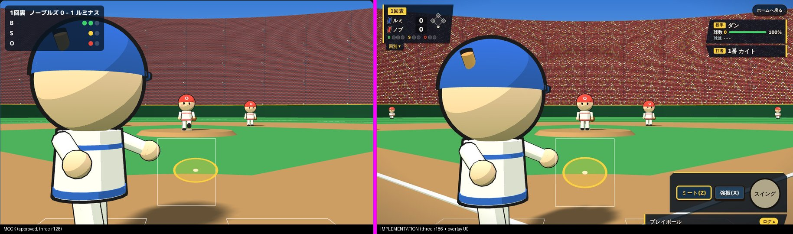
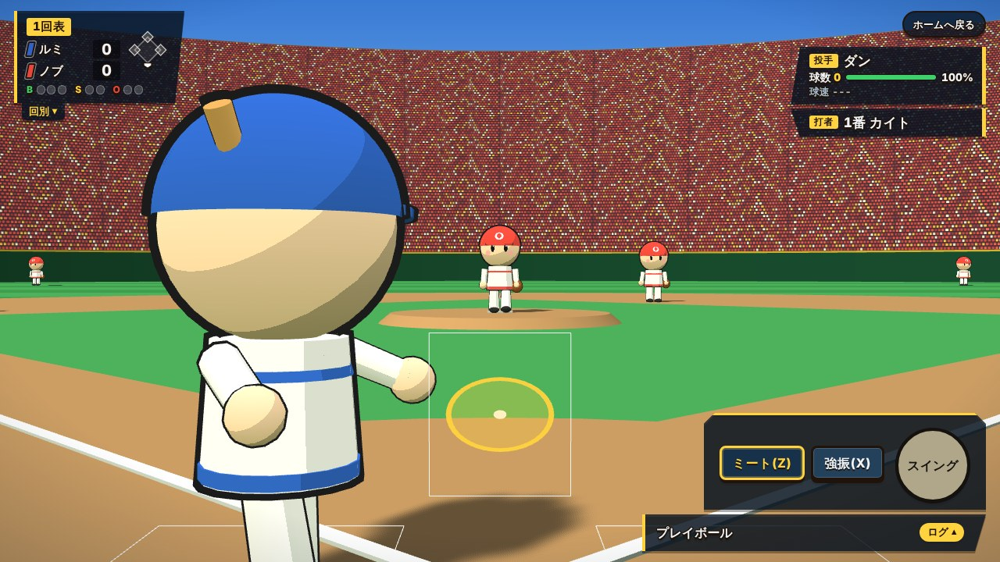
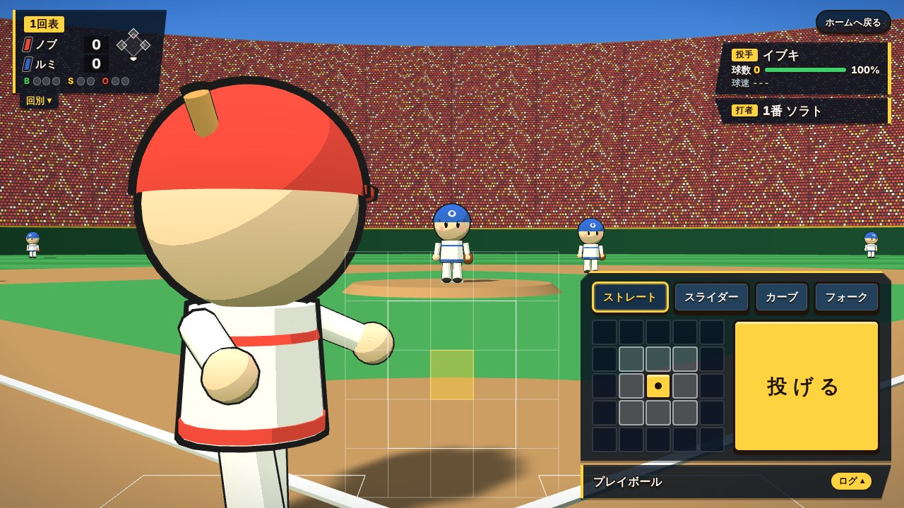
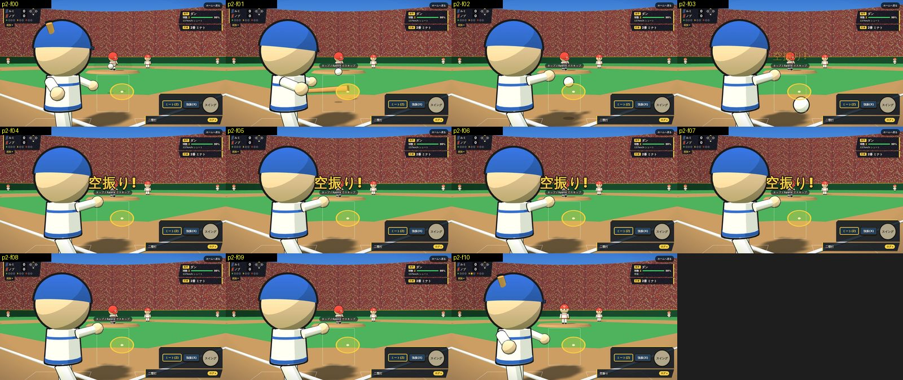
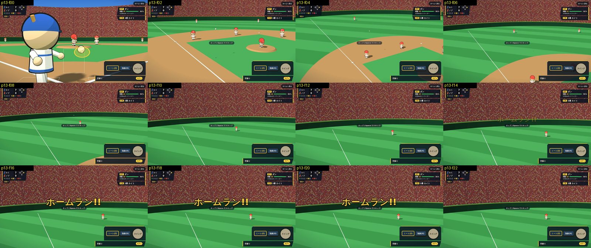
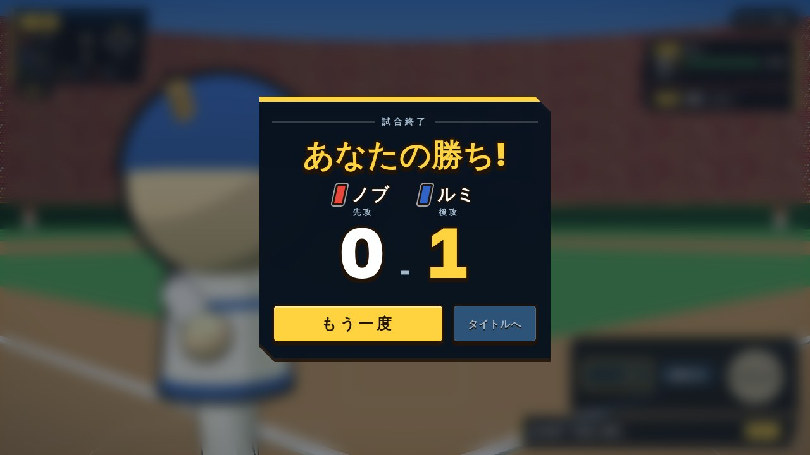
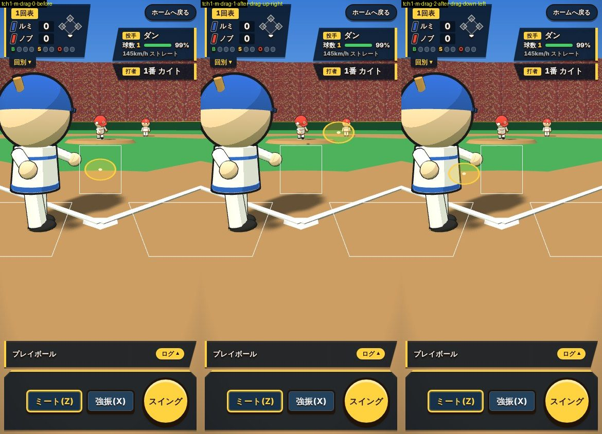

# テストレポート: ブラウザ野球(1試合モード・CPU対戦)第2版 — Three.js 3D 化+ゲーム風オーバーレイ UI

- 日付: 2026-10-12(実施は 2026-10-12〜13)
- ステータス: 修正依頼(ゲート2、2026-10-13)
- 対応する設計ドキュメント: [docs/designs/2026-10-12-baseball-game.md](../designs/2026-10-12-baseball-game.md)(第1版: [docs/designs/2026-10-11-baseball-game.md](../designs/2026-10-11-baseball-game.md)。第1版のテストレポート: [docs/tests/2026-10-11-baseball-game.md](2026-10-11-baseball-game.md)=ゲート2「設計からやり直し」)
- テスト環境: クラウド実行環境(Linux、4 CPU)、Playwright 1.62 の headless Chromium(ブラウザ revision は回避構成。`docs/memory/entries/playwright-browser-revision-mismatch.md`)、WebGL2 は **SwiftShader のソフトウェア描画**(実 GPU・実機は未検証)。dev サーバ(vite)を自分で起動して確認し、終了後に停止した。
- 実施者: tester(G の自己判定は鵜呑みにせず、スクリーンショットと計測値を撮り直して判定した)

## テスト対象

第2版の描画層・UI 層の置き換え(`render/`・`model/world/`・`hooks/`・`ui/`・`e2e/baseball.spec.ts`)と、実装後のコードレビュー指摘の修正(Fix1〜Fix3)を含む、`feature/baseball-game` の HEAD(コミット e3185bb)全体。

- 画面: タイトル(CSS で描いた球場+ボタン群)、試合画面(Three.js の 3D ステージ全面+オーバーレイ=左上 HUD・右上ネームプレート・下部ティッカーと操作バー・中央テロップ)、結果画面(ぼかした試合画面+大きなスコア)。
- 振る舞い: 打撃(マウス/タッチの相対ドラッグ/Space・Z・X キー)、守備(球種・コース選択・投げる)、演出のスキップ(タップ/クリック/Space/Enter)、攻守交代のチーム色、WebGL 不可時のフォールバック、リサイズ。
- ロジック層(`model/` の判定・CPU・ルール)は無改変(加算のみ)。第1版の 749 件のアサーションは無改変であることを差分で確認した。

## 実施したテスト

| 種別 | 内容 | 結果 |
| --- | --- | --- |
| Lint | `cd sample-app && npm run lint`(eslint .、サイズ/複雑さ/型/sonarjs/security/prettier すべて error 扱い) | **pass**(終了コード 0、指摘 0) |
| 型チェック | `npm run typecheck`(shared/backend/frontend) | **pass**(終了コード 0) |
| ビルド | `npm run build`(nest build + vite build) | **pass**。`index` チャンク **201.04 KB / gzip 63.51 KB**(E の申し送りの基準 201.04 / 63.51 から**増加なし**)。three を含む `GameScreen` チャンクは 636.58 KB / gzip 168.77 KB(E 時点 635.36 / 168.33 から +1.2 KB / +0.4 KB。Fix1〜Fix3 の分)。`index` に `WebGLRenderer`・`MeshToonMaterial`・`PerspectiveCamera` の文字列は **0 件**(`GameScreen` 側のみ)。vite の「500 KB 超」警告は three を隔離した遅延チャンクに対するもので設計どおり |
| Knip(report-only) | `npx knip`(終了コード 1、**判定には使わない**) | 11 件を記録: 未使用 export 1 件(`model/game/test-fixtures.ts` の `makeTeam`)、未使用 export 型 10 件(`FrameCallback`・`LaunchSettings`・`UsePitchFlightResult`・`MeasureContactInput`・`ClientPoint`・`ViewRect`・`ResultRow`・`RunnerAdvance`・`SimulationResult`・`InitialStateInput`)。Fix3 の申し送りの「残り 11 件(2D 残置分など)」と一致し、増加なし |
| 構造検査(設計書「静的チェック」1〜12) | grep による検査(詳細は下の表) | **pass**(注記 2 件: 検査 5 の誤検出、検査 7 と Fix3 の不整合) |
| 単体テスト | `cd sample-app/frontend && npx vitest run` | **pass**: 54 ファイル・**1142 件**(9.05 s)。`e2e/*.spec.ts` は拾われていない。`balance.test.ts` は 9 件 pass(ファイルは第1版のコミット 6ee0b3d から無改変で、結果は第1版から変わらない)。第1版の `model/` のテスト変更は加算のみ(`teams.test.ts` +43/−0、`view.test.ts` +129/−2(import 行のみ)、`test-fixtures.ts` は `Team` の新フィールドを渡すだけ) |
| E2E 1回目 | `npm run test:e2e --workspace frontend`(13 件) | **pass**: 13 passed / 1.6 分 |
| E2E 2回目 | 同上 | **pass**: 13 passed / 1.6 分 |
| E2E 3回目 | 同上 | **pass**: 13 passed / 1.6 分 |
| E2E 追加観察(フレーク) | `npx playwright test --repeat-each=2`(26 実行) | **1 件 fail**(25 passed / 3.5 分)。「Space でスイング」E2E の既知フレークが再現(下記「不具合・所見」F1) |
| 手動確認(ゴールデンパス) | 設計書「手動確認」1〜12 を Playwright(実時間スクリプトと仮想時間ハーネス)で実施。通常速度で 3 試合(計 4 試合+延長)を通し | **pass**(詳細は下の表) |
| 手動確認(エッジケース) | WebGL 不可、リサイズ 7 サイズ、リソース解放 5 周、本番ビルド、スキップ 6 方法×打撃/守備、タッチ操作、Space とフォーカス中ボタン、最後の打席のスキップ | **pass**(所見あり。下記 F1〜F7) |
| 見た目の受け入れ基準(S1〜S11) | チェックリストを撮り直した画像と計測値で〇×判定 | **全項目〇**(注記あり。下の表) |

### E2E 3回の詳細(各回とも 13 件 pass、失敗 0、リトライなし)

| テスト | 1回目 | 2回目 | 3回目 |
| --- | --- | --- | --- |
| ホーム→ゲーム画面へ遷移 | 0.9 s | 0.8 s | 0.9 s |
| 1イニングの試合が結果画面まで到達 | 40.7 s | 40.4 s | 40.8 s |
| WebGL 不可でも結果画面まで進む | 10.5 s | 10.5 s | 10.5 s |
| 演出中のタップでスキップ(通常速度) | 18.6 s | 18.3 s | 16.9 s |
| **Space でスイングしても同じ keydown の演出がスキップされない** | 11.1 s | 5.8 s | 6.1 s |
| Enter 長押しで結果画面が出ても再試合しない | 36.7 s | 36.0 s | 35.8 s |
| Space 長押しで結果画面が出ても再試合しない | 36.2 s | 34.6 s | 35.3 s |
| オーバーレイ幾何: デスクトップ・打撃 / 守備 | 9.1 / 10.0 s | 9.4 / 9.6 s | 8.9 / 9.1 s |
| オーバーレイ幾何: スマホ縦・打撃 / 守備 | 5.6 / 5.4 s | 5.1 / 4.1 s | 5.6 / 3.6 s |
| home.spec(2 件、無改変) | 0.3 / 0.4 s | 0.3 / 0.4 s | 0.4 / 0.3 s |

「Space でスイング」のフレークは公式の 3 回では**再現しなかった**(0/3)。追加の `--repeat-each=2`(2 workers)では 2 実行中 1 回失敗(全 26 実行中 1 件)。失敗内容と原因の切り分けは F1 に記す(テストは緩めず、リトライでも隠していない)。

### 構造検査(設計書「静的チェック」)

| # | 検査 | 結果 |
| --- | --- | --- |
| 1 | `from "three"` が `render/` 配下のみ。`import * as THREE`・`getObjectByName` なし | pass(frontend の `src`・`e2e`・`vite.config.ts` 全体を grep。`render/` の 12 ファイルのみ) |
| 2 | `render/` が `../model`・`../hooks`・`../ui` を import しない。`Team`・`uniformColor`・チーム名・チーム id が無い。ゾーン/ボール寸法の直書きなし | pass(`render/character.ts` の `0.42`・`0.26` はキャラクターの腿の長さ・帽子マークの位置でゾーン寸法ではない。ゾーンは `geometry.zone`・ボールは `geometry.ballRadius` から読む) |
| 3 | `model/` の他サブフォルダが `world/` を import しない。`world/` が `game/`・`cpu/`・`data/` を import しない | pass |
| 4 | `document`・`window`・`ResizeObserver`・`WebGLRenderer`・`getContext` は `stage.ts` のみ。`CanvasTexture`・`createElement("canvas")` は `stage.ts` の canvas 生成のみ。WebGL1 の `getContext("webgl")` なし。`dispose` の順序(`disposed` → リスナ解除 → `disconnect()` → シーン破棄 → `renderer.dispose()` → `forceContextLoss()` → `canvas.remove()`) | pass |
| 5 | `model/`(`world/` 以外)に `react`・`document`・`window`・`Math.random`・`Date`・`performance`・三角関数/`hypot` なし。`world/` に `react`・`document`・`window`・乱数・時刻なし | pass(`world/` は 0 件。`world/` 以外は `contact.test.ts` の変数名 `window` と `view.test.ts` の説明文字列 "contact window" の 2 件が語としてヒットする**誤検出**で、第1版から不変) |
| 6 | `import.meta.env` が `hooks/useLaunchParams.ts` のみ | pass(コメントを除くと 1 箇所) |
| 7 | `ui/` が `../model`・`../render` を import しない。props のみのコンポーネントに hooks の呼び出しなし。`TitleScreen` に `<select>` なし | **pass(注記あり)**: import・`<select>` は 0 件。ただし `ResultScreen` に Fix3(M1)の `useHeldKeyGuard`(`useRef` のみ、状態なし)が入っており、検査文言「`ResultScreen` など props のみのコンポーネントに hooks の呼び出しが無い」とは**文面上一致しない**(F6) |
| 8 | `holding` を effect 内で `setState` していない(render 中に導出)。director が `stage === null` でも plan を進める。`useStage3d` の生成 effect の deps が `quality` のみ | pass(`useGameStage.ts:181` で render 中に `isHolding(...)`。`useStageDirector.ts:237` は `options.stage?.apply(...)` で終了判定は常に実行。`useStage3d.ts:77` は `[quality]`) |
| 9 | `skip()` が `dispatch`/`throwPitch`/`swing`/`cpuPitch`/`pitchArrived` を呼ばない。`usePointerInput` が `routeStagePointer` の戻り値で分岐し `holding` を直接参照しない。`useKeyboardInput.ts` が変更されていない | pass(`skip()` は `finishPlay` のみ。`useKeyboardInput.ts` の履歴は第1版の 1 コミットのみ) |
| 10 | 各 `data-testid` が 1 コンポーネントだけ。`score-away`/`score-home` は `ScoreHud` のみ、`LineScore` は `line-score-runs-<side>`。旧 `Scoreboard`・`MatchupPanel`・`CommentaryLog` が無い | pass(`action-bar` は打撃/守備の排他な分岐で 2 箇所に書かれるが同時には存在しない。旧コンポーネントは `types/view.ts` の型名 `ScoreboardView` などを除き存在しない) |
| 11 | `bb-overlay` 配下で操作しない要素が `pointer-events: none`、操作する要素(`bb-bar`・`bb-hud__more`・`bb-ticker__more`・`bb-home-link`)が `auto` | pass(`baseball-stage.css` で selector ごとに確認) |
| 12 | `grep -rin "パワプロ\|パワフル" sample-app --exclude-dir=node_modules` が 0 件 | pass(`dist` も除外して 0 件) |

## 見た目の受け入れ基準(S1〜S11)の判定

判定の根拠は、G が保存したスクリーンショット(`docs/tests/assets/2026-10-12-baseball-game/01〜28`)と、tester が撮り直した画像(`29〜50`、ファイル名に `t` を含む)・計測値。**モック側の画像は G が撮った並置画像(25〜28)を基準に使った**(モック本体 `docs/designs/assets/2026-10-11-baseball-game-mock3d.html` は追加コミット 62ccb44 以降無改変であることを確認。tester によるモックの撮り直しは行っていない)。ピクセル差分は使っていない。

| 項目 | 判定 | 根拠・注記 |
| --- | --- | --- |
| S1 打撃画面(待機) | **〇(注記あり)** | (a) 捕手後方から投手方向、手前左に打者、奥中央に投手。**注記: 打者の脚は画面下端で切れる(モックも同じ構図)ため、基準文の「両者の全身が画面内に収まる」は打者については文面どおりではなく、「モックと同等」で〇とした。基準文とモックの不一致はゲートで人間が確認してほしい**。(b) 白いゾーン枠と黄色のカーソル(半透明の楕円+輪郭リング+中心点)。(c) 空のグラデーション・縞の芝・内野の土・ベース・ファウルライン・緑のフェンスと黄色の縁・ドット柄の観客席・遠景の霞。(d) 2頭身、トゥーンの段階影、黒い輪郭線、目・頬・帽子とマーク(拡大: `49-t-zoom-characters-s1d.jpg`。目のハイライトは表示サイズでは判別できない)。(e) 人物に影。(f) 左上 HUD(回表裏・略称・得点・B/S/O)、両チーム名の横にチーム色チップ。(g) 打者=攻撃側の色、投手・捕手・野手=守備側の色(ルミナス攻撃時は打者=青・守備=赤でモックと同じ)。画像: `47-t-d-bat-idle-s1.jpg`・`25-cmp-mock-vs-impl-s1-idle.jpg` |
| S2 投球中 | 〇 | ボールが投手の手を離れてゾーンへ大きくなりながら進む、黒い輪郭と地面の影、投手のワインドアップ→投球→フォロースルー(`03`・`26`・`50-t-d-pitch-windup-s2c.jpg`) |
| S3 スイング〜接触 | 〇 | (a) 打者の体が回りバットが水平に振られる(`04`・`27`)。(b) スイング開始直後にカーソルが強調され(濃い黄の太い楕円)、接触後はゾーン枠とカーソルが消えて中継カメラへ移る(設計どおり)。(c) 空振りではバットがボールの下を通過(`29-t-seq-miss-s3c.jpg` の連写)。(d) 接触の直前直後のスイングでも `60 ≤ contactAtMs − startMs ≤ 132` を `play-plan.test.ts` が機械検証し、連写でも構え→接触が複数フレームに分かれる |
| S4 打球追従(ヒット) | 〇 | (a) 接触後、打撃カメラから高い位置の中継カメラへ移る(`06`・`28`)。移動量は `rig.test.ts`・`frame.test.ts` が 16ms あたり 1.5m 以下を検証。(b) 打球と最寄りの野手が同時に画面内で、野手が走り他は打球の方を向く。(c) 捕手が現れゾーン枠とカーソルは消える。(d) ゴロ・ライナー・フライの軌道: ゴロは地面すれすれで進み(`31`)、ライナーは低く(`33`)、フライは高い(`32`)。ボールは小さな白い点でモックと同程度 |
| S4' 打球追従(ホームラン) | 〇 | 実プレーで出た本塁打(`30-t-seq-homerun-s4b.jpg`、`marker: homerun, over-fence, 106.7m`)。カメラが打球を追って観客席側へ向き、**野手は走らず立ったまま**、テロップ「ホームラン!!」が出る。ボールは遠距離で数 px の点になり見づらい(F3) |
| S5 テロップ | 〇 | 黄色の太字+黒い縁取り+影、`scale 0.6→1`・0.18 秒の CSS トランジション、文言は結果に対応(「レフトへの二塁打!」「ホームラン!!」「空振り!」「空振り三振!」「ストライク」「ファウル」「ボール」など実測で確認)。位置は画面中央やや上(`07`・`09`・`20`) |
| S6 スマホ縦 | 〇(注記あり) | (a) ステージは 390×844 の全面。ゾーン枠の幅は **81 px**(基準 70 px 以上)。**注記: 打者が大きく、頭と左半身が画面左端で切れる(F2)** が、打者・投手・ゾーン枠は見える。(b) HUD と右上ネームプレートは重ならず画面内。(c) 計測値: スイングボタン 92×92 px(基準 64 px 以上)、ミート/強振 94×44 px、守備の球種チップ 65×44 px 以上、5×5 グリッドのセル 44×44 px、「投げる」112×228 px。操作バーは画面内(打撃 8,720・374×116、守備 8,533・374×303)でゾーン・投手・打者と重ならない(E2E のテスト5 も 4 条件で pass)。(d) `scrollHeight = innerHeight = 844`(スクロールなし)。画像: `18`・`21` |
| S7 攻守交代の配色 | 〇 | 後攻で開始し 3 アウト目の打球演出中: 守備側(ルミナス=青)・HUD の「O」が旧状態のまま(`40-t-d-teamswap-before-3rd-out.jpg`)。演出後の次の半イニングの待機画面: 打者=ルミナス(青)、守備=ノーブルズ(赤)に入れ替わる(`41-t-d-teamswap-after.jpg`)。HUD のチップ(ノブ=赤、ルミ=青)がユニフォームの色と一致 |
| S8 オーバーレイ型の画面構成 | 〇 | (a) ステージ全面、右パネル・カード並びなし(旧 `aside` 0 件、旧 testid 0 件)。(b) HUD に回表裏・略称+色チップ+得点・B/S/O・走者ダイヤモンド・延長(`39-t-d-extra-innings-hud.jpg` で「延長」を確認)、「回別」が開く(`13`・`37`)。(c) ネームプレート(打者の打順と名前、投手の名前・球数・スタミナバー・球速)。(d) 下部ティッカー 1 行+「ログ」が開く(スマホ縦・デスクトップとも開閉を確認)。(e) ゾーン枠・投手・打者・テロップを隠さない(E2E と重なり計測 0)。(f) 太めの丸ゴシック・白字+濃い縁取り・半透明の濃紺・黄のアクセント、グラデーションのヒーロー/全面角丸カード/既定フォームなし。(g) 演出中の HUD・ネームプレート・テロップ上のタップでスキップできる(スキップ試験の `hud`・`plates`・`telop`)。**注記: デスクトップでログを開くと一覧が右下ドックの上に重なりスイングボタンの下側が隠れる(任意操作。F4)** |
| S9 操作バー | 〇 | (a) スイングボタンが右下(デスクトップ 96×96 px)、ミート/強振が隣。`disabled` は灰色で分かる(`04` の演出中など)。(b) 球種は横並びのチップで選択中が黄、5×5 の小型グリッドで選択中のセルが強調、「投げる」が大きく目立つ。投球中は「投げる」が灰色(`40`・`09`)。(c) ボタン・セルは 44 px 以上(デスクトップのグリッドのセルは 36 px の例外)。(d) バーの背景部分を押してもスイング/スキップにならない(飛行中・演出中とも確認。「手動確認」10) |
| S10 タイトル画面 | 〇 | 背景に球場(空・観客席・縞の芝)、黄色の差し色のロゴ「ブラウザ 野球」、イニング/攻守/難易度が**ボタン群**(`<select>` は 0 件、選択中は黄の枠、各ボタン 54 px 以上の高さ)、大きな黄色の「試合開始」(412×66 px)。キーボード(Tab・矢印・Enter)で操作でき、フォーカスリングが出る(`01`・`17`・`42-t-d-title-keyboard-focus.jpg`) |
| S11 結果画面 | 〇 | 勝ち(`44`)・負け(`45`)・引き分け(`46`)をデスクトップで、勝ち・負け(`43`)をスマホ縦で撮り直した。3D の試合画面がぼけて背景に見える、大きなスコア(両チームの略称+色チップ+「先攻/後攻」)、勝敗の文言と色が変わる(勝ち=黄、負け=赤、引き分け=白)。「もう一度」(黄・主)と「タイトルへ」(従)。G が未達としていた S11(b)(略称+色チップ)は Fix2 で解消済みで、撮り直した画像で確認 |

## 証跡(手動確認分)

### 手動確認 1〜12 の結果

| # | 内容 | 結果 | 実測・証跡 |
| --- | --- | --- | --- |
| 1 | 見た目の突き合わせ S1〜S11 | pass | 上の表。画像 `docs/tests/assets/2026-10-12-baseball-game/` の 01〜49 |
| 2 | 打撃体験(通常速度、マウス、10 球以上) | pass | 通し 4 試合で計 147 球の打撃(6 球に 1 球は見送り)を行い、空振り・見逃し・ファウル・インプレーが起きる(例: 3 回制の通し 1 試合で `in-play` 8・`called-strike` 20・`swinging-strike` 18・`ball` 34・`foul` 2)。ヒットで中継カメラに切り替わり野手が走る。仮想時間の `seed=7` では 1 球目が「レフトへの二塁打!」。Space のスイングはフォーカス中のスイングボタンでも keydown 1 回・演出 1 回で二重発火せず、次の投球に持ち越されない(`rt-keys`)。Z/X キーでミート/強振が切り替わる |
| 3 | 投球(後攻) | pass | コースのセルを選ぶと 3D のゾーン上の同じセルが黄色でハイライトされ、投球はされない(球数 0 のまま・`phase = idle`)。「投げる」で `windup → flight → play`(この間「投げる」は押せない)。投球後も球種(スライダー)とセル(3,3)の選択が保持される。画像: `48-t-d-pitch-idle-s9.jpg`、`08` |
| 4 | ネタバレ抑止 | pass | 画面の更新時刻を MutationObserver で記録: 本塁打の例で `play` 開始から +2825 ms にテロップ表示、+3920 ms にテロップ消灯、**+4133 ms(演出終了)にスコア・実況・打者・カウントが同時に更新**。他のインプレー・ファウルもすべて HUD・ネームプレート・ティッカーの更新は演出の終了時刻(テロップ消灯の約 200 ms 後)で、テロップより前には変わらない。スキップした場合はスキップの時点で更新(下の 10) |
| 5 | スマホ縦(390×844、hasTouch) | pass | 寸法は S6 の表。タッチの相対ドラッグでカーソルが動く(`34-t-m-touch-relative-drag.jpg`: 指を右上へなぞるとカーソルが右上へ、左下へなぞると左下へ移動)。ステージのタップはスイングにならない(`phase = flight` のまま)。「スイング」ボタンのタップでスイング。演出中のステージのタップでスキップ(`touchscreen.tap` で `play → windup`、ヒント消灯)。次の投球はスキップのタップの影響を受けず見送りになる。1 イニングの通し(`seed=5`、延長なし)も無事に完了(200 s) |
| 6 | WebGL 不可 | pass | `getContext` が `webgl`/`webgl2` に `null` を返すスタブで、`data-status="unsupported"`、「3D表示を使えません」(`35`・`36`)。試合は結果画面まで進行。**コンソールのメッセージは vite と React DevTools の案内の 3 件のみで、error・warning・pageerror は 0 件**(`createStage` が three を呼ばずに `null` を返すため、WebGL 生成失敗のログも出ない) |
| 7 | リソース解放 | pass | 開発サーバー(StrictMode)でタイトル→開始した直後と 2 秒後: `canvas` 1・`data-status = ready`・フォールバックなし。「もう一度」と「タイトルへ→開始」を 5 周(結果画面で `canvas` 1・タイトルで `canvas` 0・再開始で `canvas` 1・`ready`・フォールバックなし)。コンソールの error・warning 0 |
| 8 | 本番ビルド | pass | `vite preview` で確認: `/` とタイトル(`/?seed=7&innings=1&fast=1#/baseball`)の読み込みで `GameScreen`(three)のチャンクは**取得されない**。「試合開始」後に初めて取得される。起動パラメータは無視される(`innings=1` でも既定の 3 回、最初の飛行から `play` まで実時間 1.7 秒=通常速度で `fast=1` の約 0.17 秒ではない)。`index` チャンクは 201.04 KB(three を含まない) |
| 9 | コンソールエラー 0(WebGL 使用可) | pass | タイトル→開始、人間打撃・守備、リサイズ、通し 4 試合、5 周の再開始のすべてで error・warning・pageerror は 0 件(SwiftShader の `GPU stall` 警告は収集時に除外)。**例外**: 本番ビルドの確認(8)でホーム `/` を開いたときに 1 件 `500 Internal Server Error` が出たが、`App.tsx` の `/api/health` を backend 未起動のまま叩いたもの(テスト環境の事情。試合画面とは無関係で、backend 同時起動の E2E では出ない) |
| 10 | 演出スキップ | pass | 打撃で **in-play** の演出を (a) マウスクリック (c) Space (d) Enter (HUD 上) (ネームプレート上) (テロップ上) の 6 方法すべてでスキップ。入力から `idle`/次の windup までの時間は **7〜14 ms**。(b) タッチのタップは 5 に記載。守備側(CPU 打撃)でも 6 方法でスキップ。スキップに使った入力は次の投球のスイングとして扱われない(見送りの `ball`・`called-strike` になる)。飛行中のステージのクリックはスイングになりスキップにならない。バーの背景を押してもスイング/スキップにならない。スキップ直後にスコア・実況が更新され、ヒントは消える。**最後の打席の演出を Space/Enter でスキップすると結果画面が出て、「もう一度」は押されない**(`rt-game` の mixed で 2 試合) |
| 11 | 攻守交代の配色 | pass | S7 のとおり |
| 12 | オーバーレイ型の UI | pass | 「回別」「ログ」の開閉(デスクトップ・スマホ縦)、タイトルのキーボード操作(Tab で最初のラジオ、矢印で選択変更、Enter で開始)、勝ち・負け・引き分けで文言と色が変わる、旧パネルが残っていない(`aside` 0・旧 testid 0) |

### 通常速度での通し(進行が止まる・操作が効かない・表示が崩れる等の確認)

| 試合 | 設定 | 結果 | 所要 | 備考 |
| --- | --- | --- | --- | --- |
| A | 先攻・`seed=11`・3 回・スキップなし・守備は球種とコースを巡回 | 先攻 0-4 後攻で負け(3 回表で終了) | 424 s | 停止 0。状態・canvas 数・スクロールの違反 0。コンソール 0 |
| B | 後攻・`seed=23`・3 回・スキップを混在(クリック・Space・Enter・HUD・ネームプレート)20 回 | 先攻 1-0 後攻で負け(3 回裏まで) | 543 s | 停止 0、違反 0、コンソール 0 |
| C | 先攻・`seed=7`・**1 回制が延長に入った**(2 回表・裏)・スキップ混在 17 回 | 先攻 2-1 後攻で勝ち(2 回裏) | 266 s | 「延長」表示を確認(`39`)、停止 0、違反 0、コンソール 0 |
| D | スマホ縦(390×844)・先攻・`seed=5`・1 回・スキップ混在 | 先攻 3-0 後攻で勝ち | 200 s | 停止 0、違反 0、コンソール 0。**注: この試合のスキップ「click」は座標(640,250)がスマホ縦の幅 390 px の外で、スクリプトの不備のため無効**(スキップは Space・Enter・HUD・ネームプレートの実測と、タッチのタップ(5)で確認済み) |

- 演出時間(`play → idle` の自然経過): ボール 約 0.7〜0.8 s、見逃し 約 0.7 s、空振り 約 0.9〜1.0 s、インプレー 約 2.4〜4.2 s(平均 約 2.9 s)、ファウル 約 2.5 s。1 球(ボール・ストライク)は windup+飛行+演出で**約 4.1〜4.3 s**(設計の見積もり約 3 s より長い。F7)。
- リサイズ(試合中にビューポートを変更): 1280×720 → 800×600 → 390×844 → 844×390 → 1920×1080 → 1024×768 → 1280×720 のすべてで、ステージ=ビューポート全体、canvas 属性=CSS サイズ=ステージ、ゾーン枠の画面サイズが追従(幅 81〜272 px)、ゾーン枠と HUD/ネームプレート/ティッカー/操作バーの重なり 0、スクロールなし、`canvas` 1・`ready`、試合は進行し続ける。

### スクリーンショット

保存先: `docs/tests/assets/2026-10-12-baseball-game/`(1 枚 500 KB 以下)。`01〜28` は G が仮想時計ハーネスで撮影、`29〜50` は tester が撮り直し・追加。

| 画像 | 内容 |
| --- | --- |
| `25`〜`28` | モックと実装の並置(S1 待機・S2 投球中・S3 スイング・S4 打球追従)。モック側は G の撮影 |
| `01`〜`16` | デスクトップ: タイトル・打撃(待機/飛行/接触/空振り/中継カメラ/テロップとヒント)・守備・本塁打・攻守交代・回別・結果(勝ち/負け/引き分け) |
| `17`〜`24` | スマホ縦: タイトル・打撃・守備・結果 |
| `29` | 空振りの連写(S3(c)) |
| `30` | 本塁打の連写(S4') |
| `31`・`32`・`33` | ゴロ・フライ・ライナーの連写(S4(d)) |
| `34` | スマホ縦のタッチの相対ドラッグ(カーソルが指の移動量で動く) |
| `35`・`36` | WebGL 不可のフォールバック(デスクトップ・スマホ縦) |
| `37` | ログを開いた状態(デスクトップ。F4) |
| `38` | 横向きスマホ 844×390(F5) |
| `39` | 延長の HUD |
| `40`・`41` | 攻守交代の前後(S7) |
| `42` | タイトルのキーボードフォーカス |
| `43`〜`46` | 結果画面(スマホ縦・負け、デスクトップの勝ち・負け・引き分け) |
| `47`〜`50` | tester 撮り直しの S1(打撃待機)・S9(守備待機)・キャラクター拡大・守備の windup(S2(c)) |

(撮影・計測に使ったスクリプトと生ログは使い捨てで、リポジトリには含めない。scratchpad の `tester2/` に置いた。)

## 不合格・不具合の詳細

**不合格となった項目はない。** 以下は所見(重大度付き)で、いずれも合否を覆さない。

| # | 重大度 | 内容 |
| --- | --- | --- |
| F1 | **MINOR(テストの信頼性。CI で再発しうる)** | **E2E「Space でスイングしても同じ keydown の演出がスキップされない」が稀に失敗する(Fix3 の申し送りのフレークを再現)。** 頻度: 公式の全件 3 回は 0/3、追加の `--repeat-each=2`(全 26 実行)で 1 件。失敗内容: `expect(playKinds).toContain("swinging-strike")` が `Received ["called-strike","called-strike"]` で失敗(前提の `phaseAtKeyDown = "flight"` と `play` への遷移の検証は通過)。ページのスナップショットはカウント S=1(見逃しストライク 1 つ)。**原因の切り分け**: spec と同じ手順(飛行開始を rAF で検出 → `keyboard.down("Space")`)を、ページ内の時刻つきで 2 ブラウザ並列に各 12 回再現したところ、Space がページへ届くのが飛行開始から 1.06〜1.86 s 後(飛行時間 1.31 s)で、**届いたのが 1.47 s 以上(= 飛行時間 + 判定窓 150 ms = 1.46 s を超える)の 8/24 回は、すでに見逃しと判定済みでスイングとして受理されず `called-strike` になった**(1.38 s 以下の 16/16 回は `swinging-strike`)。SwiftShader の描画で主スレッドが詰まる(2 ブラウザ並列ではさらに悪化)ためにキー入力が遅れるテスト環境起因で、**アプリの挙動は設計どおり**(遅すぎるスイングは見逃し)。前提の検証 `phaseAtKeyDown` は DOM 属性を見るためゲーム時計より遅れうるので、遅延を検出できない。単独のブラウザではマウス入力の遅延は 0.2〜0.4 s で、失敗は起きにくい。対応はテストの設計の問題(実装者に委ねる。テストの合否の許容を緩めるのではなく、入力の到達がゲーム時計で判定窓内であることを前提にして外れた試行を無効にする、同時実行数を絞る、など)。GitHub Actions の runner も描画が SwiftShader のため、CI でも同様に稀に失敗しうる |
| F2 | NIT(見た目) | スマホ縦 390×844 の打撃画面で、打者の頭と左半身が画面左端で切れる(ゾーン枠・投手は見える。S6(a) は〇)。縦長の FOV 補正は `fovFor`(`MIN_HALF_WIDTH_TAN`)の範囲。画像: `18`・`34` |
| F3 | NIT(見た目) | 本塁打・長打の追従で、遠距離のボールが数 px の白い点になり見づらい(承認済みモックも同程度)。野手とテロップは分かる |
| F4 | NIT(UI) | デスクトップで「ログ」を開くと一覧が右下ドックの上へ開き、スイングボタンの下側(約 3 分の 1)が隠れる。ログは任意操作で、閉じれば元に戻り、ボタンの上側・Space キーでスイングできる。画像: `37` |
| F5 | NIT(対象外) | 横向きスマホ(844×390)では右下ドックが画面の約 4 割を占め、飛行中のボールが一時ドックの裏に隠れる。ゾーン枠との重なり 0・全要素が画面内。設計の対象外(スマホ縦とデスクトップ)。画像: `38` |
| F6 | MINOR(設計書との不整合) | Fix3(M1)で `ResultScreen` に `useHeldKeyGuard`(`useRef` のみ)が入ったが、設計書の構造検査 7 の文言(props のみのコンポーネントに hooks なし)と、UI 設計の記述が更新されていない。機能上の不具合ではない。設計書側の追記か、検査文言の例外化が必要 |
| F7 | 観察(設計見積もりとの差) | 1 球(ボール・ストライク)のテンポが約 4.1〜4.3 s で、設計(N14)の「約 3 秒」より長い。3 回制の通し 1 試合は約 7〜9 分(設計見積もり約 5〜6 分)。SwiftShader の描画遅延と CPU の待ち(`cpuWaitMs`)を含み、実機の値ではない。タップ/Space/Enter のスキップで短縮できる(確定済みの仕様) |

## 未検証の観点・既知の制限事項

- **実機 GPU・実機のモバイル(iOS Safari・Android Chrome)・Firefox・Safari は未検証**。検証したのは headless Chromium(Playwright 1.62、SwiftShader のソフトウェア描画)のみ。フレームレート・描画の質・入力遅延の実機での感触、`webglcontextlost` の実際の発生、モバイル GPU での影マップ負荷は分からない。
- タッチの相対ドラッグ・縦画面の FOV 補正と `framingLift`・`details`/`summary` と `input[type=radio]` の見た目は、Chromium の `hasTouch`+viewport 縮小での確認のみ(iOS Safari の `summary`・ネイティブの見た目の差は未検証)。
- **`keyup` ガード(Fix3 M1 の `useHeldKeyGuard` の keyup 側)は他ブラウザで未検証**。Chromium では単独で効果を再現できず、他ブラウザ向けの予防(設計書の Fix3 の記載どおり)。keydown(repeat)側は E2E の 2 件で回帰を検出する。
- SwiftShader 環境では、`locator.click()` が数秒かかる、Playwright の入力が 0.2〜1 s 以上遅れる(F1)ため、「ジャスト付近のクリックの滑らかさ」(S3(d))は仮想時計の連写と単体テストで確認した。実時間・実機での手触りの確認ではない。
- スキップ後の即カット(打撃カメラ・待機姿勢へ補間なしで戻る)の見た目の違和感は人間の判断に委ねる(設計のリスクに記載済み)。
- モックの撮り直しは行っていない(G の並置画像を基準にした)。「見た目の受け入れ基準」の S1(a) の文言とモックの構図の不一致(打者の脚が切れる)は、ゲートで人間が判断すること。
- 難易度「かんたん」「むずかしい」・5 回制・9 回制での通しは未実施(3 回制・1 回制と延長のみ)。
- 難易度・イニング数をタイトルのキーボード操作で変えた後の試合設定の反映は、ラジオの選択状態の変化までの確認(開始後の内容の突き合わせは未実施)。
- 本番ビルドでの試合の通しは未実施(読み込み・起動パラメータの無視・最初の 1 球の速度のみ確認)。

## コードレビューからの引き継ぎ

- 未解決の `MAJOR`: **なし**(設計書「コードレビュー結果」: ラウンド1 PASS、MAJOR なし)。
- MINOR M1〜M4 と NIT N1〜N3 は修正タスク Fix3 で対応済み(コミット e3185bb)。N4(未使用のグローブ・バット材質の生成)・N5(演出中の `
` 上の Space/Enter がスキップになる)は許容済み。
- 新たに認識した引き継ぎ: F6(設計書の構造検査 7 と `ResultScreen` の `useHeldKeyGuard` の不整合)。

## 総合判定

**合格**

- 静的チェック(lint・型・ビルド・構造検査 1〜12)、単体テスト(1142 件)、E2E(公式 3 回とも 13 件 pass)がすべて成功し、`index` チャンクは基準から増えていない。
- 見た目の受け入れ基準 S1〜S11 は、撮り直した画像と計測値の上ですべて〇(S1(a) の文言とモックの構図の不一致と、S6 の打者の切れは注記。人間が最終判断)。手動確認 1〜12 は、通常速度の通し 4 試合を含めて停止・操作不能・表示崩れ・コンソールエラーなく確認できた。
- 不合格となる項目はない。ただし、**E2E「Space でスイング」の稀なフレーク(F1)が再現した**ため、CI で稀に赤くなる可能性を人間が把握したうえで、修正(`/implement` に戻ってテストの安定化)を依頼するか、そのまま承認するかをゲートで判断してほしい。

## 人間確認ゲート記録

| 日時 | 判断 | コメント |
| --- | --- | --- |
| 2026-10-13 | **修正依頼** | 遊べる版(https://claude.ai/artifact/F4pmHf72cEA7mqh1CemdNX)をスマホで試遊したユーザーの判断。「操作性、球の軌道が終わってる」。具体的には「タイミングが合わない」「カーソルが思い通りに動かない」「投球の軌道が不自然」(AskUserQuestion で確認)。自動テストは合格でも、スマホで野球ゲームとして打てる手触りに達していない。操作性と投球軌道を計測・診断し、改善内容を設計書に追記したうえで `/implement` に戻る |
